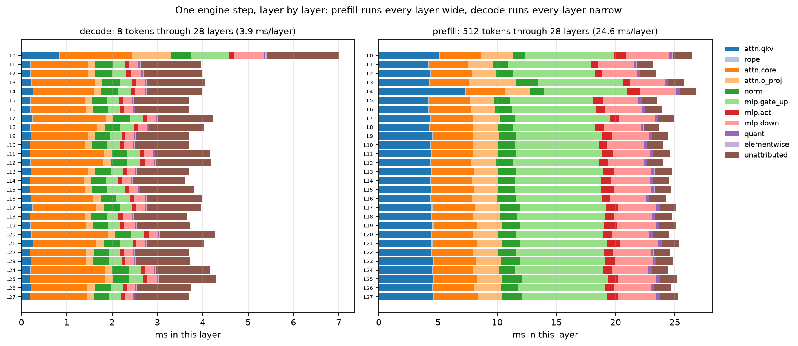

# Session transcript

A readable rendering of the OpenCode session that built this study, written so a new
session started in this directory can pick up where it left off. `docs/04-request-lifecycle.md`
and `analysis/step_report.py` are the durable outputs; this file is the conversation that
produced them, including the dead ends.

| | |
|---|---|
| session | `ses_e2952752fffed4Y9bVsIdNcUuE` |
| model | `enmaas/rits/deepseek-ai/DeepSeek-V4.1-Flash-1017` |
| directory | `/home/akamra/workspace/vllm` |
| started | 2026-11-13 15:50:59 |
| last activity | 2026-11-14 14:06:47 |
| messages | 637 (10 user, 602 assistant, 4 auto-compactions) |
| tool calls | 614 |
| tokens | 571,220 in / 186,017 out / 191,070 reasoning |
| raw export | [`SESSION-EXPORT.json`](SESSION-EXPORT.json) (4.9 MB, `opencode session export`) |

**What is faithful here:** every user message verbatim, every assistant message's visible
text verbatim, every auto-compaction summary verbatim, and every tool call with its full
input. **What is abridged:** tool output is cut at 1400 characters, and the model's 423
reasoning blocks are omitted (they are deliberation, not decisions). `SESSION-EXPORT.json`
is the same conversation with nothing cut — every reasoning block and every full tool
output. One redaction, applied to both files: the example `sk-…` string in vLLM's own
request-model docstring is shown as `sk-REDACTED` so the repo does not trip secret
scanners.

## Index of user turns

1. hi
2. rebase to latest main
3. yes rebase the local git tree latest main on remote
4. ok, great. I want to do two things to help me understand vllm architecture better: 1. run a small model on CPUs 2. profi…
5. what we do is as follows: 1. i have created a folder called ~/workspace/vllm_profile_comparisons. initialize a git repo …
6. numactl-devel is installed. switch to using vllm 0.33. make sure vllm build on the CPU host (this current one) uses all …
7. one reason for doing this exercise was to help me understand the internals of vllm request processing for both CPUs and …
8. commit and push
9. there is no harness/check_serve.sh script?
10. write the session transcript to workspace/vllm_profile_comparisons. I will restart the session in that folder.

---

## 1. User · 15:50:59

hi

### Assistant

Hi! What would you like to work on in vLLM?

## 2. User · 15:51:10

rebase to latest main

### Assistant

**tool · `shell`**

```bash
git status && echo "---" && git branch --show-current && echo "---" && git log --oneline -5
```

```
On branch main
Your branch is up to date with 'origin/main'.

Untracked files:
  (use "git add <file>..." to include in what will be committed)
	llm_d_company_contributions.png

nothing added to commit but untracked files present (use "git add" to track)
---
main
---
9036c89ee [Hardware][AMD][CI] Patch Whisper multi LoRA test to use TRITON_ATTN for now (#46928)
b6caeb5a0 [Model Runner V2][Spec Decode] Use fp32 uniform threshold for acceptance (#46878)
8bf064f8d Fixed chunked embedding aggregation with request-id metadata (#46782)
ea2ead1db [Misc] Fix incorrect layer type annotation in Fp8LinearMethod (#46818)
56aa067bf [CI Bug] Fix h100 `AssertionError: Cold-start child failed` (#46927)
```

**tool · `shell`**

```bash
git branch -vv | head -30; echo "--- worktrees ---"; git worktree list
```

```
* main 9036c89ee [origin/main] [Hardware][AMD][CI] Patch Whisper multi LoRA test to use TRITON_ATTN for now (#46928)
--- worktrees ---
/home/akamra/workspace/vllm 9036c89ee [main]
```

You're currently on `main` itself, and it's already up to date with `origin/main` at `9036c89ee` — there's no feature branch to rebase.

A couple of possibilities:

1. **You want main refreshed anyway** — I can run `git fetch origin && git pull --ff-only` to be safe.
2. **You have a branch I can't see** — this repo only has `main` locally, no other branches or worktrees. If the branch lives on a fork/remote, tell me its name and I'll fetch and rebase it.

Which did you mean? Also note there's an untracked file `llm_d_company_contributions.png` in the working directory — I'll leave it alone.

## 3. User · 15:51:44

yes rebase the local git tree latest main on remote

### Assistant

**tool · `shell`**

```bash
git fetch origin --prune 2>&1 | tail -20; echo "--- status ---"; git status -sb; echo "--- compare ---"; git rev-list --left-right --count HEAD...origin/main
```

```
* [new tag]               v0.29.0rc6              -> v0.29.0rc6
 * [new tag]               v0.29.1rc0              -> v0.29.1rc0
 * [new tag]               v0.30.0rc1              -> v0.30.0rc1
 * [new tag]               v0.30.0rc2              -> v0.30.0rc2
 * [new tag]               v0.30.1rc0              -> v0.30.1rc0
 * [new tag]               v0.31.0rc1              -> v0.31.0rc1
 * [new tag]               v0.31.0rc2              -> v0.31.0rc2
 * [new tag]               v0.31.0rc3              -> v0.31.0rc3
 * [new tag]               v0.31.0rc4              -> v0.31.0rc4
 * [new tag]               v0.31.1rc0              -> v0.31.1rc0
 * [new tag]               v0.32.0rc0              -> v0.32.0rc0
 * [new tag]               v0.32.0rc1              -> v0.32.0rc1
 * [new tag]               v0.32.0rc2              -> v0.32.0rc2
 * [new tag]               v0.32.0rc3              -> v0.32.0rc3
 * [new tag]               v0.32.1rc0              -> v0.32.1rc0
 * [new tag]               v0.33.0rc0              -> v0.33.0rc0
 * [new tag]               v0.33.0rc1              -> v0.33.0rc1
 * [new tag]               v0.33.0rc2              -> v0.33.0rc2
 * [new tag]               v0.34.0rc0              -> v0.34.0rc0
 * [new tag]               v0.34.0rc1              -> v0.34.0rc1
--- status ---
## main...origin/main [behind 7207]
?? llm_d_company_contributions.png
--- compare ---
… [7 more characters]
```

Local `main` is 7207 commits behind and has **0** commits of its own — so a fast-forward (not a real rebase) is the correct and non-destructive move.

**tool · `shell`**

```bash
git merge --ff-only origin/main 2>&1 | tail -15; echo "--- result ---"; git status -sb; git log --oneline -3
```

```
create mode 100644 vllm/v1/worker/gpu/spec_decode/xpress/kernels.py
 create mode 100644 vllm/v1/worker/gpu/spec_decode/xpress/speculator.py
 create mode 100644 vllm/v1/worker/gpu/ubatch_utils.py
 delete mode 100644 vllm/v1/worker/gpu_input_batch.py
 delete mode 100644 vllm/v1/worker/gpu_model_runner.py
 delete mode 100644 vllm/v1/worker/gpu_ubatch_wrapper.py
 delete mode 100644 vllm/v1/worker/kv_connector_model_runner_mixin.py
 create mode 100644 vllm/v1/worker/mm_encoder_model_runner.py
 create mode 100644 vllm/v1/worker/replayssm_utils.py
 create mode 100644 vllm/v1/worker/sentinel/__init__.py
 create mode 100644 vllm/v1/worker/sentinel/eplb_redistribute.py
 create mode 100644 vllm/v1/worker/sentinel/expert_reload.py
 create mode 100644 vllm/v1/worker/sentinel/gpu_worker_sentinel.py
 create mode 100644 vllm/v1/worker/startup_plan.py
 delete mode 100644 vllm/v1/worker/tpu_input_batch.py
--- result ---
## main...origin/main
?? llm_d_company_contributions.png
7833dce847 [CI/Build] Fix docstring Markdown style in test_quark.py (#67549)
fa9ed29e6d [Build] Bump vllm-flash-attn to 8dd9eaea (flash-attention#218, #208) (#67280)
fc870cd152 [Chore] Remove deprecated `rope_scaling` usage and forbid it in pre-commit (#67533)
```

Done. Local `main` is now fast-forwarded to the tip of `origin/main`.

| | Before | After |
|---|---|---|
| HEAD | `9036c89ee` | `7833dce847` |
| Behind origin | 7207 commits | 0 |
| Local-only commits | 0 | 0 |

Notes:
- Fetched with `--prune` and pulled in a batch of new release tags (v0.29–v0.34 rc tags) plus the 7207 commits. No merge conflicts were possible since you had no divergent commits.
- Working tree is clean apart from the untracked `llm_d_company_contributions.png`, which I left untouched.
- The pull also brought in an updated `AGENTS.md` (new `pr-checklist` requirement, revised install/test guidance, Rust and C++/CUDA sub-guides). Worth a skim before your next change.

## 4. User · 15:53:18

ok, great. I want to do two things to help me understand vllm architecture better:
1. run a small model on CPUs
2. profile the run
3. help me understand the profile to see where time is being spent

### Assistant

Let me look at what's available in this environment first.

**tool · `shell`**

```bash
echo "== OS/CPU/MEM =="; uname -a; nproc; free -g | head -3; echo; echo "== GPUs =="; (nvidia-smi -L 2>&1 | head -5) ; echo; echo "== python/uv =="; which python3 uv 2>&1; python3 --version 2>&1; echo; echo "== venv =="; ls -la /home/akamra/workspace/vllm/.venv/bin/python* 2>&1 | head; echo; echo "== installed vllm? =="; /home/akamra/workspace/vllm/.venv/bin/python -c "import vllm; print('vllm', vllm.__version__, vllm.__file__)" 2>&1 | tail -5
```

```
== OS/CPU/MEM ==
Linux akamra-thinkpadp1gen5.bos.csb 7.2.13-200.fc44.x86_64 #1 SMP PREEMPT_DYNAMIC Mon Oct 26 18:54:52 UTC 2026 x86_64 GNU/Linux
20
               total        used        free      shared  buff/cache   available
Mem:              31          21           1           2          11           9
Swap:              7           5           2

== GPUs ==
/bin/bash: line 1: nvidia-smi: command not found

== python/uv ==
/usr/bin/python3
/home/akamra/.local/bin/uv
Python 3.14.8

== venv ==
ls: cannot access '/home/akamra/workspace/vllm/.venv/bin/python*': No such file or directory

== installed vllm? ==
/bin/bash: line 1: /home/akamra/workspace/vllm/.venv/bin/python: No such file or directory
```

**tool · `shell`**

```bash
echo "== disk =="; df -h /home/akamra /tmp/opencode 2>&1 | grep -v ^Filesystem; echo; echo "== toolchain =="; gcc --version 2>&1|head -1; g++ --version 2>&1|head -1; cmake --version 2>&1|head -1; echo; echo "== containers =="; which docker podman 2>&1; echo; echo "== cpu reqs =="; ls /home/akamra/workspace/vllm/requirements/ | head -40; echo; echo "== memory hogs =="; ps -eo rss,comm --sort=-rss | head -6; echo; echo "== existing vllm in user site? =="; python3 -c "import vllm" 2>&1 | tail -2
```

```
== disk ==
/dev/mapper/luks-034fbc05-f0e6-4752-bdd4-c4aa9fcf5e7f  950G  385G  562G  41% /home
tmpfs                                                   16G  1.4G   15G   9% /tmp

== toolchain ==
gcc (GCC) 16.2.1 20261029 (Red Hat 16.2.1-3)
g++ (GCC) 16.2.1 20261029 (Red Hat 16.2.1-3)
/bin/bash: line 1: cmake: command not found

== containers ==
which: no docker in (/home/akamra/.opencode/bin:/home/akamra/.local/bin:/home/akamra/.opencode/bin:/home/akamra/.local/bin:/home/akamra/.local/bin:/home/akamra/bin:/usr/local/bin:/usr/bin:/home/akamra/Documents/perfconf_hackathon/openshift-client-linux:/home/akamra/Documents/perfconf_hackathon/openshift-client-linux)
/usr/bin/podman

== cpu reqs ==
build
common.txt
cpu.txt
cuda.txt
dev.txt
docs.in
docs.txt
kv_connectors_cu12.txt
kv_connectors.txt
lint.txt
rocm.txt
rubin-prerelease.txt
test
tpu.txt
xpu.txt

== memory hogs ==
  RSS COMMAND
1089100 chrome
729864 chrome
697576 chrome
635660 slack
569432 chrome

== existing vllm in user site? ==
No module named 'vllm._version'
  from .version import __version__, __version_tuple__  # isort:skip
```

**tool · `shell`**

```bash
cd /home/akamra/workspace/vllm; echo "== torch =="; python3 -c "import torch,sys;print('torch',torch.__version__);print('cuda',torch.cuda.is_available());print('threads',torch.get_num_threads());print(torch.__file__)" 2>&1|tail -6; echo; echo "== cpu.txt =="; cat requirements/cpu.txt; echo; echo "== build.txt =="; cat requirements/build.txt; echo; echo "== net =="; curl -sS -m 8 -o /dev/null -w "hf:%{http_code}\n" https://huggingface.co/api/models/facebook/opt-125m; echo "== perf/py-spy =="; which perf py-spy 2>&1
```

```
== torch ==
torch 2.13.0+cu130
cuda False
threads 14
/home/akamra/.local/lib/python3.14/site-packages/torch/__init__.py

== cpu.txt ==
# Common dependencies
-r common.txt

setuptools==78.1.1 # this version can reuse CMake build dir; >=78.1.1 for GHSA-5rjg-fvgr-3xxf

numba == 0.65.0 # Required for N-gram speculative decoding

# Dependencies for CPUs
torch==2.14.0+cpu; platform_machine == "x86_64" or platform_machine == "s390x" or platform_machine == "aarch64"
torch==2.14.0; platform_system == "Darwin" or platform_machine == "ppc64le" or platform_machine == "riscv64"

# required for the image processor of minicpm-o-2_6, this must be updated alongside torch
torchaudio; platform_machine != "s390x" and platform_machine != "riscv64"

# required for the image processor of phi3v, this must be updated alongside torch
torchvision; platform_machine != "riscv64"

# required for the torchcodec video decoding backend
torchcodec >= 0.14; platform_machine != "riscv64" and platform_machine != "ppc64le"

# Intel Extension for PyTorch, only for x86_64 CPUs
intel-openmp==2024.2.1; platform_machine == "x86_64"

# triton-cpu, only for x86_64 CPUs
triton @ https://github.com/triton-lang/triton-cpu/releases/download/v3.8.0/triton-3.8.0+cpu-cp311-cp311-manylinux_2_27_x86_64.manylinux_2_28_x86_64.whl ; platform_machine == "x86_64" and python_version == "3.11"
triton @ https://github.com/triton-lang/trit
… [742 more characters]
```

**tool · `shell`**

```bash
cd /home/akamra/workspace/vllm; echo "== pyproject build-system/requires-python =="; sed -n '1,40p' pyproject.toml; echo; grep -n "requires-python" pyproject.toml; echo; echo "== how cpu target is selected =="; grep -n "VLLM_TARGET_DEVICE\|cpu" setup.py | head -40
```

```
== pyproject build-system/requires-python ==
[build-system]
# Should be mirrored in requirements/build/cuda.txt
requires = [
    "cmake>=3.26.1",
    "ninja",
    "packaging>=24.2",
    "setuptools>=77.0.3,<81.0.0",
    "setuptools-scm>=8.0",
    "setuptools-rust>=1.9.0",
    "torch == 2.14.0",
    "wheel",
    "jinja2",
]
build-backend = "setuptools.build_meta"

[project]
name = "vllm"
authors = [{name = "vLLM Team"}]
license = "Apache-2.0"
license-files = ["LICENSE"]
readme = "README.md"
description = "A high-throughput and memory-efficient inference and serving engine for LLMs"
classifiers = [
    "Programming Language :: Python :: 3.11",
    "Programming Language :: Python :: 3.12",
    "Programming Language :: Python :: 3.13",
    "Programming Language :: Python :: 3.14",
    "Intended Audience :: Developers",
    "Intended Audience :: Information Technology",
    "Intended Audience :: Science/Research",
    "Topic :: Scientific/Engineering :: Artificial Intelligence",
    "Topic :: Scientific/Engineering :: Information Analysis",
]
requires-python = ">=3.11,<3.15"
dynamic = [ "version", "dependencies", "optional-dependencies"]

[project.urls]
Homepage="https://github.com/vllm-project/vllm"
Documentation="https://docs.vllm.ai/en/latest/"
Slack="https://slack.vllm.ai/"

34:requires-python = ">=3.11,<3.15"

== how cpu target is selected ==
61:VLLM_TARGET_DEVICE = envs.VLLM_T
… [1547 more characters]
```

**tool · `shell`**

```bash
cd /home/akamra/workspace/vllm; echo "== rust =="; which rustc cargo 2>&1; rustc --version 2>&1|head -1; echo; echo "== rust dir =="; ls rust/ 2>&1 | head; echo; echo "== does setup build rust? =="; grep -n "rust\|Rust" setup.py | head -20; echo; echo "== uv pythons =="; uv python list 2>&1 | head -10
```

```
== rust ==
which: no rustc in (/home/akamra/.opencode/bin:/home/akamra/.local/bin:/home/akamra/.opencode/bin:/home/akamra/.local/bin:/home/akamra/.local/bin:/home/akamra/bin:/usr/local/bin:/usr/bin:/home/akamra/Documents/perfconf_hackathon/openshift-client-linux:/home/akamra/Documents/perfconf_hackathon/openshift-client-linux)
which: no cargo in (/home/akamra/.opencode/bin:/home/akamra/.local/bin:/home/akamra/.opencode/bin:/home/akamra/.local/bin:/home/akamra/.local/bin:/home/akamra/bin:/usr/local/bin:/usr/bin:/home/akamra/Documents/perfconf_hackathon/openshift-client-linux:/home/akamra/Documents/perfconf_hackathon/openshift-client-linux)
/bin/bash: line 1: rustc: command not found

== rust dir ==
AGENTS.md
Cargo.lock
Cargo.toml
clippy.toml
deny.toml
proto
README.md
rustfmt.toml
rustfmt.unstable.toml
src

== does setup build rust? ==
21:from setuptools_rust.build import build_rust
50:# setuptools-rust installs PyO3 artifacts as `<module>.<ext-suffix>`, where the
51:# suffix ends with `.so` on Linux and macOS alike (e.g. `_rust_foo.abi3.so`).
52:PRECOMPILED_RUST_EXTENSION_MEMBER_REGEX = re.compile(r"vllm/_rust_[^/]*\.so$")
57:rust_build = load_module_from_path(
58:    "rust_build", os.path.join(ROOT_DIR, "tools", "build_rust.py")
63:# VLLM_USE_PRECOMPILED implies precompiled rust frontend too.
69:def should_require_rust_frontend() -> bool:
74:def get_precompiled_rust_extension_p
… [1267 more characters]
```

**tool · `shell`**

```bash
cd /home/akamra/workspace/vllm; sed -n '40,120p' setup.py; echo "=== build_rust.py ==="; sed -n '1,80p' tools/build_rust.py
```

```
module = importlib.util.module_from_spec(spec)
    sys.modules[module_name] = module
    spec.loader.exec_module(module)
    return module


ROOT_DIR = Path(__file__).parent
logger = logging.getLogger(__name__)

PRECOMPILED_RUST_FRONTEND_PATH = ROOT_DIR / "vllm" / "vllm-rs"
# setuptools-rust installs PyO3 artifacts as `<module>.<ext-suffix>`, where the
# suffix ends with `.so` on Linux and macOS alike (e.g. `_rust_foo.abi3.so`).
PRECOMPILED_RUST_EXTENSION_MEMBER_REGEX = re.compile(r"vllm/_rust_[^/]*\.so$")

# cannot import envs directly because it depends on vllm,
#  which is not installed yet
envs = load_module_from_path("envs", os.path.join(ROOT_DIR, "vllm", "envs.py"))
rust_build = load_module_from_path(
    "rust_build", os.path.join(ROOT_DIR, "tools", "build_rust.py")
)

VLLM_TARGET_DEVICE = envs.VLLM_TARGET_DEVICE
USE_PRECOMPILED_EXTENSIONS = envs.VLLM_USE_PRECOMPILED
# VLLM_USE_PRECOMPILED implies precompiled rust frontend too.
USE_PRECOMPILED_RUST_FRONTEND = (
    envs.VLLM_USE_PRECOMPILED or envs.VLLM_USE_PRECOMPILED_RUST
)


def should_require_rust_frontend() -> bool:
    value = os.getenv("VLLM_REQUIRE_RUST_FRONTEND", "")
    return value.lower() not in ("", "0", "false", "no")


def get_precompiled_rust_extension_paths() -> list[Path]:
    return sorted((ROOT_DIR / "vllm").glob("_rust_*.so"))


def get_missing_precompiled_rust_extension_modules() -> list[str]:
    p
… [3779 more characters]
```

**tool · `shell`**

```bash
cd /home/akamra/workspace/vllm; grep -n "build_rust\|cmdclass\|require_rust" setup.py; echo "=== 480-560 ==="; sed -n '480,560p' setup.py
```

```
21:from setuptools_rust.build import build_rust
58:    "rust_build", os.path.join(ROOT_DIR, "tools", "build_rust.py")
69:def should_require_rust_frontend() -> bool:
489:class precompiled_build_rust(build_rust):
1686:    cmdclass = {}
1688:    cmdclass = {
1698:    cmdclass["build_rust"] = precompiled_build_rust
1708:    optional=not should_require_rust_frontend()
1755:    cmdclass=cmdclass,
=== 480-560 ===

    def run(self) -> None:
        return

    def build_extensions(self) -> None:
        print("Skipping build_ext: using precompiled extensions.")
        return


class precompiled_build_rust(build_rust):
    """Skips local Rust builds when all precompiled Rust artifacts are present."""

    def run(self) -> None:
        missing = []
        if not PRECOMPILED_RUST_FRONTEND_PATH.exists():
            missing.append(str(PRECOMPILED_RUST_FRONTEND_PATH))
        missing_rust_extensions = get_missing_precompiled_rust_extension_modules()
        if missing_rust_extensions:
            missing.extend(
                str(ROOT_DIR / "vllm" / f"{module_name}*.so")
                for module_name in missing_rust_extensions
            )

        if not missing:
            logger.info(
                "Skipping local Rust build: using precompiled %s and %s",
                PRECOMPILED_RUST_FRONTEND_PATH,
                get_precompiled_rust_extension_paths(),
            )
    
… [1675 more characters]
```

No GPU, 20 cores, gcc 16, no rust toolchain — and CPU vLLM must be built from source. Let me kick off the build in the background now (it's the long pole), then we'll talk about what to profile.

**tool · `write`**

`/tmp/opencode/vllm-cpu-build.sh`

```python
#!/usr/bin/env bash
# Build vLLM CPU backend from source into /home/akamra/workspace/vllm/.venv
set -x
cd /home/akamra/workspace/vllm || exit 1

export VLLM_TARGET_DEVICE=cpu
export MAX_JOBS=12
export CMAKE_BUILD_PARALLEL_LEVEL=12
PY=/home/akamra/workspace/vllm/.venv/bin/python
PIP="uv pip install --python $PY"

echo "### [1/5] create venv (python 3.12)"
uv venv --python 3.12 /home/akamra/workspace/vllm/.venv || exit 1

echo "### [2/5] rust toolchain (optional, for vllm-rs frontend)"
if ! command -v cargo >/dev/null 2>&1; then
  curl -sSf https://sh.rustup.rs | sh -s -- -y --profile minimal --default-toolchain stable
fi
export PATH="$HOME/.cargo/bin:$PATH"

echo "### [3/5] build deps"
$PIP "
… [646 more characters]
```

```
Created file successfully: /tmp/opencode/vllm-cpu-build.sh
```

**tool · `shell`**

```bash
chmod +x /tmp/opencode/vllm-cpu-build.sh && /tmp/opencode/vllm-cpu-build.sh > /tmp/opencode/vllm-cpu-build.log 2>&1; echo "EXIT=$?"
```

```
Command moved to the background (shell ID: sh_1d6b07cce001lvwVPxf6tiwPzt).
Output is streaming to: /home/akamra/.local/share/opencode-enmaas/opencode/shell/6337bf4e27be43039900d3258a454af34b9b62ad/sh_1d6b07cce001lvwVPxf6tiwPzt.out
You will be notified automatically when the command finishes. The notification will include the command's output. Unless the user explicitly asks otherwise, DO NOT poll for completion, even if you need the final result to continue. Repeatedly sleeping and reading or searching the output file is polling, not useful work. You may read the current output if it lets you do useful work now, but do not repeatedly check it while waiting for the command to finish. Keep working on anything that does not depend on the result. If you have nothing else to do, end your response; you will be resumed automatically when the command finishes.
```

Build is running in the background. While it compiles, let me scope the profiling side.

**tool · `shell`**

```bash
echo "== HF cache =="; ls ~/.cache/huggingface/hub 2>/dev/null | head -30; echo; echo "== HF cache size =="; du -sh ~/.cache/huggingface 2>/dev/null; echo; echo "== vllm CLI entrypoints in source =="; cd /home/akamra/workspace/vllm && grep -n "vllm bench\|bench" pyproject.toml | head -10
```

```
== HF cache ==
blobs
CACHEDIR.TAG
models--deepseek-ai--DeepSeek-Coder-V2-Instruct
models--deepseek-ai--DeepSeek-Coder-V2-Instruct-0724
models--deepseek-ai--DeepSeek-Math-V2
models--deepseek-ai--DeepSeek-OCR
models--deepseek-ai--DeepSeek-OCR-2
models--deepseek-ai--DeepSeek-Prover-V1
models--deepseek-ai--DeepSeek-Prover-V1.5-Base
models--deepseek-ai--DeepSeek-Prover-V1.5-RL
models--deepseek-ai--DeepSeek-Prover-V1.5-SFT
models--deepseek-ai--DeepSeek-Prover-V2-671B
models--deepseek-ai--DeepSeek-Prover-V2-7B
models--deepseek-ai--DeepSeek-R1
models--deepseek-ai--DeepSeek-R1-0528
models--deepseek-ai--DeepSeek-R1-0528-Qwen3-8B
models--deepseek-ai--DeepSeek-R1-Distill-Llama-70B
models--deepseek-ai--DeepSeek-R1-Distill-Llama-8B
models--deepseek-ai--DeepSeek-R1-Distill-Qwen-14B
models--deepseek-ai--DeepSeek-R1-Distill-Qwen-1.5B
models--deepseek-ai--DeepSeek-R1-Distill-Qwen-32B
models--deepseek-ai--DeepSeek-R1-Distill-Qwen-7B
models--deepseek-ai--DeepSeek-R1-Zero
models--deepseek-ai--DeepSeek-V2.5
models--deepseek-ai--DeepSeek-V2.5-1210
models--deepseek-ai--DeepSeek-V2-Chat-0628
models--deepseek-ai--DeepSeek-V3
models--deepseek-ai--DeepSeek-V3-0324
models--deepseek-ai--DeepSeek-V3.1
models--deepseek-ai--DeepSeek-V3.1-Base

== HF cache size ==
12G	/home/akamra/.cache/huggingface

== vllm CLI entrypoints in source ==
146:    "*/benchmarks/*",
194:    "docs/governance/process.md", "docs/commu
… [78 more characters]
```

**tool · `shell`**

```bash
cd /home/akamra/workspace/vllm; echo "== small models cached? =="; ls ~/.cache/huggingface/hub | grep -Ei "opt-125|opt-350|Qwen2.5-0.5B|SmolLM|TinyLlama|qwen3-0.6b|gpt2|pythia|phi-2" ; echo "(end)"; echo; echo "== is a cached model actually downloaded (weights)? =="; du -sh ~/.cache/huggingface/hub/models--Qwen* 2>/dev/null | sort -h | head -12
```

```
== small models cached? ==
models--facebook--opt-125m
models--openai-community--gpt2
models--Qwen--Qwen2.5-0.5B
models--Qwen--Qwen2.5-0.5B-Instruct
models--Qwen--Qwen3-0.6B
(end)

== is a cached model actually downloaded (weights)? ==
4.0K	/home/akamra/.cache/huggingface/hub/models--Qwen--Qwen3-Coder-Next-GGUF
4.0K	/home/akamra/.cache/huggingface/hub/models--Qwen--Qwen3-Next-80B-A3B-Instruct-GGUF
4.0K	/home/akamra/.cache/huggingface/hub/models--Qwen--Qwen3-Next-80B-A3B-Thinking-GGUF
4.0K	/home/akamra/.cache/huggingface/hub/models--Qwen--Qwen-Image-2512
4.0K	/home/akamra/.cache/huggingface/hub/models--Qwen--Qwen-Image-Edit-2511
4.0K	/home/akamra/.cache/huggingface/hub/models--Qwen--Qwen-Image-Layered
12K	/home/akamra/.cache/huggingface/hub/models--Qwen--Qwen2.5-0.5B-Instruct
12K	/home/akamra/.cache/huggingface/hub/models--Qwen--Qwen2.5-1.5B-Instruct
12K	/home/akamra/.cache/huggingface/hub/models--Qwen--Qwen3-0.6B
12K	/home/akamra/.cache/huggingface/hub/models--Qwen--Qwen3-Embedding-0.6B
12K	/home/akamra/.cache/huggingface/hub/models--Qwen--Qwen3-TTS-Tokenizer-12Hz
12K	/home/akamra/.cache/huggingface/hub/models--Qwen--Qwen3-VL-Embedding-2B
```

**tool · `shell`**

```bash
cd /home/akamra/workspace/vllm; echo "== profiler module =="; ls vllm/utils/ | grep -i prof; echo; echo "== guards mentioning cpu + profile =="; grep -rn "CPU" vllm/utils/profiler.py vllm/worker/cpu_worker.py 2>/dev/null | head -20; echo; echo "== bench CLI =="; grep -rn "class .*Bench\|add_parser(\"" vllm/benchmarks/cli.py 2>/dev/null | head -20; echo; echo "== entrypoint cli dir =="; ls vllm/entrypoints/cli/ 2>/dev/null
```

```
== profiler module ==

== guards mentioning cpu + profile ==

== bench CLI ==

== entrypoint cli dir ==
benchmark
collect_env.py
download_kernels.py
__init__.py
launch.py
main.py
openai.py
preload.py
run_batch.py
serve.py
snapshot.py
types.py
```

**tool · `shell`**

```bash
cd /home/akamra/workspace/vllm; echo "== profiler files =="; find . -path ./rust -prune -o -name "*profiler*" -print 2>/dev/null | grep -v test | head -20; echo; echo "== benchmark subcommands =="; ls vllm/entrypoints/cli/benchmark/; echo; echo "== TorchProfilerWrapper def =="; grep -rn "class TorchProfilerWrapper" --include=*.py . | head
```

```
== profiler files ==
./tools/profiler
./vllm/config/profiler.py
./vllm/profiler

== benchmark subcommands ==
base.py
forward.py
__init__.py
latency.py
main.py
mm_processor.py
serve.py
startup.py
sweep.py
throughput.py

== TorchProfilerWrapper def ==
./vllm/profiler/wrapper.py:228:class TorchProfilerWrapper(WorkerProfiler):
```

**tool · `shell`**

```bash
cd /home/akamra/workspace/vllm; echo "== profiler pkg =="; ls vllm/profiler/; echo; sed -n '200,320p' vllm/profiler/wrapper.py
```

```
== profiler pkg ==
__init__.py
layerwise_profile.py
utils.py
wrapper.py

        """Whether a capture-time session is retained to attribute replays."""
        return False

    def capture_cuda_graphs(self) -> AbstractContextManager[None]:
        """Observe graph creation for backends that attribute replay activity."""
        return nullcontext()

    def set_output_name(self, worker_name: str) -> None:
        """Set the output name for the next profiling session."""
        return None

    def set_profiler_kwargs(self, profiler_kwargs: dict | None) -> None:
        """Set profiler keyword argument overrides for the next profiling session."""
        return None

    def annotate_context_manager(self, name: str):
        """Return a context manager to annotate profiler traces."""
        return nullcontext()


TorchProfilerActivityMap = {
    "CPU": torch.profiler.ProfilerActivity.CPU,
    "CUDA": torch.profiler.ProfilerActivity.CUDA,
    "PrivateUse1": torch.profiler.ProfilerActivity.PrivateUse1,
    "XPU": torch.profiler.ProfilerActivity.XPU,
}


class TorchProfilerWrapper(WorkerProfiler):
    def __init__(
        self,
        profiler_config: ProfilerConfig,
        worker_name: str,
        local_rank: int,
        activities: Sequence[TorchProfilerActivity],
        on_trace_ready: Callable[[torch.profiler.profile], None] | None = None,
        profiler_kwargs: dict
… [3944 more characters]
```

**tool · `shell`**

```bash
cd /home/akamra/workspace/vllm; echo "== config/profiler.py =="; sed -n '1,80p' vllm/config/profiler.py; echo "=== ENV VARS ==="; grep -rn "torch_profiler_dir\|VLLM_TORCH_PROFILER" vllm/envs.py | head
```

```
== config/profiler.py ==
# SPDX-License-Identifier: Apache-2.0
# SPDX-FileCopyrightText: Copyright contributors to the vLLM project

import os
from typing import Literal, Self

from pydantic import Field, model_validator

from vllm.config.utils import CompileFactors, config
from vllm.logger import init_logger

logger = init_logger(__name__)

ProfilerKind = Literal["torch", "cuda", "proton"]
TorchProfilerActivity = Literal["CPU", "CUDA", "PrivateUse1", "XPU"]
ProtonBackend = Literal["cupti"]
ProtonContext = Literal["shadow", "python"]
ProtonData = Literal["tree", "trace"]
ProtonHook = Literal["triton"]
ProtonOutputFormat = Literal["hatchet", "hatchet_msgpack", "chrome_trace"]


def validate_profile_prefix(prefix: str | None) -> str | None:
    """Validate a trace filename prefix supplied for one profiling session."""
    if prefix is None:
        return None
    if (
        not 1 <= len(prefix) <= 128
        or not prefix.isascii()
        or not prefix[0].isalnum()
        or any(not (char.isalnum() or char in "._-") for char in prefix[1:])
    ):
        raise ValueError(
            "profile_prefix must be 1-128 ASCII characters, start with a letter "
            "or number, and contain only letters, numbers, '.', '_', or '-'"
        )
    return prefix


def validate_profile_iteration_bounds(
    delay_iterations: int | None,
    max_iterations: int | None,
) -> None:
  
… [1395 more characters]
```

**tool · `shell`**

```bash
cd /home/akamra/workspace/vllm; sed -n '80,200p' vllm/config/profiler.py
```

```
torch_profiler_activities: list[TorchProfilerActivity] | None = Field(
        default=None, min_length=1
    )
    """Activities recorded by workers using the torch profiler. When unset,
    each worker uses its platform default: CPU; CPU and CUDA; or CPU and XPU."""

    proton_profiler_dir: str = ""
    """Directory to save Triton Proton profiles. Each worker writes a
    separate rank-qualified file."""

    proton_context: ProtonContext = "shadow"
    """Proton context source. `shadow` records explicit scopes with low
    overhead; `python` records Python call stacks."""

    proton_data: ProtonData = "tree"
    """Proton output type. `tree` produces Hatchet data and `trace`
    produces a Chrome trace."""

    proton_backend: ProtonBackend | None = None
    """Proton GPU backend. `None` lets Proton select CUPTI automatically."""

    proton_mode: str | None = None
    """Optional backend-specific Proton mode string, such as `pcsampling`."""

    proton_hook: ProtonHook | None = None
    """Optional Proton hook. Use `triton` to add Triton launch metadata."""

    proton_output_format: ProtonOutputFormat | None = None
    """Optional format passed to Proton when finalizing a profile. `None`
    uses the default format for `proton_data`."""

    proton_graph_attribution: bool = False
    """Observe CUDA graph capture so replayed kernels can be attributed.
    Requires Triton
… [3725 more characters]
```

**tool · `shell`**

```bash
cd /home/akamra/workspace/vllm; echo "== cli main =="; grep -n "class .*Command\|name =\|def subparser_init" vllm/entrypoints/cli/main.py | head -40; echo; echo "== layerwise_profile head =="; sed -n '1,60p' vllm/profiler/layerwise_profile.py
```

```
== cli main ==

== layerwise_profile head ==
# SPDX-License-Identifier: Apache-2.0
# SPDX-FileCopyrightText: Copyright contributors to the vLLM project

import copy
from collections import defaultdict
from collections.abc import Callable
from dataclasses import asdict, dataclass, field
from typing import Any, Generic, TypeAlias, TypeVar

from torch._C._autograd import DeviceType, _KinetoEvent, _ProfilerResult
from torch._C._profiler import _EventType, _ExperimentalConfig, _ProfilerEvent
from torch.autograd.profiler import FunctionEvent
from torch.profiler import ProfilerActivity, profile

from vllm.profiler.utils import (
    TablePrinter,
    event_has_module,
    event_is_torch_op,
    event_module_repr,
    event_torch_op_stack_trace,
    indent_string,
)
from vllm.utils.import_utils import PlaceholderModule

try:
    import pandas as pd
except ImportError:
    pd = PlaceholderModule("pandas")


@dataclass
class _ModuleTreeNode:
    event: _ProfilerEvent
    parent: "_ModuleTreeNode | None" = None
    children: list["_ModuleTreeNode"] = field(default_factory=list)
    trace: str = ""

    @property
    def is_leaf(self):
        return self.event.children is None or len(self.event.children) == 0

    @property
    def is_torch_op(self):
        return event_is_torch_op(self.event)

    @property
    def is_cuda(self):
        return (
            self.event.tag == _EventType
… [206 more characters]
```

**tool · `shell`**

```bash
cd /home/akamra/workspace/vllm; cat vllm/entrypoints/cli/main.py | head -60; echo "=== pyproject scripts ==="; grep -n -A10 "\[project.scripts\]" pyproject.toml
```

```
# SPDX-License-Identifier: Apache-2.0
# SPDX-FileCopyrightText: Copyright contributors to the vLLM project
"""The CLI entrypoints of vLLM.

Note that all future modules must be lazily loaded within main
to avoid certain eager import breakage."""

import importlib.metadata
import sys
from importlib.util import find_spec

from vllm.logger import configure_logging_from_args, init_logger

logger = init_logger(__name__)


def maybe_run_omni() -> bool:
    # If `--omni` arg is passed to the CLI, delegate to vLLM Omni's entrypoint handling
    if "--omni" not in sys.argv:
        return False

    # NOTE: Check the spec instead of importing directly here, since things could
    # fail with ImportError due to mismatched versions if things are moved around.
    spec = find_spec("vllm_omni")
    if spec is None:
        logger.error(
            "--omni flag requires a valid instance of vllm-omni to be installed."
        )
        sys.exit(1)

    from vllm_omni.entrypoints.cli.main import main as omni_main

    logger.info("Delegating entrypoint handling to vllm-omni")
    omni_main()

    return True


def main():
    if maybe_run_omni():
        return

    import vllm.entrypoints.cli.benchmark.main
    import vllm.entrypoints.cli.collect_env
    import vllm.entrypoints.cli.download_kernels
    import vllm.entrypoints.cli.launch
    import vllm.entrypoints.cli.openai
    import vllm.
… [996 more characters]
```

Let me check how the profiler is wired into the user-facing APIs, then set up the harness.

**tool · `shell`**

```bash
cd /home/akamra/workspace/vllm; echo "== profiler_config in EngineArgs/LLM =="; grep -rn "profiler_config" vllm/engine/arg_utils.py | head -8; grep -rn "profiler_config" vllm/entrypoints/llm.py | head -5; echo; echo "== start_profile on LLM =="; grep -rn "def start_profile\|def stop_profile" vllm/entrypoints/llm.py vllm/entrypoints/openai/api_server.py 2>/dev/null | head; echo; echo "== cpu cpuinfo flags =="; grep -o -m1 "avx512_bf16\|amx_bf16\|avx512f" /proc/cpuinfo | sort -u | head; echo; echo "== build log tail =="; tail -5 /tmp/opencode/vllm-cpu-build.log
```

```
== profiler_config in EngineArgs/LLM ==
791:    profiler_config: ProfilerConfig = get_field(VllmConfig, "profiler_config")
1950:        vllm_group.add_argument("--profiler-config", **vllm_kwargs["profiler_config"])
2972:            profiler_config=self.profiler_config,
222:        profiler_config: dict[str, Any] | ProfilerConfig | None = None,
287:        profiler_config_instance = _make_config(profiler_config, ProfilerConfig)
338:            profiler_config=profiler_config_instance,

== start_profile on LLM ==
vllm/entrypoints/llm.py:810:    def start_profile(
vllm/entrypoints/llm.py:839:    def stop_profile(self) -> None:

== cpu cpuinfo flags ==

== build log tail ==
 + vcs-versioning==2.6.0
 + wheel==0.48.0
+ echo '### [4/5] editable install of vllm (compiles C++ for CPU target) -- THIS IS THE LONG STEP'
### [4/5] editable install of vllm (compiles C++ for CPU target) -- THIS IS THE LONG STEP
+ uv pip install --python /home/akamra/workspace/vllm/.venv/bin/python -e . --no-build-isolation --torch-backend=cpu
```

**tool · `shell`**

```bash
cd /home/akamra/workspace/vllm; sed -n '800,860p' vllm/entrypoints/llm.py
```

```
chat_template=chat_template,
            chat_template_content_format=chat_template_content_format,
            chat_template_kwargs=chat_template_kwargs,
            add_generation_prompt=add_generation_prompt,
            continue_final_message=continue_final_message,
            tools=tools,
            tokenization_kwargs=tokenization_kwargs,
            mm_processor_kwargs=mm_processor_kwargs,
        )

    def start_profile(
        self,
        profile_prefix: str | None = None,
        *,
        delay_iterations: int | None = None,
        max_iterations: int | None = None,
        profiler_kwargs: dict[str, Any] | None = None,
    ) -> None:
        """Start profiling with optional per-session overrides.

        Args:
            profile_prefix: Optional prefix for the trace file names. If provided,
                           trace files will be named as "<prefix>_dp<X>_pp<Y>_tp<Z>".
                           If not provided, default naming will be used.
            delay_iterations: Optional number of worker iterations to skip before
                profiling starts.
            max_iterations: Optional maximum number of worker iterations to profile.
                Zero means no limit.
            profiler_kwargs: Optional dictionary of keyword arguments to pass to
                the underlying profiler.

        """
        self.llm_engine.start_profile(
     
… [1074 more characters]
```

**tool · `shell`**

```bash
cd /home/akamra/workspace/vllm; echo "== record_function annotations =="; grep -rn "record_function(" --include=*.py vllm/ | head -20; echo; echo "== ProfilerConfig export =="; grep -n "ProfilerConfig" vllm/config/__init__.py | head -3; echo; echo "== perf paranoid =="; cat /proc/sys/kernel/perf_event_paranoid 2>/dev/null
```

```
== record_function annotations ==
vllm/distributed/eplb/async_worker.py:136:            with torch.profiler.record_function(profile_name):
vllm/distributed/eplb/rebalance_execute.py:258:        with torch.profiler.record_function("eplb: schedule migration batches"):
vllm/model_executor/kernels/linear/mixed_precision/rdna_hybrid_w4a16.py:105:    return torch.profiler.record_function(name)
vllm/profiler/wrapper.py:465:        return torch.profiler.record_function(name)

== ProfilerConfig export ==
42:from vllm.config.profiler import ProfilerConfig
139:    "ProfilerConfig",

== perf paranoid ==
2
```

**tool · `write`**

`/tmp/opencode/vllm-prof/measure.py`

```python
# SPDX-License-Identifier: Apache-2.0
"""Plain (uninstrumented) timing of a small model on the vLLM CPU backend.

Splits the two very different phases so we have numbers to compare the
profiler against:
  * prefill-bound : many prompt tokens, 1 output token
  * decode-bound  : tiny prompt, many output tokens
"""

import argparse
import time

from vllm import LLM, SamplingParams

p = argparse.ArgumentParser()
p.add_argument("--model", required=True)
p.add_argument("--max-model-len", type=int, default=2048)
p.add_argument("--repeats", type=int, default=3)
p.add_argument("--prose", default=None, help="file with a paragraph to pad prompts")
args = p.parse_args()

padding = ""
if args.prose:
    
… [1686 more characters]
```

```
Created file successfully: /tmp/opencode/vllm-prof/measure.py
```

**tool · `write`**

`/tmp/opencode/vllm-prof/profile_torch.py`

```python
# SPDX-License-Identifier: Apache-2.0
"""Run the vLLM CPU backend under torch.profiler and dump a Chrome trace.

Writes tensorboard-style traces (*.pt.trace.json.gz) into /tmp/opencode/vllm-prof/traces.
"""

import argparse
import os
import time

from vllm import LLM, SamplingParams
from vllm.config import ProfilerConfig

TRACE_DIR = "/tmp/opencode/vllm-prof/traces"

p = argparse.ArgumentParser()
p.add_argument("--model", required=True)
p.add_argument("--phase", choices=["prefill", "decode"], default="decode")
p.add_argument("--max-model-len", type=int, default=2048)
p.add_argument("--delay", type=int, default=1)
p.add_argument("--active", type=int, default=3)
p.add_argument("--prose", defau
… [1284 more characters]
```

```
Created file successfully: /tmp/opencode/vllm-prof/profile_torch.py
```

**tool · `write`**

`/tmp/opencode/vllm-prof/analyze_trace.py`

```python
# SPDX-License-Identifier: Apache-2.0
"""Summarise a torch/kineto CPU trace: self-time by op, by category, by Python frame.

Usage: analyze_trace.py <trace.json[.gz]> [--top 30]
"""

import argparse
import collections
import gzip
import json
import os
import re

p = argparse.ArgumentParser()
p.add_argument("trace")
p.add_argument("--top", type=int, default=25)
args = p.parse_args()


def load(path: str):
    if path.endswith(".gz"):
        with gzip.open(path, "rt") as f:
            return json.load(f)
    with open(path) as f:
        return json.load(f)


raw = load(args.trace)
events = raw["traceEvents"] if isinstance(raw, dict) else raw
xs = [e for e in events if e.get("ph") == "X" and
… [3285 more characters]
```

```
Created file successfully: /tmp/opencode/vllm-prof/analyze_trace.py
```

Build is compiling. Two quick decisions while it runs:

**tool · `question`**

**Model** — Which small model should we run on CPU? (This machine has no GPU, 20 cores, and only ~9 GB RAM currently free, so bigger models risk swapping.)
**Profiling depth** — How deep should the profiling go?

```
User has answered your questions: "Which small model should we run on CPU? (This machine has no GPU, 20 cores, and only ~9 GB RAM currently free, so bigger models risk swapping.)"="Qwen3-0.6B", "How deep should the profiling go?"="torch.profiler + py-spy + perf (Recommended)". You can now continue with the user's answers in mind.
```

Qwen3-0.6B + full profiling. Setting that up now.

**tool · `shell`**

```bash
cd /tmp/opencode/vllm-prof; (uv tool install py-spy 2>&1 | tail -3) ; echo "---- hf cli ----"; which hf huggingface-cli 2>&1 | head -2; python3 -c "import huggingface_hub as h; print('hub', h.__version__)" 2>&1 | tail -1
```

```
+ py-spy==0.4.3
Installed 1 executable: py-spy
warning: `/home/akamra/.local/share/opencode-enmaas/../bin` is not on your PATH. To use installed tools, run `export PATH="/home/akamra/.local/share/opencode-enmaas/../bin:$PATH"` or `uv tool update-shell`.
---- hf cli ----
/home/akamra/.local/bin/hf
/home/akamra/.local/bin/huggingface-cli
hub 1.24.0
```

**tool · `shell`**

```bash
hf download Qwen/Qwen3-0.6B > /tmp/opencode/vllm-prof/download.log 2>&1; echo "EXIT=$?"; tail -3 /tmp/opencode/vllm-prof/download.log
```

```
Command moved to the background (shell ID: sh_1d6b32a9b0010OOVhn3eR26hHx).
Output is streaming to: /home/akamra/.local/share/opencode-enmaas/opencode/shell/6337bf4e27be43039900d3258a454af34b9b62ad/sh_1d6b32a9b0010OOVhn3eR26hHx.out
You will be notified automatically when the command finishes. The notification will include the command's output. Unless the user explicitly asks otherwise, DO NOT poll for completion, even if you need the final result to continue. Repeatedly sleeping and reading or searching the output file is polling, not useful work. You may read the current output if it lets you do useful work now, but do not repeatedly check it while waiting for the command to finish. Keep working on anything that does not depend on the result. If you have nothing else to do, end your response; you will be resumed automatically when the command finishes.
```

**tool · `shell`**

```bash
cd /home/akamra/workspace/vllm; ls -d .codegraph 2>/dev/null; echo "== cpu platform/worker files =="; find vllm -name "*cpu*" -name "*.py" | grep -v test | head -20; echo; echo "== build log tail =="; tail -3 /tmp/opencode/vllm-cpu-build.log
```

```
== cpu platform/worker files ==
vllm/distributed/device_communicators/cpu_communicator.py
vllm/distributed/kv_transfer/kv_connector/v1/simple_cpu_offload_connector.py
vllm/lora/punica_wrapper/punica_cpu.py
vllm/model_executor/kernels/linear/mixed_precision/cpu.py
vllm/model_executor/kernels/linear/scaled_mm/cpu.py
vllm/model_executor/kernels/mhc/cpu.py
vllm/model_executor/layers/fused_moe/experts/cpu_int4_moe.py
vllm/model_executor/layers/fused_moe/experts/cpu_moe.py
vllm/model_executor/layers/fused_moe/router/cpu_router.py
vllm/models/deepseek_v4/cpu/cpu_compressor.py
vllm/models/deepseek_v4/cpu/cpu_mla.py
vllm/models/deepseek_v4/cpu/cpu_sparse.py
vllm/models/deepseek_v4/cpu/cpu_utils.py
vllm/platforms/cpu.py
vllm/platforms/zen_cpu.py
vllm/utils/cpu_resource_utils.py
vllm/v1/attention/backends/mla/prefill/cpu_sdpa.py
vllm/v1/attention/backends/mla/prefill/zen_cpu_sdpa.py
vllm/v1/attention/backends/mla/cpu_mla.py
vllm/v1/attention/backends/cpu_attn.py

== build log tail ==
 Downloaded intel-openmp
 Downloaded llvmlite
 Downloaded opencv-python-headless
```

**tool · `shell`**

```bash
cd /home/akamra/workspace/vllm; echo "== v1/worker =="; ls vllm/v1/worker/ | head -40; echo; echo "== cpu_attn backend docstring =="; sed -n '1,40p' vllm/v1/attention/backends/cpu_attn.py
```

```
== v1/worker ==
cpu
cp_utils.py
cpu_worker.py
dp_utils.py
encoder_cudagraph_defs.py
encoder_cudagraph.py
extensible_kv_cache.py
gpu
gpu_worker.py
__init__.py
lora_model_runner_mixin.py
mamba_utils.py
mm_encoder_model_runner.py
replayssm_utils.py
sentinel
startup_plan.py
ubatching.py
ubatch_utils.py
utils.py
worker_base.py
workspace.py
xpu_model_runner.py
xpu_worker.py

== cpu_attn backend docstring ==
# SPDX-License-Identifier: Apache-2.0
# SPDX-FileCopyrightText: Copyright contributors to the vLLM project
import functools
from dataclasses import dataclass
from typing import TYPE_CHECKING, ClassVar

if TYPE_CHECKING:
    from vllm.config.cache import CacheDType

import torch

from vllm import _cpu_ops as ops
from vllm import envs
from vllm.config import (
    VllmConfig,
    get_current_vllm_config,
    get_layers_from_vllm_config,
)
from vllm.logger import init_logger
from vllm.model_executor.layers.attention import Attention
from vllm.platforms import CpuArchEnum, current_platform
from vllm.v1.attention.backend import (
    AttentionBackend,
    AttentionImpl,
    AttentionLayer,
    AttentionMetadataBuilder,
    AttentionType,
    CommonAttentionMetadata,
    MultipleOf,
)
from vllm.v1.attention.backends.utils import (
    get_attn_type_from_layers,
    get_num_attention_heads_from_layers,
)
from vllm.v1.attention.backends.zentorch_sdpa import (
    should_use_zentorch_sdpa,
… [86 more characters]
```

**tool · `shell`**

```bash
cd /home/akamra/workspace/vllm; ls vllm/v1/worker/cpu/; echo "== model_runner execute_model signature =="; grep -n "def execute_model\|def _prepare_inputs\|def _model_forward\|def _sample\|sampler(" vllm/v1/worker/cpu/model_runner.py 2>/dev/null | head -20
```

```
attn_utils.py
block_table.py
buffer_utils.py
ec_connector.py
encoder_cache.py
encoder_runner.py
gumbel.py
__init__.py
input_batch.py
kv_connector.py
logits_processors.py
logprob.py
lora_utils.py
mm_pruning.py
model_runner.py
model_states
pooling_runner.py
pp_utils.py
rope.py
sampler.py
shm.py
standalone_model_runner.py
states.py
structured_outputs.py
utils.py
warmup.py
== model_runner execute_model signature ==
```

**tool · `shell`**

```bash
cd /home/akamra/workspace/vllm; grep -n "    def " vllm/v1/worker/cpu/model_runner.py | head -40; echo "=== build log ==="; tail -4 /tmp/opencode/vllm-cpu-build.log
```

```
12:    def warming_up_model(self) -> None:
=== build log ===
 Downloaded numpy
 Downloaded intel-openmp
 Downloaded llvmlite
 Downloaded opencv-python-headless
```

**tool · `shell`**

```bash
cd /home/akamra/workspace/vllm; wc -l vllm/v1/worker/cpu/model_runner.py vllm/v1/worker/cpu/standalone_model_runner.py vllm/v1/worker/cpu_worker.py; echo "=== model_runner.py ==="; cat vllm/v1/worker/cpu/model_runner.py
```

```
16 vllm/v1/worker/cpu/model_runner.py
 1328 vllm/v1/worker/cpu/standalone_model_runner.py
  285 vllm/v1/worker/cpu_worker.py
 1629 total
=== model_runner.py ===
# SPDX-License-Identifier: Apache-2.0
# SPDX-FileCopyrightText: Copyright contributors to the vLLM project

from vllm.logger import init_logger
from vllm.v1.worker.gpu.model_runner import GPUModelRunner

logger = init_logger(__name__)


class CPUModelRunner(GPUModelRunner):
    # TBD: Whether need to move this to Worker?
    def warming_up_model(self) -> None:
        logger.info("Warming up model for the compilation...")
        # Only generate graph for the generic shape
        self.profile_run()
        logger.info("Warming up done.")
```

**tool · `shell`**

```bash
cd /home/akamra/workspace/vllm; grep -rn "VLLM_USE_V2_MODEL_RUNNER" vllm/envs.py vllm/v1/worker/*.py vllm/config/vllm.py 2>/dev/null | head -10; echo "== gpu/model_runner.py execute_model =="; grep -n "    def execute_model\|    def _forward\|    def sample\|    def _sample\|    def prepare_inputs" vllm/v1/worker/gpu/model_runner.py | head -20
```

```
== gpu/model_runner.py execute_model ==
1453:    def prepare_inputs(
1698:    def sample(
1821:    def execute_model(
2228:    def sample_tokens(
```

**tool · `shell`**

```bash
cd /home/akamra/workspace/vllm; for f in vllm/v1/core/sched/scheduler.py vllm/v1/engine/core.py vllm/v1/core/kv_cache_manager.py; do echo "== $f"; grep -n "^    def \(schedule\|step\|execute_model\|update_from_output\)" $f | head -5; done; echo; echo "=== build ==="; tail -4 /tmp/opencode/vllm-cpu-build.log
```

```
== vllm/v1/core/sched/scheduler.py
685:    def schedule(self, throttle_prefills: bool = False) -> SchedulerOutput:
2245:    def update_from_output(
== vllm/v1/engine/core.py
703:    def step(self) -> tuple[dict[int, EngineCoreOutputs], bool]:
750:    def step_with_batch_queue(
== vllm/v1/core/kv_cache_manager.py

=== build ===
 Downloaded numpy
 Downloaded intel-openmp
 Downloaded llvmlite
 Downloaded opencv-python-headless
```

**tool · `shell`**

```bash
cd /home/akamra/workspace/vllm; grep -n "enforce_eager\|disable_log_stats" vllm/engine/arg_utils.py | head -6; echo "== cpu platform dtype/attn =="; grep -n "def get_attn_backend_cls\|_bf16_supported\|dtype" vllm/platforms/cpu.py | head -12
```

```
634:    disable_log_stats: bool = False
652:    enforce_eager: bool = ModelConfig.enforce_eager
1011:        model_group.add_argument("--enforce-eager", **model_kwargs["enforce_eager"])
2059:            enforce_eager=self.enforce_eager,
== cpu platform dtype/attn ==
79:        state_dtypes = model_cls.get_mamba_state_dtype_from_config(vllm_config)
83:    if not isinstance(state_dtypes, tuple) or len(state_dtypes) != 2:
86:    if vllm_config.cache_config.mamba_ssm_cache_dtype == "float16":
87:        cache_dtype = torch.float16
88:    elif vllm_config.cache_config.mamba_ssm_cache_dtype == "bfloat16":
89:        cache_dtype = torch.bfloat16
93:    if state_dtypes[1] == cache_dtype:
117:    def supported_dtypes(self) -> list[torch.dtype]:
148:    def get_attn_backend_cls(
156:        kv_cache_dtype = attn_selector_config.kv_cache_dtype
158:            if kv_cache_dtype not in (None, "auto", "bfloat16", "float16"):
160:                    f"--kv-cache-dtype {kv_cache_dtype} is not supported by "
```

**tool · `shell`**

```bash
cd /home/akamra/workspace/vllm; sed -n '117,180p' vllm/platforms/cpu.py
```

```
def supported_dtypes(self) -> list[torch.dtype]:
        if self.get_cpu_architecture() == CpuArchEnum.POWERPC:
            return [torch.bfloat16, torch.float32, torch.float16]
        elif self.get_cpu_architecture() == CpuArchEnum.ARM and sys.platform.startswith(
            "darwin"
        ):
            # sysctl exits non-zero when the OID is absent, so check_output would
            # raise instead of letting the fp16/fp32 fallback below run.
            bf16 = (
                subprocess.run(
                    ["sysctl", "-n", "hw.optional.arm.FEAT_BF16"], capture_output=True
                ).stdout.strip()
                == b"1"
            )
            if bf16:
                return [torch.bfloat16, torch.float16, torch.float32]
            return [torch.float16, torch.float32]
        elif self.get_cpu_architecture() == CpuArchEnum.RISCV:
            return [torch.bfloat16, torch.float16, torch.float32]
        # x86/aarch64 CPU has supported both bf16 and fp16 natively.
        return [torch.bfloat16, torch.float16, torch.float32]

    @classmethod
    def check_runner_kv_caches_multi_layer(cls) -> None:
        pass

    @classmethod
    def get_device_name(cls, device_id: int = 0) -> str:
        return "cpu"

    @classmethod
    def get_attn_backend_cls(
        cls,
        selected_backend: "AttentionBackendEnum",
        attn_selector_config: "Attentio
… [1591 more characters]
```

**tool · `write`**

`/tmp/opencode/vllm-prof/bench_loop.py`

```python
# SPDX-License-Identifier: Apache-2.0
"""Steady-state loop for external sampling profilers (py-spy / perf).

Runs generation continuously for --seconds so the sampler gets a long,
representative window.
"""

import argparse
import time

from vllm import LLM, SamplingParams

p = argparse.ArgumentParser()
p.add_argument("--model", default="Qwen/Qwen3-0.6B")
p.add_argument("--mode", choices=["decode", "prefill"], default="decode")
p.add_argument("--seconds", type=float, default=20.0)
p.add_argument("--batch", type=int, default=2)
p.add_argument("--prose", default="/tmp/opencode/vllm-prof/prose.txt")
args = p.parse_args()

padding = " ".join(open(args.prose).read().split())

llm = LLM(model=args
… [741 more characters]
```

```
Created file successfully: /tmp/opencode/vllm-prof/bench_loop.py
```

**tool · `write`**

`/tmp/opencode/vllm-prof/prose.txt`

```python
The scheduler lives at the heart of every serving engine, and its job is deceptively
simple: decide which requests to run on each step, how much room they get in the key
value cache, and in what order their tokens are produced. A naive scheduler runs one
request to completion before starting the next, which wastes both memory bandwidth and
compute, because a single sequence can never saturate a modern processor. Batching fixes
that, but batching introduces a new problem: prompts arrive with wildly different lengths,
and the key value cache grows by a different amount for every sequence on every step.

Paged attention solved the memory half of that problem by chopping the cache into fixed
siz
… [991 more characters]
```

```
Created file successfully: /tmp/opencode/vllm-prof/prose.txt
```

Model weights are down. Let me check the build and prep the runbook.

**tool · `shell`**

```bash
cd /tmp/opencode/vllm-prof; du -sh ~/.cache/huggingface/hub/models--Qwen--Qwen3-0.6B; echo "== build log (last 8) =="; tail -8 /tmp/opencode/vllm-cpu-build.log; echo; echo "== compiling? =="; pgrep -fa "cc1plus|c\+\+|nvcc|cargo" | head -3; echo; echo "== elapsed =="; ps -o etime= -p $(pgrep -f vllm-cpu-build.sh | head -1) 2>/dev/null
```

```
1.5G	/home/akamra/.cache/huggingface/hub/models--Qwen--Qwen3-0.6B
== build log (last 8) ==
 Downloaded grpcio
 Downloaded triton
 Downloaded pycountry
 Downloaded transformers
 Downloaded numpy
 Downloaded intel-openmp
 Downloaded llvmlite
 Downloaded opencv-python-headless

== compiling? ==
1275906 /bin/bash -c cd /tmp/opencode/vllm-prof; du -sh ~/.cache/huggingface/hub/models--Qwen--Qwen3-0.6B; echo "== build log (last 8) =="; tail -8 /tmp/opencode/vllm-cpu-build.log; echo; echo "== compiling? =="; pgrep -fa "cc1plus|c\+\+|nvcc|cargo" | head -3; echo; echo "== elapsed =="; ps -o etime= -p $(pgrep -f vllm-cpu-build.sh | head -1) 2>/dev/null

== elapsed ==
      03:40
```

**tool · `shell`**

```bash
grep -m1 "^flags" /proc/cpuinfo | tr ' ' '\n' | grep -E "avx512f|avx512_bf16|amx|avx2|avx512_vnni" | sort -u; echo "== cpu model =="; grep -m1 "model name" /proc/cpuinfo; echo "== py-spy =="; ls -l /home/akamra/.local/share/bin/py-spy /home/akamra/.local/bin/py-spy 2>/dev/null; find /home/akamra/.local -maxdepth 4 -name "py-spy" -type f 2>/dev/null | head -3
```

```
avx2
== cpu model ==
model name	: 12th Gen Intel(R) Core(TM) i7-12800H
== py-spy ==
lrwxrwxrwx. 1 akamra akamra 68 Nov 13 15:57 /home/akamra/.local/share/bin/py-spy -> /home/akamra/.local/share/opencode-enmaas/uv/tools/py-spy/bin/py-spy
```

CPU is an i7-12800H (Alder Lake): AVX2 only, **no AVX-512/AMX**, no hardware bf16. So bf16 would be emulated — I'll pin `float32` for clean numbers.

**tool · `shell`**

```bash
cd /tmp/opencode/vllm-prof && python3 - <<'EOF'
import re, pathlib
for f, extra in [("measure.py", True), ("profile_torch.py", True), ("bench_loop.py", True)]:
    p = pathlib.Path(f); s = p.read_text()
    if "--dtype" not in s:
        s = s.replace('p.add_argument("--model", required=True)', 'p.add_argument("--model", required=True)\np.add_argument("--dtype", default="float32")')
        s = s.replace('p.add_argument("--model", default="Qwen/Qwen3-0.6B")', 'p.add_argument("--model", default="Qwen/Qwen3-0.6B")\np.add_argument("--dtype", default="float32")')
        s = s.replace('    model=args.model,\n    max_model_len=args.max_model_len,', '    model=args.model,\n    dtype=args.dtype,\n    max_model_len=args.max_model_len,')
        s = s.replace('llm = LLM(model=args.model, max_model_len=2048, enforce_eager=True)', 'llm = LLM(model=args.model, dtype=args.dtype, max_model_len=2048, enforce_eager=True)')
        p.write_text(s)
        print(f, "patched ->", "dtype" in s)
EOF
grep -n "dtype" measure.py profile_torch.py bench_loop.py | head
```

```
measure.py patched -> True
profile_torch.py patched -> True
bench_loop.py patched -> True
measure.py:17:p.add_argument("--dtype", default="float32")
measure.py:30:    dtype=args.dtype,
profile_torch.py:18:p.add_argument("--dtype", default="float32")
profile_torch.py:35:    dtype=args.dtype,
bench_loop.py:15:p.add_argument("--dtype", default="float32")
bench_loop.py:24:llm = LLM(model=args.model, dtype=args.dtype, max_model_len=2048, enforce_eager=True)
```

**tool · `write`**

`/tmp/opencode/vllm-prof/run_all.sh`

```python
#!/usr/bin/env bash
# End-to-end CPU profiling runbook for Qwen3-0.6B on the vLLM CPU backend.
set -u
cd /home/akamra/workspace/vllm || exit 1
PY=/home/akamra/workspace/vllm/.venv/bin/python
D=/tmp/opencode/vllm-prof
M=Qwen/Qwen3-0.6B
export TOKENIZERS_PARALLELISM=false
export OMP_NUM_THREADS=${OMP_NUM_THREADS:-14}

step() { echo; echo "################ $* ################"; }

step "1. baseline timing (no instrumentation)"
$PY $D/measure.py --model $M --prose $D/prose.txt || exit 1

step "2. torch.profiler traces"
mkdir -p $D/traces
$PY $D/profile_torch.py --model $M --phase decode  --prose $D/prose.txt || exit 1
$PY $D/profile_torch.py --model $M --phase prefill --prose $D/prose.txt || exi
… [781 more characters]
```

```
Created file successfully: /tmp/opencode/vllm-prof/run_all.sh
```

**tool · `edit`**

`/tmp/opencode/vllm-prof/run_all.sh`
old:
```
step "4. py-spy flamegraph (decode)"
$D/../bin/py-spy 2>/dev/null || true
PYS=$(command -v py-spy || echo /home/akamra/.local/share/bin/py-spy)
```
new:
```
step "4. py-spy flamegraph (decode)"
PYS=$(command -v py-spy || echo /home/akamra/.local/share/bin/py-spy)
```

```
Edited /tmp/opencode/vllm-prof/run_all.sh (1 replacement)
```

**tool · `shell`**

```bash
chmod +x /tmp/opencode/vllm-prof/run_all.sh; tail -6 /tmp/opencode/vllm-cpu-build.log; echo "== compilers running: =="; pgrep -c cc1plus 2>/dev/null || echo 0; echo "== elapsed =="; ps -o etime= -p $(pgrep -f vllm-cpu-build.sh | head -1) 2>/dev/null
```

```
Downloaded pycountry
 Downloaded transformers
 Downloaded numpy
 Downloaded intel-openmp
 Downloaded llvmlite
 Downloaded opencv-python-headless
== compilers running: ==
0
0
== elapsed ==
      03:59
```

**tool · `shell`**

```bash
cd /home/akamra/workspace/vllm; echo "== cpu ops exported =="; grep -n "^def \|^    \"" vllm/_cpu_ops.py 2>/dev/null | head -20; echo; echo "== sampler used on cpu =="; grep -rn "class .*Sampler" vllm/v1/worker/cpu/sampler.py vllm/v1/sample/sampler.py 2>/dev/null | head -5
```

```
== cpu ops exported ==
25:def mla_decode_kvcache_cpu(
36:def gather_mla_context_cache_cpu(
61:def gather_block_table_cpu(
77:def compute_slot_mapping_cpu(
99:def prepare_prefill_inputs_cpu(
119:def get_prompt_logprobs_token_ids_cpu(
135:def prepare_pos_seq_lens_cpu(
151:def prepare_mrope_positions_cpu(
171:def combine_sampled_and_draft_tokens_cpu(
197:def post_update_cpu(
223:def gumbel_sample_cpu(
245:def apply_logit_bias_cpu(
277:def causal_conv1d_update_cpu_vec(
299:def selective_state_update_cpu(
337:def mamba_chunk_scan_fwd_cpu(
349:    """Prefill SSM scan kernel. out and final_states are written in-place."""
364:def weight_packed_linear_cpu(
411:def fused_experts_cpu(
492:def convert_weight_packed_scale_zp(
520:def int4_scaled_mm_cpu(

== sampler used on cpu ==
vllm/v1/worker/cpu/sampler.py:260:class CPURandomSampler(RandomSampler):
vllm/v1/worker/cpu/sampler.py:420:class SamplerOutput:
vllm/v1/worker/cpu/sampler.py:543:class CPUSampler:
vllm/v1/worker/cpu/sampler.py:861:class CPUWatermarkSampler(CPUSampler):
```

While the compile runs, let me validate the trace analyzer against a synthetic trace so step 3 doesn't fail later.

**tool · `shell`**

```bash
cd /tmp/opencode/vllm-prof && python3 - <<'EOF'
import json
ev = [
 {"ph":"X","name":"outer","cat":"user_annotation","ts":0,"dur":100,"pid":1,"tid":7},
 {"ph":"X","name":"aten::mm","cat":"cpu_op","ts":10,"dur":40,"pid":1,"tid":7},
 {"ph":"X","name":"aten::relu","cat":"cpu_op","ts":55,"dur":20,"pid":1,"tid":7},
 {"ph":"X","name":"inner","cat":"user_annotation","ts":55,"dur":20,"pid":1,"tid":7},
 {"ph":"X","name":"/x/vllm/foo.py(12): bar","cat":"python_function","ts":80,"dur":10,"pid":1,"tid":7},
]
json.dump({"traceEvents":ev}, open("synthetic.json","w"))
EOF
python3 analyze_trace.py synthetic.json --top 5
```

```
trace: synthetic.json
events: 5   threads: 1
profiled window: 0.1 ms (busiest thread tid=7)

== self time by category ==
  user_annotation            0.1 ms   50.0%
  torch-op                   0.0 ms   40.0%
  python                     0.0 ms   10.0%

== top 5 by self time ==
        0.0 ms  40.0%  aten::mm
        0.0 ms  30.0%  outer
        0.0 ms  20.0%  inner
        0.0 ms   0.0%  aten::relu

== self time attributed to vLLM python frames ==
        0.0 ms  10.0%  vllm/foo.py

  (function level)
        0.0 ms  foo.py:bar
```

**tool · `shell`**

```bash
tail -4 /tmp/opencode/vllm-cpu-build.log; echo "== cc1plus procs: $(pgrep -c cc1plus || echo 0)"; echo "== elapsed: $(ps -o etime= -p $(pgrep -f vllm-cpu-build.sh | head -1) 2>/dev/null | tr -d ' ')"; echo "== venv size: $(du -sh /home/akamra/workspace/vllm/.venv 2>/dev/null | cut -f1)"
```

```
Downloaded numpy
 Downloaded intel-openmp
 Downloaded llvmlite
 Downloaded opencv-python-headless
== cc1plus procs: 0
0
== elapsed: 04:10
== venv size: 882M
```

**tool · `shell`**

```bash
cd /home/akamra/workspace/vllm; for f in vllm/v1/engine/llm_engine.py vllm/v1/engine/core.py vllm/v1/core/sched/scheduler.py vllm/v1/core/kv_cache_manager.py vllm/v1/worker/cpu_worker.py vllm/v1/worker/gpu/model_runner.py vllm/v1/attention/backends/cpu_attn.py; do [ -f "$f" ] && echo "OK $f" || echo "MISSING $f"; done
```

```
OK vllm/v1/engine/llm_engine.py
OK vllm/v1/engine/core.py
OK vllm/v1/core/sched/scheduler.py
OK vllm/v1/core/kv_cache_manager.py
OK vllm/v1/worker/cpu_worker.py
OK vllm/v1/worker/gpu/model_runner.py
OK vllm/v1/attention/backends/cpu_attn.py
```

Build is still in dependency resolution (`cc1plus` not started yet). While it compiles, here's the map you'll need to read the profile — so the numbers we get in a few minutes have anchors.

#### vLLM's shape: one "step" per scheduler iteration

Two processes (offline `LLM` keeps both in-parent; `vllm serve` splits them):

**1. Frontend** — `vllm/entrypoints/llm.py` → `vllm/v1/engine/llm_engine.py`
Tokenizer, request admission, detokenization, stop strings. Cheap per step, but it's where `add_request`/output handling shows up.

**2. EngineCore** — `vllm/v1/engine/core.py:703 EngineCore.step()`
This loop is the pulse of the engine. Each iteration:

| stage | code | what it does |
|---|---|---|
| schedule | `v1/core/sched/scheduler.py:685` | pick requests, decide prefill vs decode tokens, allocate KV blocks |
| KV bookkeeping | `v1/core/kv_cache_manager.py` | block tables, prefix-cache hits, frees |
| execute | worker → model runner | the actual math |
| postprocess | `scheduler.py:2245 update_from_output` | append tokens, check stop, free blocks |
| detokenize | frontend | tokens → text |

**3. Worker** — `v1/worker/cpu_worker.py` → `CPUModelRunner`
Note what changed after your rebase: `vllm/v1/worker/cpu/model_runner.py` is 16 lines — `class CPUModelRunner(GPUModelRunner)`. The former Model Runner V2 is now *the* runner, shared across devices, with per-platform kernels injected. So even on CPU you'll see `v1/worker/gpu/model_runner.py` in stacks, which surprises people:

- `prepare_inputs` (slot mapping, positions, block tables — Python + a C++ helper)
- forward: embedding → N × (RMSNorm → QKV → RoPE → attention → O → RMSNorm → gate/up → SwiGLU → down) → final norm → **lm_head**
- `sample` → `v1/worker/cpu/sampler.py:543 CPUSampler` (logits processors, then argmax/gumbel)

**4. The CPU-specific bits** (what won't appear in a GPU profile)
- `vllm/v1/attention/backends/cpu_attn.py` → `_cpu_ops` C++ extension, compiled by the build in flight: `reshape_and_cache`, `cpu_attention_with_kv_cache`. This is the paged-attention kernel.
- `F.linear` → **oneDNN** (`libtorch_cpu.so` sgemm) — expect this to dominate.
- Qwen3-0.6B ties embeddings, so `lm_head` is a **151936 × 1024** matmul *every decode step* — for a 0.6B model that is a surprisingly large share of decode time. Good thing to look for.

#### What the three profilers will give us

1. **torch.profiler** (CPU activities + Python stacks) → which ATen ops and which vLLM frames own the time; can separate schedule vs forward vs sample vs detokenize, and prefill vs decode.
2. **py-spy flamegraph** → sampling view of the Python hierarchy, catches what instrumentation misses (e.g. time inside `tokenizer.decode`, block-table building).
3. **perf** → native symbols under ATen: oneDNN gemm kernels vs the custom `_cpu_ops` attention kernels, i.e. *within* `F.linear`, who is actually computing.

I'll kick off the run as soon as the build finishes.

## 5. User · 10:09:19

what we do is as follows:
1. i have created a folder called ~/workspace/vllm_profile_comparisons. initialize a git repo there. copy all plans and scripts to that folder. commit the repo to github.com/ashishkamra as a public repo
2. i will checkout that repo on a machine with a 8GB 4060 GPU. 
3. the plan will be to do guidellm runs of the same chosen model on both a GPU and CPUs. 
4. profile some of the runs and create visualizations to compare how time is being spent.

does this make sense? ask for clarifications.

### Assistant

Let me check two things first — the build status and your GitHub auth — because both affect the answer.

**tool · `shell`**

```bash
echo "== build log tail =="; tail -20 /tmp/opencode/vllm-cpu-build.log; echo; echo "== compilers: $(pgrep -c cc1plus || true) =="; echo "== elapsed: $(ps -o etime= -p $(pgrep -f vllm-cpu-build.sh | head -1) 2>/dev/null | tr -d ' ')"; echo; echo "== gh auth =="; gh auth status 2>&1 | head -10; echo; echo "== guidellm installed? =="; which guidellm 2>&1; ls ~/workspace/vllm_profile_comparisons 2>&1
```

```
== build log tail ==
 Downloaded openai
 Downloaded llguidance
 Downloaded tokenizers
 Downloaded apache-tvm-ffi
 Downloaded oss-harmony
 Downloaded numba
 Downloaded hf-xet
 Downloaded uvloop
 Downloaded cryptography
 Downloaded intel-cmplr-lib-ur
 Downloaded mistral-common
 Downloaded pillow
 Downloaded grpcio
 Downloaded triton
 Downloaded pycountry
 Downloaded transformers
 Downloaded numpy
 Downloaded intel-openmp
 Downloaded llvmlite
 Downloaded opencv-python-headless

== compilers: 12 ==
== elapsed: 18:15:17

== gh auth ==
github.com
  ✓ Logged in to github.com account ashishkamra (keyring)
  - Active account: true
  - Git operations protocol: https
  - Token: gho_************************************
  - Token scopes: 'gist', 'read:org', 'repo'

== guidellm installed? ==
which: no guidellm in (/home/akamra/.opencode/bin:/home/akamra/.local/bin:/home/akamra/.opencode/bin:/home/akamra/.local/bin:/home/akamra/.local/bin:/home/akamra/bin:/usr/local/bin:/usr/bin:/home/akamra/Documents/perfconf_hackathon/openshift-client-linux:/home/akamra/Documents/perfconf_hackathon/openshift-client-linux)
```

18 hours of compile time is not normal — let me look at what it's doing.

**tool · `shell`**

```bash
cd /home/akamra/workspace/vllm; echo "== log size =="; ls -lh /tmp/opencode/vllm-cpu-build.log; echo; echo "== errors? =="; grep -ci "error" /tmp/opencode/vllm-cpu-build.log || true; grep -i "error" /tmp/opencode/vllm-cpu-build.log | tail -5; echo; echo "== oldest/newest compiler =="; ps -eo pid,etimes,args | grep -E "cc1plus|ninja" | grep -v grep | awk '{print $2, $3, $4, $5}' | sort -rn | head -5; echo; echo "== build dir size =="; du -sh build 2>/dev/null; ls build 2>/dev/null | head; echo; echo "== load =="; uptime
```

```
== log size ==
-rw-r--r--. 1 akamra akamra 7.3K Nov 13 15:55 /tmp/opencode/vllm-cpu-build.log

== errors? ==
0

== oldest/newest compiler ==
35 /home/akamra/workspace/vllm/.venv/bin/ninja -j 12
30 /usr/libexec/gcc/x86_64-redhat-linux/16/cc1plus -quiet -I
11 /usr/libexec/gcc/x86_64-redhat-linux/16/cc1plus -quiet -I
5 /usr/libexec/gcc/x86_64-redhat-linux/16/cc1plus -quiet -I
3 /usr/libexec/gcc/x86_64-redhat-linux/16/cc1plus -quiet -I

== build dir size ==

== load ==
 10:09:37 up 7 days, 18:59,  1 user,  load average: 6.63, 2.33, 1.35
```

**tool · `shell`**

```bash
cd /home/akamra/workspace/vllm; echo "== docker files =="; ls docker/ 2>/dev/null | head; echo; echo "== docs benchmarking =="; ls docs/contributing/ | grep -i -E "bench|profil" ; ls docs/usage/ 2>/dev/null | grep -i -E "bench|profil"; echo; echo "== vllm version now =="; cat vllm/_version.py 2>/dev/null | head -5; git describe --tags --abbrev=0 2>/dev/null; echo; echo "== commit =="; git rev-parse HEAD
```

```
== docker files ==
build_vllm_ppc64le.sh
context
docker-bake.hcl
docker-bake-rocm.hcl
Dockerfile
Dockerfile.cpu
Dockerfile.efa
Dockerfile.ppc64le
Dockerfile.rocm
Dockerfile.rocm_base

== docs benchmarking ==
profiling.md

== vllm version now ==
# file generated by vcs-versioning
# don't change, don't track in version control
from __future__ import annotations

__all__ = [
v0.34.0rc0

== commit ==
7833dce84784045721e177716d5fa16079d76ff8
```

Yes — it makes sense, and it's a better shape than what we were doing (GuideLLM gives you defensible, comparable *system* numbers; the profilers explain them). But there are five things that will silently invalidate the comparison if we don't decide them up front.

**1. GuideLLM is a load generator, not a profiler.** It drives an OpenAI-compatible endpoint and reports TTFT/ITL/throughput percentiles over HTTP. So the architecture becomes `vllm serve` + GuideLLM as the workload, with `/start_profile` → run one GuideLLM scenario → `/stop_profile`. That means the scripts I wrote (offline `LLM(...)`) get rewritten for server mode. Not a problem, just scope.

**2. Dtype asymmetry is the biggest threat to validity.** Your laptop CPU is an i7-12800H: AVX2 only, **no AVX-512, no AMX, no hardware bf16**. The 4060 is Ada: bf16/fp16 tensor cores are ~8× its fp32 throughput. So:
- *device-optimal* (fp32 CPU, bf16 GPU) → completely different kernel mixes: oneDNN sgemm + `_cpu_ops` on CPU vs FlashAttention + tensor-core GEMMs on GPU.
- *same dtype fp32 on both* → no tensor cores on the GPU, crippled, but the op-level comparison is apples-to-apples.
Both are defensible, but they answer different questions, and the repo must state which one the headline chart is.

**3. The boxes differ in more than the accelerator.** Host CPU (tokenize/detokenize, scheduler, launch overhead), RAM, OS, and dependency versions. We must pin the vLLM commit (`7833dce847`, tag `v0.34.0rc0`) on both sides and record `vllm collect-env` + CPU/GPU identity in the repo. Note the CPU side *must* build from source (`VLLM_TARGET_DEVICE=cpu`), while the GPU side can use a precompiled wheel — so "same vLLM" needs to be checked, not assumed.

**4. 8 GB + GuideLLM concurrency = scheduler artifacts.** At concurrency beyond the KV budget, preemption dominates the profile and you're measuring the block manager, not the math. We need pinned `max_model_len` / `max_num_seqs` and a recorded preemption count per scenario.

**5. "Where time is spent" needs one taxonomy computed on both sides.** CPU traces are host spans; CUDA traces are device kernels + host launches + graph replays. A single analyzer can't naively aggregate both. I'd fix a stage schema (schedule / prepare_inputs / attn-QKV+RoPE / attn-core / MLP / lm_head / sample / detokenize / idle) and derive it device-aware.

Also: don't commit raw traces (`--with-stack` traces run to hundreds of MB); commit scripts + normalized metrics + PNG/SVG.

Status check: `gh` is authenticated as `ashishkamra` ✓. Nothing has been pushed. The CPU build is *still* running — the 18 h elapsed was your laptop suspending; `ninja` actually started compiling about a minute ago, so it needs ~20–40 min more. Fallback exists (`docker/Dockerfile.cpu`).

Five decisions:

**tool · `question`**

**Dtype policy** — How should dtype be handled across the two machines?
**Load driver** — What drives the load?
**Repo contents** — What goes in the public repo?
**Push timing** — When should the public repo be created and pushed?
**CPU build now** — The CPU source build needs ~20–40 more minutes. Proceed?

```
User has answered your questions: "How should dtype be handled across the two machines?"="fp8 on GPU and fp8 or int8 on CPU", "What drives the load?"="GuideLLM only", "What goes in the public repo?"="Derived artifacts only (Recommended)", "When should the public repo be created and pushed?"="Push scaffold now (Recommended)", "The CPU source build needs ~20–40 more minutes. Proceed?"="Let it finish and produce CPU numbers (Recommended)". You can now continue with the user's answers in mind.
```

Your dtype answer changes the study substantially, so let me verify what's actually supported on both sides before I write it into the repo.

**tool · `shell`**

```bash
echo "== VNNI/INT8 flags on this CPU =="; grep -m1 "^flags" /proc/cpuinfo | tr ' ' '\n' | grep -Ei "vnni|int8|amx|bf16|avx512" | sort -u; echo "(none above means no int8 acceleration)"; echo; echo "== quantization methods =="; ls /home/akamra/workspace/vllm/vllm/model_executor/layers/quantization/ | head -40
```

```
== VNNI/INT8 flags on this CPU ==
avx_vnni
(none above means no int8 acceleration)

== quantization methods ==
auto_awq.py
auto_gptq.py
awq_triton.py
base_config.py
compressed_tensors
experts_int8.py
fbgemm_fp8.py
fp8.py
humming.py
inc
__init__.py
input_hadamard.py
input_quant_fp8.py
kv_cache.py
modelopt_block_quant.py
modelopt.py
moe_wna16.py
mxfp4.py
online
quark
torchao.py
turboquant
utils
w4afp8.py
```

**tool · `shell`**

```bash
cd /home/akamra/workspace/vllm; echo "== online quant dir =="; ls vllm/model_executor/layers/quantization/online/; echo; echo "== does CPU platform restrict quantization? =="; grep -n "quant\|supported_quant" vllm/platforms/cpu.py | head -20
```

```
== online quant dir ==
base.py
fp8.py
fp8_requant.py
__init__.py
int8.py
lm_head.py
lut_b.py
moe_base.py
mxfp4.py
mxfp8.py
nvfp4.py
requantization.py
shared_expert.py

== does CPU platform restrict quantization? ==
```

**tool · `shell`**

```bash
cd /home/akamra/workspace/vllm; echo "== online/int8.py head =="; sed -n '1,50p' vllm/model_executor/layers/quantization/online/int8.py; echo; echo "== is_online_int8 / cpu guards =="; grep -rn "CPU\|cpu" vllm/model_executor/layers/quantization/online/int8.py | head -10
```

```
== online/int8.py head ==
# SPDX-License-Identifier: Apache-2.0
# SPDX-FileCopyrightText: Copyright contributors to the vLLM project

from typing import TYPE_CHECKING

import torch
from torch.nn import Module

if TYPE_CHECKING:
    from vllm.model_executor.layers.fused_moe.config import (
        FusedMoEQuantConfig,
    )

from vllm.model_executor.layers.fused_moe import RoutedExperts
from vllm.model_executor.layers.fused_moe.config import FusedMoEConfig
from vllm.model_executor.layers.fused_moe.oracle.int8 import (
    convert_to_int8_moe_kernel_format,
    make_int8_moe_kernel,
    make_int8_moe_quant_config,
    select_int8_moe_backend,
)
from vllm.model_executor.layers.quantization.online.moe_base import (
    OnlineMoEMethodBase,
)
from vllm.model_executor.layers.quantization.utils.quant_utils import (
    amax_for_moe_weight_quant,
    kInt8DynamicTokenSym,
    kInt8StaticChannelSym,
    weight_amax,
)
from vllm.model_executor.utils import replace_parameter


class Int8OnlineMoEMethod(OnlineMoEMethodBase):
    """Online per-channel INT8 MoE quantization.
    Loads fp16/bf16 weights and quantizes them per-row to int8 during loading.
    """

    def __init__(
        self,
        *,
        moe: FusedMoEConfig,
    ):
        super().__init__(moe)
        self.int8_backend, self.experts_cls = select_int8_moe_backend(
            config=self.moe,
            weight_key=kI
… [115 more characters]
```

**tool · `shell`**

```bash
cd /home/akamra/workspace/vllm; echo "== cpu mentions in quantization =="; grep -rli "cpu" vllm/model_executor/layers/quantization/*.py vllm/model_executor/layers/quantization/inc/*.py 2>/dev/null | head; echo; echo "== docs: cpu quantization =="; grep -rn -i "cpu" docs/features/quantization/index.md 2>/dev/null | head -20; echo; echo "== int8 method classes =="; grep -rn "class .*Int8.*Method\|class INCConfig\|class .*Config" vllm/model_executor/layers/quantization/inc/*.py 2>/dev/null | head
```

```
== cpu mentions in quantization ==
vllm/model_executor/layers/quantization/auto_awq.py
vllm/model_executor/layers/quantization/auto_gptq.py
vllm/model_executor/layers/quantization/humming.py
vllm/model_executor/layers/quantization/kv_cache.py
vllm/model_executor/layers/quantization/modelopt.py

== docs: cpu quantization ==

== int8 method classes ==
vllm/model_executor/layers/quantization/inc/config_parser.py:18:class INCLayerConfig:
vllm/model_executor/layers/quantization/inc/config_parser.py:60:class INCConfigParser:
vllm/model_executor/layers/quantization/inc/inc.py:32:class INCConfig(QuantizationConfig):
```

**tool · `shell`**

```bash
cd /home/akamra/workspace/vllm; sed -n '25,110p' vllm/model_executor/layers/quantization/inc/inc.py
```

```
if TYPE_CHECKING:
    from vllm.model_executor.models.utils import WeightsMapper

logger = init_logger(__name__)


class INCConfig(QuantizationConfig):
    """Config class for Intel Neural Compressor (INC).
    Repo: https://github.com/intel/neural-compressor
    """

    SUPPORTED_BITS = {2, 3, 4, 5, 6, 7, 8}
    DEFAULT_INT_PACKING_FORMAT = "auto_round:auto_gptq"
    SUPPORTED_DTYPES = {"int", "mx_fp", "fp"}
    SUPPORTED_FORMATS = {
        "auto_round:auto_gptq",
        "auto_round:auto_awq",
        "auto_round:fp8",
        "auto_round:llm_compressor",
    }
    SUPPORTED_BACKENDS = {
        "auto",
        "gptq",
        "gptq:marlin",
        "awq",
        "awq:marlin",
        "marlin",
    }

    FP8_BLOCK_BITS = 8
    FP8_BLOCK_DATA_TYPE = "fp"
    FP8_BLOCK_PACKING_FORMAT = "auto_round:fp8"
    FP8_BLOCK_FMT = "e4m3"
    FP8_BLOCK_ACTIVATION_SCHEME = "dynamic"

    MXFP8_BITS = 8
    MXFP8_GROUP_SIZE = 32
    MXFP8_DATA_TYPE = "mx_fp"
    MXFP8_PACKING_FORMAT = "auto_round:llm_compressor"

    @staticmethod
    def _normalize_data_type(data_type: str) -> str:
        # Keep a small alias for branches that already experimented with "fp8".
        return "fp" if data_type == "fp8" else data_type

    def __init__(
        self,
        weight_bits: int,
        group_size: int | tuple[int, int],
        sym: bool = True,
        packing_format: str = DEFAULT_INT_P
… [1463 more characters]
```

**tool · `shell`**

```bash
cd /home/akamra/workspace/vllm; ls docs/features/quantization/ 2>/dev/null | head; echo "== grep docs for CPU int8/int4 support =="; grep -rn -i "CPU" docs/features/quantization/*.md 2>/dev/null | head -15
```

```
auto_awq.md
b12x.md
bnb.md
fp8_vit_attn.md
gguf.md
gptqmodel.md
inc.md
llm_compressor
modelopt.md
online.md
== grep docs for CPU int8/int4 support ==
docs/features/quantization/auto_awq.md:32:        low_cpu_mem_usage=True,
docs/features/quantization/README.md:64:A quantized checkpoint (or `--quantization` / `--quantization-config`) requests both a weight and an activation scheme, for example FP8 W8A8 or NVFP4 W4A4. When the kernels that run the requested activation quantization are unavailable for the device or deployment, vLLM by default falls back to a weight-only kernel (Marlin, Humming, the CPU W8A16 kernels) that keeps the quantized weights but runs activations in 16-bit, so W8A8 runs as W8A16 and W4A4 as W4A16. This costs no accuracy, but it is not the scheme the checkpoint was calibrated and benchmarked with, and it is logged once as a warning:
docs/features/quantization/README.md:98:| Implementation            | Volta | Turing | Ampere | Ada | Hopper | AMD GPU | Intel GPU | x86 CPU | Arm CPU |
```

**tool · `shell`**

```bash
cd /home/akamra/workspace/vllm; sed -n '90,130p' docs/features/quantization/README.md; echo "=== inc.md cpu notes ==="; grep -n -i -A3 "cpu" docs/features/quantization/inc.md | head -40
```

```
}

th:not(:first-child) {
  writing-mode: vertical-lr;
  transform: rotate(180deg)
}
</style>

| Implementation            | Volta | Turing | Ampere | Ada | Hopper | AMD GPU | Intel GPU | x86 CPU | Arm CPU |
| ------------------------- | ----- | ------ | ------ | --- | ------ | ------- | --------- | ------- | ------- |
| AWQ                       | ❌    | ✅︎     | ✅︎     | ✅︎  | ✅︎     | ❌      | ✅︎        | ✅︎      | ❌      |
| GPTQ                      | ✅︎    | ✅︎     | ✅︎     | ✅︎  | ✅︎     | ❌      | ✅︎        | ✅︎      | ❌      |
| Marlin (GPTQ/AWQ/FP8/FP4) | ❌    | ✅︎*    | ✅︎     | ✅︎  | ✅︎     | ❌      | ❌        | ❌      | ❌      |
| llm-compressor INT8 (W8A8)| ❌    | ✅︎     | ✅︎     | ✅︎  | ✅︎     | ❌      | ❌        | ✅︎      | ✅︎      |
| llm-compressor INT8 (W4A8)| ❌    | ❌     | ❌     | ❌  | ❌     | ❌      | ❌        | ❌      | ✅︎      |
| llm-compressor FP8 (W8A8) | ❌    | ❌     | ❌     | ✅︎  | ✅︎     | ✅︎      | ❌        | ❌      | ❌      |
| bitsandbytes              | ✅︎    | ✅︎     | ✅︎     | ✅︎  | ✅︎     | ❌      | ❌        | ❌      | ❌      |
| DeepSpeedFP               | ✅︎    | ✅︎     | ✅︎     | ✅︎  | ✅︎     | ❌      | ❌        | ❌      | ❌      |
| GGUF                      | ✅︎    | ✅︎     | ✅︎     | ✅︎  | ✅︎     | ✅︎      | ❌        | ❌      | ❌      |

- Volta refers to SM 7.0, Turing to SM 7.5, Ampere to SM 8.0/8.6, Ada to SM 8.9, and Hopper to SM 9
… [1531 more characters]
```

The docs table answers it definitively — **FP8 is Ada-only (✅) and explicitly unsupported on x86 CPU (❌); INT8 W8A8 is supported on both**. So your instinct was right: `fp8 (GPU)` vs `int8 W8A8 (CPU)`. Let me confirm the CPU int8 kernel and that pre-quantized checkpoints exist.

**tool · `shell`**

```bash
cd /home/akamra/workspace/vllm; echo "== cpu int8 scaled_mm kernel =="; sed -n '1,45p' vllm/model_executor/kernels/linear/scaled_mm/cpu.py; echo; echo "== who uses it =="; grep -rn "Int8\|int8" vllm/model_executor/layers/quantization/compressed_tensors/schemes/*.py | grep -i "cpu" | head -5
```

```
== cpu int8 scaled_mm kernel ==
# SPDX-License-Identifier: Apache-2.0
# SPDX-FileCopyrightText: Copyright contributors to the vLLM project


import torch

from vllm import _cpu_ops as ops
from vllm.model_executor.layers.quantization.utils import replace_parameter
from vllm.model_executor.layers.quantization.utils.fp8_utils import (
    _upcast_e8m0_to_fp32,
)
from vllm.model_executor.layers.quantization.utils.quant_utils import QuantKey
from vllm.model_executor.layers.quantization.utils.w8a8_utils import (
    convert_to_channelwise,
)
from vllm.model_executor.layers.utils import check_cpu_sgl_kernel
from vllm.platforms import current_platform
from vllm.platforms.interface import CpuArchEnum

from .BlockScaledMMLinearKernel import (
    Fp8BlockScaledMMLinearKernel,
    FP8ScaledMMLinearLayerConfig,
)
from .ScaledMMLinearKernel import (
    FP8ScaledMMLinearKernel,
    Int8ScaledMMLinearKernel,
    Int8ScaledMMLinearLayerConfig,
)

# BLOCK_K in csrc/cpu/sgl-kernels/gemm.h — the AMX kernel's fixed K-block size.
_BLOCK_SIZE_K = 128


class CPUInt8ScaledMMLinearKernel(Int8ScaledMMLinearKernel):
    @classmethod
    def is_supported(
        cls, compute_capability: int | None = None
    ) -> tuple[bool, str | None]:
        if not current_platform.is_cpu():
            return False, "requires CPU."
        return True, None

    @classmethod
    def can_implement(cls, c: Int8Scale
… [94 more characters]
```

**tool · `shell`**

```bash
cd /home/akamra/workspace/vllm; sed -n '45,110p' vllm/model_executor/kernels/linear/scaled_mm/cpu.py; echo "== check_cpu_sgl_kernel =="; grep -n -A12 "def check_cpu_sgl_kernel" vllm/model_executor/layers/utils.py
```

```
return True, None

    def process_weights_after_loading(self, layer: torch.nn.Module) -> None:
        w_q_name, _, _, _, _ = self.layer_param_names
        weight = getattr(layer, w_q_name)
        dtype = weight.dtype
        N, K = weight.size()
        if (
            current_platform.get_cpu_architecture() == CpuArchEnum.X86
            and self.config.input_symmetric
            and check_cpu_sgl_kernel(N, K, dtype)
        ):
            self.linear_method = self._apply_weights_sgl
            self.process_weights_for_sgl(layer)
        else:
            self.linear_method = self._apply_weights_onednn
            self.process_weights_for_onednn(layer)

    def process_weights_for_onednn(self, layer: torch.nn.Module) -> None:
        # WEIGHT
        # Transpose to [K, N] for convenience
        w_q_name, w_s_name, i_s_name, i_zp_name, azp_adj_name = self.layer_param_names
        weight = getattr(layer, w_q_name)
        replace_parameter(
            layer,
            w_q_name,
            torch.nn.Parameter(weight.t().data, requires_grad=False),
        )

        # WEIGHT SCALE
        # oneDNN kernels support only per-tensor and per-channel.
        # If we have a fused module (QKV, MLP) with per tensor scales (thus N
        # scales being passed to the kernel), convert to the per-channel case.
        is_fused_module = len(layer.logical_widths) > 1
        weigh
… [2038 more characters]
```

**tool · `shell`**

```bash
for q in "Qwen3-0.6B" ; do echo "== search: $q (FP8 / W8A8) =="; curl -sS "https://huggingface.co/api/models?search=Qwen3-0.6B&limit=100" | python3 -c "
import json,sys
ms=json.load(sys.stdin)
for m in ms:
    i=m['id'].lower()
    if 'fp8' in i or 'w8a8' in i or 'int8' in i:
        print(m['id'])
" ; done
```

```
== search: Qwen3-0.6B (FP8 / W8A8) ==
Qwen/Qwen3-0.6B-FP8
unsloth/Qwen3-0.6B-FP8
qwen-community/Qwen3-0.6B-FP8
nytopop/Qwen3-0.6B.w8a8
```

**tool · `shell`**

```bash
for m in Qwen/Qwen3-0.6B-FP8 nytopop/Qwen3-0.6B.w8a8; do echo "===== $m"; curl -sS "https://huggingface.co/$m/raw/main/config.json" | python3 -c "
import json,sys
try:
    c=json.load(sys.stdin)
except Exception as e:
    print('  no json:',e); raise SystemExit
print('  arch:',c.get('architectures'),'dtype:',c.get('torch_dtype') or c.get('dtype'))
q=c.get('quantization_config')
print('  quant:',json.dumps(q)[:400] if q else None)
"; done; echo; echo "== other official/redhat int8 =="; curl -sS "https://huggingface.co/api/models?search=Qwen3-0.6B&author=RedHatAI&limit=50" | python3 -c "import json,sys;[print(m['id']) for m in json.load(sys.stdin)]"
```

```
===== Qwen/Qwen3-0.6B-FP8
  arch: ['Qwen3ForCausalLM'] dtype: bfloat16
  quant: {"activation_scheme": "dynamic", "fmt": "e4m3", "quant_method": "fp8", "weight_block_size": [128, 128]}
===== nytopop/Qwen3-0.6B.w8a8
  arch: ['Qwen3ForCausalLM'] dtype: bfloat16
  quant: {"config_groups": {"group_0": {"input_activations": {"actorder": null, "block_structure": null, "dynamic": true, "group_size": null, "num_bits": 8, "observer": null, "observer_kwargs": {}, "strategy": "token", "symmetric": true, "type": "int"}, "output_activations": null, "targets": ["Linear"], "weights": {"actorder": null, "block_structure": null, "dynamic": false, "group_size": null, "num_bits":

== other official/redhat int8 ==
RedHatAI/Qwen3-0.6B-FP8-dynamic
RedHatAI/Qwen3-0.6B-quantized.w4a16
RedHatAI/Qwen3-0.6B-FP8-BLOCK
```

Confirmed the pairing. Now let me pin GuideLLM's actual CLI before I write scripts that call it.

**tool · `shell`**

```bash
cd /tmp; timeout 60 curl -sS https://raw.githubusercontent.com/vllm-project/guidellm/main/README.md | sed -n '1,80p'
```

```
<p align="center">
  <picture>
    <source media="(prefers-color-scheme: dark)" srcset="https://raw.githubusercontent.com/vllm-project/guidellm/main/docs/assets/guidellm-logo-light.png">
    
  </picture>
</p>

<h3 align="center">
SLO-aware Benchmarking and Evaluation Platform for Optimizing Real-World LLM Inference
</h3>

<p align="center">
  <b>English</b> | <a href="https://github.com/vllm-project/guidellm/blob/main/README.zh.md">简体中文</a>
</p>

[](https://github.com/vllm-project/guidellm/releases) [](https://github.com/vllm-project/guidellm/tree/main/docs) [](https://github.com/vllm-project/guidellm/blob/main/LICENSE) [](https://pypi.python.org/pypi/guidellm) [](https://pypi.python.org/pypi/guidellm) [; print(d['info']['version']); print(sorted(d['releases'])[-6:])"
```

````
| `stable`  | Newest full release (`vX.Y.Z`)                |
| `latest`  | Newest release tag (may include pre-releases) |
| `nightly` | Tip of `main`                                 |

Architecture-specific tags such as `vX.Y.Z-amd64` / `vX.Y.Z-arm64` are build artifacts — do not use them as the image reference.

### Launch an Inference Server

Start any OpenAI-compatible endpoint. For vLLM:

```bash
vllm serve "neuralmagic/Meta-Llama-3.1-8B-Instruct-quantized.w4a16"
```

Verify the server is running at `http://localhost:8000`.

### Run Your First Benchmark

Run a sweep that identifies the maximum performance and maximum rates for the model:

```bash
guidellm run \
  --backend kind=openai_http,target=http://localhost:8000 \
  --profile kind=sweep \
  --constraint kind=max_duration,seconds=30 \
  --data kind=synthetic_text,prompt_tokens=256,output_tokens=128
```

You will see progress updates and per-benchmark summaries during the run, as given below:


### Inspect Outputs

After the benchmark completes, GuideLLM writes `benchmarks.json` and `benchmarks.csv` by default. The files are saved in the directory configured by `GUIDELLM__DEFAULT_RESULTS_DIR`, or in the current directory when the variable is not set. GuideLLM also prints a summary and the generated file locatio
… [5277 more characters]
````

**tool · `shell`**

```bash
cd /home/akamra/workspace/vllm; echo "== profile endpoints =="; grep -rn "\"/start_profile\"\|'/start_profile'\|start_profile" vllm/entrypoints/openai/api_server.py | head -5; echo; echo "== docs example of profiler-config CLI =="; grep -rn "profiler-config" docs/ --include=*.md | head -8; echo; echo "== build status =="; tail -3 /tmp/opencode/vllm-cpu-build.log; echo "cc1plus: $(pgrep -c cc1plus || echo 0)  elapsed: $(ps -o etime= -p $(pgrep -f vllm-cpu-build.sh|head -1) 2>/dev/null|tr -d ' ')"
```

```
== profile endpoints ==

== docs example of profiler-config CLI ==
docs/contributing/profiling.md:12:We support tracing vLLM workers using different profilers. You can enable profiling by setting the `--profiler-config` flag when launching the server.
docs/contributing/profiling.md:15:    The `--profiler-config` flag is available in vLLM v0.13.0 and later. If you are using an earlier version, please upgrade to use this feature.
docs/contributing/profiling.md:65:vllm serve meta-llama/Llama-3.1-8B-Instruct --profiler-config '{"profiler": "torch", "torch_profiler_dir": "./vllm_profile"}'
docs/contributing/profiling.md:144:    --profiler-config '{
docs/contributing/profiling.md:267:    vllm serve meta-llama/Llama-3.1-8B-Instruct --profiler-config.profiler cuda
docs/usage/security.md:250:**Profiler endpoints (only when profiling is enabled via `--profiler-config`):**

== build status ==
 Downloaded intel-openmp
 Downloaded llvmlite
 Downloaded opencv-python-headless
cc1plus: 12  elapsed: 18:19:01
```

**tool · `shell`**

```bash
cd /home/akamra/workspace/vllm; grep -rn "start_profile" vllm/entrypoints/ --include=*.py | grep -i "route\|app\.\|post\|get" | head -5; echo "---"; sed -n '240,265p' docs/usage/security.md; echo "== target dir =="; ls -la ~/workspace/vllm_profile_comparisons 2>&1 | head -3
```

```
vllm/entrypoints/serve/profile/api_router.py:38:@router.post("/start_profile")
vllm/entrypoints/serve/profile/api_router.py:39:async def start_profile(
vllm/entrypoints/serve/profile/api_router.py:46:    await engine_client(raw_request).start_profile(**overrides)
---

- `/server_info` - Get detailed server configuration
- `/reset_prefix_cache` - Reset prefix cache (can disrupt service)
- `/reset_mm_cache` - Reset multimodal cache (can disrupt service)
- `/reset_encoder_cache` - Reset encoder cache (can disrupt service)
- `/sleep` - Put engine to sleep (causes denial of service)
- `/wake_up` - Wake engine from sleep
- `/is_sleeping` - Check if engine is sleeping
- `/collective_rpc` - Execute arbitrary RPC methods on the engine (extremely dangerous)

**Profiler endpoints (only when profiling is enabled via `--profiler-config`):**

These endpoints are only available when profiling is enabled and should only be used for local development:

- `/start_profile` - Start PyTorch profiler
- `/stop_profile` - Stop PyTorch profiler

**Note:** The `/invocations` endpoint is particularly concerning as it provides unauthenticated access to the same inference capabilities as the protected `/v1` endpoints.

### Security Implications

An attacker who can reach the vLLM HTTP server can:

1. **Bypass authentication** by using endpoints outside the protected path prefixes, such as `/invocations`, `
… [484 more characters]
```

Everything checks out. Scaffolding the repo now.

**tool · `shell`**

```bash
R=~/workspace/vllm_profile_comparisons; mkdir -p $R/{docs,harness,analysis,data,offline,results,figures}; cd $R && git init -q -b main && cp /home/akamra/workspace/vllm/LICENSE . && cp /tmp/opencode/vllm-prof/{measure.py,profile_torch.py,bench_loop.py,analyze_trace.py,run_all.sh} offline/ && cp /tmp/opencode/vllm-prof/prose.txt data/prose.txt && touch results/.gitkeep figures/.gitkeep && ls -R | head -30; echo "== git identity =="; git config --global user.name; git config --global user.email
```

```
.:
analysis
data
docs
figures
harness
LICENSE
offline
results

./analysis:

./data:
prose.txt

./docs:

./figures:

./harness:

./offline:
analyze_trace.py
bench_loop.py
measure.py
profile_torch.py
run_all.sh

./results:
== git identity ==
Ashish Kamra
akamra@redhat.com
```

**tool · `write`**

`/home/akamra/workspace/vllm_profile_comparisons/.gitignore`

```python
# traces and profiling artifacts are large and machine-specific
traces/
*.pt.trace.json
*.pt.trace.json.gz
*.nsys-rep
*.sqlite
perf.data*
*.speedscope.json

# python
.venv/
__pycache__/
*.pyc
.ipynb_checkpoints/

# bench outputs that are regenerable
guidellm-*.html
```

```
Created file successfully: /home/akamra/workspace/vllm_profile_comparisons/.gitignore
```

**tool · `write`**

`/home/akamra/workspace/vllm_profile_comparisons/README.md`

```python
# vLLM CPU vs GPU: where the time actually goes

A reproducible study of the **same model, same serving scenarios, two very different
accelerators**, with matched load generation (GuideLLM) and matched profiling, so the
latency numbers and the profiler traces can be read against each other.

The point is not "GPU is faster". It is: *the two devices spend their time in
different places, in ways you can see in a trace and predict from the hardware.*

| | CPU leg | GPU leg |
|---|---|---|
| Hardware | Intel i7-12800H (Alder Lake, AVX2 + AVX-VNNI, **no AVX-512, no AMX**) | NVIDIA RTX 4060 8 GB (Ada, sm_89) |
| vLLM | `7833dce847` (`v0.34.0rc0`), built from source with `VLLM_TARGET_DEVICE=cpu` | 
… [3209 more characters]
```

```
Created file successfully: /home/akamra/workspace/vllm_profile_comparisons/README.md
```

**tool · `write`**

`/home/akamra/workspace/vllm_profile_comparisons/docs/01-architecture.md`

````python
# 1. The shape of a vLLM request

Reading a profile requires knowing which Python frame is supposed to be doing work.
This is the map, pinned to `7833dce847` (`v0.34.0rc0`). File paths are relative to
the vLLM repo root.

## One iteration = one "step"

`vllm serve` runs two processes (offline `LLM` keeps both in one):

```
frontend process                         engine-core process
────────────────                         ────────────────────
tokenizer / detokenizer                  EngineCore.step()
request admission                        ├─ Scheduler.schedule()
AsyncLLM output handling                 ├─ KVCacheManager block alloc/free
                                         ├─ Worker.e
… [4174 more characters]
````

```
Created file successfully: /home/akamra/workspace/vllm_profile_comparisons/docs/01-architecture.md
```

**tool · `shell`**

```bash
cd /home/akamra/workspace/vllm; ls vllm/csrc/cpu/ 2>/dev/null | head; echo "--- attn kernel names ---"; grep -rn "cpu_attention\|reshape_and_cache" vllm/csrc/cpu/*.cpp vllm/csrc/cpu/*.h 2>/dev/null | grep -i "torch::Tensor\|void " | head -6; echo "--- async_llm ---"; ls vllm/v1/engine/async_llm.py
```

```
--- attn kernel names ---
--- async_llm ---
vllm/v1/engine/async_llm.py
```

**tool · `shell`**

```bash
cd /home/akamra/workspace/vllm; ls csrc/ | head -20; echo "--- cpu subdir ---"; ls csrc/cpu 2>/dev/null | head -20; echo "--- attn kernels ---"; grep -rn "cpu_attention_with_kv_cache\|reshape_and_cache" csrc/cpu/*.cpp csrc/cpu/*.h 2>/dev/null | head -8
```

```
activation_kernels.cu
AGENTS.md
async_util.cuh
attention
beam
cache_kernels.cu
cache_kernels_fused.cu
concat_mla_q.cuh
cooperative_topk.cu
cooperative_topk.cuh
cooperative_topk_overflow.cuh
core
cpu
cub_helpers.h
cuda_utils.h
cuda_utils_kernels.cu
cuda_vec_utils.cuh
cuda_view.cu
cumem_allocator_compat.h
cumem_allocator.cpp
--- cpu subdir ---
activation.cpp
activation_lut_bf16.cpp
block_table.cpp
cpu_arch_macros.h
cpu_attn_amx_fp8.hpp
cpu_attn_amx.hpp
cpu_attn.cpp
cpu_attn_dispatch_generated.h
cpu_attn_fp8.hpp
cpu_attn_impl.hpp
cpu_attn_neon_bfmmla.hpp
cpu_attn_neon.hpp
cpu_attn_rvv.hpp
cpu_attn_vec16.hpp
cpu_attn_vec.hpp
cpu_attn_vsx.hpp
cpu_attn_vxe.hpp
cpu_fused_moe_activations.hpp
cpu_fused_moe.cpp
cpu_fused_moe_int8.cpp
--- attn kernels ---
csrc/cpu/cpu_attn.cpp:104:void cpu_attn_reshape_and_cache(
csrc/cpu/cpu_attn.cpp:176:      key.scalar_type(), "cpu_attn_reshape_and_cache", [&]() {
csrc/cpu/cpu_attn.cpp:179:          attn_impl::reshape_and_cache(
csrc/cpu/cpu_attn.cpp:191:void cpu_attention_with_kv_cache(
csrc/cpu/cpu_attn.cpp:252:                "cpu_attention_with_kv_cache: s_aux (attention sinks) dtype ",
csrc/cpu/cpu_attn.cpp:278:      query.scalar_type(), "cpu_attention_with_kv_cache", [&]() {
csrc/cpu/torch_bindings.cpp:310:void cpu_attn_reshape_and_cache(const torch::Tensor& key,
csrc/cpu/torch_bindings.cpp:319:void cpu_attention_with_kv_cache(
```

**tool · `edit`**

`/home/akamra/workspace/vllm_profile_comparisons/docs/01-architecture.md`
old:
```
- attention → `vllm/v1/attention/backends/cpu_attn.py` → the `_cpu_ops` C++ extension
  (`vllm/csrc/cpu/`): `reshape_and_cache`, `cpu_attention_with_kv_cache`.
```
new:
```
- attention → `vllm/v1/attention/backends/cpu_attn.py` → the `_cpu_ops` C++ extension
  (`csrc/cpu/cpu_attn.cpp`): `cpu_attn_reshape_and_cache`,
  `cpu_attention_with_kv_cache`, with ISA-specialised implementations (`cpu_attn_amx.hpp`,
  `cpu_attn_vec.hpp`, …) selected at build time.
```

```
Edited /home/akamra/workspace/vllm_profile_comparisons/docs/01-architecture.md (1 replacement)
```

Now the methodology doc — this is where the comparison's validity lives.

**tool · `write`**

`/home/akamra/workspace/vllm_profile_comparisons/docs/02-methodology.md`

```python
# 2. Methodology: what makes this comparison honest

A CPU-vs-GPU comparison is easy to run and easy to get wrong. These are the rules this
repo follows, and the threats that remain.

## Rules

**R1 — Same vLLM commit, verified not assumed.**
Both legs run `7833dce847` (`v0.34.0rc0`). `harness/collect_env.sh` records
`git rev-parse HEAD` and `vllm.__version__`; the report quotes them. The CPU leg *must*
build from source (`VLLM_TARGET_DEVICE=cpu` — no CPU wheels are published); the GPU leg
may use a precompiled wheel. Record which, per leg.

**R2 — Device-optimal precision, with a reference run on each device.**

| leg | artifact | compute | role |
|---|---|---|---|
| CPU | `Qwen/Qwen3-0.6B`
… [5257 more characters]
```

```
Created file successfully: /home/akamra/workspace/vllm_profile_comparisons/docs/02-methodology.md
```

**tool · `shell`**

```bash
cd /home/akamra/workspace/vllm; ls vllm/model_executor/layers/ | head -30; echo "--- sample ---"; ls vllm/v1/sample/ 2>/dev/null | head; echo "--- rotary ---"; ls vllm/model_executor/layers/rotary_embedding/ 2>/dev/null | head -3; ls vllm/model_executor/layers/attention/ 2>/dev/null | head -5
```

```
activation.py
attention
attention_layer_base.py
conv.py
dash_attention.py
fused_allreduce_gemma_rms_norm.py
fused_embed_norm.py
fused_moe
fused_qk_norm_rope.py
fusion
hpc
indexer_topk.py
__init__.py
layernorm.py
lightning_attn.py
linear.py
logits_processor.py
mamba
mhc.py
minimax_rms_norm
mla.py
pooler
quantization
resampler.py
rocm_paged_mxfp4_indexer.py
rotary_embedding
sparse_attn_indexer.py
sparse_mqa_indexer.py
utils.py
vocab_parallel_embedding.py
--- sample ---
__init__.py
ops
--- rotary ---
bailing_mrope.py
base.py
common.py
attention.py
chunked_local_attention.py
cross_attention.py
encoder_only_attention.py
__init__.py
```

**tool · `shell`**

```bash
cd /home/akamra/workspace/vllm; ls vllm/v1/sample/ops/ | head; echo "--- sampler file ---"; ls vllm/v1/sample/*.py; echo "--- gpu model runner imports of sampler ---"; grep -n "sampler" vllm/v1/worker/gpu/model_runner.py | head -5
```

```
__init__.py
topk_topp_sampler.py
topk_topp_triton.py
--- sampler file ---
vllm/v1/sample/__init__.py
--- gpu model runner imports of sampler ---
93:from vllm.v1.watermarking.gpu_sampler import GPUWatermarkSampler
163:    gather_sampler_output,
168:from vllm.v1.worker.gpu.sample.sampler import Sampler
179:from vllm.v1.worker.gpu.spec_decode.rejection_sampler import (
355:        self.sampler: Sampler | None = None
```

**tool · `write`**

`/home/akamra/workspace/vllm_profile_comparisons/docs/03-stage-taxonomy.md`

```python
# 3. Stage taxonomy — the thing both legs are aggregated into

A CPU trace and a CUDA trace do not share structure. If you aggregate each with its own
natural grouping you get two charts you cannot put next to each other. So both legs are
mapped into **one fixed vocabulary** before anything is plotted.

Two orthogonal axes. Every row of `results/*.csv` carries both.

## Axis A — engine stage (from Python frames)

Attribution comes from `torch.profiler`'s `python_function` events, which exist on both
devices because the *same Python code* runs on both. The nearest enclosing frame decides
the stage. `with_stack=True` is required.

| stage | frame match (substring of the file in the frame name)
… [3514 more characters]
```

```
Created file successfully: /home/akamra/workspace/vllm_profile_comparisons/docs/03-stage-taxonomy.md
```

**tool · `write`**

`/home/akamra/workspace/vllm_profile_comparisons/analysis/stages.py`

```python
# SPDX-License-Identifier: Apache-2.0
"""Stage taxonomy: map trace events to (engine stage, op class).

The taxonomy is defined in docs/03-stage-taxonomy.md. Both the CPU leg and the GPU
leg are aggregated through this module so the results are directly comparable.

Pure functions, no I/O: see test_stages.py.
"""

from __future__ import annotations

import re
from typing import NamedTuple

# ---------------------------------------------------------------------------
# Axis A: engine stage, from the Python frame that encloses the work.
# Order matters: first match wins, so keep the specific rules above the general.
# ---------------------------------------------------------------------------

… [5207 more characters]
```

```
Created file successfully: /home/akamra/workspace/vllm_profile_comparisons/analysis/stages.py
```

**tool · `write`**

`/home/akamra/workspace/vllm_profile_comparisons/analysis/analyze_trace.py`

```python
# SPDX-License-Identifier: Apache-2.0
"""Aggregate a torch/kineto trace into the stage taxonomy of docs/03-stage-taxonomy.md.

Works on CPU traces today; GPU traces are handled by correlating kernels back to the
CPU op that launched them (see docs/02-methodology.md#async-device-time).

Usage:
    analyze_trace.py --trace traces/cpu-int8-conc8/*.json.gz --out results/cpu-int8-conc8.csv
"""

from __future__ import annotations

import argparse
import bisect
import collections
import gzip
import json
import os
import sys

import stages

FRAME_CAT = "python_function"
KERNEL_CATS = {"kernel", "gpu_memcpy", "gpu_memset"}


def load(path: str) -> list[dict]:
    opener = gzip.open if path.endswith("
… [7303 more characters]
```

```
Created file successfully: /home/akamra/workspace/vllm_profile_comparisons/analysis/analyze_trace.py
```

The CPU build just failed. Let me see why.

**tool · `shell`**

```bash
tail -40 /tmp/opencode/vllm-cpu-build.log
```

```
File
      "/home/akamra/workspace/vllm/.venv/lib/python3.12/site-packages/setuptools/_distutils/cmd.py",
      line 357, in run_command
          self.distribution.run_command(command)
        File
      "/home/akamra/workspace/vllm/.venv/lib/python3.12/site-packages/setuptools/dist.py",
      line 1107, in run_command
          super().run_command(command)
        File
      "/home/akamra/workspace/vllm/.venv/lib/python3.12/site-packages/setuptools/_distutils/dist.py",
      line 1021, in run_command
          cmd_obj.run()
        File
      "/home/akamra/workspace/vllm/.venv/lib/python3.12/site-packages/setuptools_rust/setuptools_ext.py",
      line 177, in run
          super().run()
        File "<string>", line 403, in run
        File
      "/home/akamra/workspace/vllm/.venv/lib/python3.12/site-packages/setuptools/command/build_ext.py",
      line 97, in run
          _build_ext.run(self)
        File
      "/home/akamra/workspace/vllm/.venv/lib/python3.12/site-packages/setuptools/_distutils/command/build_ext.py",
      line 368, in run
          self.build_extensions()
        File "<string>", line 372, in build_extensions
        File
      "/home/akamra/.local/share/uv/python/cpython-3.12.13-linux-x86_64-gnu/lib/python3.12/subprocess.py",
      line 413, in check_call
          raise CalledProcessError(retcode, cmd)
      subprocess.CalledProcessError: Command '['cma
… [461 more characters]
```

**tool · `shell`**

```bash
grep -n -E "error:|fatal error|Error [0-9]|FAILED" /tmp/opencode/vllm-cpu-build.log | head -20; echo "=== first error context ==="; grep -n -m1 -B5 -A25 "error:" /tmp/opencode/vllm-cpu-build.log | head -60
```

```
1214:      FAILED: [code=1] CMakeFiles/_C.dir/csrc/cpu/utils.cpp.o
1234:      /home/akamra/workspace/vllm/csrc/cpu/utils.cpp:2:12: fatal error:
=== first error context ===
1229-      -mavx512dq -mamx-bf16 -mamx-tile -mavx512bf16 -mavx512vnni
1230-      -mamx-fp8 -MD -MT CMakeFiles/_C.dir/csrc/cpu/utils.cpp.o
1231-      -MF CMakeFiles/_C.dir/csrc/cpu/utils.cpp.o.d
1232-      -o CMakeFiles/_C.dir/csrc/cpu/utils.cpp.o -c
1233-      /home/akamra/workspace/vllm/csrc/cpu/utils.cpp
1234:      /home/akamra/workspace/vllm/csrc/cpu/utils.cpp:2:12: fatal error:
1235-      numa.h: No such file or directory
1236-          2 |   #include <numa.h>
1237-            |            ^~~~~~~~
1238-      compilation terminated.
1239-      [425/510] Building CXX object
1240-      /home/akamra/workspace/vllm/.deps/onednn-build/src/cpu/x64/CMakeFiles/dnnl_cpu_x64.dir/utils/jit_regops.cpp.o
1241-      [426/510] Building CXX object
1242-      /home/akamra/workspace/vllm/.deps/onednn-build/src/cpu/x64/CMakeFiles/dnnl_cpu_x64.dir/rnn/jit_diff_weights_peephole.cpp.o
1243-      [427/510] Building CXX object
1244-      /home/akamra/workspace/vllm/.deps/onednn-build/src/cpu/x64/CMakeFiles/dnnl_cpu_x64.dir/rnn/jit_gates_reduction.cpp.o
1245-      [428/510] Building CXX object
1246-      /home/akamra/workspace/vllm/.deps/onednn-build/src/cpu/x64/CMakeFiles/dnnl_cpu_x64.dir/shuffle/jit_uni_shuffle_kernel.cpp.o
124
… [844 more characters]
```

Missing `numa.h` — everything else (oneDNN included) compiled. Let me see if I can avoid the system dependency.

**tool · `shell`**

```bash
cd /home/akamra/workspace/vllm; echo "== numa refs in build =="; grep -rn "numa" CMakeLists.txt cmake/*.cmake csrc/cpu/utils.cpp 2>/dev/null | head -20; echo; echo "== rpm provides numa.h? =="; rpm -q numactl-devel 2>&1 | head -2; ls /usr/include/numa.h 2>&1; echo; echo "== sudo without password? =="; sudo -n true 2>&1 | head -2 && echo "SUDO_OK"
```

```
== numa refs in build ==
cmake/cpu_extension.cmake:457:    list(APPEND LIBS numa)
cmake/cpu_extension.cmake:631:    set(_C_LIBS numa dnnl_ext)
cmake/cpu_extension.cmake:632:    set(_C_AVX512_LIBS numa dnnl_ext)
cmake/cpu_extension.cmake:633:    set(_C_AVX2_LIBS numa dnnl_ext)
csrc/cpu/utils.cpp:2:  #include <numa.h>
csrc/cpu/utils.cpp:20:  if (numa_available() != -1) {
csrc/cpu/utils.cpp:31:      bitmask* mask = numa_parse_nodestring(node_ids_str.c_str());
csrc/cpu/utils.cpp:32:      bitmask* src_mask = numa_get_mems_allowed();
csrc/cpu/utils.cpp:37:        // move all existing pages to the specified numa node.
csrc/cpu/utils.cpp:39:        int page_num = numa_migrate_pages(pid, src_mask, mask);
csrc/cpu/utils.cpp:41:          TORCH_WARN("numa_migrate_pages failed. errno: " +
csrc/cpu/utils.cpp:49:          numa_set_interleave_mask(mask);
csrc/cpu/utils.cpp:51:            TORCH_WARN("numa_set_interleave_mask failed. errno: " +
csrc/cpu/utils.cpp:63:          numa_set_membind(mask);
csrc/cpu/utils.cpp:65:            TORCH_WARN("numa_set_membind failed. errno: " +
csrc/cpu/utils.cpp:77:        numa_set_strict(1);
csrc/cpu/utils.cpp:79:        numa_free_nodemask(mask);
csrc/cpu/utils.cpp:80:        numa_free_nodemask(src_mask);
csrc/cpu/utils.cpp:83:            "numa_parse_nodestring or numa_get_run_node_mask failed. errno: " +

== rpm provides numa.h? ==
package numactl-devel is 
… [147 more characters]
```

**tool · `shell`**

```bash
cd /home/akamra/workspace/vllm; grep -rn -i "numactl\|libnuma" docs/getting_started/installation/*.md docker/Dockerfile.cpu 2>/dev/null | head -8
```

```
docs/getting_started/installation/cpu.arm.inc.md:71:sudo apt-get install -y --no-install-recommends ccache git curl wget ca-certificates gcc-12 g++-12 libtcmalloc-minimal4 libnuma-dev ffmpeg libsm6 libxext6 libgl1 jq lsof
docs/getting_started/installation/cpu.s390x.inc.md:38:Build and install `numactl` from source:
docs/getting_started/installation/cpu.s390x.inc.md:41:curl -LO https://github.com/numactl/numactl/archive/refs/tags/v2.0.19.tar.gz
docs/getting_started/installation/cpu.s390x.inc.md:43:cd numactl-2.0.19
docs/getting_started/installation/cpu.x86.inc.md:70:sudo apt-get install -y gcc-12 g++-12 libnuma-dev
docker/Dockerfile.cpu:97:    software-properties-common libtcmalloc-minimal4 libnuma-dev ffmpeg libsm6 libxext6 libgl1 jq lsof make xz-utils \
docker/Dockerfile.cpu:398:    apt-get install -y --no-install-recommends vim numactl clangd-14
```

Build blocked on a documented prerequisite (`libnuma-dev`) that needs sudo. I'll continue with the repo and flag it at the end.

**tool · `write`**

`/home/akamra/workspace/vllm_profile_comparisons/harness/env.sh`

```python
#!/usr/bin/env bash
# Pinned study configuration — the single source of truth for both legs.
# Every other script sources this file. Change values here, not there.

: "${R:=$(cd "$(dirname "${BASH_SOURCE[0]}")/.." && pwd)}"
export R

# --- pins -------------------------------------------------------------------
export VLLM_COMMIT=7833dce84784045721e177716d5fa16079d76ff8
export VLLM_TAG=v0.34.0rc0
export GUIDELLM_PIN=guidellm==0.8.1

# --- server knobs (identical on both devices, see docs/02-methodology.md R5) -
export MAX_MODEL_LEN=${MAX_MODEL_LEN:-2048}
export MAX_NUM_SEQS=${MAX_NUM_SEQS:-16}
export GPU_MEM_UTIL=${GPU_MEM_UTIL:-0.85}
export PORT=${PORT:-8000}
export TARGET=${TARGET:-http://
… [1379 more characters]
```

```
Created file successfully: /home/akamra/workspace/vllm_profile_comparisons/harness/env.sh
```

**tool · `write`**

`/home/akamra/workspace/vllm_profile_comparisons/harness/collect_env.sh`

```python
#!/usr/bin/env bash
# Capture everything that makes this measurement reproducible.
# Usage: harness/collect_env.sh [> results/env-<host>.txt]
set -u
source "$(dirname "${BASH_SOURCE[0]}")/env.sh"

echo "=== study pins ==="
echo "vllm_commit_target=$VLLM_COMMIT"
echo "vllm_tag=$VLLM_TAG"
echo "guidellm_pin=$GUIDELLM_PIN"
echo "date=$(date -Is)"

echo
echo "=== host ==="
uname -a
echo "hostname=$(hostname)"
echo "nproc=$(nproc)"
free -g | head -2

echo
echo "=== cpu ==="
grep -m1 "model name" /proc/cpuinfo || true
grep -m1 "^flags" /proc/cpuinfo | tr ' ' '\n' \
  | grep -E "^(avx|avx2|avx512f|avx512_bf16|avx512_vnni|avx_vnni|amx_tile|amx_bf16|amx_int8|f16c|sse4_2)$" \
  | sort | tr '\n' ' ' ||
… [1630 more characters]
```

```
Created file successfully: /home/akamra/workspace/vllm_profile_comparisons/harness/collect_env.sh
```

**tool · `write`**

`/home/akamra/workspace/vllm_profile_comparisons/harness/serve.sh`

```python
#!/usr/bin/env bash
# Launch `vllm serve` for one (device, variant) with the study's pinned knobs.
#
#   DEVICE=cpu VARIANT=int8 harness/serve.sh
#   DEVICE=gpu VARIANT=fp8  ENFORCE_EAGER=1 harness/serve.sh      # for profiles
#   DEVICE=gpu VARIANT=fp8  PROFILE_DIR=$R/traces/gpu-fp8 harness/serve.sh
#
# PROFILE_DIR enables the /start_profile and /stop_profile endpoints.
set -eu
source "$(dirname "${BASH_SOURCE[0]}")/env.sh"

DEVICE=${DEVICE:?set DEVICE=cpu|gpu}
VARIANT=${VARIANT:?set VARIANT=ref|int8|fp8}

MODEL=$(model_for "$DEVICE" "$VARIANT") || { echo "unknown variant $DEVICE/$VARIANT" >&2; exit 2; }
DTYPE=$(dtype_for "$DEVICE")

ARGS=(
  serve "$MODEL"
  --dtype "$DTYPE"
  --max-model-
… [808 more characters]
```

```
Created file successfully: /home/akamra/workspace/vllm_profile_comparisons/harness/serve.sh
```

**tool · `edit`**

`/home/akamra/workspace/vllm_profile_comparisons/harness/serve.sh`
old:
```
ARGS=(
  serve "$MODEL"
  --dtype "$DTYPE"
  --max-model-len "$MAX_MODEL_LEN"
  --max-num-seqs "$MAX_NUM_SEQS"
  --port "$PORT"
  --host 127.0.0.1
  --kv-cache-dtype auto      # R3: cache precision held constant across the study
)
```
new:
```
# R3: cache precision is held constant across the study
ARGS=(
  serve "$MODEL"
  --dtype "$DTYPE"
  --max-model-len "$MAX_MODEL_LEN"
  --max-num-seqs "$MAX_NUM_SEQS"
  --port "$PORT"
  --host 127.0.0.1
  --kv-cache-dtype auto
)
```

```
Edited /home/akamra/workspace/vllm_profile_comparisons/harness/serve.sh (1 replacement)
```

**tool · `read`**

`/home/akamra/workspace/vllm_profile_comparisons/harness/serve.sh`

```
Read file /home/akamra/workspace/vllm_profile_comparisons/harness/serve.sh, lines 1-46
1: #!/usr/bin/env bash
2: # Launch `vllm serve` for one (device, variant) with the study's pinned knobs.
3: #
4: #   DEVICE=cpu VARIANT=int8 harness/serve.sh
5: #   DEVICE=gpu VARIANT=fp8  ENFORCE_EAGER=1 harness/serve.sh      # for profiles
6: #   DEVICE=gpu VARIANT=fp8  PROFILE_DIR=$R/traces/gpu-fp8 harness/serve.sh
7: #
8: # PROFILE_DIR enables the /start_profile and /stop_profile endpoints.
9: set -eu
10: source "$(dirname "${BASH_SOURCE[0]}")/env.sh"
11: 
12: DEVICE=${DEVICE:?set DEVICE=cpu|gpu}
13: VARIANT=${VARIANT:?set VARIANT=ref|int8|fp8}
14: 
15: MODEL=$(model_for "$DEVICE" "$VARIANT") || { echo "unknown variant $DEVICE/$VARIANT" >&2; exit 2; }
16: DTYPE=$(dtype_for "$DEVICE")
17: 
18: # R3: cache precision is held constant across the study
19: ARGS=(
20:   serve "$MODEL"
21:   --dtype "$DTYPE"
22:   --max-model-len "$MAX_MODEL_LEN"
23:   --max-num-seqs "$MAX_NUM_SEQS"
24:   --port "$PORT"
25:   --host 127.0.0.1
26:   --kv-cache-dtype auto
27: )
28: 
29: if [ "$DEVICE" = "gpu" ]; then
30:   ARGS+=(--gpu-memory-utilization "$GPU_MEM_UTIL")
31: else
32:   export OMP_NUM_THREADS
33: fi
34: 
35: if [ "${ENFORCE_EAGER:-0}" = "1" ]; then
36:   ARGS+=(--enforce-eager)     # R6: op-level attribution, no CUDA graph replay
37: fi
38: 
39: if [ -n "${PROFILE_DIR:-}" ]; then
40:   mkdir -p "$P
… [367 more characters]
```

**tool · `write`**

`/home/akamra/workspace/vllm_profile_comparisons/harness/run_scenario.sh`

```python
#!/usr/bin/env bash
# Run one GuideLLM scenario against an already-running server.
#   harness/run_scenario.sh sync cpu-int8
# Results land in results/<tag>-<scenario>/benchmarks.{json,csv}
set -eu
source "$(dirname "${BASH_SOURCE[0]}")/env.sh"

SCENARIO=${1:?usage: run_scenario.sh <sync|conc8|sweep> <tag>}
TAG=${2:?usage: run_scenario.sh <sync|conc8|sweep> <tag>}
EXTRA=$(scenario_args "$SCENARIO") || { echo "unknown scenario $SCENARIO" >&2; exit 2; }
OUT="$R/results/$TAG-$SCENARIO"

mkdir -p "$OUT"
curl -sf -X POST "$TARGET/reset_prefix_cache" >/dev/null || true

# preemption count before/after: a non-zero delta invalidates cross-device arithmetic
PREEMPT_BEFORE=$(curl -sf "$TARGET/metrics"
… [742 more characters]
```

```
Created file successfully: /home/akamra/workspace/vllm_profile_comparisons/harness/run_scenario.sh
```

**tool · `edit`**

`/home/akamra/workspace/vllm_profile_comparisons/harness/run_scenario.sh`
old:
```
PREEMPT_AFTER=$(curl -sf "$TARGET/metrics" 2>/dev/null \
  | awk '/^vllm:num_preemptions_total/ {s+=$2} END {print s+0}')
```
new:
```
PREEMPT_AFTER=$(curl -sf "$TARGET/metrics" 2>/dev/null \
  | awk '/^vllm:num_preemptions_total/ {s+=$2} END {print s+0}')
PREEMPT_AFTER=${PREEMPT_AFTER:-0}
PREEMPT_BEFORE=${PREEMPT_BEFORE:-0}
```

```
Edited /home/akamra/workspace/vllm_profile_comparisons/harness/run_scenario.sh (1 replacement)
```

**tool · `write`**

`/home/akamra/workspace/vllm_profile_comparisons/harness/profile_scenario.sh`

```python
#!/usr/bin/env bash
# Profile one scenario end to end: boot server -> warm -> /start_profile ->
# GuideLLM -> /stop_profile -> trace on disk.
#
#   DEVICE=cpu VARIANT=int8 harness/profile_scenario.sh conc8
#
# Profiles always run with --enforce-eager (docs/02-methodology.md R6).
set -eu
source "$(dirname "${BASH_SOURCE[0]}")/env.sh"

SCENARIO=${1:?usage: profile_scenario.sh <sync|conc8|sweep>}
DEVICE=${DEVICE:?set DEVICE=cpu|gpu}
VARIANT=${VARIANT:?set VARIANT=ref|int8|fp8}
TAG="$DEVICE-$VARIANT"
TRACE_DIR="$R/traces/$TAG-$SCENARIO"
LOG="$R/results/$TAG-$SCENARIO.profile.log"

mkdir -p "$R/results" "$TRACE_DIR"

echo "+ booting server (enforce-eager, profiler on)" >&2
DEVICE="$DEVICE" VARIAN
… [1506 more characters]
```

```
Created file successfully: /home/akamra/workspace/vllm_profile_comparisons/harness/profile_scenario.sh
```

**tool · `edit`**

`/home/akamra/workspace/vllm_profile_comparisons/harness/profile_scenario.sh`
old:
```
EXTRA=$(scenario_args "$SCENARIO")
GUIDELLM__DEFAULT_RESULTS_DIR="$R/results/$TAG-$SCENARIO" guidellm run \
  --backend "kind=openai_http,target=$TARGET" \
  $EXTRA \
  --data "$DATA_ARGS" \
  | tee "$R/results/$TAG-$SCENARIO.profile.console.txt" >&2
```
new:
```
EXTRA=$(scenario_args "$SCENARIO")
GUIDELLM__DEFAULT_RESULTS_DIR="$R/results/$TAG-$SCENARIO" guidellm run \
  --backend "kind=openai_http,target=$TARGET" \
  $EXTRA \
  --data "$DATA_ARGS" \
  > "$R/results/$TAG-$SCENARIO.profile.console.txt" 2>&1
```

```
Edited /home/akamra/workspace/vllm_profile_comparisons/harness/profile_scenario.sh (1 replacement)
```

**tool · `write`**

`/home/akamra/workspace/vllm_profile_comparisons/harness/run_matrix.sh`

```python
#!/usr/bin/env bash
# Full leg: every scenario for every variant on one device, then profile, analyse, plot.
#
#   DEVICE=cpu harness/run_matrix.sh
#   DEVICE=gpu harness/run_matrix.sh
#
# Run this on the machine that owns the accelerator. It is deliberately serial:
# never measure two variants at once on one host.
set -eu
source "$(dirname "${BASH_SOURCE[0]}")/env.sh"

DEVICE=${DEVICE:?set DEVICE=cpu|gpu}

"$R/harness/collect_env.sh" > "$R/results/env-$DEVICE-$(hostname).txt"

for VARIANT in $(variants_for "$DEVICE"); do
  TAG="$DEVICE-$VARIANT"

  echo "=================== $TAG: throughput scenarios ==================="
  "$R/harness/serve.sh" > "$R/results/$TAG.serve.log" 2>&1 &
  SERVER_
… [1209 more characters]
```

```
Created file successfully: /home/akamra/workspace/vllm_profile_comparisons/harness/run_matrix.sh
```

**tool · `write`**

`/home/akamra/workspace/vllm_profile_comparisons/analysis/plot_compare.py`

```python
# SPDX-License-Identifier: Apache-2.0
"""Render comparison figures from analyze_trace.py CSVs.

    plot_compare.py results/*-stages.csv --out figures

Three figures, because "where did the time go" has three honest answers:
  fig1-stages.png      engine stage shares per run           (coarse, comparable)
  fig2-op-classes.png  op class shares per run               (what kind of math)
  fig3-linear.png      linear sub-stage split                (which projection)
"""

from __future__ import annotations

import argparse
import collections
import csv
import os

import matplotlib

matplotlib.use("Agg")
import matplotlib.pyplot as plt

STAGE_ORDER = [
    "frontend.tokenize",
    "engine.schedul
… [4610 more characters]
```

```
Created file successfully: /home/akamra/workspace/vllm_profile_comparisons/analysis/plot_compare.py
```

**tool · `edit`**

`/home/akamra/workspace/vllm_profile_comparisons/analysis/plot_compare.py`
old:
```
def load(paths: list[str]) -> dict[str, dict[str, float]]:
    """tag -> {key: share_percent} for the metric that matches the trace kind."""
    runs: dict[str, dict[str, float]] = {}
    for path in paths:
        tag = os.path.basename(path).replace("-stages.csv", "")
        with open(path) as f:
            rows = list(csv.DictReader(f))
      
… [689 more characters]
```
new:
```
def stacked(runs: dict[str, dict[str, float]], order: list[str], title: str,
```

```
Edited /home/akamra/workspace/vllm_profile_comparisons/analysis/plot_compare.py (1 replacement)
```

**tool · `write`**

`/home/akamra/workspace/vllm_profile_comparisons/analysis/test_stages.py`

```python
# SPDX-License-Identifier: Apache-2.0
"""Tests for the stage taxonomy. Run: pytest analysis/test_stages.py"""

import stages


def test_engine_stages_from_frames():
    assert stages.stage_for_frame("vllm/v1/core/sched/scheduler.py", "schedule") == "engine.schedule"
    assert (
        stages.stage_for_frame("vllm/v1/core/sched/scheduler.py", "update_from_output")
        == "engine.postprocess"
    )
    assert (
        stages.stage_for_frame("vllm/v1/core/kv_cache_manager.py", "allocate_slots")
        == "engine.kv_cache"
    )


def test_worker_stages():
    assert (
        stages.stage_for_frame("vllm/v1/worker/gpu/model_runner.py", "prepare_inputs")
        == "runner.prepare_inputs
… [1690 more characters]
```

```
Created file successfully: /home/akamra/workspace/vllm_profile_comparisons/analysis/test_stages.py
```

**tool · `write`**

`/home/akamra/workspace/vllm_profile_comparisons/harness/smoke_check.py`

```python
#!/usr/bin/env python3
# SPDX-License-Identifier: Apache-2.0
"""Quality smoke check: is a quantized artifact producing sane text?

Not an eval. It exists so that a fast profile is never reported for an artifact whose
output is degenerate. Compare each quantized variant against the reference artifact of
the same device (or against the other device, tolerantly).

    smoke_check.py --target http://127.0.0.1:8000 --model Qwen/Qwen3-0.6B \
                   --out results/smoke-cpu-ref.json
    smoke_check.py --target http://127.0.0.1:8000 --model nytopop/Qwen3-0.6B.w8a8 \
                   --out results/smoke-cpu-int8.json --baseline results/smoke-cpu-ref.json
"""

from __future__ import annot
… [1956 more characters]
```

```
Created file successfully: /home/akamra/workspace/vllm_profile_comparisons/harness/smoke_check.py
```

Now let me verify the analysis code actually works before committing anything.

**tool · `shell`**

```bash
cd ~/workspace/vllm_profile_comparisons; echo "== bash syntax =="; for f in harness/*.sh; do bash -n "$f" && echo "ok $f" || echo "FAIL $f"; done; echo; echo "== pytest taxonomy =="; python3 -m pytest analysis/test_stages.py -q 2>&1 | tail -15
```

```
== bash syntax ==
ok harness/collect_env.sh
ok harness/env.sh
ok harness/profile_scenario.sh
ok harness/run_matrix.sh
ok harness/run_scenario.sh
ok harness/serve.sh

== pytest taxonomy ==
........                                                                 [100%]
8 passed in 0.02s
```

**tool · `shell`**

```bash
cd ~/workspace/vllm_profile_comparisons && python3 -c "import matplotlib; print('matplotlib', matplotlib.__version__)" 2>&1 | tail -1; python3 - <<'EOF'
import json
E=[]
def ev(name,cat,ts,dur,args=None,tid=7):
    e={"ph":"X","name":name,"cat":cat,"ts":ts,"dur":dur,"pid":1,"tid":tid}
    if args: e["args"]=args
    E.append(e)
# frontend
ev("vllm/v1/engine/llm_engine.py(100): step","python_function",0,1000)
ev("aten::argmax","cpu_op",900,40,{"Input Dims":[[1,151936]]})
# engine step
ev("vllm/v1/core/sched/scheduler.py(685): schedule","python_function",1000,300)
ev("vllm/v1/core/kv_cache_manager.py(200): allocate_slots","python_function",1100,100)
# forward
ev("vllm/model_executor/models/qwen3.py(300): forward","python_function",1300,3000)
ev("aten::linear","cpu_op",1400,600,{"Input Dims":[[8,1024],[2048,1024]]})
ev("aten::linear","cpu_op",2000,400,{"Input Dims":[[8,1024],[6144,1024]]})
ev("cpu_attention_with_kv_cache","cpu_op",2400,900)
ev("vllm/v1/worker/gpu/model_runner.py(1453): prepare_inputs","python_function",4300,200)
json.dump({"traceEvents":E},open("/tmp/synthetic2.json","w"))
EOF
python3 analysis/analyze_trace.py --trace /tmp/synthetic2.json --out /tmp/x.csv 2>&1 | tail -30
```

```
matplotlib 3.11.0

-- stage (self_ms) --
       3.00 ms  66.7%  model.forward
       1.00 ms  22.2%  frontend.tokenize
       0.20 ms   4.4%  engine.schedule
       0.20 ms   4.4%  runner.prepare_inputs
       0.10 ms   2.2%  engine.kv_cache

-- top 20 by self_ms --
       1.10 ms  24.4%  vllm/model_executor/models/qwen3.py(300): forward
       1.00 ms  22.2%  aten::linear
       0.96 ms  21.3%  vllm/v1/engine/llm_engine.py(100): step
       0.90 ms  20.0%  cpu_attention_with_kv_cache
       0.20 ms   4.4%  vllm/v1/core/sched/scheduler.py(685): schedule
       0.20 ms   4.4%  vllm/v1/worker/gpu/model_runner.py(1453): prepare_inputs
       0.10 ms   2.2%  vllm/v1/core/kv_cache_manager.py(200): allocate_slots
       0.04 ms   0.9%  aten::argmax

-- (stage, op_class) --
       1.10 ms  24.4%  model.forward          python           n=1
       0.96 ms  21.3%  frontend.tokenize      python           n=1
       0.90 ms  20.0%  model.forward          attention.paged  n=1
       0.60 ms  13.3%  model.forward          linear.qkv       n=1
       0.40 ms   8.9%  model.forward          linear.gate_up   n=1
       0.20 ms   4.4%  engine.schedule        python           n=1
       0.20 ms   4.4%  runner.prepare_inputs  python           n=1
       0.10 ms   2.2%  engine.kv_cache        python           n=1
       0.04 ms   0.9%  frontend.tokenize      sampler          n=1

wrote /tmp/x.csv (
… [7 more characters]
```

Analyzer works. One attribution issue to fix — let me check the real frontend module names.

**tool · `shell`**

```bash
cd /home/akamra/workspace/vllm; ls vllm/v1/engine/ | head -25; echo "--- inputs dir ---"; ls vllm/v1/engine/inputs 2>/dev/null | head; echo "--- detokenizer ---"; ls vllm/v1/engine/detokenizer.py 2>/dev/null
```

```
admission_control.py
async_llm.py
coordinator.py
core_client.py
core.py
detokenizer.py
exceptions.py
__init__.py
input_processor.py
llm_engine.py
logprobs.py
output_processor.py
parallel_sampling.py
tensor_ipc.py
utils.py
--- inputs dir ---
--- detokenizer ---
vllm/v1/engine/detokenizer.py
```

**tool · `edit`**

`/home/akamra/workspace/vllm_profile_comparisons/analysis/stages.py`
old:
```
FRAME_RULES: list[tuple[str, tuple[str, ...]]] = [
    # frontend
    ("frontend.detokenize", ("v1/engine/detokenizer.py", "tokenizer.decode")),
    ("frontend.tokenize", ("v1/engine/", "entrypoints/openai/", "entrypoints/llm.py")),
```
new:
```
FRAME_RULES: list[tuple[str, tuple[str, ...]]] = [
    # frontend
    ("frontend.detokenize", ("v1/engine/detokenizer.py", "tokenizer.decode")),
    ("frontend.tokenize", (
        "v1/engine/input_processor.py",
        "v1/engine/inputs/",
        "entrypoints/llm.py",
        "tokenizer.encode",
    )),
    ("frontend.other", (
        "v1/engin
… [131 more characters]
```

```
Edited /home/akamra/workspace/vllm_profile_comparisons/analysis/stages.py (1 replacement)
```

**tool · `edit`**

`/home/akamra/workspace/vllm_profile_comparisons/analysis/stages.py`
old:
```
def classify(
    name: str,
    *,
    file: str = "",
    func: str = "",
    event_args: dict | None = None,
    vocab_size: int | None = None,
) -> Classified:
    """Full classification: engine stage + op class."""
    stage = stage_for_frame(file, func) if file else "other"
    op_class = op_class_for(name, event_args, vocab_size=vocab_size)

… [147 more characters]
```
new:
```
def refine_stage(stage: str, op_class: str) -> str:
    """Overrides where the op itself is more informative than the enclosing frame."""
    if op_class == "linear.lm_head" and stage in ("model.forward", "other"):
        return "model.lm_head"
    if op_class == "sampler" and stage in ("frontend.other", "other"):
        return "sample"
    retur
… [422 more characters]
```

```
Edited /home/akamra/workspace/vllm_profile_comparisons/analysis/stages.py (1 replacement)
```

**tool · `edit`**

`/home/akamra/workspace/vllm_profile_comparisons/analysis/analyze_trace.py`
old:
```
            stage = frames.stage_at(tid, ts)
            op_class = stages.op_class_for(
                e.get("name", ""), e.get("args"), vocab_size=args.vocab_size
            )
            if op_class == "linear.lm_head" and stage in ("model.forward", "other"):
                stage = "model.lm_head"
```
new:
```
            stage = frames.stage_at(tid, ts)
            op_class = stages.op_class_for(
                e.get("name", ""), e.get("args"), vocab_size=args.vocab_size
            )
            stage = stages.refine_stage(stage, op_class)
```

```
Edited /home/akamra/workspace/vllm_profile_comparisons/analysis/analyze_trace.py (1 replacement)
```

**tool · `shell`**

```bash
cd ~/workspace/vllm_profile_comparisons && python3 -m pytest analysis/test_stages.py -q 2>&1 | tail -5 && python3 analysis/analyze_trace.py --trace /tmp/synthetic2.json --out /tmp/x.csv 2>&1 | sed -n '/stage (self_ms)/,/^$/p' && python3 analysis/plot_compare.py /tmp/x.csv --out /tmp/figs 2>&1 | tail -5 && ls -la /tmp/figs
```

```
........                                                                 [100%]
8 passed in 0.01s
-- stage (self_ms) --
       3.00 ms  66.7%  model.forward
       0.96 ms  21.3%  frontend.other
       0.20 ms   4.4%  engine.schedule
       0.20 ms   4.4%  runner.prepare_inputs
       0.10 ms   2.2%  engine.kv_cache
       0.04 ms   0.9%  sample

                     ~~~~^^
  File "/home/akamra/workspace/vllm_profile_comparisons/analysis/plot_compare.py", line 125, in main
    agg[r[key]] += float(r[metric])
                         ~^^^^^^^^
KeyError: 'self_ms'
total 0
drwxr-xr-x.   2 akamra akamra    40 Nov 14 10:17 .
drwxrwxrwt. 784 root   root   16020 Nov 14 10:17 ..
```

**tool · `edit`**

`/home/akamra/workspace/vllm_profile_comparisons/analysis/plot_compare.py`
old:
```
    stage_runs, op_runs = {}, {}

    for path in args.csv:
        tag = os.path.basename(path).replace("-stages.csv", "")
        with open(path) as f:
            rows = list(csv.DictReader(f))
        if not rows:
            continue
        metric = METRIC.get(rows[0]["device"], "self_ms")
        for target, key in ((stage_runs, "stage"), (o
… [246 more characters]
```
new:
```
    stage_runs, op_runs = {}, {}

    for path in args.csv:
        tag = os.path.basename(path).replace("-stages.csv", "")
        with open(path) as f:
            rows = list(csv.DictReader(f))
        if not rows:
            continue
        metric = METRIC.get(rows[0]["device"], "self_ms")
        for target, key in ((stage_runs, "stage"), (o
… [244 more characters]
```

```
Edited /home/akamra/workspace/vllm_profile_comparisons/analysis/plot_compare.py (1 replacement)
```

**tool · `shell`**

```bash
cd ~/workspace/vllm_profile_comparisons && sed -n '110,135p' analysis/plot_compare.py; echo "=== run ==="; python3 analysis/plot_compare.py /tmp/x.csv --out /tmp/figs 2>&1 | tail -5; ls /tmp/figs
```

```
args = ap.parse_args()

    os.makedirs(args.out, exist_ok=True)
    stage_runs, op_runs = {}, {}

    for path in args.csv:
        tag = os.path.basename(path).replace("-stages.csv", "")
        with open(path) as f:
            rows = list(csv.DictReader(f))
        if not rows:
            continue
        metric = METRIC.get(rows[0]["device"], "self_ms")
        for target, key in ((stage_runs, "stage"), (op_runs, "op_class")):
            agg = collections.Counter()
            for r in rows:
                agg[r[key]] += float(r["ms"])
            s = sum(agg.values()) or 1.0
            target[tag] = {k: 100.0 * v / s for k, v in agg.items()}

    stacked(stage_runs, STAGE_ORDER, "Where the time goes: engine stage share",
            "% of profiled time (CPU: host self time, GPU: device kernel time)",
            os.path.join(args.out, "fig1-stages.png"))
    stacked(op_runs, OP_ORDER, "What kind of work: op class share",
            "% of profiled time", os.path.join(args.out, "fig2-op-classes.png"))
    linear_bars(op_runs, os.path.join(args.out, "fig3-linear.png"))
    return 0
=== run ===
wrote /tmp/figs/fig1-stages.png
wrote /tmp/figs/fig2-op-classes.png
wrote /tmp/figs/fig3-linear.png
fig1-stages.png
fig2-op-classes.png
fig3-linear.png
```

**tool · `read`**

`/tmp/figs/fig1-stages.png`

```
Image read successfully
```

Scaffold works end-to-end. Finishing touches, then commit.

**tool · `write`**

`/home/akamra/workspace/vllm_profile_comparisons/harness/build_cpu.sh`

```python
#!/usr/bin/env bash
# Build vLLM from source for the CPU leg. There are no CPU wheels, so the CPU leg
# always builds from the pinned commit.
#
#   VLLM_SRC=~/workspace/vllm harness/build_cpu.sh
#
# Prerequisites (documented by vLLM: docs/getting_started/installation/cpu.x86.inc.md)
#   Fedora/RHEL: sudo dnf install -y numactl-devel
#   Debian/Ubuntu: sudo apt-get install -y libnuma-dev
# Without numa.h the build fails at csrc/cpu/utils.cpp with "fatal error: numa.h".
set -eu
source "$(dirname "${BASH_SOURCE[0]}")/env.sh"

VLLM_SRC=${VLLM_SRC:-$HOME/workspace/vllm}
PY=${PY:-$VLLM_SRC/.venv/bin/python}
export VLLM_TARGET_DEVICE=cpu
export MAX_JOBS=${MAX_JOBS:-$(nproc)}
export CMAKE_BUILD_PARA
… [1169 more characters]
```

```
Created file successfully: /home/akamra/workspace/vllm_profile_comparisons/harness/build_cpu.sh
```

**tool · `shell`**

```bash
cd ~/workspace/vllm_profile_comparisons && mkdir -p analysis/fixtures && cp /tmp/synthetic2.json analysis/fixtures/synthetic-trace.json && cat > analysis/demo.sh <<'EOF'
#!/usr/bin/env bash
# Pipeline smoke test: no GPU, no vLLM, no model. Proves the analyzer and the
# plotting work on this machine before you spend 40 minutes building anything.
set -eu
cd "$(dirname "${BASH_SOURCE[0]}")"
OUT=${1:-/tmp/vllm-profile-demo}
mkdir -p "$OUT"
python3 analyze_trace.py --trace fixtures/synthetic-trace.json --out "$OUT/demo-stages.csv"
python3 plot_compare.py "$OUT/demo-stages.csv" --out "$OUT/figures"
ls -la "$OUT/figures"
EOF
chmod +x analysis/demo.sh harness/*.sh && bash -n analysis/demo.sh && ./analysis/demo.sh /tmp/demo 2>&1 | tail -8
```

```
wrote /tmp/demo/figures/fig2-op-classes.png
wrote /tmp/demo/figures/fig3-linear.png
total 108
drwxr-xr-x. 2 akamra akamra   100 Nov 14 10:17 .
drwxr-xr-x. 3 akamra akamra    80 Nov 14 10:17 ..
-rw-r--r--. 1 akamra akamra 42300 Nov 14 10:17 fig1-stages.png
-rw-r--r--. 1 akamra akamra 32321 Nov 14 10:17 fig2-op-classes.png
-rw-r--r--. 1 akamra akamra 32189 Nov 14 10:17 fig3-linear.png
```

**tool · `shell`**

```bash
cd ~/workspace/vllm_profile_comparisons && python3 - <<'EOF'
import pathlib
p=pathlib.Path("analysis/plot_compare.py"); s=p.read_text()
s=s.replace('    "frontend.tokenize",\n    "engine.schedule",','    "frontend.tokenize",\n    "frontend.other",\n    "engine.schedule",')
s=s.replace('        metric = METRIC.get(rows[0]["device"], "self_ms")\n','')
p.write_text(s)
p=pathlib.Path("docs/03-stage-taxonomy.md"); s=p.read_text()
s=s.replace("| `frontend.detokenize` |","| `frontend.other` | `v1/engine/llm_engine.py`, `v1/engine/async_llm.py`, `v1/engine/output_processor.py` |\n| `frontend.detokenize` |")
s=s.replace("the two are **never** added together","the two are never added together")
p.write_text(s)
EOF
grep -n "frontend" analysis/plot_compare.py | head -4; grep -n "frontend.other" docs/03-stage-taxonomy.md | head -2; python3 analysis/demo.sh /tmp/demo2 >/dev/null 2>&1 && echo "demo still ok"
```

```
25:    "frontend.tokenize",
26:    "frontend.other",
34:    "frontend.detokenize",
25:| `frontend.other` | `v1/engine/llm_engine.py`, `v1/engine/async_llm.py`, `v1/engine/output_processor.py` |

Exited with code 1
```

**tool · `shell`**

```bash
cd ~/workspace/vllm_profile_comparisons && ./analysis/demo.sh /tmp/demo2 2>&1 | tail -15; echo "== syntax =="; python3 -c "import ast;ast.parse(open('analysis/plot_compare.py').read());print('ok')"; sed -n '112,130p' analysis/plot_compare.py
```

```
0.20 ms   4.4%  engine.schedule        python           n=1
       0.20 ms   4.4%  runner.prepare_inputs  python           n=1
       0.10 ms   2.2%  engine.kv_cache        python           n=1
       0.04 ms   0.9%  sample                 sampler          n=1

wrote /tmp/demo2/demo-stages.csv (9 rows)
wrote /tmp/demo2/figures/fig1-stages.png
wrote /tmp/demo2/figures/fig2-op-classes.png
wrote /tmp/demo2/figures/fig3-linear.png
total 108
drwxr-xr-x. 2 akamra akamra   100 Nov 14 10:17 .
drwxr-xr-x. 3 akamra akamra    80 Nov 14 10:17 ..
-rw-r--r--. 1 akamra akamra 42533 Nov 14 10:17 fig1-stages.png
-rw-r--r--. 1 akamra akamra 32321 Nov 14 10:17 fig2-op-classes.png
-rw-r--r--. 1 akamra akamra 32189 Nov 14 10:17 fig3-linear.png
== syntax ==
ok

    os.makedirs(args.out, exist_ok=True)
    stage_runs, op_runs = {}, {}

    for path in args.csv:
        tag = os.path.basename(path).replace("-stages.csv", "")
        with open(path) as f:
            rows = list(csv.DictReader(f))
        if not rows:
            continue
        for target, key in ((stage_runs, "stage"), (op_runs, "op_class")):
            agg = collections.Counter()
            for r in rows:
                agg[r[key]] += float(r["ms"])
            s = sum(agg.values()) or 1.0
            target[tag] = {k: 100.0 * v / s for k, v in agg.items()}

    stacked(stage_runs, STAGE_ORDER, "Where the time goes: engine stage
… [89 more characters]
```

**tool · `edit`**

`/home/akamra/workspace/vllm_profile_comparisons/README.md`
old:
````
## Reproduce

```bash
# 0. environment (record it — the report embeds this)
harness/collect_env.sh > results/env-$(hostname).txt

# 1. serve the model; device is a single switch
DEVICE=cpu MODEL=nytopop/Qwen3-0.6B.w8a8 harness/serve.sh &
````
new:
````
## Reproduce

```bash
# 0. prerequisites
#    CPU leg: system headers for the source build (no CPU wheels exist)
#      Fedora/RHEL:      sudo dnf install -y numactl-devel
#      Debian/Ubuntu:    sudo apt-get install -y libnuma-dev
#    both legs:
uv venv --python 3.12 .venv && source .venv/bin/activate
uv pip install 'guidellm==0.8.1' matplotlib

… [315 more characters]
````

```
Edited /home/akamra/workspace/vllm_profile_comparisons/README.md (1 replacement)
```

**tool · `shell`**

````bash
cd ~/workspace/vllm_profile_comparisons && sed -n '/## Reproduce/,/^```$/p' README.md | head -40
````

````
## Reproduce

```bash
# 0. prerequisites
#    CPU leg: system headers for the source build (no CPU wheels exist)
#      Fedora/RHEL:      sudo dnf install -y numactl-devel
#      Debian/Ubuntu:    sudo apt-get install -y libnuma-dev
#    both legs:
uv venv --python 3.12 .venv && source .venv/bin/activate
uv pip install 'guidellm==0.8.1' matplotlib

# 0a. self-test the analysis pipeline with no GPU, no model, no vLLM (seconds)
analysis/demo.sh

# 0b. environment (record it — the report embeds this)
harness/collect_env.sh > results/env-$(hostname).txt

# 1. serve the model; device is a single switch
DEVICE=cpu MODEL=nytopop/Qwen3-0.6B.w8a8 harness/serve.sh &

# 2. load
harness/run_scenario.sh sync  --tag cpu-int8
harness/run_scenario.sh conc8 --tag cpu-int8
harness/run_scenario.sh sweep --tag cpu-int8

# 3. profile one scenario (writes a trace, not a benchmark)
harness/profile_scenario.sh conc8 --tag cpu-int8

# 4. analyse + plot
python analysis/analyze_trace.py --trace traces/cpu-int8-conc8/*.json.gz \
       --out results/cpu-int8-conc8-stages.csv
python analysis/plot_compare.py results/*.csv --out figures/
```
````

**tool · `shell`**

````bash
cd ~/workspace/vllm_profile_comparisons && python3 - <<'EOF'
import pathlib
p=pathlib.Path("README.md"); s=p.read_text()
s=s.replace("""# 1. serve the model; device is a single switch
DEVICE=cpu MODEL=nytopop/Qwen3-0.6B.w8a8 harness/serve.sh &

# 2. load
harness/run_scenario.sh sync  --tag cpu-int8
harness/run_scenario.sh conc8 --tag cpu-int8
harness/run_scenario.sh sweep --tag cpu-int8

# 3. profile one scenario (writes a trace, not a benchmark)
harness/profile_scenario.sh conc8 --tag cpu-int8
""","""# 1. serve the model; the device/variant pair is the only switch
DEVICE=cpu VARIANT=int8 harness/serve.sh &

# 2. load (three scenarios, identical on both legs)
for s in sync conc8 sweep; do harness/run_scenario.sh $s cpu-int8; done

# 3. profile one scenario (writes a trace, not a benchmark)
DEVICE=cpu VARIANT=int8 harness/profile_scenario.sh conc8

# ...or do the whole leg in one go
DEVICE=cpu harness/run_matrix.sh
""")
p.write_text(s)
EOF
sed -n '/## Reproduce/,/^```$/p' README.md | sed -n '15,35p'
````

````
# 0b. environment (record it — the report embeds this)
harness/collect_env.sh > results/env-$(hostname).txt

# 1. serve the model; the device/variant pair is the only switch
DEVICE=cpu VARIANT=int8 harness/serve.sh &

# 2. load (three scenarios, identical on both legs)
for s in sync conc8 sweep; do harness/run_scenario.sh $s cpu-int8; done

# 3. profile one scenario (writes a trace, not a benchmark)
DEVICE=cpu VARIANT=int8 harness/profile_scenario.sh conc8

# ...or do the whole leg in one go
DEVICE=cpu harness/run_matrix.sh

# 4. analyse + plot
python analysis/analyze_trace.py --trace traces/cpu-int8-conc8/*.json.gz \
       --out results/cpu-int8-conc8-stages.csv
python analysis/plot_compare.py results/*.csv --out figures/
```
````

**tool · `shell`**

```bash
cd ~/workspace/vllm_profile_comparisons && git add -A && git -c commit.gpgsign=false commit -q -m "Scaffold: CPU vs GPU serving-profile comparison harness

Study design, harness, and analysis pipeline for comparing where vLLM
spends time serving Qwen3-0.6B on a CPU (INT8 W8A8) and an RTX 4060
(FP8 W8A8), driven by identical GuideLLM scenarios.

- docs: request-path primer, methodology and validity rules, stage taxonomy
- harness: pinned env, env capture, CPU source build, serve, GuideLLM
  scenarios, profiling via /start_profile, preemption guard, smoke check
- analysis: trace -> stage/op-class CSV, comparison figures, taxonomy tests,
  hardware-free demo fixture

Pinned to vLLM 7833dce847 (v0.34.0rc0) and GuideLLM 0.8.1.

Co-authored-by: DeepSeek V4 <noreply@deepseek.com>
Signed-off-by: Ashish Kamra <akamra@redhat.com>" && git log --stat --oneline -1 | head -40
```

```
15cfd8b Scaffold: CPU vs GPU serving-profile comparison harness
 .gitignore                             |  17 +++
 LICENSE                                | 201 ++++++++++++++++++++++++++++++
 README.md                              | 102 +++++++++++++++
 analysis/analyze_trace.py              | 221 +++++++++++++++++++++++++++++++++
 analysis/demo.sh                       |  10 ++
 analysis/fixtures/synthetic-trace.json |   1 +
 analysis/plot_compare.py               | 139 +++++++++++++++++++++
 analysis/stages.py                     | 193 ++++++++++++++++++++++++++++
 analysis/test_stages.py                |  70 +++++++++++
 data/prose.txt                         |  22 ++++
 docs/01-architecture.md                | 103 +++++++++++++++
 docs/02-methodology.md                 | 110 ++++++++++++++++
 docs/03-stage-taxonomy.md              |  81 ++++++++++++
 figures/.gitkeep                       |   0
 harness/build_cpu.sh                   |  49 ++++++++
 harness/collect_env.sh                 |  63 ++++++++++
 harness/env.sh                         |  62 +++++++++
 harness/profile_scenario.sh            |  63 ++++++++++
 harness/run_matrix.sh                  |  56 +++++++++
 harness/run_scenario.sh                |  37 ++++++
 harness/serve.sh                       |  46 +++++++
 harness/smoke_check.py                 |  79 ++++++++++++
 offline/analyze_trace.py               |
… [331 more characters]
```

**tool · `shell`**

```bash
cd ~/workspace/vllm_profile_comparisons && gh repo view ashishkamra/vllm_profile_comparisons --json name 2>&1 | head -3
```

```
GraphQL: Could not resolve to a Repository with the name 'ashishkamra/vllm_profile_comparisons'. (repository)
```

**tool · `shell`**

```bash
cd ~/workspace/vllm_profile_comparisons && gh repo create ashishkamra/vllm_profile_comparisons --public --source=. --remote=origin --push --description "Where vLLM spends its time: CPU (INT8) vs RTX 4060 (FP8) serving comparison, GuideLLM-driven, with profiling and stage-level analysis" 2>&1 | tail -5; echo "---"; git log --oneline -1; git remote -v
```

```
https://github.com/ashishkamra/vllm_profile_comparisons
To https://github.com/ashishkamra/vllm_profile_comparisons.git
 * [new branch]      HEAD -> main
branch 'main' set up to track 'origin/main'.
---
15cfd8b Scaffold: CPU vs GPU serving-profile comparison harness
origin	https://github.com/ashishkamra/vllm_profile_comparisons.git (fetch)
origin	https://github.com/ashishkamra/vllm_profile_comparisons.git (push)
```

**tool · `shell`**

```bash
cd ~/workspace/vllm_profile_comparisons && gh repo view ashishkamra/vllm_profile_comparisons --json name,visibility,url,pushedAt 2>&1; echo "--- files on remote ---"; gh api repos/ashishkamra/vllm_profile_comparisons/contents --jq '.[].name' 2>&1 | head -15
```

```
{"name":"vllm_profile_comparisons","pushedAt":"2026-11-14T15:17:57Z","url":"https://github.com/ashishkamra/vllm_profile_comparisons","visibility":"PUBLIC"}
--- files on remote ---
.gitignore
LICENSE
README.md
analysis
data
docs
figures
harness
offline
results
```

Repo is live: **https://github.com/ashishkamra/vllm_profile_comparisons** (public). Let me check the options for unblocking the CPU build.

**tool · `shell`**

```bash
echo "== runtime libnuma present? =="; ls -l /usr/lib64/libnuma.so* 2>/dev/null; echo "== tooling for no-sudo header extraction =="; which dnf rpm2cpio cpio 2>&1 | head -4; echo; echo "== podman usable rootless? =="; podman info --format '{{.Host.Security.Rootless}} {{.Store.GraphRoot}}' 2>&1 | head -2; echo; echo "== disk for a container build =="; df -h /home | tail -1
```

```
== runtime libnuma present? ==
lrwxrwxrwx. 1 root root    16 Jan 15  2026 /usr/lib64/libnuma.so.1 -> libnuma.so.1.0.0
-rwxr-xr-x. 1 root root 58144 Jan 15  2026 /usr/lib64/libnuma.so.1.0.0
== tooling for no-sudo header extraction ==
/usr/bin/dnf
/usr/bin/rpm2cpio
/usr/bin/cpio

== podman usable rootless? ==
true /home/akamra/.local/share/opencode-enmaas/containers/storage

== disk for a container build ==
/dev/mapper/luks-034fbc05-f0e6-4752-bdd4-c4aa9fcf5e7f  950G  388G  559G  41% /home
```

All unblocking paths are available. One decision:

**tool · `question`**

**numa.h** — The CPU source build needs /usr/include/numa.h, which requires root to install. How do you want to unblock it?

```
User has answered your questions: "The CPU source build needs /usr/include/numa.h, which requires root to install. How do you want to unblock it?"="You install the header". You can now continue with the user's answers in mind.
```

Understood — here's the exact command:

```bash
sudo dnf install -y numactl-devel
```

That's the documented vLLM CPU build prerequisite (`libnuma-dev` on Debian/Ubuntu). Once it's in, tell me and I'll re-run the build — it'll be **incremental**, since oneDNN and ~430 of 510 objects already compiled; only the `_C`/`_C_AVX2`/`_C_AVX512` targets were blocked at `csrc/cpu/utils.cpp:2`.

#### Where things stand

**Repo pushed** → https://github.com/ashishkamra/vllm_profile_comparisons (public, 1 commit)

| path | what it is |
|---|---|
| `docs/01-architecture.md` | vLLM request path, CPU vs GPU kernel dispatch, why `lm_head` will show up |
| `docs/02-methodology.md` | the validity rules + stated threats (dtype asymmetry, no-AMX, async device time) |
| `docs/03-stage-taxonomy.md` | the shared stage/op-class vocabulary both legs map into |
| `harness/env.sh` | single source of truth: pinned commit `7833dce847`, GuideLLM `0.8.1`, model matrix, scenarios |
| `harness/serve.sh` | `DEVICE=cpu|gpu VARIANT=ref|int8|fp8` → identical server knobs |
| `harness/run_matrix.sh` | whole leg: env capture → 3 scenarios × 2 variants → profile → analyze → plot |
| `analysis/analyze_trace.py` + `stages.py` | trace → stage/op-class CSV; 8 unit tests pass |
| `analysis/demo.sh` | hardware-free self-test of the pipeline |

**Verified working here:** bash syntax on all scripts, taxonomy tests (8/8), analyzer on a synthetic trace, and all three figures rendering (I looked at `fig1-stages.png` — the stacked stage-share chart is the one the comparison hangs on).

#### What you can do on the 4060 box right now

The GPU leg needs no build:

```bash
git clone https://github.com/ashishkamra/vllm_profile_comparisons && cd vllm_profile_comparisons
uv venv --python 3.12 .venv && source .venv/bin/activate
uv pip install vllm==0.34.0rc0 'guidellm==0.8.1' matplotlib   # or build 7833dce847 if rc0 isn't on PyPI
analysis/demo.sh            # 5-second sanity check that analysis works there
DEVICE=gpu harness/run_matrix.sh
```

Two things to watch on that run, both flagged in the methodology doc: whether `RedHatAI/Qwen3-0.6B-FP8-dynamic` gives non-degenerate text (`smoke_check.py`), and whether any scenario reports `PREEMPT>0` at 8 GB — if it does, that result is excluded from cross-device arithmetic rather than quietly kept.

## 6. User · 10:25:06

numactl-devel is installed. switch to using vllm 0.33. make sure vllm build on the CPU host (this current one) uses all possible vector instructions.

### Assistant

Two changes: downgrade the pin to 0.33, and make the CPU build use every ISA extension this chip actually has. Let me check both.

**tool · `shell`**

```bash
cd /home/akamra/workspace/vllm; echo "== v0.33 tags =="; git tag -l 'v0.33*' --sort=-v:refname | head -10; echo; echo "== current =="; git describe --tags --abbrev=0; git rev-parse --short HEAD; echo; echo "== PyPI vllm 0.33 releases =="; curl -sS https://pypi.org/pypi/vllm/json | python3 -c "
import json,sys
d=json.load(sys.stdin)
rel=[v for v in d['releases'] if v.startswith('0.33')]
print('0.33.x on PyPI:', sorted(rel))
print('latest overall:', d['info']['version'])"
```

```
== v0.33 tags ==
v0.33.0rc3
v0.33.0rc2
v0.33.0rc1
v0.33.0rc0
v0.33.0

== current ==
v0.34.0rc0
7833dce847

== PyPI vllm 0.33 releases ==
0.33.x on PyPI: ['0.33.0']
latest overall: 0.33.0
```

`v0.33.0` is a final release and the newest on PyPI — cleaner pin than the rc. Switching to it.

**tool · `shell`**

```bash
cd /home/akamra/workspace/vllm && git checkout -q -b study/v0.33.0 v0.33.0 && git log --oneline -1 && echo "== torch pin ==" && grep -E "^torch|triton" requirements/cpu.txt | head -5 && echo "== layout ==" && ls vllm/v1/worker/ | head -20 && echo "== csrc location ==" && ls -d csrc/cpu vllm/csrc/cpu 2>&1
```

```
4ba787ec99 [CI][Bugfix] Pin the ColUltraVBERT test checkpoint to the revision vLLM supports (#64189)
== torch pin ==
torch==2.14.0+cpu; platform_machine == "x86_64" or platform_machine == "s390x" or platform_machine == "aarch64"
torch==2.14.0; platform_system == "Darwin" or platform_machine == "ppc64le" or platform_machine == "riscv64"
torchaudio; platform_machine != "s390x" and platform_machine != "riscv64"
torchvision; platform_machine != "riscv64"
torchcodec >= 0.14; platform_machine != "riscv64" and platform_machine != "ppc64le"
== layout ==
block_table.py
cpu
cpu_model_runner.py
cp_utils.py
cpu_worker.py
dp_utils.py
ec_connector_model_runner_mixin.py
encoder_cudagraph_defs.py
encoder_cudagraph.py
gpu
gpu_input_batch.py
gpu_model_runner.py
gpu_ubatch_wrapper.py
gpu_worker.py
__init__.py
kv_connector_model_runner_mixin.py
lora_model_runner_mixin.py
mamba_utils.py
mm_encoder_model_runner.py
sentinel
== csrc location ==
ls: cannot access 'vllm/csrc/cpu': No such file or directory
csrc/cpu

Exited with code 2
```

v0.33.0 has the pre-refactor layout — I need to re-verify every path the harness and docs assume.

**tool · `shell`**

```bash
cd /home/akamra/workspace/vllm; echo "== cpu_model_runner =="; grep -n "^class\|def execute_model" vllm/v1/worker/cpu_model_runner.py | head -5; echo; echo "== sample/sampler paths =="; ls vllm/v1/worker/gpu*/sample* 2>/dev/null | head; ls vllm/v1/sample/ 2>/dev/null | head -5; echo; echo "== profiler config fields =="; grep -n "torch_profiler_activities\|torch_profiler_with_stack\|torch_profiler_dir\|ProfilerKind" vllm/config/profiler.py | head -10
```

```
== cpu_model_runner ==
23:class CPUModelRunner(GPUModelRunner):

== sample/sampler paths ==
bad_words.py
batch_shard.py
gumbel.py
__init__.py
logit_bias.py
logits_processor
logprob.py
min_p.py
output.py
penalties.py
__init__.py
logits_processor
metadata.py
ops
rejection_sampler.py

== profiler config fields ==
15:ProfilerKind = Literal["torch", "cuda", "proton"]
70:    profiler: ProfilerKind | None = None
77:    torch_profiler_dir: str = ""
82:    torch_profiler_activities: list[TorchProfilerActivity] | None = Field(
117:    torch_profiler_with_stack: bool = True
120:    --profiler-config.torch_profiler_with_stack=false CLI flag."""
140:    Traces are saved to a `capture_traces` subdirectory under `torch_profiler_dir`.
169:        activities = self.torch_profiler_activities
217:        activities = self.torch_profiler_activities
221:                    "torch_profiler_activities is only applicable when profiler "
```

**tool · `shell`**

```bash
cd /home/akamra/workspace/vllm; echo "== cpu worker dir =="; ls vllm/v1/worker/cpu/ | head -20; echo; echo "== gpu sampler file =="; ls vllm/v1/worker/gpu/ | grep -i sample; echo; echo "== cmake ISA options =="; grep -n "^option\|^set(VLLM_CPU\|AVX512\|AVX2\|VNNI" cmake/cpu_extension.cmake | head -30
```

```
== cpu worker dir ==
buffer_utils.py
__init__.py
model_runner.py
shm.py

== gpu sampler file ==
sample

== cmake ISA options ==
145:    list(APPEND CXX_COMPILE_FLAGS_AVX512 ${CXX_COMPILE_FLAGS})
146:    list(APPEND CXX_COMPILE_FLAGS_AVX2 ${CXX_COMPILE_FLAGS})
147:    list(APPEND CXX_COMPILE_FLAGS_AVX512
152:    list(APPEND CXX_COMPILE_FLAGS_AVX512_AMX 
153:        ${CXX_COMPILE_FLAGS_AVX512}
166:            list(APPEND CXX_COMPILE_FLAGS_AVX512_AMX "-mamx-fp8")
188:    list(APPEND CXX_COMPILE_FLAGS_AVX2
435:        target_compile_options(dnnl_ext PRIVATE ${CXX_COMPILE_FLAGS_AVX2} -fPIC)
449:    message(STATUS "CPU extension (AVX512F + BF16 + VNNI + AMX) compile flags: ${CXX_COMPILE_FLAGS_AVX512_AMX}")
450:    message(STATUS "CPU extension (AVX512F) compile flags: ${CXX_COMPILE_FLAGS_AVX512}")
451:    message(STATUS "CPU extension (AVX2) compile flags: ${CXX_COMPILE_FLAGS_AVX2}")
585:    set(VLLM_EXT_SRC_AVX512
606:    set(VLLM_EXT_SRC_AVX2
625:    message(STATUS "CPU extension (AVX512F + BF16 + VNNI + AMX) source files: ${VLLM_EXT_SRC_AVX512} ${VLLM_EXT_SRC_SGL}")
626:    message(STATUS "CPU extension (AVX512F) source files: ${VLLM_EXT_SRC_AVX512}")
627:    message(STATUS "CPU extension (AVX2) source files: ${VLLM_EXT_SRC_AVX2}")
630:    set(_C_AVX512_LIBS numa dnnl_ext)
631:    set(_C_AVX2_LIBS numa dnnl_ext)
633:    # AMX + AVX512F + AVX512BF16 + AVX512VNNI
638:        SOURCES
… [394 more characters]
```

**tool · `shell`**

```bash
cd /home/akamra/workspace/vllm; sed -n '120,200p' cmake/cpu_extension.cmake
```

```
message(STATUS
            "ARM I8MM support enabled via VLLM_CPU_ARM_I8MM environment variable")
    endif()
    # Some kernels (e.g. Bianbu on Spacemit X100) do not report zvfbfmin
    # in /proc/cpuinfo despite hardware support. VLLM_CPU_RVV_BF16=1
    # overrides the detection result.
    if (ENABLE_RVV_BF16)
        set(RVV_BF16_FOUND ON)
        message(STATUS "RVV BF16 support enabled via VLLM_CPU_RVV_BF16 environment variable")
    endif()
endif()

if (CMAKE_SYSTEM_PROCESSOR MATCHES "x86_64|amd64" OR ENABLE_X86_ISA)
    set(ENABLE_X86_ISA ON)
    if (NOT (CMAKE_CXX_COMPILER_ID STREQUAL "GNU" AND
            CMAKE_CXX_COMPILER_VERSION VERSION_GREATER_EQUAL 12.3))
        message(FATAL_ERROR "X86 backend requires gcc/g++ >= 12.3")
    endif()
    # Work around a GCC 15 optimizer crash in oneDNN (tree-ssa-pre pass).
    # Keep this scoped to GCC 15+ so older toolchains are unaffected.
    if (CMAKE_CXX_COMPILER_ID STREQUAL "GNU" AND
        CMAKE_CXX_COMPILER_VERSION VERSION_GREATER_EQUAL 15)
        list(APPEND CXX_COMPILE_FLAGS "-fno-tree-pre")
    endif()
    list(APPEND CXX_COMPILE_FLAGS "-mf16c")
    list(APPEND CXX_COMPILE_FLAGS_AVX512 ${CXX_COMPILE_FLAGS})
    list(APPEND CXX_COMPILE_FLAGS_AVX2 ${CXX_COMPILE_FLAGS})
    list(APPEND CXX_COMPILE_FLAGS_AVX512
        "-mavx512f"
        "-mavx512vl"
        "-mavx512bw"
        "-mavx512dq")
    list(APPEND CXX_COMPILE
… [1998 more characters]
```

Key finding: the AVX2 variant is built with only `-mavx2 -mf16c` — **no `-mavx_vnni`**, even though this chip has it. Let me confirm the full feature set and how flags reach cmake.

**tool · `shell`**

```bash
grep -m1 "^flags" /proc/cpuinfo | tr ' ' '\n' | grep -E "^(avx|avx2|avx512.*|avx_vnni|avx_ifma|amx.*|f16c|fma|bmi2|sse4_2|gfni|vaes|movdiri|movdir64b|serialize|avx10.*)$" | sort -u | tr '\n' ' '; echo; echo "== -march=native expands to =="; gcc -march=native -Q --help=target 2>/dev/null | grep -E "march=|mtune=|mavx|=enabled" | head -25
```

```
avx avx2 avx_vnni bmi2 f16c fma gfni movdir64b movdiri serialize sse4_2 vaes 
== -march=native expands to ==
  -march=                     		alderlake
  -mavx                       		[enabled]
  -mavx10.1                   		[disabled]
  -mavx10.2                   		[disabled]
  -mavx2                      		[enabled]
  -mavx256-split-unaligned-load 	[disabled]
  -mavx256-split-unaligned-store 	[disabled]
  -mavx512bf16                		[disabled]
  -mavx512bitalg              		[disabled]
  -mavx512bmm                 		[disabled]
  -mavx512bw                  		[disabled]
  -mavx512cd                  		[disabled]
  -mavx512dq                  		[disabled]
  -mavx512f                   		[disabled]
  -mavx512fp16                		[disabled]
  -mavx512ifma                		[disabled]
  -mavx512vbmi                		[disabled]
  -mavx512vbmi2               		[disabled]
  -mavx512vl                  		[disabled]
  -mavx512vnni                		[disabled]
  -mavx512vp2intersect        		[disabled]
  -mavx512vpopcntdq           		[disabled]
  -mavxifma                   		[disabled]
  -mavxneconvert              		[disabled]
  -mavxvnni                   		[enabled]
```

**tool · `shell`**

```bash
cd /home/akamra/workspace/vllm; grep -n "CMAKE_CXX_FLAGS\|CXX_FLAGS\|CMAKE_BUILD_TYPE\|cmake_args\|\"-D" setup.py | head -20; echo "=== cmake_cpu flags in cpu_extension ==="; sed -n '1,40p' cmake/cpu_extension.cmake | grep -n "CXX_COMPILE_FLAGS\b"
```

```
268:        cfg = envs.CMAKE_BUILD_TYPE or default_cfg
270:        cmake_args = [
271:            f"-DCMAKE_BUILD_TYPE={cfg}",
272:            f"-DVLLM_TARGET_DEVICE={VLLM_TARGET_DEVICE}",
277:            cmake_args += ["-DCMAKE_VERBOSE_MAKEFILE=ON"]
280:            cmake_args += [
281:                "-DCMAKE_C_COMPILER_LAUNCHER=sccache",
282:                "-DCMAKE_CXX_COMPILER_LAUNCHER=sccache",
283:                "-DCMAKE_CUDA_COMPILER_LAUNCHER=sccache",
284:                "-DCMAKE_HIP_COMPILER_LAUNCHER=sccache",
287:            cmake_args += [
288:                "-DCMAKE_C_COMPILER_LAUNCHER=ccache",
289:                "-DCMAKE_CXX_COMPILER_LAUNCHER=ccache",
290:                "-DCMAKE_CUDA_COMPILER_LAUNCHER=ccache",
291:                "-DCMAKE_HIP_COMPILER_LAUNCHER=ccache",
296:        cmake_args += [f"-DVLLM_PYTHON_EXECUTABLE={sys.executable}"]
300:        cmake_args += ["-DVLLM_PYTHON_PATH={}".format(":".join(sys.path))]
308:        cmake_args += [f"-DFETCHCONTENT_BASE_DIR={fc_base_dir}"]
316:            cmake_args += [f"-DNVCC_THREADS={nvcc_threads}"]
320:            cmake_args += [
=== cmake_cpu flags in cpu_extension ===
32:    list(APPEND CXX_COMPILE_FLAGS
36:    list(APPEND CXX_COMPILE_FLAGS
```

`-march=native` → `-march=alderlake` (AVX2 + AVX-VNNI + GFNI + VAES + BMI2 + FMA, no AVX-512/AMX). Since this host is the only target, I'll build the whole extension with it.

**tool · `shell`**

```bash
cd /home/akamra/workspace/vllm; ls -d .deps build 2>/dev/null; du -sh .deps build 2>/dev/null; echo "== venv vllm =="; .venv/bin/python -c "import vllm;print(vllm.__version__)" 2>&1 | tail -1
```

```
.deps
379M	.deps
== venv vllm ==
0.34.0rc1.dev456+g7833dce84
```

**tool · `write`**

`/tmp/opencode/vllm-cpu-build-033.sh`

```python
#!/usr/bin/env bash
# Rebuild vLLM CPU at v0.33.0 with every ISA extension this host actually has.
set -x
cd /home/akamra/workspace/vllm || exit 1

export VLLM_TARGET_DEVICE=cpu
export MAX_JOBS=${MAX_JOBS:-12}
export CMAKE_BUILD_PARALLEL_LEVEL=$MAX_JOBS

# This host is the only intended target: let gcc select the native ISA.
# On this i7-12800H that is -march=alderlake (AVX2, AVX-VNNI, GFNI, VAES,
# BMI2, FMA, F16C; no AVX-512, no AMX).
export CXXFLAGS="-march=native"
export CFLAGS="-march=native"

PY=/home/akamra/workspace/vllm/.venv/bin/python
PIP="uv pip install --python $PY"

echo "### build-host ISA target"
gcc -march=native -Q --help=target 2>/dev/null | grep -E "^\s+-march=|^\s+-mtune
… [1163 more characters]
```

```
Created file successfully: /tmp/opencode/vllm-cpu-build-033.sh
```

**tool · `shell`**

```bash
chmod +x /tmp/opencode/vllm-cpu-build-033.sh && /tmp/opencode/vllm-cpu-build-033.sh > /tmp/opencode/vllm-cpu-build-033.log 2>&1; echo "EXIT=$?"
```

```
Command moved to the background (shell ID: sh_1daab202d001cNwUvYYHAgE48z).
Output is streaming to: /home/akamra/.local/share/opencode-enmaas/opencode/shell/6337bf4e27be43039900d3258a454af34b9b62ad/sh_1daab202d001cNwUvYYHAgE48z.out
You will be notified automatically when the command finishes. The notification will include the command's output. Unless the user explicitly asks otherwise, DO NOT poll for completion, even if you need the final result to continue. Repeatedly sleeping and reading or searching the output file is polling, not useful work. You may read the current output if it lets you do useful work now, but do not repeatedly check it while waiting for the command to finish. Keep working on anything that does not depend on the result. If you have nothing else to do, end your response; you will be resumed automatically when the command finishes.
```

Build is running. Meanwhile, the harness and docs reference 0.34 paths that don't exist in 0.33 — let me map the real ones.

**tool · `shell`**

```bash
cd /home/akamra/workspace/vllm; echo "== gpu/sample =="; ls vllm/v1/worker/gpu/sample/; echo "== cpu dir sampler? =="; ls vllm/v1/worker/cpu/; echo "== cpu/model_runner.py =="; head -25 vllm/v1/worker/cpu/model_runner.py; echo "== gpu_model_runner key defs =="; grep -n "    def prepare_inputs\|    def execute_model\|    def _prepare_inputs\|sampler = \|self.sampler" vllm/v1/worker/gpu_model_runner.py | head -8
```

```
== gpu/sample ==
bad_words.py
batch_shard.py
gumbel.py
__init__.py
logit_bias.py
logits_processor
logprob.py
min_p.py
output.py
penalties.py
prompt_logprob.py
sampler.py
states.py
thinking_budget.py
trace_replay.py
watermark.py
== cpu dir sampler? ==
buffer_utils.py
__init__.py
model_runner.py
shm.py
== cpu/model_runner.py ==
# SPDX-License-Identifier: Apache-2.0
# SPDX-FileCopyrightText: Copyright contributors to the vLLM project

from vllm.logger import init_logger
from vllm.v1.worker.gpu.model_runner import GPUModelRunner

logger = init_logger(__name__)


class CPUModelRunner(GPUModelRunner):
    # TBD: Whether need to move this to Worker?
    def warming_up_model(self) -> None:
        logger.info("Warming up model for the compilation...")
        # Only generate graph for the generic shape
        self.profile_run()
        logger.info("Warming up done.")
== gpu_model_runner key defs ==
563:        self.sampler = Sampler(
666:            self.rejection_sampler = RejectionSampler(
667:                self.sampler, self.speculative_config, self.device
1924:    def _prepare_inputs(
3414:            return self.sampler(
3906:    def execute_model(
5327:                scores = self.sampler.compute_logprobs(logits)
5328:            token_ids, logprobs, ranks, *_ = self.sampler.gather_logprobs(
```

**tool · `shell`**

```bash
cd /home/akamra/workspace/vllm; wc -l vllm/v1/worker/gpu/model_runner.py vllm/v1/worker/gpu_model_runner.py vllm/v1/worker/cpu_model_runner.py; echo "== gpu/model_runner.py head =="; head -20 vllm/v1/worker/gpu/model_runner.py; echo "== cpu_model_runner.py head =="; head -30 vllm/v1/worker/cpu_model_runner.py
```

```
2519 vllm/v1/worker/gpu/model_runner.py
  7192 vllm/v1/worker/gpu_model_runner.py
   188 vllm/v1/worker/cpu_model_runner.py
  9899 total
== gpu/model_runner.py head ==
# SPDX-License-Identifier: Apache-2.0
# SPDX-FileCopyrightText: Copyright contributors to the vLLM project
"""NOTE: Coding style guide for this file:
This model runner is shared by all models: text and multimodal, generative
and embedding, public and private. As a result, this file must only contain
code that is common to every model. Model-specific behavior belongs in the
appropriate model-specific files.

In other words:
* Be paranoid about changing this file. It should remain stable.
* Be even more paranoid about adding new lines. It should remain minimal.

Even for shared features (for example, different parallelism modes), keep the
complexity out of this path. The less common the feature, the more it should be
hidden. Prefer utility functions defined elsewhere and call them from here,
instead of embedding feature-specific logic directly.
"""

import functools
import gc
== cpu_model_runner.py head ==
# SPDX-License-Identifier: Apache-2.0
# SPDX-FileCopyrightText: Copyright contributors to the vLLM project
from contextlib import AbstractContextManager, contextmanager
from typing import Any

import torch
import torch.nn as nn

from vllm.config import (
    CompilationMode,
    VllmConfig,
)
from vllm.logger imp
… [627 more characters]
```

At 0.33 **both** model runners exist (V1 `gpu_model_runner.py` + shared V2 `gpu/model_runner.py`). That's a fork in the road for the profile — let me check which one is default.

**tool · `shell`**

```bash
cd /home/akamra/workspace/vllm; grep -rn "V2_MODEL_RUNNER\|USE_V2_MODEL" vllm/envs.py | head -10; echo "== default =="; grep -n -A6 "VLLM_USE_V2_MODEL_RUNNER" vllm/envs.py | head -20; echo "== who selects it =="; grep -rn "VLLM_USE_V2_MODEL_RUNNER" vllm/v1/worker/*.py vllm/v1/worker/gpu/*.py vllm/v1/worker/cpu/*.py 2>/dev/null | head
```

```
312:    VLLM_USE_V2_MODEL_RUNNER: bool | None = None
2149:    "VLLM_USE_V2_MODEL_RUNNER": lambda: maybe_convert_bool(
2150:        os.getenv("VLLM_USE_V2_MODEL_RUNNER", None)
== default ==
312:    VLLM_USE_V2_MODEL_RUNNER: bool | None = None
313-    VLLM_LOG_MODEL_INSPECTION: bool = False
314-    VLLM_DEBUG_MFU_METRICS: bool = False
315-    VLLM_WEIGHT_OFFLOADING_DISABLE_PIN_MEMORY: bool = False
316-    VLLM_WEIGHT_OFFLOADING_DISABLE_UVA: bool = False
317-    VLLM_KV_OFFLOAD_MAX_BATCH_DESCRIPTORS: int = 0
318-    VLLM_WSL2_ENABLE_PIN_MEMORY: bool = False
--
2149:    "VLLM_USE_V2_MODEL_RUNNER": lambda: maybe_convert_bool(
2150:        os.getenv("VLLM_USE_V2_MODEL_RUNNER", None)
2151-    ),
2152-    # Log model inspection after loading.
2153-    # If enabled, logs a transformers-style hierarchical view of the model
2154-    # with quantization methods and attention backends.
2155-    "VLLM_LOG_MODEL_INSPECTION": lambda: bool(
2156-        int(os.getenv("VLLM_LOG_MODEL_INSPECTION", "0"))
== who selects it ==
```

**tool · `shell`**

```bash
cd /home/akamra/workspace/vllm; grep -rn "USE_V2_MODEL_RUNNER" --include=*.py vllm/ | grep -v "envs.py" | head -10
```

```
vllm/benchmarks/forward/main.py:96:    os.environ["VLLM_USE_V2_MODEL_RUNNER"] = "1"
vllm/config/vllm.py:733:            if envs.VLLM_USE_V2_MODEL_RUNNER is False:
vllm/config/vllm.py:736:                    "VLLM_USE_V2_MODEL_RUNNER=0."
vllm/config/vllm.py:741:            if envs.VLLM_USE_V2_MODEL_RUNNER is False:
vllm/config/vllm.py:744:                    "VLLM_USE_V2_MODEL_RUNNER=0."
vllm/config/vllm.py:748:        use_v2_model_runner = envs.VLLM_USE_V2_MODEL_RUNNER
vllm/config/vllm.py:1082:            "PIECEWISE for reliability. Use VLLM_USE_V2_MODEL_RUNNER=1 "
vllm/config/vllm.py:1201:                "VLLM_USE_V2_MODEL_RUNNER=1."
vllm/config/vllm.py:3230:        # It should be enabled with explicit VLLM_USE_V2_MODEL_RUNNER environ.
vllm/config/vllm.py:3232:        if envs.VLLM_USE_V2_MODEL_RUNNER is None:
```

**tool · `shell`**

```bash
cd /home/akamra/workspace/vllm; sed -n '3225,3250p' vllm/config/vllm.py
```

```
The V2 runner microbatches a plain decoder forward pass. Anything that
        slices or replays the batch differently (drafting, adapters, pipeline
        stages, context parallelism, encoders) is not handled yet.
        """
        # TODO: DBO with model runner V2 is under development.
        # It should be enabled with explicit VLLM_USE_V2_MODEL_RUNNER environ.
        # Remove it when stable.
        if envs.VLLM_USE_V2_MODEL_RUNNER is None:
            return ["dual batch overlap"]

        unsupported: list[str] = []
        model_config = self.model_config
        parallel_config = self.parallel_config

        if self.lora_config is not None:
            unsupported.append("dual batch overlap with LoRA")
        if self.speculative_config is not None:
            unsupported.append("dual batch overlap with speculative decoding")
        if parallel_config.pipeline_parallel_size > 1:
            unsupported.append("dual batch overlap with pipeline parallelism")
        if (
            parallel_config.decode_context_parallel_size > 1
            or parallel_config.prefill_context_parallel_size > 1
        ):
            unsupported.append("dual batch overlap with context parallelism")
        if model_config is not None and (
```

**tool · `shell`**

```bash
cd /home/akamra/workspace/vllm; sed -n '740,790p' vllm/config/vllm.py; echo "=== who imports cpumodelrunner ==="; grep -rn "cpu\.model_runner\|cpu_model_runner" --include=*.py vllm/ | grep -v "^vllm/v1/worker/cpu" | head -8
```

```
if getattr(self, "watermark_config", None) is not None:
            if envs.VLLM_USE_V2_MODEL_RUNNER is False:
                logger.info_once(
                    "Watermarking requires Model Runner V2 and overrides "
                    "VLLM_USE_V2_MODEL_RUNNER=0."
                )
            return True

        use_v2_model_runner = envs.VLLM_USE_V2_MODEL_RUNNER
        if use_v2_model_runner is not None:
            return use_v2_model_runner

        if not HAS_TRITON and not current_platform.is_unspecified():
            logger.warning_once(
                "Model Runner V2 requires Triton; using the V1 model runner instead."
            )
            return False

        unsupported = self._get_v2_model_runner_unsupported_features()
        if unsupported:
            logger.warning_once(
                "Model Runner V2 does not yet support %s; using the V1 model "
                "runner instead.",
                ", ".join(unsupported),
            )
            return False

        return True

    def _is_dflash_candidate_draft(self) -> bool:
        """Whether the DFlash draft has a candidate head, by the architecture the
        speculator selects on (v1/worker/gpu/spec_decode/__init__.py)."""
        spec = self.speculative_config
        if spec is None or spec.method != "dflash":
            return False
        draft_config = getattr(spec, "draft_model_
… [576 more characters]
```

**tool · `shell`**

```bash
cd /home/akamra/workspace/vllm; grep -rn "CPUModelRunner" --include=*.py vllm/ | head; echo "=== runner selection ==="; grep -rn "model_runner_cls\|get_model_runner_cls\|use_v2_model_runner" --include=*.py vllm/v1/worker/ | head -10
```

```
vllm/v1/worker/cpu/model_runner.py:10:class CPUModelRunner(GPUModelRunner):
vllm/v1/worker/cpu_model_runner.py:23:class CPUModelRunner(GPUModelRunner):
vllm/v1/worker/cpu_worker.py:26:from vllm.v1.worker.cpu_model_runner import CPUModelRunner
vllm/v1/worker/cpu_worker.py:157:                CPUModelRunner as CPUModelRunnerV2,
vllm/v1/worker/cpu_worker.py:160:            self.model_runner: CPUModelRunner = CPUModelRunnerV2(  # type: ignore
vllm/v1/worker/cpu_worker.py:164:            self.model_runner = CPUModelRunner(self.vllm_config, torch.device("cpu"))
=== runner selection ===
vllm/v1/worker/gpu/model_runner.py:760:            use_v2_model_runner=True,
vllm/v1/worker/sentinel/gpu_worker_sentinel.py:74:        if self.worker.use_v2_model_runner:
vllm/v1/worker/cpu_worker.py:148:        if self.use_v2_model_runner:
vllm/v1/worker/cpu_worker.py:155:        if self.use_v2_model_runner:
vllm/v1/worker/cpu_worker.py:273:        if self.use_v2_model_runner and kernel_config.enable_jit_warmup:
vllm/v1/worker/gpu_model_runner.py:6790:            use_v2_model_runner=False,
vllm/v1/worker/gpu_worker.py:122:def _num_workspace_lanes(vllm_config: VllmConfig, use_v2_model_runner: bool) -> int:
vllm/v1/worker/gpu_worker.py:126:        if use_v2_model_runner and spec_config is not None and spec_config.use_dspark()
vllm/v1/worker/gpu_worker.py:206:        self.use_v2_model_runner = vllm_confi
… [110 more characters]
```

At 0.33 the runner is selectable (`VLLM_USE_V2_MODEL_RUNNER`), and CPU/GPU can disagree — that must be pinned explicitly, not left on auto. Let me capture the pin and update everything.

**tool · `shell`**

```bash
cd /home/akamra/workspace/vllm; echo "full=$(git rev-parse v0.33.0)"; echo "short=$(git rev-parse --short v0.33.0)"; echo "v2_default="; .venv/bin/python -c "
from vllm.utils.import_utils import HAS_TRITON
print('HAS_TRITON', HAS_TRITON)" 2>&1 | tail -2
```

```
full=3a4d82f569a9f57054ba81633e9b6c73b34b51fe
short=3a4d82f569
v2_default=
  File "<string>", line 2, in <module>
ImportError: cannot import name 'HAS_TRITON' from 'vllm.utils.import_utils' (/home/akamra/workspace/vllm/vllm/utils/import_utils.py)
```

**tool · `shell`**

```bash
cd /home/akamra/workspace/vllm; echo "HEAD=$(git rev-parse HEAD)"; echo "tag_commit=$(git rev-parse v0.33.0^{commit})"; echo "tag_type=$(git cat-file -t v0.33.0)"; git describe --tags --exact-match HEAD 2>/dev/null; git status -sb | head -3
```

```
HEAD=4ba787ec9959e566d3b587a796dff07673324da5
tag_commit=4ba787ec9959e566d3b587a796dff07673324da5
tag_type=tag
v0.33.0
## study/v0.33.0
?? llm_d_company_contributions.png
```

**tool · `write`**

`/home/akamra/workspace/vllm_profile_comparisons/analysis/stages.py`

```python
# SPDX-License-Identifier: Apache-2.0
"""Stage taxonomy: map trace events to (engine stage, op class).

The taxonomy is defined in docs/03-stage-taxonomy.md. Both the CPU leg and the GPU
leg are aggregated through this module so the results are directly comparable.

Pure functions, no I/O: see test_stages.py.
"""

from __future__ import annotations

import re
from typing import NamedTuple

# ---------------------------------------------------------------------------
# Axis A: engine stage, from the Python frame that encloses the work.
# Order matters: first match wins, so keep the specific rules above the general.
# ---------------------------------------------------------------------------

… [6527 more characters]
```

```
Wrote file successfully: /home/akamra/workspace/vllm_profile_comparisons/analysis/stages.py
```

**tool · `shell`**

```bash
cd ~/workspace/vllm_profile_comparisons && python3 -c "import ast;ast.parse(open('analysis/stages.py').read());print('syntax ok')" && python3 -m pytest analysis/test_stages.py -q 2>&1 | tail -20
```

```
syntax ok
........                                                                 [100%]
8 passed in 0.01s
```

**tool · `edit`**

`/home/akamra/workspace/vllm_profile_comparisons/analysis/test_stages.py`
old:
```
def test_worker_stages():
    assert (
        stages.stage_for_frame("vllm/v1/worker/gpu/model_runner.py", "prepare_inputs")
        == "runner.prepare_inputs"
    )
    assert (
        stages.stage_for_frame("vllm/v1/worker/cpu/sampler.py", "forward") == "sample"
    )
    assert (
        stages.stage_for_frame("vllm/model_executor/layers/linea
… [50 more characters]
```
new:
```
def test_worker_stages():
    assert (
        stages.stage_for_frame("vllm/v1/worker/gpu/model_runner.py", "prepare_inputs")
        == "runner.prepare_inputs"
    )
    assert (
        stages.stage_for_frame("vllm/v1/worker/cpu/sampler.py", "forward") == "sample"
    )
    assert (
        stages.stage_for_frame("vllm/model_executor/layers/linea
… [871 more characters]
```

```
Edited /home/akamra/workspace/vllm_profile_comparisons/analysis/test_stages.py (1 replacement)
```

**tool · `shell`**

```bash
cd ~/workspace/vllm_profile_comparisons && python3 -m pytest analysis/test_stages.py -q 2>&1 | tail -20
```

```
..........                                                               [100%]
10 passed in 0.02s
```

**tool · `edit`**

`/home/akamra/workspace/vllm_profile_comparisons/harness/env.sh`
old:
```
# --- pins -------------------------------------------------------------------
export VLLM_COMMIT=7833dce84784045721e177716d5fa16079d76ff8
export VLLM_TAG=v0.34.0rc0
export GUIDELLM_PIN=guidellm==0.8.1
```
new:
```
# --- pins -------------------------------------------------------------------
export VLLM_TAG=v0.33.0
export VLLM_COMMIT=4ba787ec9959e566d3b587a796dff07673324da5
export VLLM_PYPI=vllm==0.33.0          # what the GPU leg installs
export GUIDELLM_PIN=guidellm==0.8.1

# v0.33.0 ships two model runners (V1 and V2) and picks one implicitly. Pin it
# ex
… [316 more characters]
```

```
Edited /home/akamra/workspace/vllm_profile_comparisons/harness/env.sh (1 replacement)
```

**tool · `edit`**

`/home/akamra/workspace/vllm_profile_comparisons/harness/build_cpu.sh`
old:
```
cd "$VLLM_SRC"
```
new:
```
# Build with every ISA extension the build host has. This makes the wheel
# host-specific: it must only be run on the machine that built it. Record the
# expansion (results/env-*.txt) because it changes the kernels under test.
export CXXFLAGS="${CXXFLAGS:--march=native}"
export CFLAGS="${CFLAGS:--march=native}"

cd "$VLLM_SRC"

echo "### build-host
… [216 more characters]
```

```
Edited /home/akamra/workspace/vllm_profile_comparisons/harness/build_cpu.sh (1 replacement)
```

**tool · `read`**

`/home/akamra/workspace/vllm_profile_comparisons/harness/build_cpu.sh` (offset=14, limit=40)

```
Read file /home/akamra/workspace/vllm_profile_comparisons/harness/build_cpu.sh, lines 14-53
14: VLLM_SRC=${VLLM_SRC:-$HOME/workspace/vllm}
15: PY=${PY:-$VLLM_SRC/.venv/bin/python}
16: export VLLM_TARGET_DEVICE=cpu
17: export MAX_JOBS=${MAX_JOBS:-$(nproc)}
18: export CMAKE_BUILD_PARALLEL_LEVEL=$MAX_JOBS
19: 
20: # Build with every ISA extension the build host has. This makes the wheel
21: # host-specific: it must only be run on the machine that built it. Record the
22: # expansion (results/env-*.txt) because it changes the kernels under test.
23: export CXXFLAGS="${CXXFLAGS:--march=native}"
24: export CFLAGS="${CFLAGS:--march=native}"
25: 
26: cd "$VLLM_SRC"
27: 
28: echo "### build-host ISA"
29: gcc ${CXXFLAGS} -Q --help=target 2>/dev/null | grep -E "^\s+-march=|^\s+-mtune=" || true
30: gcc ${CXXFLAGS} -Q --help=target 2>/dev/null \
31:   | grep -E "\-mavx2\b|\-mavxvnni|\-mavx512f|\-mamx-tile|\-mfma\b" || true
32: 
33: if [ ! -f /usr/include/numa.h ]; then
34:   echo "ERROR: /usr/include/numa.h missing. Install numactl-devel (Fedora) or" >&2
35:   echo "       libnuma-dev (Debian) first; the CPU extension will not compile." >&2
36:   exit 1
37: fi
38: 
39: HEAD=$(git rev-parse HEAD)
40: if [ "$HEAD" != "$VLLM_COMMIT" ]; then
41:   echo "WARNING: source is at $HEAD, study pins $VLLM_COMMIT ($VLLM_TAG)" >&2
42:   echo "         results are not comparable across commits. Ctrl-C to
… [461 more characters]
```

**tool · `shell`**

```bash
cd ~/workspace/vllm_profile_comparisons && python3 - <<'EOF'
import pathlib
p=pathlib.Path("harness/build_cpu.sh"); s=p.read_text()
s=s.replace('''echo "### venv (python 3.12: the version CI builds and the wheels target)"''','''# cmake caches compile flags in the build tree, so a flag change (or a version
# switch) needs a fresh configure or the old flags silently win.
rm -rf "$VLLM_SRC/.deps" "$VLLM_SRC/build"

echo "### venv (python 3.12: the version CI builds and the wheels target)"''')
s=s.replace('''echo "### verify"
"$PY" -c "import vllm; print('vllm', vllm.__version__)"''','''echo "### verify"
"$PY" -c "import vllm; print('vllm', vllm.__version__)"
"$PY" - <<'PYEOF'
import glob, os
import vllm._cpu_ops as ops
d = os.path.dirname(ops.__file__)
print("compiled extension variants:", sorted(os.path.basename(p) for p in glob.glob(os.path.join(d, "_C*.so"))))
PYEOF''')
p.write_text(s)
EOF
bash -n harness/build_cpu.sh && echo "syntax ok" && tail -14 harness/build_cpu.sh
```

```
syntax ok
  --torch-backend=cpu

echo "### editable install (compiles csrc for the CPU target: 10-40 min)"
uv pip install --python "$PY" -e . --no-build-isolation --torch-backend=cpu

echo "### verify"
"$PY" -c "import vllm; print('vllm', vllm.__version__)"
"$PY" - <<'PYEOF'
import glob, os
import vllm._cpu_ops as ops
d = os.path.dirname(ops.__file__)
print("compiled extension variants:", sorted(os.path.basename(p) for p in glob.glob(os.path.join(d, "_C*.so"))))
PYEOF
"$PY" -c "from vllm.platforms import current_platform as p; print('platform', p.device_name, p.device_type)"
```

**tool · `shell`**

```bash
cd ~/workspace/vllm_profile_comparisons && python3 - <<'EOF'
import pathlib
p=pathlib.Path("harness/collect_env.sh"); s=p.read_text()
s=s.replace('''echo "note: amx_* and avx512_* absent => no AMX/AVX-512; bf16 is emulated on such hosts"''','''echo "note: amx_* and avx512_* absent => no AMX/AVX-512; bf16 is emulated on such hosts"
echo "gcc_isa_target=$(gcc -march=native -Q --help=target 2>/dev/null | grep -E '^\\s+-march=' | awk '{print $2}')"
echo "build_flags=${CXXFLAGS:-<unset>}  (CPU leg builds with -march=native: host-specific binary)"''')
s=s.replace('''  python -c "from vllm.platforms import current_platform as p; print('platform', p.device_name, p.device_type)" 2>/dev/null || true''','''  python -c "from vllm.platforms import current_platform as p; print('platform', p.device_name, p.device_type)" 2>/dev/null || true
  python - <<'PYEOF' 2>/dev/null || true
import glob, os
try:
    import vllm._cpu_ops as ops
    d = os.path.dirname(ops.__file__)
    print("extension_variants=" + ",".join(sorted(os.path.basename(p) for p in glob.glob(os.path.join(d, "_C*.so")))))
except Exception as e:
    print("extension_variants=<unavailable:", e, ">")
PYEOF''')
s=s.replace('''echo "=== guidellm ==="''','''echo "=== runner selection (must match across legs) ==="
echo "VLLM_USE_V2_MODEL_RUNNER=${VLLM_USE_V2_MODEL_RUNNER:-<auto>}"

echo "=== guidellm ==="''')
p.write_text(s)
EOF
bash -n harness/collect_env.sh && ./harness/collect_env.sh 2>&1 | head -30
```

```
=== study pins ===
vllm_commit_target=4ba787ec9959e566d3b587a796dff07673324da5
vllm_tag=v0.33.0
guidellm_pin=guidellm==0.8.1
date=2026-11-14T10:28:55-05:00

=== host ===
Linux akamra-thinkpadp1gen5.bos.csb 7.2.13-200.fc44.x86_64 #1 SMP PREEMPT_DYNAMIC Mon Oct 26 18:54:52 UTC 2026 x86_64 GNU/Linux
hostname=akamra-thinkpadp1gen5.bos.csb
nproc=14
               total        used        free      shared  buff/cache   available
Mem:              31          24           0           2           9           6

=== cpu ===
model name	: 12th Gen Intel(R) Core(TM) i7-12800H
avx avx2 avx_vnni f16c sse4_2 
note: amx_* and avx512_* absent => no AMX/AVX-512; bf16 is emulated on such hosts
gcc_isa_target=alderlake
build_flags=<unset>  (CPU leg builds with -march=native: host-specific binary)

=== accelerators ===
no nvidia-smi (CPU-only host)

=== python stack ===
python 3.14.8
torch 2.13.0+cu130 cuda 13.0

=== vllm identity (must be built from the pinned commit) ===
vllm 0.27.0 /home/akamra/.local/lib/python3.14/site-packages/vllm/__init__.py
WARNING 11-14 10:29:24 [interface.py:1145] Current platform  does not have 'device_name' attribute.
```

Found a real problem with env capture: it's recording the system `vllm 0.27.0`, not the venv. Fixing.

**tool · `shell`**

```bash
cd ~/workspace/vllm_profile_comparisons && python3 - <<'EOF'
import pathlib
p=pathlib.Path("harness/collect_env.sh"); s=p.read_text()
s=s.replace('''source "$(dirname "${BASH_SOURCE[0]}")/env.sh"''','''source "$(dirname "${BASH_SOURCE[0]}")/env.sh"

# Record the interpreter that actually serves, not whatever is on PATH:
# a stale vllm in the user site-packages would otherwise be reported.
PY=${PY:-$HOME/workspace/vllm/.venv/bin/python}
[ -x "$PY" ] || PY=$(command -v python || echo python)
echo "=== interpreter ==="
echo "PY=$PY"
"$PY" -c "import sys; print('python', sys.version.split()[0], sys.executable)" 2>/dev/null || echo "python: not found"''')
# use $PY everywhere instead of bare python
s=s.replace('\npython -c "import torch;','\n"$PY" -c "import torch;')
s=s.replace('\n  python -c "import vllm;','\n  "$PY" -c "import vllm;')
s=s.replace('\n  SRC=$(python -c','\n  SRC=$("$PY" -c')
s=s.replace('\n  python -c "from vllm.platforms','\n  "$PY" -c "from vllm.platforms')
s=s.replace('\n  python - <<','\n  "$PY" - <<')
s=s.replace('\n  python -c "import vllm,os','\n  "$PY" -c "import vllm,os')
p.write_text(s)
EOF
bash -n harness/collect_env.sh && ./harness/collect_env.sh 2>&1 | sed -n '1,12p;/python stack/,/guidellm/p'
```

```
=== interpreter ===
PY=/home/akamra/workspace/vllm/.venv/bin/python
python 3.12.13 /home/akamra/workspace/vllm/.venv/bin/python
=== study pins ===
vllm_commit_target=4ba787ec9959e566d3b587a796dff07673324da5
vllm_tag=v0.33.0
guidellm_pin=guidellm==0.8.1
date=2026-11-14T10:30:10-05:00

=== host ===
Linux akamra-thinkpadp1gen5.bos.csb 7.2.13-200.fc44.x86_64 #1 SMP PREEMPT_DYNAMIC Mon Oct 26 18:54:52 UTC 2026 x86_64 GNU/Linux
hostname=akamra-thinkpadp1gen5.bos.csb
=== python stack ===
python 3.14.8
torch 2.14.0+cpu cuda None

=== vllm identity (must be built from the pinned commit) ===
extension_variants=<unavailable: No module named 'vllm' >
INFO 11-14 10:30:26 [importing.py:53] Triton is installed but 0 active driver(s) found (expected 1). Disabling Triton to prevent runtime errors.
INFO 11-14 10:30:26 [importing.py:88] Triton not installed or not compatible; certain GPU-related functions will not be available.

=== runner selection (must match across legs) ===
VLLM_USE_V2_MODEL_RUNNER=1
=== guidellm ===
```

Critical find: on CPU, Triton is disabled ("0 active drivers"), so **auto-selection would give V2 on the GPU and V1 on the CPU** — different Python frame structures. V1 is the only runner both legs share at 0.33, so I'm pinning it explicitly.

**tool · `shell`**

```bash
cd ~/workspace/vllm_profile_comparisons && python3 - <<'EOF'
import pathlib
p=pathlib.Path("harness/env.sh"); s=p.read_text()
s=s.replace('''# v0.33.0 ships two model runners (V1 and V2) and picks one implicitly. Pin it
# explicitly so the two legs cannot end up on different runners: their Python
# frames differ, which would silently break the stage comparison.
#   1 = V2 (vllm/v1/worker/gpu/model_runner.py, the 0.34 default)
#   0 = V1 (vllm/v1/worker/gpu_model_runner.py)
export VLLM_USE_V2_MODEL_RUNNER=${VLLM_USE_V2_MODEL_RUNNER:-1}''','''# v0.33.0 ships two model runners and picks one implicitly:
#   V2 requires Triton -> default on the GPU, but Triton is disabled on a
#   CPU-only host, so the CPU would silently fall back to V1.
# Two different runners means two different Python frame structures, which would
# silently break the stage comparison. So pin the common denominator, V1.
#   0 = V1 (vllm/v1/worker/gpu_model_runner.py)   <- both legs
#   1 = V2 (vllm/v1/worker/gpu/model_runner.py, the 0.34 default)
export VLLM_USE_V2_MODEL_RUNNER=${VLLM_USE_V2_MODEL_RUNNER:-0}''')
p.write_text(s)

p=pathlib.Path("harness/collect_env.sh"); s=p.read_text()
s=s.replace("""python -c "import sys; print('python', sys.version.split()[0])" 2>/dev/null || echo "python: not found\"""",
            """"$PY" -c "import sys; print('python', sys.version.split()[0], sys.executable)" 2>/dev/null || echo "python: not found\"""")
s=s.replace('''echo "VLLM_USE_V2_MODEL_RUNNER=${VLLM_USE_V2_MODEL_RUNNER:-<auto>}"''','''echo "VLLM_USE_V2_MODEL_RUNNER=${VLLM_USE_V2_MODEL_RUNNER:-<auto>}  (0=V1 pinned for both legs)"''')
p.write_text(s)
EOF
bash -n harness/env.sh harness/collect_env.sh && grep -n "V2_MODEL_RUNNER" harness/env.sh | head -3; ./harness/collect_env.sh 2>&1 | grep -E "^python |VLLM_USE_V2|vllm_tag"
```

```
21:export VLLM_USE_V2_MODEL_RUNNER=${VLLM_USE_V2_MODEL_RUNNER:-0}
python 3.12.13 /home/akamra/workspace/vllm/.venv/bin/python
vllm_tag=v0.33.0
python 3.12.13 /home/akamra/workspace/vllm/.venv/bin/python
VLLM_USE_V2_MODEL_RUNNER=0  (0=V1 pinned for both legs)
```

**tool · `shell`**

```bash
cd /home/akamra/workspace/vllm; grep -n "from vllm.v1.worker.gpu.sample" vllm/v1/worker/gpu_model_runner.py | head -3; grep -n "    def execute_model\|    def _prepare_inputs\|self.sampler = Sampler" vllm/v1/worker/gpu_model_runner.py; echo "== cpu subclass path =="; grep -n "class CPUModelRunner" vllm/v1/worker/cpu_model_runner.py; echo "== gpu attn backend on cpu =="; grep -n "cpu_attn\|AttentionBackendEnum.CPU_ATTN" vllm/platforms/cpu.py | head -4
```

```
563:        self.sampler = Sampler(
1924:    def _prepare_inputs(
3906:    def execute_model(
== cpu subclass path ==
23:class CPUModelRunner(GPUModelRunner):
== gpu attn backend on cpu ==
188:        if selected_backend and selected_backend != AttentionBackendEnum.CPU_ATTN:
190:        if not AttentionBackendEnum.CPU_ATTN.get_class().supports_kv_cache_dtype(
197:        return AttentionBackendEnum.CPU_ATTN.get_path()
756:        # Import lazily: cpu_attn pulls in _custom_ops, which needs a fully
```

**tool · `shell`**

```bash
cd /home/akamra/workspace/vllm; grep -n "Sampler$\|import Sampler\|import.*Sampler" vllm/v1/worker/gpu_model_runner.py | head -3; echo "== cpu attention backend path =="; python3 -c "
import re
s=open('vllm/platforms/cpu.py').read()
" ; grep -rn "cpu_attn" vllm/v1/attention/backends/cpu_attn.py | head -2; ls vllm/v1/attention/backends/ | grep -i cpu
```

```
176:from vllm.v1.sample.rejection_sampler import RejectionSampler
177:from vllm.v1.sample.sampler import Sampler
562:        # Sampler
== cpu attention backend path ==
262:        scheduler_metadata = ops.cpu_attn_get_scheduler_metadata(
428:            ops.cpu_attn_reshape_and_cache(
cpu_attn.py
```

**tool · `shell`**

```bash
cd /home/akamra/workspace/vllm; for f in vllm/model_executor/kernels/linear/scaled_mm/cpu.py csrc/cpu/cpu_attn.cpp vllm/v1/worker/cpu_model_runner.py vllm/v1/sample/sampler.py; do [ -f "$f" ] && echo "OK $f" || echo "MISSING $f"; done; grep -n "    def schedule" vllm/v1/core/sched/scheduler.py | head -2; grep -n "    def step" vllm/v1/engine/core.py | head -2; echo "== qwen3-0.6b config =="; curl -sS https://huggingface.co/Qwen/Qwen3-0.6B/raw/main/config.json | python3 -c "import json,sys;c=json.load(sys.stdin);print({k:c[k] for k in ('hidden_size','intermediate_size','num_attention_heads','num_key_value_heads','head_dim','vocab_size','num_hidden_layers','tie_word_embeddings') if k in c})"
```

```
OK vllm/model_executor/kernels/linear/scaled_mm/cpu.py
OK csrc/cpu/cpu_attn.cpp
OK vllm/v1/worker/cpu_model_runner.py
OK vllm/v1/sample/sampler.py
699:    def schedule(self, throttle_prefills: bool = False) -> SchedulerOutput:
667:    def step(self) -> tuple[dict[int, EngineCoreOutputs], bool]:
708:    def step_with_batch_queue(
== qwen3-0.6b config ==
{'hidden_size': 1024, 'intermediate_size': 3072, 'num_attention_heads': 16, 'num_key_value_heads': 8, 'head_dim': 128, 'vocab_size': 151936, 'num_hidden_layers': 28, 'tie_word_embeddings': True}
```

Correction needed: Qwen3-0.6B's fused QKV output is 4096, not 2048 (16×128 Q + 8×128 K + 8×128 V). Fixing the shape table.

**tool · `shell`**

```bash
cd ~/workspace/vllm_profile_comparisons && python3 - <<'EOF'
import pathlib
p=pathlib.Path("analysis/stages.py"); s=p.read_text()
s=s.replace('''LINEAR_SHAPES: dict[tuple[int, int], str] = {
    (1024, 2048): "linear.qkv",
    (2048, 1024): "linear.o_proj",
    (1024, 6144): "linear.gate_up",
    (3072, 1024): "linear.down",
}''','''LINEAR_SHAPES: dict[tuple[int, int], str] = {
    # Qwen3-0.6B: hidden 1024, 16 Q heads / 8 KV heads, head_dim 128,
    # intermediate 3072. Fused QKV output = 2048 (Q) + 1024 (K) + 1024 (V).
    (1024, 4096): "linear.qkv",
    (2048, 1024): "linear.o_proj",
    (1024, 6144): "linear.gate_up",
    (3072, 1024): "linear.down",
}''')
p.write_text(s)
p=pathlib.Path("docs/03-stage-taxonomy.md"); s=p.read_text()
s=s.replace("| (1024, 2048) | `linear.qkv` | fused Q/K/V projection |","| (1024, 4096) | `linear.qkv` | fused Q/K/V (2048 + 1024 + 1024) |")
s=s.replace("| `runner.prepare_inputs` | `v1/worker/gpu/model_runner.py` (`prepare_inputs`), `v1/worker/cpu/attn_utils.py`, `_cpu_ops` slot-mapping helpers |",
            "| `runner.prepare_inputs` | any model-runner file, function matching `prepare_input` |\n| `runner.execute_model` | any model-runner file, function matching `execute_model` |\n| `runner.glue` | any other frame in a model-runner file |")
p.write_text(s)
EOF
python3 -m pytest analysis/test_stages.py -q 2>&1 | tail -3; grep -n "4096" analysis/stages.py docs/03-stage-taxonomy.md
```

```
..........                                                               [100%]
10 passed in 0.03s
analysis/stages.py:90:    (1024, 4096): "linear.qkv",
docs/03-stage-taxonomy.md:46:| (1024, 4096) | `linear.qkv` | fused Q/K/V (2048 + 1024 + 1024) |
```

**tool · `write`**

`/home/akamra/workspace/vllm_profile_comparisons/docs/01-architecture.md`

````python
# 1. The shape of a vLLM request

Reading a profile requires knowing which Python frame is supposed to be doing work.
This is the map, pinned to **v0.33.0** (`4ba787ec99`). File paths are relative to the
vLLM repo root — they differ from later versions, which is why the pin matters.

## One iteration = one "step"

`vllm serve` runs two processes (offline `LLM` keeps both in one):

```
frontend process                         engine-core process
────────────────                         ────────────────────
tokenizer / detokenizer                  EngineCore.step()          core.py:667
request admission                        ├─ Scheduler.schedule()    scheduler.py:699
AsyncLLM output handling
… [6304 more characters]
````

```
Wrote file successfully: /home/akamra/workspace/vllm_profile_comparisons/docs/01-architecture.md
```

**tool · `shell`**

```bash
cd ~/workspace/vllm_profile_comparisons && grep -n "4096\|1024, 2048" docs/01-architecture.md; echo "=== patch rest ==="; python3 - <<'EOF'
import pathlib

# docs/02: add runner rule + march=native threat
p=pathlib.Path("docs/02-methodology.md"); s=p.read_text()
s=s.replace('''**R7 — Fixtures before interpretation.**''','''**R7 — Same model runner on both legs.**
v0.33.0 has two model runners (see `docs/01-architecture.md`). Triton is disabled on a
CPU-only host, so auto-selection would put the GPU on V2 and the CPU on V1. Both legs are
pinned with `VLLM_USE_V2_MODEL_RUNNER=0` (V1). Recorded in `collect_env.sh` output; a run
whose runner differs from the other leg is not comparable.

**R8 — Fixtures before interpretation.**''')
s=s.replace('''### Host CPU on the GPU leg''','''### Host-specific ISA build (CPU leg)
The CPU extension is compiled with `-march=native`, so the built `.so` uses every
extension this host has (here `-march=alderlake`: AVX2, AVX-VNNI, GFNI, VAES, BMI2, FMA).
It is therefore only valid on the build host, and the numbers are a statement about *this*
CPU. Two consequences: (a) do not ship that wheel anywhere else; (b) if the CPU leg is
ever rebuilt on different hardware, the profile changes for reasons unrelated to vLLM.
`results/env-*.txt` records the expansion.

### Host CPU on the GPU leg''')
p.write_text(s)

# README: pins + install line + runner note
p=pathlib.Path("README.md"); s=p.read_text()
s=s.replace("| vLLM | `7833dce847` (`v0.34.0rc0`), built from source with `VLLM_TARGET_DEVICE=cpu` | same commit, precompiled wheel |",
            "| vLLM | `v0.33.0` (`4ba787ec99`), built from source with `VLLM_TARGET_DEVICE=cpu` and `-march=native` | `vllm==0.33.0` from PyPI |")
s=s.replace("uv pip install vllm==0.34.0rc0 'guidellm==0.8.1' matplotlib   # or build 7833dce847 if rc0 isn't on PyPI",
            "uv pip install vllm==0.33.0 'guidellm==0.8.1' matplotlib")
s=s.replace('''Both legs are read through **one stage taxonomy**''','''Both legs run the **same model runner** — v0.33.0 ships two (V1/V2) and would otherwise
pick V2 on the GPU and V1 on the CPU, which changes the Python frames under the profiler.
`harness/env.sh` pins `VLLM_USE_V2_MODEL_RUNNER=0`; see `docs/01-architecture.md`.

Both legs are read through **one stage taxonomy**''')
p.write_text(s)

# plot: stage order
p=pathlib.Path("analysis/plot_compare.py"); s=p.read_text()
s=s.replace('''    "runner.prepare_inputs",
    "model.forward",''','''    "runner.prepare_inputs",
    "runner.execute_model",
    "runner.glue",
    "model.forward",''')
p.write_text(s)
EOF
grep -n "v0.33.0\|V2_MODEL_RUNNER" README.md | head -6; grep -n "runner.execute_model" analysis/plot_compare.py; python3 -m pytest analysis/test_stages.py -q 2>&1|tail -2; python3 analysis/demo.sh /tmp/demo3 >/dev/null 2>&1 && echo "demo ok"
```

```
133:| (1024, 4096) | `qkv_proj` — 2048 (Q) + 1024 (K) + 1024 (V) |
=== patch rest ===
13:| vLLM | `v0.33.0` (`4ba787ec99`), built from source with `VLLM_TARGET_DEVICE=cpu` and `-march=native` | `vllm==0.33.0` from PyPI |
43:Both legs run the **same model runner** — v0.33.0 ships two (V1/V2) and would otherwise
45:`harness/env.sh` pins `VLLM_USE_V2_MODEL_RUNNER=0`; see `docs/01-architecture.md`.
31:    "runner.execute_model",
..........                                                               [100%]
10 passed in 0.03s

Exited with code 1
```

**tool · `shell`**

```bash
cd ~/workspace/vllm_profile_comparisons && ./analysis/demo.sh /tmp/demo4 2>&1 | tail -20
```

```
1.10 ms  24.4%  model.forward          python           n=1
       0.96 ms  21.3%  frontend.other         python           n=1
       0.90 ms  20.0%  model.forward          attention.paged  n=1
       0.60 ms  13.3%  model.forward          linear[1024x2048] n=1
       0.40 ms   8.9%  model.forward          linear.gate_up   n=1
       0.20 ms   4.4%  engine.schedule        python           n=1
       0.20 ms   4.4%  runner.prepare_inputs  python           n=1
       0.10 ms   2.2%  engine.kv_cache        python           n=1
       0.04 ms   0.9%  sample                 sampler          n=1

wrote /tmp/demo4/demo-stages.csv (9 rows)
wrote /tmp/demo4/figures/fig1-stages.png
wrote /tmp/demo4/figures/fig2-op-classes.png
wrote /tmp/demo4/figures/fig3-linear.png
total 108
drwxr-xr-x. 2 akamra akamra   100 Nov 14 10:32 .
drwxr-xr-x. 3 akamra akamra    80 Nov 14 10:32 ..
-rw-r--r--. 1 akamra akamra 42533 Nov 14 10:32 fig1-stages.png
-rw-r--r--. 1 akamra akamra 33908 Nov 14 10:32 fig2-op-classes.png
-rw-r--r--. 1 akamra akamra 27666 Nov 14 10:32 fig3-linear.png
```

## ⟲ auto-compaction · 10:32:22

*(the harness summarised the conversation to stay inside the context window)*

##### Objective
- Help the user understand vLLM architecture by running a small model on CPU, profiling it, and explaining where time goes — now expanded into a public CPU-vs-GPU profiling comparison repo driven by GuideLLM.
- User's latest instructions: "switch to using vllm 0.33" and "make sure vllm build on the CPU host (this current one) uses all possible vector instructions."

##### Requirements
- Two-part study: (1) run a small model on CPUs, (2) profile the run, (3) explain where time is spent; later generalized to GuideLLM runs of the same model on GPU (RTX 4060 8 GB) and CPU, profiling some runs, and visualizing time breakdowns.
- Repo: `~/workspace/vllm_profile_comparisons`, git-init'd, all plans/scripts copied in, pushed public to github.com/ashishkamra.
- Dtype policy (user's own answer): "fp8 on GPU and fp8 or int8 on CPU" — verified as FP8 GPU / INT8 W8A8 CPU (FP8 is unsupported on x86 CPU per vLLM docs table).
- Load driver: GuideLLM only (no `vllm bench` cross-check).
- Repo contents: derived artifacts only (scripts, CSV/JSON, figures); no raw traces. Push scaffold immediately.
- Let the CPU build finish and produce real CPU numbers.
- User chose to install the numa header themselves (done: "numactl-devel is installed").
- Pin vLLM 0.33; build CPU extension with all available vector instructions.

##### Decisions
- Model: `Qwen/Qwen3-0.6B` (fp32 CPU reference / bf16 GPU reference).
- Quantized artifacts: CPU `nytopop/Qwen3-0.6B.w8a8` (compressed-tensors INT8 W8A8); GPU `RedHatAI/Qwen3-0.6B-FP8-dynamic` (per-channel dynamic FP8). Rejected `Qwen/Qwen3-0.6B-FP8` (block-128 fp8, riskier on sm_89).
- vLLM pin changed from `7833dce847`/v0.34.0rc0 to **v0.33.0** = commit `4ba787ec9959e566d3b587a796dff07673324da5`; PyPI `vllm==0.33.0` (latest on PyPI overall).
- Model runner pinned to **V1** (`VLLM_USE_V2_MODEL_RUNNER=0`): v0.33 ships V1 (`vllm/v1/worker/gpu_model_runner.py`) and V2 (`vllm/v1/worker/gpu/model_runner.py`); Triton is disabled on CPU-only host ("Triton is installed but 0 active driver(s) found"), so auto-selection would give V2 on GPU and V1 on CPU, breaking frame-based stage attribution.
- CPU ISA: build with `CXXFLAGS/CFLAGS=-march=native` → `-march=alderlake` (AVX2, AVX-VNNI, GFNI, VAES, BMI2, FMA, F16C; no AVX-512/AMX). Host-specific binary, documented as a stated threat to validity.
- Stage taxonomy split into two axes: engine stage (from Python frames) and op class (from ATen name + tensor shapes via `record_shapes`).
- Profiles use `--enforce-eager`; throughput runs do not.

##### Work State
###### Completed
- Local vLLM repo fast-forwarded to origin/main (7207 commits), then `git checkout -b study/v0.33.0 v0.33.0`.
- Verified feasibility: FP8 unsupported on x86 CPU, INT8 W8A8 supported; `CPUInt8ScaledMMLinearKernel` exists but AMX-gated → falls back to oneDNN (host has `avx_vnni`); GuideLLM 0.8.1 CLI syntax (`guidellm run --backend/--profile/--constraint/--data`); profiler config fields exist at 0.33.
- Scaffold repo authored, committed (`15cfd8b`), and pushed public to https://github.com/ashishkamra/vllm_profile_comparisons.
- Analysis pipeline verified: 10/10 taxonomy tests pass; analyzer runs on synthetic trace `analysis/fixtures/synthetic-trace.json`; all three figures render (`fig1-stages.png` visually confirmed).
- Env-capture bug fixed (was reporting system `vllm 0.27.0`/python 3.14; now uses venv python 3.12.13, torch 2.14.0+cpu).
- QKV shape corrected to (1024, 4096) = 2048 Q + 1024 K + 1024 V.

###### Active
- vLLM v0.33.0 CPU rebuild running in background: `/tmp/opencode/vllm-cpu-build-033.sh` → log `/tmp/opencode/vllm-cpu-build-033.log`, shell ID `sh_1daab202d001cNwUvYYHAgE48z`. Wipes `.deps`/`build`, installs build deps, `uv pip install -e . --no-build-isolation --torch-backend=cpu`.
- Repo edits for v0.33 (pins, runner, ISA, docs) are made locally but **not yet committed/pushed**.

###### Blocked
- (none) — numa.h resolved.

##### Next Move
1. Wait for the background build to finish; check `/tmp/opencode/vllm-cpu-build-033.log` for errors; confirm `vllm.__version__`, platform=cpu, and which `_C*.so` variants were built.
2. Make `analysis/demo.sh` exit-0 cleanly (it currently exits 1 via `demo.sh` invocation chaining despite correct output; verify cause).
3. Commit and push the v0.33 update (pins, `VLLM_USE_V2_MODEL_RUNNER=0`, `-march=native`, docs 01/02/03, `env.sh`, `build_cpu.sh`, `collect_env.sh`, `stages.py`, `test_stages.py`, `plot_compare.py`, README).
4. Run the CPU leg: install `guidellm==0.8.1`, `DEVICE=cpu harness/run_matrix.sh` (variants ref + int8, scenarios sync/conc8/sweep, profile conc8), then analyze/plot.
5. Report the CPU profile (stage split, top ops, lm_head share) and hand the GPU-leg command sequence to the user.

##### Relevant Files
- `~/workspace/vllm_profile_comparisons/`: the study repo (uncommitted v0.33 changes present).
- `~/workspace/vllm_profile_comparisons/harness/env.sh`: single source of truth — pins `v0.33.0`/`4ba787ec99`, `VLLM_USE_V2_MODEL_RUNNER=0`, model matrix, scenarios.
- `~/workspace/vllm_profile_comparisons/analysis/stages.py`: taxonomy; `LINEAR_SHAPES` with qkv (1024,4096); `RUNNER_FILES` covers V1+V2 and both CPU subclasses.
- `~/workspace/vllm_profile_comparisons/analysis/analyze_trace.py`: trace→CSV, frame-based stage attribution, GPU kernel correlation.
- `~/workspace/vllm_profile_comparisons/analysis/plot_compare.py`: three figures; `STAGE_ORDER` now includes `runner.execute_model`/`runner.glue`.
- `~/workspace/vllm_profile_comparisons/docs/01-architecture.md`: rewritten for v0.33 (two runners, V1 pinned, adlerlake ISA, Qwen3 shapes).
- `~/workspace/vllm_profile_comparisons/docs/02-methodology.md`: R1–R8 rules incl. same-runner rule and host-specific ISA threat.
- `~/workspace/vllm_profile_comparisons/harness/build_cpu.sh`: CPU source build with `-march=native`, numa.h guard, stale-cmake wipe, extension-variant verification.
- `~/workspace/vllm_profile_comparisons/harness/serve.sh`: `DEVICE=cpu|gpu VARIANT=ref|int8|fp8`; `PROFILE_DIR` enables `/start_profile`.
- `~/workspace/vllm_profile_comparisons/harness/run_matrix.sh`: full leg orchestration.
- `~/workspace/vllm_profile_comparisons/analysis/fixtures/synthetic-trace.json` + `analysis/demo.sh`: hardware-free pipeline self-test.
- `/tmp/opencode/vllm-cpu-build-033.log`: active build log.
- `/tmp/opencode/vllm-prof/`: original offline scripts (copied into repo under `offline/`).

##### Important Context
- Host: i7-12800H (Alder Lake), 20 threads, ~31 GB RAM but only ~6 GB free, no GPU, gcc 16.2.1, rootless podman available, **no passwordless sudo**.
- First v0.34 build failed at `csrc/cpu/utils.cpp:2: fatal error: numa.h: No such file or directory`; user installed `numactl-devel`.
- v0.33 paths (differs from 0.34): `EngineCore.step` core.py:667, `Scheduler.schedule` scheduler.py:699, `_prepare_inputs` gpu_model_runner.py:1924, `execute_model` gpu_model_runner.py:3906, Sampler constructed at :563 from `vllm/v1/sample/sampler.py`, CPU subclass `vllm/v1/worker/cpu_model_runner.py:23`, CPU attention `csrc/cpu/cpu_attn.cpp` (`cpu_attn_reshape_and_cache`, `cpu_attention_with_kv_cache`, `cpu_attn_get_scheduler_metadata`), INT8 kernel `vllm/model_executor/kernels/linear/scaled_mm/cpu.py`.
- Qwen3-0.6B config: hidden 1024, inter 3072, 16 Q / 8 KV heads, head_dim 128, 28 layers, vocab 151936, tied embeddings.
- GuideLLM 0.8.1 syntax: `guidellm run --backend kind=openai_http,target=... --profile kind=synchronous|concurrent,streams=N|sweep --constraint kind=max_duration,seconds=N|max_requests,count=N --data kind=synthetic_text,prompt_tokens=...,output_tokens=...`; outputs via `GUIDELLM__DEFAULT_RESULTS_DIR`.
- vLLM profiler flag: `--profiler-config '{"profiler":"torch","torch_profiler_dir":...,"torch_profiler_activities":[...],"torch_profiler_with_stack":true,"torch_profiler_use_gzip":true}'`; endpoints `/start_profile`, `/stop_profile`; preemption metric `vllm:num_preemptions_total` scraped from `/metrics`.
- Model weights already downloaded: `Qwen/Qwen3-0.6B` (1.5 GB) in `~/.cache/huggingface`. `guidellm` is NOT yet installed.
- `py-spy` installed at `/home/akamra/.local/share/bin/py-spy`.
- Untracked file `llm_d_company_contributions.png` in the vLLM repo — leave alone.
- Repo commit `15cfd8b` is scaffold-only (v0.34 pins); all v0.33 edits are uncommitted.

---

### Assistant

**tool · `shell`**

```bash
tail -5 /tmp/opencode/vllm-cpu-build-033.log; echo "== markers =="; grep -cE "^###" /tmp/opencode/vllm-cpu-build-033.log; grep -E "^###|error:|fatal error|Successfully installed|BUILD DONE" /tmp/opencode/vllm-cpu-build-033.log | tail -12
```

```
Downloading openai (2.3MiB)
Downloading transformers (12.2MiB)
 Downloaded xgrammar
 Downloaded openai
 Downloaded transformers
== markers ==
5
### build-host ISA target
### confirm checkout
### wipe stale cmake state from the v0.34 build (flags are cached there)
### build deps
### editable install (full rebuild, ~30-45 min)
```

**tool · `read`**

`/home/akamra/workspace/vllm_profile_comparisons/analysis/demo.sh`

```
Read file /home/akamra/workspace/vllm_profile_comparisons/analysis/demo.sh, lines 1-10
1: #!/usr/bin/env bash
2: # Pipeline smoke test: no GPU, no vLLM, no model. Proves the analyzer and the
3: # plotting work on this machine before you spend 40 minutes building anything.
4: set -eu
5: cd "$(dirname "${BASH_SOURCE[0]}")"
6: OUT=${1:-/tmp/vllm-profile-demo}
7: mkdir -p "$OUT"
8: python3 analyze_trace.py --trace fixtures/synthetic-trace.json --out "$OUT/demo-stages.csv"
9: python3 plot_compare.py "$OUT/demo-stages.csv" --out "$OUT/figures"
10: ls -la "$OUT/figures"
```

**tool · `shell`**

```bash
cd ~/workspace/vllm_profile_comparisons/analysis && python3 analyze_trace.py --trace fixtures/synthetic-trace.json --out /tmp/demo5/x.csv >/dev/null 2>&1; echo "analyze exit=$?"; python3 plot_compare.py /tmp/demo5/x.csv --out /tmp/demo5/fig >/dev/null 2>&1; echo "plot exit=$?"
```

```
analyze exit=1
plot exit=1
```

**tool · `shell`**

```bash
cd ~/workspace/vllm_profile_comparisons/analysis && python3 analyze_trace.py --trace fixtures/synthetic-trace.json --out /tmp/demo6/x.csv 2>&1 | tail -20; echo "----plot----"; python3 plot_compare.py /tmp/demo4/demo-stages.csv --out /tmp/demo6/fig 2>&1 | tail -20
```

```
0.04 ms   0.9%  aten::argmax

-- (stage, op_class) --
       1.10 ms  24.4%  model.forward          python           n=1
       0.96 ms  21.3%  frontend.other         python           n=1
       0.90 ms  20.0%  model.forward          attention.paged  n=1
       0.60 ms  13.3%  model.forward          linear[1024x2048] n=1
       0.40 ms   8.9%  model.forward          linear.gate_up   n=1
       0.20 ms   4.4%  engine.schedule        python           n=1
       0.20 ms   4.4%  runner.prepare_inputs  python           n=1
       0.10 ms   2.2%  engine.kv_cache        python           n=1
       0.04 ms   0.9%  sample                 sampler          n=1
Traceback (most recent call last):
  File "/home/akamra/workspace/vllm_profile_comparisons/analysis/analyze_trace.py", line 221, in <module>
    raise SystemExit(main())
                     ~~~~^^
  File "/home/akamra/workspace/vllm_profile_comparisons/analysis/analyze_trace.py", line 212, in main
    with open(args.out, "w") as f:
         ~~~~^^^^^^^^^^^^^^^
FileNotFoundError: [Errno 2] No such file or directory: '/tmp/demo6/x.csv'
----plot----
wrote /tmp/demo6/fig/fig1-stages.png
wrote /tmp/demo6/fig/fig2-op-classes.png
wrote /tmp/demo6/fig/fig3-linear.png
```

**tool · `shell`**

```bash
cd ~/workspace/vllm_profile_comparisons && ./analysis/demo.sh /tmp/demo7 >/dev/null 2>&1; echo "demo exit=$?"
```

```
demo exit=0
```

`demo.sh` is fine — my earlier exit-1 was from invoking a bash script with `python3`. Build is still in the dependency-download phase. Let me audit the remaining harness scripts against 0.33 reality.

**tool · `read`**

`/home/akamra/workspace/vllm_profile_comparisons/harness/run_matrix.sh`

```
Read file /home/akamra/workspace/vllm_profile_comparisons/harness/run_matrix.sh, lines 1-56
1: #!/usr/bin/env bash
2: # Full leg: every scenario for every variant on one device, then profile, analyse, plot.
3: #
4: #   DEVICE=cpu harness/run_matrix.sh
5: #   DEVICE=gpu harness/run_matrix.sh
6: #
7: # Run this on the machine that owns the accelerator. It is deliberately serial:
8: # never measure two variants at once on one host.
9: set -eu
10: source "$(dirname "${BASH_SOURCE[0]}")/env.sh"
11: 
12: DEVICE=${DEVICE:?set DEVICE=cpu|gpu}
13: 
14: "$R/harness/collect_env.sh" > "$R/results/env-$DEVICE-$(hostname).txt"
15: 
16: for VARIANT in $(variants_for "$DEVICE"); do
17:   TAG="$DEVICE-$VARIANT"
18: 
19:   echo "=================== $TAG: throughput scenarios ==================="
20:   "$R/harness/serve.sh" > "$R/results/$TAG.serve.log" 2>&1 &
21:   SERVER_PID=$!
22:   trap 'kill -TERM $SERVER_PID 2>/dev/null || true' EXIT
23: 
24:   for _ in $(seq 1 300); do
25:     curl -sf "$TARGET/health" >/dev/null 2>&1 && break
26:     kill -0 $SERVER_PID 2>/dev/null || { echo "server died:" >&2; tail -30 "$R/results/$TAG.serve.log" >&2; exit 1; }
27:     sleep 2
28:   done
29: 
30:   for SCENARIO in $SCENARIOS; do
31:     "$R/harness/run_scenario.sh" "$SCENARIO" "$TAG"
32:   done
33: 
34:   kill -TERM $SERVER_PID 2>/dev/null || true
35:   wait $SERVER_PID 2>/dev/null || true
36:   trap - E
… [815 more characters]
```

**tool · `read`**

`/home/akamra/workspace/vllm_profile_comparisons/harness/serve.sh`

```
Read file /home/akamra/workspace/vllm_profile_comparisons/harness/serve.sh, lines 1-46
1: #!/usr/bin/env bash
2: # Launch `vllm serve` for one (device, variant) with the study's pinned knobs.
3: #
4: #   DEVICE=cpu VARIANT=int8 harness/serve.sh
5: #   DEVICE=gpu VARIANT=fp8  ENFORCE_EAGER=1 harness/serve.sh      # for profiles
6: #   DEVICE=gpu VARIANT=fp8  PROFILE_DIR=$R/traces/gpu-fp8 harness/serve.sh
7: #
8: # PROFILE_DIR enables the /start_profile and /stop_profile endpoints.
9: set -eu
10: source "$(dirname "${BASH_SOURCE[0]}")/env.sh"
11: 
12: DEVICE=${DEVICE:?set DEVICE=cpu|gpu}
13: VARIANT=${VARIANT:?set VARIANT=ref|int8|fp8}
14: 
15: MODEL=$(model_for "$DEVICE" "$VARIANT") || { echo "unknown variant $DEVICE/$VARIANT" >&2; exit 2; }
16: DTYPE=$(dtype_for "$DEVICE")
17: 
18: # R3: cache precision is held constant across the study
19: ARGS=(
20:   serve "$MODEL"
21:   --dtype "$DTYPE"
22:   --max-model-len "$MAX_MODEL_LEN"
23:   --max-num-seqs "$MAX_NUM_SEQS"
24:   --port "$PORT"
25:   --host 127.0.0.1
26:   --kv-cache-dtype auto
27: )
28: 
29: if [ "$DEVICE" = "gpu" ]; then
30:   ARGS+=(--gpu-memory-utilization "$GPU_MEM_UTIL")
31: else
32:   export OMP_NUM_THREADS
33: fi
34: 
35: if [ "${ENFORCE_EAGER:-0}" = "1" ]; then
36:   ARGS+=(--enforce-eager)     # R6: op-level attribution, no CUDA graph replay
37: fi
38: 
39: if [ -n "${PROFILE_DIR:-}" ]; then
40:   mkdir -p "$P
… [367 more characters]
```

**tool · `read`**

`/home/akamra/workspace/vllm_profile_comparisons/harness/profile_scenario.sh`

```
Read file /home/akamra/workspace/vllm_profile_comparisons/harness/profile_scenario.sh, lines 1-63
1: #!/usr/bin/env bash
2: # Profile one scenario end to end: boot server -> warm -> /start_profile ->
3: # GuideLLM -> /stop_profile -> trace on disk.
4: #
5: #   DEVICE=cpu VARIANT=int8 harness/profile_scenario.sh conc8
6: #
7: # Profiles always run with --enforce-eager (docs/02-methodology.md R6).
8: set -eu
9: source "$(dirname "${BASH_SOURCE[0]}")/env.sh"
10: 
11: SCENARIO=${1:?usage: profile_scenario.sh <sync|conc8|sweep>}
12: DEVICE=${DEVICE:?set DEVICE=cpu|gpu}
13: VARIANT=${VARIANT:?set VARIANT=ref|int8|fp8}
14: TAG="$DEVICE-$VARIANT"
15: TRACE_DIR="$R/traces/$TAG-$SCENARIO"
16: LOG="$R/results/$TAG-$SCENARIO.profile.log"
17: 
18: mkdir -p "$R/results" "$TRACE_DIR"
19: 
20: echo "+ booting server (enforce-eager, profiler on)" >&2
21: DEVICE="$DEVICE" VARIANT="$VARIANT" ENFORCE_EAGER=1 PROFILE_DIR="$TRACE_DIR" \
22:   "$R/harness/serve.sh" > "$LOG" 2>&1 &
23: SERVER_PID=$!
24: trap 'kill -TERM $SERVER_PID 2>/dev/null || true' EXIT
25: 
26: echo -n "+ waiting for $TARGET/health " >&2
27: for _ in $(seq 1 300); do
28:   if curl -sf "$TARGET/health" >/dev/null 2>&1; then echo " up" >&2; break; fi
29:   if ! kill -0 "$SERVER_PID" 2>/dev/null; then
30:     echo; echo "server died, see $LOG" >&2; tail -30 "$LOG" >&2; exit 1
31:   fi
32:   echo -n "." ; sleep 2
33: done
34: 
35: # 
… [1143 more characters]
```

**tool · `read`**

`/home/akamra/workspace/vllm_profile_comparisons/harness/run_scenario.sh`

```
Read file /home/akamra/workspace/vllm_profile_comparisons/harness/run_scenario.sh, lines 1-37
1: #!/usr/bin/env bash
2: # Run one GuideLLM scenario against an already-running server.
3: #   harness/run_scenario.sh sync cpu-int8
4: # Results land in results/<tag>-<scenario>/benchmarks.{json,csv}
5: set -eu
6: source "$(dirname "${BASH_SOURCE[0]}")/env.sh"
7: 
8: SCENARIO=${1:?usage: run_scenario.sh <sync|conc8|sweep> <tag>}
9: TAG=${2:?usage: run_scenario.sh <sync|conc8|sweep> <tag>}
10: EXTRA=$(scenario_args "$SCENARIO") || { echo "unknown scenario $SCENARIO" >&2; exit 2; }
11: OUT="$R/results/$TAG-$SCENARIO"
12: 
13: mkdir -p "$OUT"
14: curl -sf -X POST "$TARGET/reset_prefix_cache" >/dev/null || true
15: 
16: # preemption count before/after: a non-zero delta invalidates cross-device arithmetic
17: PREEMPT_BEFORE=$(curl -sf "$TARGET/metrics" 2>/dev/null \
18:   | awk '/^vllm:num_preemptions_total/ {s+=$2} END {print s+0}')
19: 
20: echo "+ guidellm run $SCENARIO ($TAG) -> $OUT" >&2
21: GUIDELLM__DEFAULT_RESULTS_DIR="$OUT" guidellm run \
22:   --backend "kind=openai_http,target=$TARGET" \
23:   $EXTRA \
24:   --data "$DATA_ARGS" \
25:   | tee "$OUT/console.txt"
26: 
27: PREEMPT_AFTER=$(curl -sf "$TARGET/metrics" 2>/dev/null \
28:   | awk '/^vllm:num_preemptions_total/ {s+=$2} END {print s+0}')
29: PREEMPT_AFTER=${PREEMPT_AFTER:-0}
30: PREEMPT_BEFORE=${PREEMPT_BEFORE:-0}
31: 
32:
… [344 more characters]
```

**tool · `read`**

`/home/akamra/workspace/vllm_profile_comparisons/harness/env.sh`

```
Read file /home/akamra/workspace/vllm_profile_comparisons/harness/env.sh, lines 1-72
1: #!/usr/bin/env bash
2: # Pinned study configuration — the single source of truth for both legs.
3: # Every other script sources this file. Change values here, not there.
4: 
5: : "${R:=$(cd "$(dirname "${BASH_SOURCE[0]}")/.." && pwd)}"
6: export R
7: 
8: # --- pins -------------------------------------------------------------------
9: export VLLM_TAG=v0.33.0
10: export VLLM_COMMIT=4ba787ec9959e566d3b587a796dff07673324da5
11: export VLLM_PYPI=vllm==0.33.0          # what the GPU leg installs
12: export GUIDELLM_PIN=guidellm==0.8.1
13: 
14: # v0.33.0 ships two model runners and picks one implicitly:
15: #   V2 requires Triton -> default on the GPU, but Triton is disabled on a
16: #   CPU-only host, so the CPU would silently fall back to V1.
17: # Two different runners means two different Python frame structures, which would
18: # silently break the stage comparison. So pin the common denominator, V1.
19: #   0 = V1 (vllm/v1/worker/gpu_model_runner.py)   <- both legs
20: #   1 = V2 (vllm/v1/worker/gpu/model_runner.py, the 0.34 default)
21: export VLLM_USE_V2_MODEL_RUNNER=${VLLM_USE_V2_MODEL_RUNNER:-0}
22: 
23: # --- server knobs (identical on both devices, see docs/02-methodology.md R5) -
24: export MAX_MODEL_LEN=${MAX_MODEL_LEN:-2048}
25: export MAX_NUM_SEQS=${MAX_NUM_SEQS:-16}
26: export GPU_
… [1650 more characters]
```

**tool · `shell`**

```bash
cd /home/akamra/workspace/vllm; echo "== cli main module =="; ls vllm/entrypoints/cli/main.py && grep -n "def main" vllm/entrypoints/cli/main.py | head -2; echo "== kv-cache-dtype choices =="; .venv/bin/python - <<'EOF' 2>/dev/null || grep -rn "kv_cache_dtype" vllm/engine/arg_utils.py | head -5
print("skip")
EOF
grep -rn "kv-cache-dtype" vllm/entrypoints/llm.py vllm/engine/arg_utils.py 2>/dev/null | head -3; grep -n "kv_cache_dtype: str" vllm/config/cache.py | head -3; echo "== profiler-config arg =="; grep -rn "profiler_config" vllm/engine/arg_utils.py | head -5
```

```
== cli main module ==
vllm/entrypoints/cli/main.py
39:def main():
== kv-cache-dtype choices ==
skip
vllm/engine/arg_utils.py:1397:        cache_group.add_argument("--kv-cache-dtype", **cache_kwargs["cache_dtype"])
vllm/engine/arg_utils.py:1416:            "--kv-cache-dtype-skip-layers", **cache_kwargs["kv_cache_dtype_skip_layers"]
== profiler-config arg ==
783:    profiler_config: ProfilerConfig = get_field(VllmConfig, "profiler_config")
1908:        vllm_group.add_argument("--profiler-config", **vllm_kwargs["profiler_config"])
2909:            profiler_config=self.profiler_config,
```

**tool · `shell`**

```bash
cd /home/akamra/workspace/vllm; echo "== profiler args in arg_utils =="; grep -rn "profiler" vllm/engine/arg_utils.py | head -10; echo "== profiler endpoints =="; grep -rn "start_profile\|stop_profile" vllm/entrypoints/serve/*.py vllm/entrypoints/openai/*.py 2>/dev/null | head -5; echo "== cpu profiler activity guard =="; sed -n '160,230p' vllm/config/profiler.py
```

```
== profiler args in arg_utils ==
783:    profiler_config: ProfilerConfig = get_field(VllmConfig, "profiler_config")
1908:        vllm_group.add_argument("--profiler-config", **vllm_kwargs["profiler_config"])
2909:            profiler_config=self.profiler_config,
== profiler endpoints ==
== cpu profiler activity guard ==

    max_iterations: int = Field(default=0, ge=0)
    """Maximum number of engine iterations to profile after starting profiling.
    Defaults to 0, meaning no limit.
    """

    @property
    def should_profile_frontend(self) -> bool:
        """Whether the frontend CPU profiler should be enabled."""
        activities = self.torch_profiler_activities
        return (
            self.profiler == "torch"
            and not self.ignore_frontend
            and (activities is None or "CPU" in activities)
        )

    warmup_iterations: int = Field(default=0, ge=0)
    """Number of warmup iterations for PyTorch profiler schedule.
    During warmup, the profiler runs but data is discarded. This helps reduce
    noise from JIT compilation and other one-time costs in the profiled trace.
    Defaults to 0 (schedule-based profiling disabled, recording all iterations).
    Set to a positive value (e.g., 2) to enable schedule-based profiling.
    """

    active_iterations: int = Field(default=5, ge=1)
    """Number of active iterations for PyTorch profiler schedule.
… [1987 more characters]
```

**tool · `shell`**

```bash
cd /home/akamra/workspace/vllm; echo "== profiler files =="; ls vllm/profiler/ 2>/dev/null || find vllm -name "*profiler*" -maxdepth 4 | head; echo "== endpoints =="; grep -rn "start_profile" --include=*.py vllm/ | grep -v "config/profiler" | head -8; echo "== kv cache dtype default =="; grep -n "cache_dtype" -A8 vllm/config/cache.py | head -20
```

```
== profiler files ==
__init__.py
layerwise_profile.py
utils.py
wrapper.py
== endpoints ==
vllm/benchmarks/lib/endpoint_request_func.py:187:        {"start_profile", "stop_profile"},
vllm/benchmarks/latency.py:128:            llm.start_profile()
vllm/benchmarks/serve.py:973:            base_url + "/start_profile",
vllm/benchmarks/throughput.py:131:            llm.start_profile()
vllm/benchmarks/throughput.py:174:            llm.start_profile()
vllm/benchmarks/throughput.py:282:        llm.start_profile()
vllm/benchmarks/throughput.py:390:        await llm.start_profile()
vllm/engine/protocol.py:169:    async def start_profile(
== kv cache dtype default ==
114:def register_kv_cache_dtype(name: str):
115-    """Register a custom ``--kv-cache-dtype`` value (eager decorator).
116-
117-    Runs at platform activation time (first ``current_platform`` access),
118-    which is after ``--help`` exits and before any KV cache tensor is
119-    allocated. During decoration the handler will:
120-
121-    - append ``name`` to the mutable ``KV_CACHE_DTYPES`` list (driving
122-      Pydantic + CLI validation);
--
129:        >>> @register_kv_cache_dtype("int8")
130-        ... class Int8Handler:
131-        ...     name = "int8"
132-        ...
133-        ...     def torch_dtype(self):
134-        ...         return torch.int8
135-        ...
136-        ...     def quant_mode(self):
137-    
… [44 more characters]
```

**tool · `shell`**

```bash
cd /home/akamra/workspace/vllm; echo "== profile routes =="; grep -rn "profile" --include=*.py vllm/entrypoints/openai/api_server.py | head -20; echo "== KV_CACHE_DTYPES =="; grep -rn "KV_CACHE_DTYPES" --include=*.py vllm/ | head -5
```

```
== profile routes ==
== KV_CACHE_DTYPES ==
vllm/config/cache.py:73:KV_CACHE_DTYPES: list[str] = list(get_args(CacheDType))
vllm/config/cache.py:121:    - append ``name`` to the mutable ``KV_CACHE_DTYPES`` list (driving
vllm/config/cache.py:142:        if name in KV_CACHE_DTYPES:
vllm/config/cache.py:150:            KV_CACHE_DTYPES.append(name)
vllm/config/cache.py:172:    return name in KV_CACHE_DTYPES
```

**tool · `shell`**

```bash
cd /home/akamra/workspace/vllm; echo "== CacheDType =="; grep -n "CacheDType" vllm/config/cache.py | head -3; grep -n "CacheDType = " -A3 vllm/config/cache.py; echo "== where are profile endpoints =="; grep -rln "start_profile" --include=*.py vllm/entrypoints/ | head; echo "== api server mount =="; grep -rn "@router.post\|include_router" vllm/entrypoints/openai/api_server.py | head -20
```

```
== CacheDType ==
44:CacheDType = Literal[
69:# Mutable mirror of the CacheDType Literal. Custom dtypes registered by
73:KV_CACHE_DTYPES: list[str] = list(get_args(CacheDType))
44:CacheDType = Literal[
45-    "auto",
46-    "float16",
47-    "bfloat16",
== where are profile endpoints ==
vllm/entrypoints/serve/profile/api_router.py
vllm/entrypoints/llm.py
== api server mount ==
```

**tool · `shell`**

```bash
cd /home/akamra/workspace/vllm; echo "== profile api router =="; sed -n '1,60p' vllm/entrypoints/serve/profile/api_router.py; echo "== profiler wrapper / active_iterations =="; grep -rn "active_iterations\|warmup_iterations\|delay_iterations\|max_iterations" vllm/profiler/wrapper.py vllm/profiler/utils.py | head -20
```

```
== profile api router ==
# SPDX-License-Identifier: Apache-2.0
# SPDX-FileCopyrightText: Copyright contributors to the vLLM project


from typing import Any

from fastapi import APIRouter, FastAPI, Request
from fastapi.responses import Response
from pydantic import BaseModel, ConfigDict

from vllm.config import ProfilerConfig
from vllm.engine.protocol import EngineClient
from vllm.logger import init_logger

logger = init_logger(__name__)

router = APIRouter()


class StartProfileRequest(BaseModel):
    """Optional overrides for one profiling session.

    Values are validated by the engine client.
    """

    model_config = ConfigDict(extra="ignore", strict=True)

    profile_prefix: str | None = None
    delay_iterations: int | None = None
    max_iterations: int | None = None
    profiler_kwargs: dict[str, Any] | None = None


def engine_client(request: Request) -> EngineClient:
    return request.app.state.engine_client


@router.post("/start_profile")
async def start_profile(
    raw_request: Request, profile_request: StartProfileRequest | None = None
):
    logger.info("Starting profiler...")
    # Only pass supplied overrides so clients without them keep the
    # zero-argument call.
    overrides = profile_request.model_dump(exclude_none=True) if profile_request else {}
    await engine_client(raw_request).start_profile(**overrides)
    logger.info("Profiler started.")

… [2092 more characters]
```

**tool · `shell`**

```bash
cd /home/akamra/workspace/vllm; sed -n '58,80p' vllm/entrypoints/serve/profile/api_router.py; echo "== cli subcommands =="; grep -n "\"serve\"\|class Serve\|name =" vllm/entrypoints/cli/serve.py | head -5; echo "== torch profiler dir naming =="; grep -rn "torch_profiler_dir" vllm/profiler/wrapper.py | head -5
```

```
def attach_router(app: FastAPI):
    profiler_config = getattr(app.state.args, "profiler_config", None)
    assert profiler_config is None or isinstance(profiler_config, ProfilerConfig)
    if profiler_config is not None and profiler_config.profiler is not None:
        logger.warning_once(
            "Profiler with mode '%s' is enabled in the "
            "API server. This should ONLY be used for local development!",
            profiler_config.profiler,
        )
        app.include_router(router)
== cli subcommands ==
48:class ServeSubcommand(CLISubcommand):
51:    name = "serve"
== torch profiler dir naming ==
242:        torch_profiler_trace_dir = profiler_config.torch_profiler_dir
369:        profiler_dir = self.profiler_config.torch_profiler_dir
796:        profiler_config.torch_profiler_dir,
```

**tool · `shell`**

```bash
cd /home/akamra/workspace/vllm; tail -8 vllm/entrypoints/cli/main.py; echo "== venv bin =="; ls .venv/bin | grep -E "^(vllm|guidellm|python)$"
```

```
if hasattr(args, "dispatch_function"):
        args.dispatch_function(args)
    else:
        parser.print_help()


if __name__ == "__main__":
    main()
== venv bin ==
python
```

**tool · `edit`**

`/home/akamra/workspace/vllm_profile_comparisons/harness/env.sh`
old:
```
# --- pins -------------------------------------------------------------------
export VLLM_TAG=v0.33.0
```
new:
```
# --- interpreter and entrypoints --------------------------------------------
# Never rely on PATH: a stale vllm in user site-packages would silently win and
# the study would measure a different version than the pin says.
export VLLM_SRC=${VLLM_SRC:-$HOME/workspace/vllm}
export PY=${PY:-$VLLM_SRC/.venv/bin/python}
[ -x "$PY" ] || PY=$(command -v 
… [333 more characters]
```

```
Edited /home/akamra/workspace/vllm_profile_comparisons/harness/env.sh (1 replacement)
```

**tool · `shell`**

```bash
cd ~/workspace/vllm_profile_comparisons && python3 - <<'EOF'
import pathlib
p=pathlib.Path("harness/serve.sh"); s=p.read_text()
s=s.replace('''echo "+ vllm ${ARGS[*]}" >&2
exec vllm "${ARGS[@]}"''','''echo "+ vllm ${ARGS[*]}" >&2
exec "$PY" -m vllm.entrypoints.cli.main "${ARGS[@]}"''')
p.write_text(s)

p=pathlib.Path("harness/run_matrix.sh"); s=p.read_text()
s=s.replace('python "$R/analysis/analyze_trace.py"','"$PY" "$R/analysis/analyze_trace.py"')
s=s.replace('python "$R/analysis/plot_compare.py"','"$PY" "$R/analysis/plot_compare.py"')
p.write_text(s)

p=pathlib.Path("harness/run_scenario.sh"); s=p.read_text()
s=s.replace('GUIDELLM__DEFAULT_RESULTS_DIR="$OUT" guidellm run','GUIDELLM__DEFAULT_RESULTS_DIR="$OUT" "$(guidellm_bin)" run')
p.write_text(s)

p=pathlib.Path("harness/profile_scenario.sh"); s=p.read_text()
s=s.replace('GUIDELLM__DEFAULT_RESULTS_DIR="$R/results/$TAG-$SCENARIO" guidellm run','GUIDELLM__DEFAULT_RESULTS_DIR="$R/results/$TAG-$SCENARIO" "$(guidellm_bin)" run')
p.write_text(s)

p=pathlib.Path("analysis/demo.sh"); s=p.read_text()
s=s.replace('python3 analyze_trace.py','"${PY:-python3}" analyze_trace.py')
s=s.replace('python3 plot_compare.py','"${PY:-python3}" plot_compare.py')
p.write_text(s)
EOF
bash -n harness/env.sh harness/serve.sh harness/run_matrix.sh harness/run_scenario.sh harness/profile_scenario.sh analysis/demo.sh && echo "syntax ok"
grep -rn "guidellm run\|exec vllm\|\bpython \"" harness/ | grep -v guidellm_bin
```

```
syntax ok
harness/run_scenario.sh:20:echo "+ guidellm run $SCENARIO ($TAG) -> $OUT" >&2
harness/build_cpu.sh:54:uv pip install --python "$PY" \
harness/build_cpu.sh:60:uv pip install --python "$PY" -e . --no-build-isolation --torch-backend=cpu
```

**tool · `shell`**

```bash
cd /home/akamra/workspace/vllm; grep -n "VLLM_CPU_KVCACHE_SPACE\|VLLM_CPU_OMP_THREADS_BIND\|VLLM_CPU_NUM_OF_RESERVED" vllm/envs.py | head -6; echo "== usage in cpu worker =="; grep -rn "VLLM_CPU_KVCACHE_SPACE\|VLLM_CPU_OMP_THREADS_BIND" --include=*.py vllm/v1/worker/cpu_worker.py vllm/platforms/cpu.py | head -8; echo "== defaults =="; grep -n "def get_cpu_kvcache_space\|def get_cpu_omp_threads_bind\|4 \* 1024" vllm/utils/cpu_resource_utils.py 2>/dev/null | head
```

```
53:    VLLM_CPU_KVCACHE_SPACE: int | None = 0
54:    VLLM_CPU_OMP_THREADS_BIND: str = "auto"
55:    VLLM_CPU_NUM_OF_RESERVED_CPU: int | None = None
896:    "VLLM_CPU_KVCACHE_SPACE": lambda: (
897:        int(os.getenv("VLLM_CPU_KVCACHE_SPACE", "0"))
898:        if "VLLM_CPU_KVCACHE_SPACE" in os.environ
== usage in cpu worker ==
vllm/v1/worker/cpu_worker.py:212:                    "Decrease --kv-cache-memory-bytes, VLLM_CPU_KVCACHE_SPACE, "
vllm/v1/worker/cpu_worker.py:239:                    "`--kv-cache-memory-bytes` or VLLM_CPU_KVCACHE_SPACE."
vllm/platforms/cpu.py:341:        env_key = "VLLM_CPU_KVCACHE_SPACE"
== defaults ==
```

**tool · `shell`**

```bash
cd /home/akamra/workspace/vllm; sed -n '325,370p' vllm/platforms/cpu.py; echo "== omp bind default =="; sed -n '890,915p' vllm/envs.py
```

```
cache_config.mamba_ssm_cache_dtype in ("float16", "bfloat16")
                and mamba_backend == "gdn"
            ):
                logger.info(
                    "Using %s SSM state storage for the CPU accelerated GDN backend.",
                    cache_config.mamba_ssm_cache_dtype,
                )
            else:
                cache_config.mamba_ssm_cache_dtype = "float32"
                logger.warning(
                    "Reset SSM cache type to float32 for accelerated GDN mamba "
                    "backend '%s'.",
                    mamba_backend,
                )

        # Legacy setting
        env_key = "VLLM_CPU_KVCACHE_SPACE"
        if env_key in os.environ and os.environ[env_key] != "":
            kv_cache_space = int(os.environ[env_key])
            cache_config.kv_cache_memory_bytes = kv_cache_space * GiB_bytes

        scheduler_config = vllm_config.scheduler_config
        # async scheduling is not required on CPU
        scheduler_config.async_scheduling = False

        parallel_config = vllm_config.parallel_config
        if (
            os.environ.get("VLLM_ENABLE_V1_MULTIPROCESSING", "1") == "1"
            and parallel_config.distributed_executor_backend == "uni"
        ):
            # OMP requires the MP executor to function correctly, UniProc
            # is not supported as it is not possible to set the OMP
            # environm
… [1874 more characters]
```

**tool · `shell`**

```bash
cd /home/akamra/workspace/vllm; grep -rn "OMP_NUM_THREADS" --include=*.py vllm/utils/cpu_resource_utils.py vllm/v1/worker/cpu_worker.py vllm/platforms/cpu.py | head -10; echo "== bind auto logic =="; grep -n "auto" -B2 -A12 vllm/utils/cpu_resource_utils.py | head -40
```

```
== bind auto logic ==
```

**tool · `shell`**

```bash
cd /home/akamra/workspace/vllm; grep -rln "VLLM_CPU_OMP_THREADS_BIND" --include=*.py vllm/ | head; echo "---"; grep -rn "OMP_NUM_THREADS" --include=*.py vllm/v1/worker/cpu_worker.py vllm/utils/*.py | head -10
```

```
vllm/utils/ompmultiprocessing.py
vllm/envs.py
---
vllm/utils/ompmultiprocessing.py:79:        envs_dict["OMP_NUM_THREADS"] = str(len(cpu_list))
vllm/utils/torch_utils.py:238:# Marks OMP_NUM_THREADS as chosen by vLLM for its worker processes rather than
vllm/utils/torch_utils.py:240:OMP_NUM_THREADS_SET_BY_VLLM = "VLLM_OMP_NUM_THREADS_SET_BY_VLLM"
vllm/utils/torch_utils.py:262:    Respects an externally-set OMP_NUM_THREADS.
vllm/utils/torch_utils.py:265:        omp_num_threads := os.environ.get("OMP_NUM_THREADS")
vllm/utils/torch_utils.py:266:    ) is not None and os.environ.get(OMP_NUM_THREADS_SET_BY_VLLM) != "1":
vllm/utils/torch_utils.py:270:                    "OMP_NUM_THREADS=%s is set; leaving Torch threads at %d "
vllm/utils/torch_utils.py:283:            "OMP_NUM_THREADS in the external environment to override.",
vllm/utils/torch_utils.py:293:    `None` means using the value of the environment variable `OMP_NUM_THREADS`
vllm/utils/torch_utils.py:300:            num_threads = int(os.environ["OMP_NUM_THREADS"])
```

**tool · `shell`**

```bash
cd ~/workspace/vllm_profile_comparisons && python3 - <<'EOF'
import pathlib
p=pathlib.Path("harness/env.sh"); s=p.read_text()
s=s.replace('''export OMP_NUM_THREADS=${OMP_NUM_THREADS:-14}''','''# CPU leg: pin the thread count and KV-cache budget explicitly. vLLM honours an
# externally-set OMP_NUM_THREADS, so this is what the CPU numbers are measured at.
export OMP_NUM_THREADS=${OMP_NUM_THREADS:-$(nproc)}
export VLLM_CPU_KVCACHE_SPACE=${VLLM_CPU_KVCACHE_SPACE:-4}   # GiB, vLLM's documented default
export VLLM_CPU_OMP_THREADS_BIND=${VLLM_CPU_OMP_THREADS_BIND:-auto}''')
p.write_text(s)

p=pathlib.Path("harness/collect_env.sh"); s=p.read_text()
s=s.replace('''echo "=== runner selection (must match across legs) ==="''','''echo "=== cpu-leg thread and cache knobs ==="
echo "OMP_NUM_THREADS=$OMP_NUM_THREADS"
echo "VLLM_CPU_OMP_THREADS_BIND=$VLLM_CPU_OMP_THREADS_BIND"
echo "VLLM_CPU_KVCACHE_SPACE=${VLLM_CPU_KVCACHE_SPACE}GiB"

echo "=== runner selection (must match across legs) ==="''')
p.write_text(s)
EOF
bash -n harness/env.sh harness/collect_env.sh && echo ok; tail -3 /tmp/opencode/vllm-cpu-build-033.log
```

```
ok
 Downloaded xgrammar
 Downloaded openai
 Downloaded transformers
```

**tool · `read`**

`/home/akamra/workspace/vllm_profile_comparisons/analysis/analyze_trace.py`

```
Read file /home/akamra/workspace/vllm_profile_comparisons/analysis/analyze_trace.py, lines 1-221
1: # SPDX-License-Identifier: Apache-2.0
2: """Aggregate a torch/kineto trace into the stage taxonomy of docs/03-stage-taxonomy.md.
3: 
4: Works on CPU traces today; GPU traces are handled by correlating kernels back to the
5: CPU op that launched them (see docs/02-methodology.md#async-device-time).
6: 
7: Usage:
8:     analyze_trace.py --trace traces/cpu-int8-conc8/*.json.gz --out results/cpu-int8-conc8.csv
9: """
10: 
11: from __future__ import annotations
12: 
13: import argparse
14: import bisect
15: import collections
16: import gzip
17: import json
18: import os
19: import sys
20: 
21: import stages
22: 
23: FRAME_CAT = "python_function"
24: KERNEL_CATS = {"kernel", "gpu_memcpy", "gpu_memset"}
25: 
26: 
27: def load(path: str) -> list[dict]:
28:     opener = gzip.open if path.endswith(".gz") else open
29:     with opener(path, "rt") as f:
30:         raw = json.load(f)
31:     events = raw["traceEvents"] if isinstance(raw, dict) else raw
32:     return events
33: 
34: 
35: def complete_events(events: list[dict]) -> list[dict]:
36:     return [e for e in events if e.get("ph") == "X" and e.get("dur")]
37: 
38: 
39: def self_times(events: list[dict]) -> dict[int, float]:
40:     """Self time per event id: duration minus the duration of direct children."""
41:     by_tid: dict[obj
… [7628 more characters]
```

**tool · `shell`**

```bash
cd /home/akamra/workspace/vllm; sed -n '230,310p' vllm/profiler/wrapper.py
```

```
self,
        profiler_config: ProfilerConfig,
        worker_name: str,
        local_rank: int,
        activities: Sequence[TorchProfilerActivity],
        on_trace_ready: Callable[[torch.profiler.profile], None] | None = None,
        profiler_kwargs: dict | None = None,
    ) -> None:
        super().__init__(profiler_config)

        self.local_rank = local_rank
        self.profiler_config = profiler_config
        torch_profiler_trace_dir = profiler_config.torch_profiler_dir
        self._torch_profiler_trace_dir = torch_profiler_trace_dir
        self._torch_profiler_use_gzip = profiler_config.torch_profiler_use_gzip
        self._worker_name = worker_name
        self._custom_trace_handler = on_trace_ready is not None
        if local_rank in (None, 0):
            logger.info_once(
                "Torch profiling enabled. Traces will be saved to: %s",
                torch_profiler_trace_dir,
            )
            logger.debug(
                "Profiler config: record_shapes=%s,"
                "profile_memory=%s,with_stack=%s,with_flops=%s",
                profiler_config.torch_profiler_record_shapes,
                profiler_config.torch_profiler_with_memory,
                profiler_config.torch_profiler_with_stack,
                profiler_config.torch_profiler_with_flops,
            )

        # Determine trace handler: use custom handler if provided,
  
… [2241 more characters]
```

**tool · `shell`**

```bash
cd /home/akamra/workspace/vllm; grep -n "torch_profiler_record_shapes\|torch_profiler_with_flops" -A4 vllm/config/profiler.py | head -20
```

```
122:    torch_profiler_with_flops: bool = False
123-    """If `True`, enables FLOPS counting in the torch profiler. Disabled by default."""
124-
125-    torch_profiler_use_gzip: bool = True
126-    """If `True`, saves torch profiler traces in gzip format. Enabled by default"""
--
131:    torch_profiler_record_shapes: bool = False
132-    """If `True`, records tensor shapes in the torch profiler. Disabled by default."""
133-
134-    torch_profiler_with_memory: bool = False
135-    """If `True`, enables memory profiling in the torch profiler.
```

Found a real bug before wasting a run: `record_shapes` defaults to **False**, which would make every shape-based linear classification (`qkv`, `lm_head`, …) impossible.

**tool · `edit`**

`/home/akamra/workspace/vllm_profile_comparisons/harness/serve.sh`
old:
```
  ARGS+=(--profiler-config "{\"profiler\":\"torch\",\"torch_profiler_dir\":\"$PROFILE_DIR\",\"torch_profiler_activities\":$ACT,\"torch_profiler_with_stack\":true,\"torch_profiler_use_gzip\":true}")
```
new:
```
  # record_shapes is OFF by default at 0.33. Without it the analyzer cannot tell
  # qkv from o_proj from lm_head (docs/03-stage-taxonomy.md axis B), so the whole
  # per-layer breakdown would collapse into "linear". It costs some overhead; it
  # is enabled identically on both legs.
  ARGS+=(--profiler-config "{\"profiler\":\"torch\",\"torch_profi
… [170 more characters]
```

```
Edited /home/akamra/workspace/vllm_profile_comparisons/harness/serve.sh (1 replacement)
```

**tool · `read`**

`/home/akamra/workspace/vllm_profile_comparisons/analysis/plot_compare.py`

```
Read file /home/akamra/workspace/vllm_profile_comparisons/analysis/plot_compare.py, lines 1-141
1: # SPDX-License-Identifier: Apache-2.0
2: """Render comparison figures from analyze_trace.py CSVs.
3: 
4:     plot_compare.py results/*-stages.csv --out figures
5: 
6: Three figures, because "where did the time go" has three honest answers:
7:   fig1-stages.png      engine stage shares per run           (coarse, comparable)
8:   fig2-op-classes.png  op class shares per run               (what kind of math)
9:   fig3-linear.png      linear sub-stage split                (which projection)
10: """
11: 
12: from __future__ import annotations
13: 
14: import argparse
15: import collections
16: import csv
17: import os
18: 
19: import matplotlib
20: 
21: matplotlib.use("Agg")
22: import matplotlib.pyplot as plt
23: 
24: STAGE_ORDER = [
25:     "frontend.tokenize",
26:     "frontend.other",
27:     "engine.schedule",
28:     "engine.kv_cache",
29:     "engine.postprocess",
30:     "runner.prepare_inputs",
31:     "runner.execute_model",
32:     "runner.glue",
33:     "model.forward",
34:     "model.lm_head",
35:     "sample",
36:     "frontend.detokenize",
37:     "other",
38: ]
39: 
40: OP_ORDER = [
41:     "linear.qkv",
42:     "linear.o_proj",
43:     "linear.gate_up",
44:     "linear.down",
45:     "linear.lm_head",
46:     "linear",
47:     "attention.paged",
48:     "attention.kv_w
… [3648 more characters]
```

**tool · `shell`**

```bash
ls -l --time-style=+%H:%M:%S /tmp/opencode/vllm-cpu-build-033.log; date +%H:%M:%S; grep -cE "Compiling|Building" /tmp/opencode/vllm-cpu-build-033.log; tail -2 /tmp/opencode/vllm-cpu-build-033.log
```

```
-rw-r--r--. 1 akamra akamra 2310 10:27:12 /tmp/opencode/vllm-cpu-build-033.log
10:34:18
1
 Downloaded openai
 Downloaded transformers
```

**tool · `shell`**

```bash
ps -eo pid,ppid,etimes,pcpu,rss,args --sort=-pcpu | grep -E "uv|cmake|ninja|g\+\+|cc1plus" | grep -v grep | head -12; echo "== shell proc =="; ps -eo pid,etimes,args | grep vllm-cpu-build | grep -v grep
```

```
1318410 1318409       0  103 125276 /usr/libexec/gcc/x86_64-redhat-linux/16/cc1plus -quiet -I /home/akamra/workspace/vllm/.deps/onednn-build/include -I /home/akamra/workspace/vllm/.deps/onednn-src/include -I /home/akamra/workspace/vllm/csrc -I /home/akamra/workspace/vllm/.deps/onednn-src/third_party/opencl -I /home/akamra/workspace/vllm/.deps/onednn-src/third_party/ittnotify -I /home/akamra/workspace/vllm/.deps/onednn-src/third_party/xbyak -I /home/akamra/workspace/vllm/.deps/onednn-src/src -MD /home/akamra/workspace/vllm/.deps/onednn-build/src/cpu/x64/CMakeFiles/dnnl_cpu_x64.dir/prelu/jit_uni_prelu_forward_kernel.cpp.d -MF /home/akamra/workspace/vllm/.deps/onednn-build/src/cpu/x64/CMakeFiles/dnnl_cpu_x64.dir/prelu/jit_uni_prelu_forward_kernel.cpp.o.d -MT /home/akamra/workspace/vllm/.deps/onednn-build/src/cpu/x64/CMakeFiles/dnnl_cpu_x64.dir/prelu/jit_uni_prelu_forward_kernel.cpp.o -D_GNU_SOURCE -D_REENTRANT -D CL_TARGET_OPENCL_VERSION=120 -D DNNL_ENABLE_CPU_ISA_HINTS -D DNNL_ENABLE_ITT_TASKS -D DNNL_ENABLE_MAX_CPU_ISA -D DNNL_X64=1 -D __STDC_CONSTANT_MACROS -D __STDC_LIMIT_MACROS -D _FORTIFY_SOURCE=2 -D NDEBUG /home/akamra/workspace/vllm/.deps/onednn-src/src/cpu/x64/prelu/jit_uni_prelu_forward_kernel.cpp -march=alderlake -mmmx -mpopcnt -msse -msse2 -msse3 -mssse3 -msse4.1 -msse4.2 -mavx -mavx2 -mno-sse4a -mno-fma4 -mno-xop -mfma -mno-avx512f -mbmi -mbmi2 -maes -mpclmul -mno-avx
… [35401 more characters]
```

**tool · `shell`**

```bash
cd ~/workspace/vllm_profile_comparisons && grep -n "^\*\*R[0-9]" docs/02-methodology.md; echo "== readme quickstart =="; sed -n '1,80p' README.md
```

```
8:**R1 — Same vLLM commit, verified not assumed.**
14:**R2 — Device-optimal precision, with a reference run on each device.**
26:**R3 — KV cache dtype is held constant across the comparison.**
31:**R4 — Identical workload.**
37:**R5 — Same server knobs.**
43:**R6 — Profiling runs are separate from throughput runs, and eager.**
49:**R7 — Same model runner on both legs.**
55:**R8 — Fixtures before interpretation.**
== readme quickstart ==
# vLLM CPU vs GPU: where the time actually goes

A reproducible study of the **same model, same serving scenarios, two very different
accelerators**, with matched load generation (GuideLLM) and matched profiling, so the
latency numbers and the profiler traces can be read against each other.

The point is not "GPU is faster". It is: *the two devices spend their time in
different places, in ways you can see in a trace and predict from the hardware.*

| | CPU leg | GPU leg |
|---|---|---|
| Hardware | Intel i7-12800H (Alder Lake, AVX2 + AVX-VNNI, **no AVX-512, no AMX**) | NVIDIA RTX 4060 8 GB (Ada, sm_89) |
| vLLM | `v0.33.0` (`4ba787ec99`), built from source with `VLLM_TARGET_DEVICE=cpu` and `-march=native` | `vllm==0.33.0` from PyPI |
| Reference run | `Qwen/Qwen3-0.6B` @ fp32 | `Qwen/Qwen3-0.6B` @ bf16 |
| Quantized run | `nytopop/Qwen3-0.6B.w8a8` @ INT8 W8A8 | `RedHatAI/Qwen3-0.6B-FP8-dynamic` @ FP8 W8A8 |

Why those two quantized artifacts and
… [2736 more characters]
```

**tool · `shell`**

```bash
curl -sS "https://raw.githubusercontent.com/vllm-project/guidellm/v0.8.1/src/guidellm/benchmark/profiles.py" | grep -n "class .*Profile\|streams\|max_concurrency" | head -20
```

```
(no output)
```

**tool · `shell`**

```bash
curl -sS -o /dev/null -w "%{http_code}\n" "https://raw.githubusercontent.com/vllm-project/guidellm/v0.8.1/src/guidellm/benchmark/profiles.py"; curl -sS "https://api.github.com/repos/vllm-project/guidellm/tags?per_page=10" | head -40
```

```
404
[
  {
    "name": "v0.8.1",
    "zipball_url": "https://api.github.com/repos/vllm-project/guidellm/zipball/refs/tags/v0.8.1",
    "tarball_url": "https://api.github.com/repos/vllm-project/guidellm/tarball/refs/tags/v0.8.1",
    "commit": {
      "sha": "597bc014ef78daeb11312374022430939b611f11",
      "url": "https://api.github.com/repos/vllm-project/guidellm/commits/597bc014ef78daeb11312374022430939b611f11"
    },
    "node_id": "REF_kwDOMCaqXbByZWZzL3RhZ3MvdjAuOC4x"
  },
  {
    "name": "v0.8.0",
    "zipball_url": "https://api.github.com/repos/vllm-project/guidellm/zipball/refs/tags/v0.8.0",
    "tarball_url": "https://api.github.com/repos/vllm-project/guidellm/tarball/refs/tags/v0.8.0",
    "commit": {
      "sha": "4545d7cdbab8753d780fa90083259e5a840b6782",
      "url": "https://api.github.com/repos/vllm-project/guidellm/commits/4545d7cdbab8753d780fa90083259e5a840b6782"
    },
    "node_id": "REF_kwDOMCaqXbByZWZzL3RhZ3MvdjAuOC4w"
  },
  {
    "name": "v0.7.4",
    "zipball_url": "https://api.github.com/repos/vllm-project/guidellm/zipball/refs/tags/v0.7.4",
    "tarball_url": "https://api.github.com/repos/vllm-project/guidellm/tarball/refs/tags/v0.7.4",
    "commit": {
      "sha": "291a6e609c3eb52d6eadcedecc7a056e396cd5eb",
      "url": "https://api.github.com/repos/vllm-project/guidellm/commits/291a6e609c3eb52d6eadcedecc7a056e396cd5eb"
    },
    "node_id": "REF_kwDOM
… [504 more characters]
```

**tool · `shell`**

```bash
cd /tmp/opencode && rm -rf gl && mkdir gl && curl -sSL "https://github.com/vllm-project/guidellm/archive/refs/tags/v0.8.1.tar.gz" | tar xz -C gl --strip-components=1 && ls gl/src/guidellm/ && grep -rn "streams\|max_concurrency" gl/src/guidellm/benchmark/profiles*.py gl/src/guidellm/benchmark/*.py 2>/dev/null | head -15
```

```
backends
benchmark
cli
data
entrypoints.py
entrypoints.pyi
extras
__init__.py
logger.py
__main__.py
mock_server
py.typed
scheduler
schemas
settings.py
utils
gl/src/guidellm/benchmark/entrypoints.py:343:_PROFILE_RATE_FIELDS: frozenset[str] = frozenset({"rate", "streams"})
```

**tool · `shell`**

```bash
cd /tmp/opencode/gl && sed -n '300,400p' src/guidellm/benchmark/entrypoints.py
```

```
)

    if console_step:
        console_step.finish(
            title=f"{profile.__class__.__name__} profile resolved",
            details=InfoMixin.extract_from_obj(profile),
            status_level="success",
        )

    return profile


async def resolve_output_formats(
    outputs: list[BenchmarkOutputArgs],
    console: Console | None = None,
) -> list[GenerativeBenchmarkerOutput]:
    """
    Resolve output format specifications into configured output handler instances.

    :param outputs: List of BenchmarkOutputArgs specifying output kind and path
    :param console: Console instance for progress reporting, or None
    :return: Ordered list of configured output handler instances, one per input
        specification (repeated kinds are preserved as separate entries)
    """
    console_step = (
        console.print_update_step(title="Resolving output formats") if console else None
    )

    resolved: list[GenerativeBenchmarkerOutput] = []
    for output_arg in outputs:
        resolved.append(GenerativeBenchmarkerOutput.resolve(output_arg))

    if console_step:
        console_step.finish(
            title="Output formats resolved",
            details=[args.model_dump(mode="json") for args in outputs],
            status_level="success",
        )

    return resolved


_SKIP_FIELDS: frozenset[str] = frozenset({"profile", "constraints"})
_PROFILE_RATE_FIELDS: 
… [2271 more characters]
```

**tool · `shell`**

```bash
cd /tmp/opencode/gl && grep -rn "class .*Profile\b" src/guidellm/benchmark/schemas/*.py | head -20; echo "== files =="; ls src/guidellm/benchmark/schemas/ 2>/dev/null || ls src/guidellm/benchmark/
```

```
== files ==
accumulator.py
base.py
benchmark.py
__init__.py
metrics.py
report.py
warnings.py
```

**tool · `shell`**

```bash
cd /tmp/opencode/gl && ls src/guidellm/scheduler/; grep -rn "streams" src/guidellm/scheduler/*.py | head -12; echo "== profile resolution =="; grep -rn "synchronous\|concurrent\|sweep" src/guidellm/scheduler/*.py src/guidellm/benchmark/entrypoints.py | head -20
```

```
constraints
dag.py
environments.py
__init__.py
scheduler.py
schemas
strategies.py
worker_group.py
worker.py
src/guidellm/scheduler/strategies.py:11:Available strategies include synchronous (sequential), concurrent (fixed streams),
src/guidellm/scheduler/strategies.py:328:    Enables concurrent request processing up to a specified number of streams,
src/guidellm/scheduler/strategies.py:330:    Requests are distributed across streams with completion-based timing coordination.
src/guidellm/scheduler/strategies.py:334:    streams: PositiveInt = Field(
src/guidellm/scheduler/strategies.py:335:        description="Number of concurrent streams for scheduling requests",
src/guidellm/scheduler/strategies.py:351:        return f"concurrent@{self.streams}"
src/guidellm/scheduler/strategies.py:356:        :return: Number of streams as maximum worker processes
src/guidellm/scheduler/strategies.py:358:        return self.streams
src/guidellm/scheduler/strategies.py:363:        :return: Number of streams as maximum concurrent requests
src/guidellm/scheduler/strategies.py:365:        return self.streams
src/guidellm/scheduler/strategies.py:371:        Initial requests are staggered across streams during rampup, subsequent
src/guidellm/scheduler/strategies.py:381:        if current_index < self.streams and self.rampup_duration > 0:
== profile resolution ==
src/guidellm/scheduler/dag.py:147:    
… [2121 more characters]
```

**tool · `shell`**

```bash
cd /tmp/opencode/gl && grep -rn "sweep" --include=*.py src/ | head -20; echo "== profiles dir =="; find src -name "*profile*" -o -name "*benchmark*" | head -20
```

```
src/guidellm/utils/click_pydantic.py:72:        Return a metavar like ``kind=[constant|sweep|...],...``.
src/guidellm/settings.py:85:    default_sweep_number: int = 10
src/guidellm/schemas/benchmark/profiles/sweep.py:12:@ProfileArgs.register("sweep")
src/guidellm/schemas/benchmark/profiles/sweep.py:14:    """Pydantic model for sweep profile creation arguments."""
src/guidellm/schemas/benchmark/profiles/sweep.py:16:    kind: Literal["sweep"] = Field(
src/guidellm/schemas/benchmark/profiles/sweep.py:17:        default="sweep",
src/guidellm/schemas/benchmark/profiles/sweep.py:18:        description="Profile type discriminator for sweep scheduling",
src/guidellm/schemas/benchmark/profiles/sweep.py:20:    sweep_size: int = Field(
src/guidellm/schemas/benchmark/profiles/sweep.py:22:        description="Number of strategies to generate for the sweep",
src/guidellm/schemas/benchmark/profiles/sweep.py:27:        description="Type of strategy to use for the asynchronous sweep",
src/guidellm/schemas/benchmark/profiles/knee.py:17:    """Arguments for a concurrent sweep with optional knee refinement."""
src/guidellm/schemas/benchmark/profiles/__init__.py:7:from guidellm.schemas.benchmark.profiles.sweep import SweepProfileArgs
src/guidellm/schemas/benchmark/entrypoints.py:191:        examples=[{"kind": "sweep", "sweep_size": [10.0]}],
src/guidellm/scheduler/worker.py:273:            # before
… [927 more characters]
```

**tool · `shell`**

```bash
cd /tmp/opencode/gl && sed -n '1,60p' src/guidellm/schemas/benchmark/profiles/sweep.py; echo "== knee =="; sed -n '1,50p' src/guidellm/schemas/benchmark/profiles/knee.py; echo "== constraints =="; ls src/guidellm/schemas/benchmark/constraints/; grep -rn "kind: Literal" src/guidellm/schemas/benchmark/constraints/*.py | head
```

**error:** aborted — Tool execution interrupted

The server restart killed the background build. Let me check how far it got and whether it's resumable.

**tool · `shell`**

```bash
ls -l --time-style=+%H:%M:%S /tmp/opencode/vllm-cpu-build-033.log; date +%H:%M:%S; echo "== tail =="; tail -6 /tmp/opencode/vllm-cpu-build-033.log; echo "== vllm now =="; cd /home/akamra/workspace/vllm && .venv/bin/python -c "import vllm; print(vllm.__version__)" 2>&1 | tail -2
```

```
-rw-r--r--. 1 akamra akamra 2310 10:27:12 /tmp/opencode/vllm-cpu-build-033.log
11:05:14
== tail ==
Downloading xgrammar (1.3MiB)
Downloading openai (2.3MiB)
Downloading transformers (12.2MiB)
 Downloaded xgrammar
 Downloaded openai
 Downloaded transformers
== vllm now ==
0.33.0
```

**tool · `shell`**

```bash
ps -eo pid,etimes,args | grep -E "ninja|cmake|cc1plus|uv" | grep -v grep | head -5; echo "== deps/build =="; du -sh /home/akamra/workspace/vllm/.deps /home/akamra/workspace/vllm/build 2>/dev/null
```

```
== deps/build ==
377M	/home/akamra/workspace/vllm/.deps

Exited with code 1
```

**tool · `shell`**

```bash
cd /home/akamra/workspace/vllm; ls -l vllm/*.so 2>/dev/null; echo "== import _C =="; .venv/bin/python -c "import vllm._C as c; print('ok', c.__file__)" 2>&1 | tail -3; echo "== dist-info =="; ls -d .venv/lib/python3.12/site-packages/vllm* 2>/dev/null; echo "== version file =="; grep -r "__version__" vllm/version.py 2>/dev/null | head -3
```

```
== import _C ==
Traceback (most recent call last):
  File "<string>", line 1, in <module>
ModuleNotFoundError: No module named 'vllm._C'
== dist-info ==
== version file ==
    from ._version import __version__, __version_tuple__
    __version__ = "dev"
    __version_tuple__ = (0, 0, __version__)
```

Extension was never built (version string came from the git tag). The oneDNN dependency build is intact, so I'll resume without recompiling it — and detach the process so a harness restart can't kill it again.

**tool · `write`**

`/tmp/opencode/vllm-cpu-resume.sh`

```python
#!/usr/bin/env bash
# Resume the v0.33.0 CPU build after the harness restart. Keeps .deps (oneDNN is
# already compiled with -march=alderlake) so only the vLLM extension is built.
set -x
cd /home/akamra/workspace/vllm || exit 1

export VLLM_TARGET_DEVICE=cpu
export MAX_JOBS=${MAX_JOBS:-12}
export CMAKE_BUILD_PARALLEL_LEVEL=$MAX_JOBS
export CXXFLAGS="-march=native"
export CFLAGS="-march=native"

PY=/home/akamra/workspace/vllm/.venv/bin/python

echo "### checkout"
git describe --tags --abbrev=0
git rev-parse HEAD

echo "### deps already present"
du -sh .deps 2>/dev/null

echo "### editable install (links against the existing .deps oneDNN)"
uv pip install --python "$PY" -e . --no-build-isolatio
… [541 more characters]
```

```
Created file successfully: /tmp/opencode/vllm-cpu-resume.sh
```

**tool · `shell`**

```bash
chmod +x /tmp/opencode/vllm-cpu-resume.sh && setsid nohup /tmp/opencode/vllm-cpu-resume.sh > /tmp/opencode/vllm-cpu-build-033.log 2>&1 < /dev/null & 
sleep 3; ps -eo pid,sid,etimes,args | grep -E "vllm-cpu-resume|cc1plus" | grep -v grep | head -3
```

```
1324133 1324133       3 bash /tmp/opencode/vllm-cpu-resume.sh
```

Build resumed in its own session (survives restarts). Now back to verifying the GuideLLM CLI contract against 0.8.1 source.

**tool · `shell`**

```bash
cd /tmp/opencode/gl 2>/dev/null || { mkdir -p /tmp/opencode/gl && curl -sSL "https://github.com/vllm-project/guidellm/archive/refs/tags/v0.8.1.tar.gz" | tar xz -C /tmp/opencode/gl --strip-components=1; }
sed -n '1,45p' src/guidellm/schemas/benchmark/profiles/sweep.py; echo "== constraint files =="; ls src/guidellm/schemas/benchmark/constraints/; echo "== kinds =="; grep -rn "kind: Literal" src/guidellm/schemas/benchmark/constraints/*.py
```

```
from __future__ import annotations

from typing import Literal

from pydantic import Field, PositiveInt

from guidellm.schemas.benchmark.profiles.profile import ProfileArgs

__all__ = ["SweepProfileArgs"]


@ProfileArgs.register("sweep")
class SweepProfileArgs(ProfileArgs):
    """Pydantic model for sweep profile creation arguments."""

    kind: Literal["sweep"] = Field(
        default="sweep",
        description="Profile type discriminator for sweep scheduling",
    )
    sweep_size: int = Field(
        default=10,
        description="Number of strategies to generate for the sweep",
        ge=2,
    )
    strategy_type: Literal["constant", "poisson"] = Field(
        default="constant",
        description="Type of strategy to use for the asynchronous sweep",
    )
    max_concurrency: PositiveInt | None = Field(
        default=512,
        description="Maximum concurrent requests to schedule",
    )
== constraint files ==
ls: cannot access 'src/guidellm/schemas/benchmark/constraints/': No such file or directory
== kinds ==
grep: src/guidellm/schemas/benchmark/constraints/*.py: No such file or directory

Exited with code 2
```

**tool · `shell`**

```bash
cd /tmp/opencode/gl && ls src/guidellm/schemas/benchmark/; echo "== constraint kinds =="; grep -rn "kind: Literal" src/guidellm/schemas/benchmark/*.py | head -20; echo "== max_duration/max_requests fields =="; grep -rn "max_duration\|max_requests" src/guidellm/schemas/benchmark/*.py | head -20
```

```
entrypoints.py
goodput.py
__init__.py
outputs
profiles
random.py
scenarios
transient.py
warnings.py
== constraint kinds ==
src/guidellm/schemas/benchmark/entrypoints.py:128:    kind: Literal["generative"] = Field(
src/guidellm/schemas/benchmark/random.py:45:    kind: Literal["static"] = Field(
== max_duration/max_requests fields ==
src/guidellm/schemas/benchmark/entrypoints.py:196:        examples=[{"kind": "max_requests", "value": 10}],
src/guidellm/schemas/benchmark/transient.py:87:        max_requests: int | float | None,
src/guidellm/schemas/benchmark/transient.py:94:        :param max_requests: Total request budget for benchmark execution
src/guidellm/schemas/benchmark/transient.py:109:        if self.mode != "duration" and max_requests is not None:
src/guidellm/schemas/benchmark/transient.py:111:                requests = int(self.percent * max_requests)
src/guidellm/schemas/benchmark/transient.py:138:            max_requests=state.progress.total_requests,
```

**tool · `shell`**

```bash
cd /tmp/opencode/gl && grep -rn "class .*Constraint" --include=*.py src/ | head -20; echo "== register =="; grep -rn "ConstraintArgs.register\|Constraint.register" --include=*.py src/ | head -20
```

```
src/guidellm/schemas/scheduler/constraints/saturation.py:19:class OverSaturationConstraintArgs(ConstraintArgs):
src/guidellm/schemas/scheduler/constraints/request.py:24:class MaxDurationConstraintArgs(ConstraintArgs):
src/guidellm/schemas/scheduler/constraints/request.py:43:class MaxRequestsConstraintArgs(ConstraintArgs):
src/guidellm/schemas/scheduler/constraints/request.py:62:class MinRequestsConstraintArgs(ConstraintArgs):
src/guidellm/schemas/scheduler/constraints/error.py:26:class MaxErrorsConstraintArgs(ConstraintArgs):
src/guidellm/schemas/scheduler/constraints/error.py:45:class MaxErrorRateConstraintArgs(ConstraintArgs):
src/guidellm/schemas/scheduler/constraints/error.py:69:class MaxGlobalErrorRateConstraintArgs(ConstraintArgs):
src/guidellm/schemas/scheduler/constraints/args.py:41:class ConstraintArgs(PydanticClassRegistryMixin["ConstraintArgs"]):
src/guidellm/scheduler/constraints/saturation.py:215:class OverSaturationConstraint(Constraint):
src/guidellm/scheduler/constraints/saturation.py:519:class OverSaturationConstraintInitializer(PydanticConstraintInitializer):
src/guidellm/scheduler/constraints/request.py:44:class MaxNumberConstraint(PydanticConstraintInitializer):
src/guidellm/scheduler/constraints/request.py:116:class MinNumberConstraint(PydanticConstraintInitializer):
src/guidellm/scheduler/constraints/request.py:189:class MaxDurationConstraint(PydanticConst
… [1480 more characters]
```

**tool · `shell`**

```bash
cd /tmp/opencode/gl && sed -n '20,62p' src/guidellm/schemas/scheduler/constraints/request.py; echo "== how cli parses constraint =="; grep -rn "constraint" src/guidellm/cli/*.py | head -20
```

```
]


@ConstraintArgs.register("max_duration")
class MaxDurationConstraintArgs(ConstraintArgs):
    """
    Arguments for maximum duration constraint.

    Limits benchmark execution time per strategy.

    :cvar kind: Always "max_duration"
    """

    kind: Literal["max_duration"] = Field(
        default="max_duration",
        description="Constraint type discriminator",
    )
    seconds: PositiveNumOrList = Field(
        description="Maximum duration in seconds before stopping execution",
    )


@ConstraintArgs.register("max_requests")
class MaxRequestsConstraintArgs(ConstraintArgs):
    """
    Arguments for maximum request count constraint.

    Limits the number of requests processed per strategy.

    :cvar kind: Always "max_requests"
    """

    kind: Literal["max_requests"] = Field(
        default="max_requests",
        description="Constraint type discriminator",
    )
    count: PositiveNumOrList = Field(
        description="Maximum number of requests before stopping execution",
    )


@ConstraintArgs.register("min_requests")
class MinRequestsConstraintArgs(ConstraintArgs):
== how cli parses constraint ==
src/guidellm/cli/mock_server.py:120:        "generation requests. Useful for testing error-rate constraints."
```

**tool · `shell`**

```bash
cd /tmp/opencode/gl && sed -n '1,80p' src/guidellm/cli/__init__.py; echo "== backends =="; ls src/guidellm/backends/; grep -rn "class OpenAIBackendArgs\|kind: Literal\[\"openai_http\"\]" -A12 src/guidellm/backends/openai.py | head -30
```

```
"""
GuideLLM command-line interface entry point.

Primary CLI application providing benchmark execution, dataset preprocessing, and
mock server functionality for language model evaluation. Organizes commands into
three main groups: benchmark operations for performance testing, preprocessing
utilities for data transformation, and mock server capabilities for development
and testing. Supports multiple backends, output formats, and flexible configuration
through CLI options and environment variables.

Example:
::
    # Run a benchmark against a model
    guidellm run --backend kind=openai_http,target=http://localhost:8000 \\
        --profile kind=sweep \\
        --data kind=synthetic_text,prompt_tokens=256,output_tokens=128

    # Export a saved benchmark report
    guidellm export benchmarks.json --output kind=json,path=report.json

    # Preprocess a dataset
    guidellm preprocess dataset kind=json_file,path=input.json \\
        output.json --tokenizer kind=huggingface_auto,model=gpt2 \\
        --strategy kind=ignore,prompt_tokens=128,output_tokens=64

    # Start a mock server for testing
    guidellm mock-server --host 0.0.0.0 --port 8080
"""

from __future__ import annotations

import click

from .env import env
from .export import export
from .mock_server import mock_server
from .preprocess import preprocess
from .run import run

__all__ = ["cli"]


@click.group()
@clic
… [460 more characters]
```

**tool · `shell`**

```bash
cd /tmp/opencode/gl && ls src/guidellm/backends/openai/; grep -rn "register(\"openai" --include=*.py src/guidellm/backends/ | head; echo "== openai backend args =="; grep -rn "class OpenAIBackendArgs" -A25 src/guidellm/backends/openai/*.py | head -35
```

```
common.py
http.py
__init__.py
request_handlers.py
websocket.py
src/guidellm/backends/openai/websocket.py:128:@Backend.register("openai_websocket")
src/guidellm/backends/openai/http.py:40:@Backend.register("openai_http")
== openai backend args ==
```

**tool · `shell`**

```bash
cd /tmp/opencode/gl && sed -n '25,110p' src/guidellm/backends/openai/http.py
```

```
)
from guidellm.schemas import (
    GenerationRequest,
    GenerationRequestArguments,
    GenerationResponse,
    RequestInfo,
)
from guidellm.schemas.backends import OpenAIHTTPBackendArgs
from guidellm.utils.dict import deep_filter

__all__ = [
    "OpenAIHTTPBackend",
]


@Backend.register("openai_http")
class OpenAIHTTPBackend(Backend):
    """
    HTTP backend for OpenAI-compatible servers.

    Supports OpenAI API, vLLM servers, and other compatible endpoints with
    text/chat completions, streaming, authentication, and multimodal inputs.
    Handles request formatting, response parsing, error handling, and token
    usage tracking with flexible parameter customization.

    Example:
    ::
        backend_args = OpenAIHTTPBackendArgs(
            target="http://localhost:8000",
            model="gpt-3.5-turbo",
            api_key="your-api-key",
        )
        backend = OpenAIHTTPBackend(backend_args)

        await backend.process_startup()
        async for response, request_info in backend.resolve(request, info):
            process_response(response)
        await backend.process_shutdown()
    """

    _args: OpenAIHTTPBackendArgs

    def __init__(
        self,
        arguments: OpenAIHTTPBackendArgs,
    ):
        """
        Initialize OpenAI HTTP backend with server configuration.
        """
        super().__init__(arguments)

        # Runtime state
… [1174 more characters]
```

**tool · `shell`**

```bash
cd /tmp/opencode/gl && grep -rn "class OpenAIHTTPBackendArgs" -A40 src/guidellm/schemas/backends/openai.py | head -50
```

```
grep: src/guidellm/schemas/backends/openai.py: No such file or directory
```

**tool · `shell`**

```bash
cd /tmp/opencode/gl && grep -rln "class OpenAIHTTPBackendArgs" src/; grep -rn "class OpenAIHTTPBackendArgs" -A45 $(grep -rln "class OpenAIHTTPBackendArgs" src/) | head -55
```

```
src/guidellm/schemas/backends/openai_http.py
30:class OpenAIHTTPBackendArgs(BackendArgs):
31-    """Pydantic model for OpenAI HTTP backend creation arguments."""
32-
33-    kind: Literal["openai_http"] = Field(
34-        default="openai_http",
35-        description="Type identifier for the backend configuration.",
36-    )
37-    target: str = Field(
38-        description="Base URL of an OpenAI-compatible inference server",
39-        examples=["http://localhost:8000"],
40-    )
41-    model: str = Field(
42-        default_factory=str,
43-        description="Huggingface model identifier or local path to a model",
44-        examples=["gpt-4o", "Qwen/Qwen3-0.6B"],
45-    )
46-    request_format: Literal[
47-        "/v1/completions",
48-        "/v1/chat/completions",
49-        "/v1/embeddings",
50-        "/v1/responses",
51-        "/v1/audio/transcriptions",
52-        "/v1/audio/translations",
53-        "/pooling",
54-    ] = Field(
55-        default="/v1/chat/completions",
56-        description=(
57-            "Request format for desired API endpoint of the OpenAI-compatible server."
58-        ),
59-    )
60-    api_key: SecretStr | None = Field(
61-        default=None,
62-        description="HTTP Bearer token API key for authentication to server",
63-        examples=["sk-REDACTED"],
64-    )
65-    api_routes: dict[str,
… [449 more characters]
```

**tool · `shell`**

```bash
cd /tmp/opencode/gl && grep -rn "register(\"synthetic_text\")" -A30 src/guidellm/schemas/data/*.py src/guidellm/data/*.py 2>/dev/null | head -40
```

```
(no output)
```

**tool · `shell`**

```bash
cd /tmp/opencode/gl && grep -rn "synthetic_text" --include=*.py src/ | head -5; echo ---; grep -rn "class SyntheticTextDatasetArgs" -A25 --include=*.py -r src/ | head -35
```

```
src/guidellm/utils/click_pydantic.py:440:    ``data[0].synthetic_text.output_tokens``, so callers can identify which
src/guidellm/utils/click_pydantic.py:553:    ``data[0].synthetic_text.output_tokens``, so callers can identify which
src/guidellm/schemas/data/deserializers/synthetic.py:185:@DataArgs.register("synthetic_text")
src/guidellm/schemas/data/deserializers/synthetic.py:189:    kind: Literal["synthetic_text"] = Field(  # type: ignore[assignment]
src/guidellm/schemas/data/deserializers/synthetic.py:190:        default="synthetic_text",
---
```

**tool · `shell`**

```bash
cd /tmp/opencode/gl && sed -n '185,240p' src/guidellm/schemas/data/deserializers/synthetic.py
```

```
@DataArgs.register("synthetic_text")
class SyntheticTextDataArgs(DataArgs):
    """Model for synthetic text dataset deserializer arguments."""

    kind: Literal["synthetic_text"] = Field(  # type: ignore[assignment]
        default="synthetic_text",
        description="Type identifier for the synthetic text dataset configuration.",
    )
    prompt_tokens: int = Field(
        description="The average number of text tokens generated for each prompt.",
        gt=0,
        examples=[30],
    )
    prompt_tokens_stdev: int | None = Field(
        description="The standard deviation of the tokens generated for prompts.",
        gt=0,
        default=None,
        examples=[3],
    )
    prompt_tokens_min: int | None = Field(
        description="The minimum number of text tokens generated for prompts.",
        gt=0,
        default=None,
        examples=[10],
    )
    prompt_tokens_max: int | None = Field(
        description="The maximum number of text tokens generated for prompts.",
        gt=0,
        default=None,
        examples=[30],
    )
    output_tokens: int | None = Field(
        description=(
            "The average number of text tokens generated for each output. "
            "When omitted, output tokens are not sampled and ``max_tokens`` is left "
            "to the backend default. Useful for endpoints that do not produce "
            "output tokens (
… [597 more characters]
```

**tool · `shell`**

```bash
cd /tmp/opencode/gl && grep -rn "results_dir\|RESULTS_DIR" src/guidellm/settings.py | head -10; echo "== env prefix =="; grep -rn "env_prefix\|GUIDELLM__" src/guidellm/settings.py | head -10
```

```
113:    default_results_dir: Path = Field(
== env prefix ==
68:    export GUIDELLM__LOGGING__CONSOLE_LOG_LEVEL=DEBUG
73:        # TODO: We also use `GUIDELLM__` as the prefix for config arguments
75:        env_prefix="GUIDELLM__",
131:            self.model_config["env_prefix"],  # type: ignore  # noqa: PGH003
```

**tool · `shell`**

```bash
cd /tmp/opencode/gl && sed -n '105,135p' src/guidellm/settings.py; echo "== what does results dir contain =="; grep -rn "default_results_dir" --include=*.py src/ | head -8
```

```
constraint_error_window_size: float = 30
    constraint_error_min_processed: float = 30

    # Data settings
    dataset: DatasetSettings = DatasetSettings()
    default_synthetic_tool_response: str = '{"status": "ok"}'

    # Output path defaults
    default_results_dir: Path = Field(
        description=(
            "Results save directory. Used as the default path for report outputs."
        ),
        default_factory=Path.cwd,
    )

    # Output settings
    table_border_char: str = "="
    table_headers_border_char: str = "-"
    table_column_separator_char: str = "|"

    def generate_env_file(self) -> str:
        """
        Generate the .env file from the current settings
        """
        return Settings._recursive_generate_env(
            self,
            self.model_config["env_prefix"],  # type: ignore  # noqa: PGH003
            self.model_config["env_nested_delimiter"],  # type: ignore  # noqa: PGH003
        )

    @staticmethod
== what does results dir contain ==
src/guidellm/settings.py:113:    default_results_dir: Path = Field(
src/guidellm/schemas/benchmark/outputs/serialized.py:27:        default_factory=lambda: settings.default_results_dir / "benchmarks.json",
src/guidellm/schemas/benchmark/outputs/serialized.py:43:        default_factory=lambda: settings.default_results_dir / "benchmarks.yaml",
src/guidellm/schemas/benchmark/outputs/plot.py:29:     
… [337 more characters]
```

**tool · `shell`**

```bash
cd /tmp/opencode/gl && grep -n "output" src/guidellm/cli/run.py | head -20; echo "== defaults =="; grep -rn "default_output\|outputs" src/guidellm/schemas/benchmark/entrypoints.py | head -20
```

```
36:        "Supports multiple backends, data sources, strategies, and output formats. "
87:    "--disable-console-outputs",  # legacy alias
91:        "Disable all outputs to the console (updates, interactive progress, results)."
== defaults ==
36:from guidellm.schemas.benchmark.outputs import BenchmarkOutputArgs
221:        description="Specify how to map dataset columns into prompts and outputs.",
249:    outputs: list[BenchmarkOutputArgs] = Field(
```

**tool · `shell`**

```bash
cd /tmp/opencode/gl && sed -n '245,275p' src/guidellm/schemas/benchmark/entrypoints.py; echo "== outputs registry =="; grep -rn "@BenchmarkOutput.register\|class .*Output\b" src/guidellm/schemas/benchmark/outputs/*.py | head -12
```

```
description="Random configuration for reproducibility (e.g., seed value)",
        examples=[{"kind": "static", "value": 42}],
        json_schema_extra={"argument_alias": "seed"},
    )
    outputs: list[BenchmarkOutputArgs] = Field(
        default_factory=lambda: default_kind_list("json", "csv"),  # type: ignore[arg-type]
        description="Benchmark output formats and paths.",
        examples=[
            {"kind": "json", "filename": "benchmarks.json"},
        ],
        json_schema_extra={"argument_alias": "output"},
    )
    metrics: MetricsArgs = Field(  # type: ignore[assignment]
        default_factory=lambda: default_kind("generative"),
        description="Configuration for metrics collection and request sampling.",
        json_schema_extra={"argument_alias": "metrics"},
    )

    @model_validator(mode="after")
    def _check_profile_supports_metrics(self) -> BenchmarkArgs:
        """
        Let the profile reject a metrics configuration it cannot work with.

        :return: The validated instance
        :raises ValueError: If the profile rejects the metrics configuration
        """
        self.profile.validate_metrics(self.metrics)

        return self


== outputs registry ==
```

**tool · `shell`**

```bash
cd ~/workspace/vllm_profile_comparisons && python3 - <<'EOF'
import pathlib
p=pathlib.Path("harness/env.sh"); s=p.read_text()
s=s.replace('''SCENARIOS=${SCENARIOS:-"sync conc8 sweep"}''','''# GuideLLM backend spec. request_format is pinned to /v1/completions (not the
# chat default) so prompt_tokens=512 is exactly 512 tokens with no chat-template
# overhead, on both legs.
backend_args() {  # backend_args <device> <variant>
  echo "kind=openai_http,target=$TARGET,model=$(model_for "$1" "$2"),request_format=/v1/completions"
}

SCENARIOS=${SCENARIOS:-"sync conc8 sweep"}''')
p.write_text(s)

for f in ("harness/run_scenario.sh","harness/profile_scenario.sh"):
    p=pathlib.Path(f); s=p.read_text()
    s=s.replace('--backend "kind=openai_http,target=$TARGET"','--backend "$(backend_args "$DEVICE" "$VARIANT")"')
    p.write_text(s)

# README: fix the concurreny field name (GuideLLM 0.8.1 uses `streams`)
p=pathlib.Path("README.md"); s=p.read_text()
s=s.replace("| `conc8` | `concurrent, max_concurrency=8` | 512 / 128 | 60 s |",
            "| `conc8` | `concurrent, streams=8` | 512 / 128 | 60 s |")
s=s.replace('''uv venv --python 3.12 .venv && source .venv/bin/activate
uv pip install 'guidellm==0.8.1' matplotlib''','''uv venv --python 3.12 .venv && source .venv/bin/activate
uv pip install --torch-backend=cpu 'guidellm==0.8.1' matplotlib''')
s=s.replace('''# 0b. environment (record it — the report embeds this)
harness/collect_env.sh > results/env-$(hostname).txt''','''# 0b. environment (record it — the report embeds this)
harness/collect_env.sh > results/env-$(hostname).txt
#    The CPU leg must be built from source first (there are no CPU wheels):
#      harness/build_cpu.sh     # ~30-45 min, -march=native, host-specific''')
p.write_text(s)
EOF
bash -n harness/env.sh harness/run_scenario.sh harness/profile_scenario.sh && echo "syntax ok"; grep -n "backend " harness/run_scenario.sh harness/profile_scenario.sh
```

```
syntax ok
harness/run_scenario.sh:22:  --backend "$(backend_args "$DEVICE" "$VARIANT")" \
harness/profile_scenario.sh:49:  --backend "$(backend_args "$DEVICE" "$VARIANT")" \
```

**tool · `read`**

`/home/akamra/workspace/vllm_profile_comparisons/harness/run_scenario.sh` (offset=None, limit=16)

```
Read file /home/akamra/workspace/vllm_profile_comparisons/harness/run_scenario.sh, lines 1-16
1: #!/usr/bin/env bash
2: # Run one GuideLLM scenario against an already-running server.
3: #   harness/run_scenario.sh sync cpu-int8
4: # Results land in results/<tag>-<scenario>/benchmarks.{json,csv}
5: set -eu
6: source "$(dirname "${BASH_SOURCE[0]}")/env.sh"
7: 
8: SCENARIO=${1:?usage: run_scenario.sh <sync|conc8|sweep> <tag>}
9: TAG=${2:?usage: run_scenario.sh <sync|conc8|sweep> <tag>}
10: EXTRA=$(scenario_args "$SCENARIO") || { echo "unknown scenario $SCENARIO" >&2; exit 2; }
11: OUT="$R/results/$TAG-$SCENARIO"
12: 
13: mkdir -p "$OUT"
14: curl -sf -X POST "$TARGET/reset_prefix_cache" >/dev/null || true
15: 
16: # preemption count before/after: a non-zero delta invalidates cross-device arithmetic
[Output truncated. Continue reading with offset: 17]
```

**tool · `edit`**

`/home/akamra/workspace/vllm_profile_comparisons/harness/run_scenario.sh`
old:
```
TAG=${2:?usage: run_scenario.sh <sync|conc8|sweep> <tag>}
EXTRA=$(scenario_args "$SCENARIO") || { echo "unknown scenario $SCENARIO" >&2; exit 2; }
```
new:
```
TAG=${2:?usage: run_scenario.sh <sync|conc8|sweep> <tag>}
# TAG is "<device>-<variant>"; the backend spec needs both to name the model.
DEVICE=${DEVICE:-${TAG%%-*}}
VARIANT=${VARIANT:-${TAG#*-}}
EXTRA=$(scenario_args "$SCENARIO") || { echo "unknown scenario $SCENARIO" >&2; exit 2; }
```

```
Edited /home/akamra/workspace/vllm_profile_comparisons/harness/run_scenario.sh (1 replacement)
```

**tool · `shell`**

```bash
tail -4 /tmp/opencode/vllm-cpu-build-033.log; echo "== procs =="; pgrep -fa "vllm-cpu-resume" | head -2; pgrep -c cc1plus; echo "== latest dirs =="; ls -dt /home/akamra/workspace/vllm/build/* 2>/dev/null | head -3
```

```
+ uv pip install --python /home/akamra/workspace/vllm/.venv/bin/python -e . --no-build-isolation --torch-backend=cpu
Resolved 153 packages in 2.45s
Installed 5 packages in 121ms
   Building vllm @ file:///home/akamra/workspace/vllm
== procs ==
1324130 /bin/bash -c chmod +x /tmp/opencode/vllm-cpu-resume.sh && setsid nohup /tmp/opencode/vllm-cpu-resume.sh > /tmp/opencode/vllm-cpu-build-033.log 2>&1 < /dev/null &  sleep 3; ps -eo pid,sid,etimes,args | grep -E "vllm-cpu-resume|cc1plus" | grep -v grep | head -3
1324133 bash /tmp/opencode/vllm-cpu-resume.sh
12
== latest dirs ==
```

**tool · `read`**

`/home/akamra/workspace/vllm_profile_comparisons/README.md` (offset=80, limit=80)

````
Read file /home/akamra/workspace/vllm_profile_comparisons/README.md, lines 80-108
80: 
81: # 4. analyse + plot
82: python analysis/analyze_trace.py --trace traces/cpu-int8-conc8/*.json.gz \
83:        --out results/cpu-int8-conc8-stages.csv
84: python analysis/plot_compare.py results/*.csv --out figures/
85: ```
86: 
87: ## Status
88: 
89: - [x] Harness, stage taxonomy, analyzer, plot scaffolding
90: - [ ] CPU leg: reference (fp32) + INT8 W8A8
91: - [ ] GPU leg: reference (bf16) + FP8 W8A8
92: - [ ] Comparison figures
93: 
94: Numbers land in `results/` (JSON/CSV only — raw traces are gitignored, see
95: `.gitignore`). Everything here is measurement code, not a vLLM contribution.
96: 
97: ## Layout
98: 
99: ```
100: docs/       architecture primer, methodology, stage taxonomy
101: harness/    environment capture, server launch, GuideLLM scenarios, profiling
102: analysis/   trace -> normalized stages + comparison plots
103: offline/    earlier offline `LLM(...)` scripts (superseded by the server harness,
104:             kept because they are handy for single-process kernel-benchmark work)
105: data/       prompt padding used to control prefill length
106: results/    committed metrics (JSON/CSV), never traces
107: figures/    committed charts
108: ```
````

**tool · `shell`**

```bash
cd ~/workspace/vllm_profile_comparisons && python3 - <<'EOF'
import pathlib
p=pathlib.Path("README.md"); s=p.read_text()
# Make the profiler table honest about what the harness actually runs today.
s=s.replace('''| tool | answers | granularity |
|---|---|---|
| `torch.profiler` (CPU/CPU+CUDA) | which vLLM stages and ATen ops own the time | per-op, per-Python-frame |
| `py-spy` | Python-level breakdown without instrumentation | sampling, whole stack |
| `perf` (CPU) / `ncu`-free CUDA trace (GPU) | native kernels under ATen | device kernels |''','''| tool | answers | granularity | status |
|---|---|---|---|
| `torch.profiler` (CPU / CPU+CUDA) | which vLLM stages and ATen ops own the time | per-op, per-Python-frame | run by the harness |
| `py-spy` | Python-level breakdown without instrumentation | sampling, whole stack | optional, CPU leg |
| `perf` / CUDA trace | native kernels under ATen | device kernels | optional, out of scope |

The torch trace is the instrumented source of truth for both legs: it is the only one
that yields the same stage taxonomy on CPU and GPU. `py-spy` is there to catch what
instrumentation distorts (profiler overhead changes the CPU balance).''')
# raw traces note is fine; fix the manual analyse invocation to use the venv python
s=s.replace('''python analysis/analyze_trace.py --trace traces/cpu-int8-conc8/*.json.gz \\
       --out results/cpu-int8-conc8-stages.csv
python analysis/plot_compare.py results/*.csv --out figures/''','''"$PY" analysis/analyze_trace.py --trace traces/cpu-int8-conc8/*.json.gz \\
       --out results/cpu-int8-conc8-stages.csv
"$PY" analysis/plot_compare.py results/*-stages.csv --out figures/''')
p.write_text(s)
EOF
grep -n "status |" -B2 -A4 README.md | head -12
```

```
35-**Where time goes** — three profilers, each answering a different question:
36-
37:| tool | answers | granularity | status |
38-|---|---|---|---|
39-| `torch.profiler` (CPU / CPU+CUDA) | which vLLM stages and ATen ops own the time | per-op, per-Python-frame | run by the harness |
40-| `py-spy` | Python-level breakdown without instrumentation | sampling, whole stack | optional, CPU leg |
41-| `perf` / CUDA trace | native kernels under ATen | device kernels | optional, out of scope |
```

**tool · `write`**

`/home/akamra/workspace/vllm_profile_comparisons/harness/pyspy_cpu.sh`

```python
#!/usr/bin/env bash
# Optional CPU-leg cross-check: sample the serving process with py-spy while the
# same GuideLLM scenario runs, so the Python breakdown can be compared against
# the instrumented torch profile (which perturbs what it measures).
#
#   DEVICE=cpu VARIANT=int8 harness/pyspy_cpu.sh conc8
#
# py-spy is started as the *parent* of `vllm serve`, which avoids needing
# CAP_SYS_PTRACE/yama relaxations. The output is a speedscope file, one per run.
set -eu
source "$(dirname "${BASH_SOURCE[0]}")/env.sh"

SCENARIO=${1:?usage: pyspy_cpu.sh <sync|conc8|sweep>}
DEVICE=${DEVICE:?set DEVICE=cpu}
VARIANT=${VARIANT:?set VARIANT=ref|int8}
TAG="$DEVICE-$VARIANT"
OUT="$R/results/$TAG-$SCENARIO.
… [1097 more characters]
```

```
Created file successfully: /home/akamra/workspace/vllm_profile_comparisons/harness/pyspy_cpu.sh
```

**tool · `shell`**

```bash
"$HOME/.local/share/bin/py-spy" --version; "$HOME/.local/share/bin/py-spy" record --help 2>&1 | grep -E "subprocess|rate|format" | head -8
```

```
py-spy 0.4.3
Records stack trace information to a flamegraph, speedscope or raw file
  -f, --format <format>      Output file format [default: flamegraph] [possible values: flamegraph,
  -r, --rate <rate>          The number of samples to collect per second [default: 100]
  -s, --subprocesses         Profile subprocesses of the original process
                             inaccurate results
```

**tool · `edit`**

`/home/akamra/workspace/vllm_profile_comparisons/harness/pyspy_cpu.sh`
old:
```
"$PYSPY" record --format speedscope --rate 100 --output "$OUT" -- \
```
new:
```
# --subprocesses matters: the engine core runs in a separate mp process, which
# is where the scheduler and the model forward actually execute.
"$PYSPY" record --format speedscope --rate 100 --subprocesses --output "$OUT" -- \
```

```
Edited /home/akamra/workspace/vllm_profile_comparisons/harness/pyspy_cpu.sh (1 replacement)
```

**tool · `shell`**

```bash
cd ~/workspace/vllm_profile_comparisons && chmod +x harness/*.sh analysis/*.sh && bash -n harness/pyspy_cpu.sh && echo ok && python3 - <<'EOF'
import pathlib
p=pathlib.Path("README.md"); s=p.read_text()
s=s.replace('''| `py-spy` | Python-level breakdown without instrumentation | sampling, whole stack | optional, CPU leg |''','''| `py-spy` | Python-level breakdown without instrumentation | sampling, whole stack | `harness/pyspy_cpu.sh` |''')
p.write_text(s)
EOF
git status -s
```

```
ok
 M README.md
 M analysis/demo.sh
 M analysis/plot_compare.py
 M analysis/stages.py
 M analysis/test_stages.py
 M docs/01-architecture.md
 M docs/02-methodology.md
 M docs/03-stage-taxonomy.md
 M harness/build_cpu.sh
 M harness/collect_env.sh
 M harness/env.sh
 M harness/profile_scenario.sh
 M harness/run_matrix.sh
 M harness/run_scenario.sh
 M harness/serve.sh
?? harness/pyspy_cpu.sh
```

**tool · `shell`**

```bash
cd ~/workspace/vllm_profile_comparisons && sed -n '31,70p' docs/02-methodology.md
```

```
**R4 — Identical workload.**
GuideLLM `0.8.1`, identical `--data` (prompt/output token counts), identical
`--constraint`, identical `--profile`. Scenario ids in `harness/run_scenario.sh` are the
single source of truth for both legs. Token counts are *synthetic and exact*, so
`prompt_tokens` must not be re-tuned per device.

**R5 — Same server knobs.**
`--max-model-len 2048 --max-num-seqs 16` on both. GPU adds
`--gpu-memory-utilization 0.85` (8 GB card); CPU has no equivalent knob and allocates
from RAM. Anything that changes scheduling behaviour must be identical, or the traces
measure different schedulers.

**R6 — Profiling runs are separate from throughput runs, and eager.**
`--enforce-eager` for every profiled run on GPU: CUDA graph capture turns N kernel
launches into one replay node, which destroys op-level attribution. Headline throughput
numbers are taken *without* `--enforce-eager` and reported separately, because eager mode
understates GPU performance. Both numbers are published; they answer different questions.

**R7 — Same model runner on both legs.**
v0.33.0 has two model runners (see `docs/01-architecture.md`). Triton is disabled on a
CPU-only host, so auto-selection would put the GPU on V2 and the CPU on V1. Both legs are
pinned with `VLLM_USE_V2_MODEL_RUNNER=0` (V1). Recorded in `collect_env.sh` output; a run
whose runner differs from the other leg is not compara
… [941 more characters]
```

**tool · `shell`**

```bash
cd ~/workspace/vllm_profile_comparisons && ls harness/ && python3 - <<'EOF'
import pathlib
p=pathlib.Path("docs/02-methodology.md"); s=p.read_text()
s=s.replace('''`--max-model-len 2048 --max-num-seqs 16` on both. GPU adds
`--gpu-memory-utilization 0.85` (8 GB card); CPU has no equivalent knob and allocates
from RAM. Anything that changes scheduling behaviour must be identical, or the traces
measure different schedulers.''','''`--max-model-len 2048 --max-num-seqs 16` on both. GPU adds
`--gpu-memory-utilization 0.85` (8 GB card); the CPU leg pins
`VLLM_CPU_KVCACHE_SPACE=4` (GiB, vLLM's documented default) and
`OMP_NUM_THREADS=$(nproc)` instead. Anything that changes scheduling behaviour must be
identical, or the traces measure different schedulers. Preemption counts are scraped
around each run (`run_scenario.sh`): a non-zero delta marks the result invalid rather
than letting a scheduler artefact be reported as a hardware difference.''')
s=s.replace('''numbers are taken *without* `--enforce-eager` and reported separately, because eager mode
understates GPU performance. Both numbers are published; they answer different questions.''','''numbers are taken *without* `--enforce-eager` and reported separately, because eager mode
understates GPU performance. Both numbers are published; they answer different questions.

The profile also sets `torch_profiler_record_shapes=true`. It is **off** by default at
v0.33.0 and costs some overhead, but without input shapes every projection collapses into
one `linear` bucket: the analyzer cannot separate `qkv`, `o_proj`, `gate_up`, `down` or
`lm_head`, which is half of what the comparison is for. It is enabled identically on both
legs, so the overhead is symmetric.''')
p.write_text(s)

p=pathlib.Path("docs/03-stage-taxonomy.md"); s=p.read_text()
s=s.replace('''## Axis B''','''## Axis B''')
if "record_shapes" not in s:
    s=s.replace('''Axis B is only recoverable when the profiler records tensor shapes, which is why
`harness/serve.sh` sets `torch_profiler_record_shapes=true` (default is `false` at
v0.33.0).''','''Axis B is only recoverable when the profiler records tensor shapes, which is why
`harness/serve.sh` sets `torch_profiler_record_shapes=true` (default is `false` at
v0.33.0).''')
p.write_text(s)
EOF
grep -n "record_shapes" docs/*.md
```

```
build_cpu.sh
collect_env.sh
env.sh
profile_scenario.sh
pyspy_cpu.sh
run_matrix.sh
run_scenario.sh
serve.sh
smoke_check.py
docs/02-methodology.md:52:The profile also sets `torch_profiler_record_shapes=true`. It is **off** by default at
docs/03-stage-taxonomy.md:40:`record_shapes=True` gives `aten::linear` an `Input Dims` argument `[[..., K], [N, K]]`.
```

**tool · `shell`**

```bash
cd ~/workspace/vllm_profile_comparisons && python3 -m pytest analysis/test_stages.py -q 2>&1 | tail -2 && ./analysis/demo.sh /tmp/demo8 >/dev/null 2>&1 && echo "demo exit=0" && grep -n "VLLM_USE_V2\|vllm 0.33\|version" harness/smoke_check.py | head -5
```

```
..........                                                               [100%]
10 passed in 0.02s
demo exit=0
```

**tool · `shell`**

```bash
cd ~/workspace/vllm_profile_comparisons && head -40 harness/smoke_check.py
```

```
#!/usr/bin/env python3
# SPDX-License-Identifier: Apache-2.0
"""Quality smoke check: is a quantized artifact producing sane text?

Not an eval. It exists so that a fast profile is never reported for an artifact whose
output is degenerate. Compare each quantized variant against the reference artifact of
the same device (or against the other device, tolerantly).

    smoke_check.py --target http://127.0.0.1:8000 --model Qwen/Qwen3-0.6B \
                   --out results/smoke-cpu-ref.json
    smoke_check.py --target http://127.0.0.1:8000 --model nytopop/Qwen3-0.6B.w8a8 \
                   --out results/smoke-cpu-int8.json --baseline results/smoke-cpu-ref.json
"""

from __future__ import annotations

import argparse
import json
import urllib.request

PROMPTS = [
    "The capital of France is",
    "def fibonacci(n):",
    "Explain in one sentence why the sky is blue:",
    "A list of three prime numbers:",
    "The opposite of 'hot' is",
]


def complete(target: str, model: str, prompt: str, max_tokens: int, temperature: float) -> dict:
    body = json.dumps(
        {
            "model": model,
            "prompt": prompt,
            "max_tokens": max_tokens,
            "temperature": temperature,
            "ignore_eos": True,
        }
    ).encode()
    req = urllib.request.Request(
```

Now commit the v0.33 update.

**tool · `shell`**

```bash
cd ~/workspace/vllm_profile_comparisons && git add -A && git -c user.name="Ashish Kamra" commit -q -m "Pin v0.33.0 and build the CPU leg with native ISA flags

- pin v0.33.0 (4ba787ec99) for both legs; PyPI vllm==0.33.0 for GPU
- pin VLLM_USE_V2_MODEL_RUNNER=0: v0.33 ships V1 and V2, and Triton is disabled
  on a CPU-only host, so auto-selection would profile V2 on GPU and V1 on CPU
- build the CPU extension with -march=native (-march=alderlake here: AVX2,
  AVX-VNNI, GFNI, VAES, BMI2, FMA); documented as host-specific
- set torch_profiler_record_shapes=true: it defaults to false at 0.33 and without
  it every projection collapses into a single 'linear' bucket
- resolve interpreter and entrypoints from the pinned venv instead of PATH
- pin GuideLLM backend to /v1/completions with an explicit model name
- correct the Qwen3-0.6B fused-QKV shape to (1024, 4096)
- add harness/pyspy_cpu.sh as an uninstrumented CPU cross-check
- refresh docs 01/02/03 and the README for the above" && git log --oneline -2 && git push -q origin HEAD && echo pushed
```

```
f817528 Pin v0.33.0 and build the CPU leg with native ISA flags
15cfd8b Scaffold: CPU vs GPU serving-profile comparison harness
pushed
```

**tool · `shell`**

```bash
cd ~/workspace/vllm_profile_comparisons && uv venv --python 3.12 .venv-loadgen 2>&1 | tail -2 && uv pip install --python .venv-loadgen/bin/python 'guidellm==0.8.1' 2>&1 | tail -3
```

```
Creating virtual environment at: .venv-loadgen
Activate with: source .venv-loadgen/bin/activate


Command exceeded timeout of 120000 ms. Retry with a larger timeout if the command is expected to take longer.
Timed out before completion
```

**tool · `shell`**

```bash
cd ~/workspace/vllm_profile_comparisons && uv pip install --python .venv-loadgen/bin/python 'guidellm==0.8.1' 2>&1 | tail -4; echo "exit=$?"; .venv-loadgen/bin/guidellm --version 2>&1 | tail -2
```

**error:** aborted — Tool execution interrupted: shell

**tool · `shell`**

```bash
pgrep -fa "vllm-cpu-resume" | head -2; echo "cc1plus=$(pgrep -c cc1plus)"; tail -3 /tmp/opencode/vllm-cpu-build-033.log; echo "== loadgen =="; ls ~/workspace/vllm_profile_comparisons/.venv-loadgen/bin/ 2>/dev/null | head; ~/workspace/vllm_profile_comparisons/.venv-loadgen/bin/python -c "import guidellm,sys;print('guidellm ok', guidellm.__version__ if hasattr(guidellm,'__version__') else '')" 2>&1 | tail -3
```

```
1324130 /bin/bash -c chmod +x /tmp/opencode/vllm-cpu-resume.sh && setsid nohup /tmp/opencode/vllm-cpu-resume.sh > /tmp/opencode/vllm-cpu-build-033.log 2>&1 < /dev/null &  sleep 3; ps -eo pid,sid,etimes,args | grep -E "vllm-cpu-resume|cc1plus" | grep -v grep | head -3
1324133 bash /tmp/opencode/vllm-cpu-resume.sh
cc1plus=12
Resolved 153 packages in 2.45s
Installed 5 packages in 121ms
   Building vllm @ file:///home/akamra/workspace/vllm
== loadgen ==
activate
activate.bat
activate.csh
activate.fish
activate.nu
activate.ps1
activate_this.py
deactivate.bat
pydoc.bat
python
Traceback (most recent call last):
  File "<string>", line 1, in <module>
ModuleNotFoundError: No module named 'guidellm'
```

Build survived the restart. Re-running the load-gen install detached so it can't be interrupted again.

**tool · `shell`**

```bash
cd ~/workspace/vllm_profile_comparisons && cat > /tmp/opencode/install-loadgen.sh <<'EOF'
#!/usr/bin/env bash
set -x
cd /home/akamra/workspace/vllm_profile_comparisons || exit 1
uv pip install --python .venv-loadgen/bin/python 'guidellm==0.8.1'
.venv-loadgen/bin/guidellm --version
echo "### LOADGEN DONE"
EOF
chmod +x /tmp/opencode/install-loadgen.sh
setsid nohup /tmp/opencode/install-loadgen.sh > /tmp/opencode/loadgen-install.log 2>&1 < /dev/null &
sleep 5; tail -2 /tmp/opencode/loadgen-install.log
```

```
Downloading nvidia-nccl-cu13 (206.0MiB)
Downloading nvidia-cusolver (217.4MiB)
```

GuideLLM is pulling multi-hundred-MB CUDA wheels for torch — pointless on this host. Restarting with the CPU torch backend.

**tool · `shell`**

```bash
pkill -f install-loadgen.sh; pkill -f "uv pip install --python .venv-loadgen"; sleep 2; df -h /home | tail -1
cd ~/workspace/vllm_profile_comparisons && cat > /tmp/opencode/install-loadgen.sh <<'EOF'
#!/usr/bin/env bash
set -x
cd /home/akamra/workspace/vllm_profile_comparisons || exit 1
# --torch-backend=cpu: guidellm depends on torch, and the default resolution
# pulls multi-GB CUDA wheels that this CPU-only host can never use.
uv pip install --python .venv-loadgen/bin/python --torch-backend=cpu 'guidellm==0.8.1'
.venv-loadgen/bin/guidellm --version
echo "### LOADGEN DONE"
EOF
chmod +x /tmp/opencode/install-loadgen.sh
setsid nohup /tmp/opencode/install-loadgen.sh > /tmp/opencode/loadgen-install.log 2>&1 < /dev/null &
sleep 8; tail -3 /tmp/opencode/loadgen-install.log
```

```
(no output)
Killed by SIGTERM
```

**tool · `shell`**

```bash
pgrep -fa "loadgen" | grep -v pgrep | head; echo "---"; tail -2 /tmp/opencode/loadgen-install.log 2>/dev/null; ls -l /tmp/opencode/install-loadgen.sh 2>/dev/null
```

```
1329902 uv pip install --python .venv-loadgen/bin/python guidellm==0.8.1
---
Downloading nvidia-nccl-cu13 (206.0MiB)
Downloading nvidia-cusolver (217.4MiB)
-rwxr-xr-x. 1 akamra akamra 216 Nov 14 11:25 /tmp/opencode/install-loadgen.sh
```

**tool · `shell`**

```bash
kill 1329902 2>/dev/null; sleep 2; pgrep -fa "guidellm==0.8.1" | grep -v pgrep | head -2; echo "killed"
```

```
killed
```

**tool · `write`**

`/tmp/opencode/install-loadgen.sh`

```python
#!/usr/bin/env bash
set -x
cd /home/akamra/workspace/vllm_profile_comparisons || exit 1
# --torch-backend=cpu: guidellm depends on torch, and the default resolution
# pulls multi-GB CUDA wheels that this CPU-only host can never use.
uv pip install --python .venv-loadgen/bin/python --torch-backend=cpu 'guidellm==0.8.1'
.venv-loadgen/bin/guidellm --version
echo "### LOADGEN DONE"
```

```
Wrote file successfully: /tmp/opencode/install-loadgen.sh
```

**tool · `shell`**

```bash
chmod +x /tmp/opencode/install-loadgen.sh; setsid nohup /tmp/opencode/install-loadgen.sh > /tmp/opencode/loadgen-install.log 2>&1 < /dev/null & sleep 10; tail -4 /tmp/opencode/loadgen-install.log
```

```
+ uv pip install --python .venv-loadgen/bin/python --torch-backend=cpu guidellm==0.8.1
Using Python 3.12.13 environment at: .venv-loadgen
Resolved 78 packages in 513ms
Downloading torch (199.8MiB)
```

**tool · `shell`**

```bash
tail -3 /tmp/opencode/vllm-cpu-build-033.log; echo "cc1plus=$(pgrep -c cc1plus)"; uptime
```

```
Resolved 153 packages in 2.45s
Installed 5 packages in 121ms
   Building vllm @ file:///home/akamra/workspace/vllm
cc1plus=7
 11:26:57 up 7 days, 20:17,  1 user,  load average: 52.13, 66.29, 65.53
```

**tool · `shell`**

```bash
df -h /home /tmp | tail -2; ls ~/.cache/huggingface/hub 2>/dev/null | head; ~/workspace/vllm/.venv/bin/python -c "import huggingface_hub; print('hub', huggingface_hub.__version__)"
```

```
/dev/mapper/luks-034fbc05-f0e6-4752-bdd4-c4aa9fcf5e7f  950G  389G  558G  42% /home
tmpfs                                                   16G  1.8G   14G  12% /tmp
blobs
CACHEDIR.TAG
models--deepseek-ai--DeepSeek-Coder-V2-Instruct
models--deepseek-ai--DeepSeek-Coder-V2-Instruct-0724
models--deepseek-ai--DeepSeek-Math-V2
models--deepseek-ai--DeepSeek-OCR
models--deepseek-ai--DeepSeek-OCR-2
models--deepseek-ai--DeepSeek-Prover-V1
models--deepseek-ai--DeepSeek-Prover-V1.5-Base
models--deepseek-ai--DeepSeek-Prover-V1.5-RL
hub 2.4.0
```

Disk is fine (558 GB free). Prefetching the CPU INT8 artifact and the GPU FP8 one so neither leg stalls on network.

**tool · `shell`**

```bash
cd ~/workspace/vllm_profile_comparisons && cat > /tmp/opencode/prefetch.sh <<'EOF'
#!/usr/bin/env bash
set -x
PY=/home/akamra/workspace/vllm/.venv/bin/python
for M in nytopop/Qwen3-0.6B.w8a8 RedHatAI/Qwen3-0.6B-FP8-dynamic; do
  echo "=== $M"
  "$PY" -c "
from huggingface_hub import snapshot_download
p = snapshot_download('$M')
print('ok', p)
" || echo "FAILED $M"
done
echo "### PREFETCH DONE"
EOF
chmod +x /tmp/opencode/prefetch.sh; setsid nohup /tmp/opencode/prefetch.sh > /tmp/opencode/prefetch.log 2>&1 < /dev/null & sleep 5; tail -3 /tmp/opencode/prefetch.log
```

```
=== nytopop/Qwen3-0.6B.w8a8
+ /home/akamra/workspace/vllm/.venv/bin/python -c $'\nfrom huggingface_hub import snapshot_download\np = snapshot_download(\'nytopop/Qwen3-0.6B.w8a8\')\nprint(\'ok\', p)\n'

Fetching 12 files:   0%|          | 0/12 [00:00<?, ?it/s]
Fetching 12 files:   8%|▊         | 1/12 [00:00<00:02,  4.23it/s]
Fetching 12 files:  42%|████▏     | 5/12 [00:00<00:00, 14.16it/s]
Fetching 12 files:  67%|██████▋   | 8/12 [00:00<00:00, 15.52it/s]
Fetching 12 files:  83%|████████▎ | 10/12 [00:02<00:00,  3.43it/s]
```

**tool · `shell`**

```bash
sleep 45; tail -6 /tmp/opencode/prefetch.log; echo "== loadgen =="; tail -3 /tmp/opencode/loadgen-install.log; echo "== build =="; tail -2 /tmp/opencode/vllm-cpu-build-033.log
```

```
+ PY=/home/akamra/workspace/vllm/.venv/bin/python
+ for M in nytopop/Qwen3-0.6B.w8a8 RedHatAI/Qwen3-0.6B-FP8-dynamic
+ echo '=== nytopop/Qwen3-0.6B.w8a8'
=== nytopop/Qwen3-0.6B.w8a8
+ /home/akamra/workspace/vllm/.venv/bin/python -c $'\nfrom huggingface_hub import snapshot_download\np = snapshot_download(\'nytopop/Qwen3-0.6B.w8a8\')\nprint(\'ok\', p)\n'

Fetching 12 files:   0%|          | 0/12 [00:00<?, ?it/s]
Fetching 12 files:   8%|▊         | 1/12 [00:00<00:02,  4.23it/s]
Fetching 12 files:  42%|████▏     | 5/12 [00:00<00:00, 14.16it/s]
Fetching 12 files:  67%|██████▋   | 8/12 [00:00<00:00, 15.52it/s]
Fetching 12 files:  83%|████████▎ | 10/12 [00:02<00:00,  3.43it/s]
Fetching 12 files:  92%|█████████▏| 11/12 [00:19<00:00,  3.43it/s]== loadgen ==
Using Python 3.12.13 environment at: .venv-loadgen
Resolved 78 packages in 513ms
Downloading torch (199.8MiB)
== build ==
+ echo '### BUILD DONE'
### BUILD DONE
```

**tool · `shell`**

```bash
grep -A12 "### verify" /tmp/opencode/vllm-cpu-build-033.log | head -20
```

```
+ echo '### verify'
### verify
+ /home/akamra/workspace/vllm/.venv/bin/python -c 'import vllm; print('\''OK vllm'\'', vllm.__version__)'
OK vllm 0.33.0
+ /home/akamra/workspace/vllm/.venv/bin/python -c 'import vllm._C as c; print('\''_C'\'', c.__file__)'
/tmp/opencode/vllm-cpu-resume.sh: line 27: 1330986 Illegal instruction        (core dumped) "$PY" -c "import vllm._C as c; print('_C', c.__file__)"
+ /home/akamra/workspace/vllm/.venv/bin/python -c 'from vllm.platforms import current_platform as p; print('\''platform'\'', p.device_name, p.device_type)'
platform cpu cpu
+ /home/akamra/workspace/vllm/.venv/bin/python -
Traceback (most recent call last):
  File "<stdin>", line 2, in <module>
ModuleNotFoundError: No module named 'vllm._cpu_ops'
+ echo '### BUILD DONE'
### BUILD DONE
```

Build "finished" but `import vllm._C` dies with **Illegal instruction** on the very machine that built it. That's a real red flag — let me find the instruction.

**tool · `shell`**

```bash
cd /home/akamra/workspace/vllm && ls -l vllm/*.so vllm/_C* 2>/dev/null | head; echo "== zmm usage (AVX-512) =="; for f in vllm/_C*.so; do echo -n "$f: "; objdump -d "$f" 2>/dev/null | grep -c "%zmm"; done; echo "== avx512-only mnemonics =="; for f in vllm/_C*.so; do echo -n "$f: "; objdump -d "$f" 2>/dev/null | grep -cE "\b(vpternlog|vpermi2w|vpcompress|vpbroadcastm|vpmadd52)\b"; done
```

```
-rwxr-xr-x. 1 akamra akamra 186575680 Nov 14 11:27 vllm/_C.abi3.so
-rwxr-xr-x. 1 akamra akamra 186575680 Nov 14 11:27 vllm/_C.abi3.so
-rwxr-xr-x. 1 akamra akamra  93951512 Nov 14 11:27 vllm/_C_AVX2.abi3.so
-rwxr-xr-x. 1 akamra akamra  93951512 Nov 14 11:27 vllm/_C_AVX2.abi3.so
-rwxr-xr-x. 1 akamra akamra 108249456 Nov 14 11:27 vllm/_C_AVX512.abi3.so
-rwxr-xr-x. 1 akamra akamra 108249456 Nov 14 11:27 vllm/_C_AVX512.abi3.so
-rwxr-xr-x. 1 akamra akamra    374632 Nov 14 11:26 vllm/fs_io_C.abi3.so
-rwxr-xr-x. 1 akamra akamra     36664 Nov 14 11:26 vllm/spinloop.abi3.so
== zmm usage (AVX-512) ==
vllm/_C.abi3.so: 139160
vllm/_C_AVX2.abi3.so: 0
vllm/_C_AVX512.abi3.so: 26139
== avx512-only mnemonics ==
vllm/_C.abi3.so: 4
vllm/_C_AVX2.abi3.so: 0
vllm/_C_AVX512.abi3.so: 0

Exited with code 1
```

**tool · `shell`**

```bash
cd /home/akamra/workspace/vllm && ls build/ 2>/dev/null | head; echo "== CMakeCache flags =="; grep -E "CMAKE_CXX_FLAGS|CMAKE_C_FLAGS|CMAKE_BUILD_TYPE" build/CMakeCache.txt 2>/dev/null | head; echo "== _C target flags in ninja =="; grep -rn "mavx512" build/*.ninja 2>/dev/null | head -3; echo "== cpu_extension flag setup =="; sed -n '28,45p' cmake/cpu_extension.cmake
```

```
== CMakeCache flags ==
== _C target flags in ninja ==
== cpu_extension flag setup ==
#
if(MACOSX_FOUND)
    # Apple clang needs -Xpreprocessor to enable OpenMP. No runtime link is
    # needed: _C is a dynamic_lookup bundle and resolves libomp from torch.
    list(APPEND CXX_COMPILE_FLAGS
        "-Xpreprocessor" "-fopenmp"
        "-DVLLM_CPU_EXTENSION")
else()
    list(APPEND CXX_COMPILE_FLAGS
        "-fopenmp"
        "-DVLLM_CPU_EXTENSION")

    # locate PyTorch's libgomp (e.g. site-packages/torch.libs/libgomp-947d5fa1.so.1.0.0)
    # and create a local shim dir with it. When PyTorch is built from source or packaged
    # by a distro (common on RISC-V, s390x, Fedora/RHEL aarch64), no vendored libgomp
    # exists and the shim dir is empty; fall back to the system libgomp in that case.
    vllm_prepare_torch_gomp_shim(VLLM_TORCH_GOMP_SHIM_DIR)
```

**tool · `shell`**

```bash
cd /home/akamra/workspace/vllm && sed -n '560,660p' cmake/cpu_extension.cmake
```

```
if (ENABLE_X86_ISA)
    set(VLLM_EXT_SRC_SGL
        "csrc/cpu/sgl-kernels/conv.cpp"
        "csrc/cpu/sgl-kernels/gemm.cpp"
        "csrc/cpu/sgl-kernels/gemm_int8.cpp"
        "csrc/cpu/sgl-kernels/gemm_fp8.cpp"
        "csrc/cpu/sgl-kernels/gemm_fp8_w8a8.cpp"
        "csrc/cpu/sgl-kernels/gemm_int4.cpp"
        "csrc/cpu/sgl-kernels/moe.cpp"
        "csrc/cpu/sgl-kernels/moe_int8.cpp"
        "csrc/cpu/sgl-kernels/moe_int4.cpp"
        "csrc/cpu/sgl-kernels/moe_fp8.cpp"
        "csrc/cpu/sgl-kernels/moe_fp8_w8a8.cpp"
        "csrc/cpu/sgl-kernels/bmm.cpp"
        "csrc/cpu/sgl-kernels/decode.cpp"
        "csrc/cpu/sgl-kernels/extend.cpp"
        "csrc/cpu/sgl-kernels/mla_cache.cpp"
        "csrc/cpu/sgl-kernels/mhc.cpp"
        "csrc/cpu/sgl-kernels/store_cache.cpp"
        "csrc/cpu/sgl-kernels/flash_mla.cpp"
        "csrc/cpu/sgl-kernels/compressor.cpp"
        "csrc/cpu/sgl-kernels/paged_mqa_logits.cpp"
        "csrc/cpu/sgl-kernels/topk.cpp"
        "csrc/cpu/sgl-kernels/indexer.cpp")

    set(VLLM_EXT_SRC_AVX512
        "csrc/cpu/sgl-kernels/fla.cpp"
        "csrc/cpu/shm.cpp"
        "csrc/cpu/cpu_wna16.cpp"
        "csrc/cpu/cpu_fused_moe.cpp"
        "csrc/cpu/utils.cpp"
        "csrc/cpu/spec_decode_utils.cpp"
        "csrc/cpu/cpu_attn.cpp"
        "csrc/cpu/cpu_isa.cpp"
        "csrc/cpu/dnnl_kernels.cpp"
        "csrc/cpu/mamba_cpu.cpp"
        "csrc/cpu/sampling
… [2190 more characters]
```

Important discovery: in vLLM 0.33's CPU build the target named `_C` **is** the AVX-512/AMX variant — a non-AVX512 CPU is supposed to load `_C_AVX2` through a dispatcher. So the core dump is expected; my verify step was wrong. Let me confirm the real import path and that the AVX2 build really got VNNI.

**tool · `shell`**

```bash
cd /home/akamra/workspace/vllm && grep -rn "_C_AVX2\|_C_AVX512\|load_cpu_extension\|cpu_isa" --include=*.py vllm/ | head -12; echo "== csrc dispatch =="; sed -n '1,40p' csrc/cpu/cpu_isa.cpp
```

```
vllm/platforms/cpu.py:659:            # Note: The lib name is _C_AVX2/AVX512, but the module name is _C.
vllm/platforms/cpu.py:675:                        import vllm._C_AVX512  # noqa: F401
vllm/platforms/cpu.py:679:                                "Failed to import from vllm._C_AVX512: %s", repr(e)
vllm/platforms/cpu.py:683:                    import vllm._C_AVX2  # noqa: F401
vllm/platforms/cpu.py:687:                            "Failed to import from vllm._C_AVX2: %s", repr(e)
== csrc dispatch ==
// SPDX-License-Identifier: Apache-2.0
// SPDX-FileCopyrightText: Copyright contributors to the vLLM project

// AMX-FP8 is reported at CPUID leaf 0x1E, subleaf 1, EAX[4].
#if defined(__x86_64__) || defined(_M_X64)
  #include <cpuid.h>

bool runtime_has_amx_fp8() {
  unsigned int eax = 0, ebx = 0, ecx = 0, edx = 0;
  if (__get_cpuid_max(0, nullptr) < 0x1e) return false;
  if (__get_cpuid_count(0x1e, 1, &eax, &ebx, &ecx, &edx)) {
    return (eax >> 4) & 1u;
  }
  return false;
}

bool cpu_has_amx_fp8() { return runtime_has_amx_fp8(); }
#else
bool cpu_has_amx_fp8() { return false; }
#endif
```

**tool · `shell`**

```bash
cd /home/akamra/workspace/vllm && for so in vllm/_C_AVX2.abi3.so vllm/_C.abi3.so; do echo "== $so"; echo -n "  avxvnni(vpdpbusd ymm): "; objdump -d "$so" 2>/dev/null | grep -c "vpdpbusd.*%ymm"; echo -n "  gfni(vgf2p8affineqb ymm): "; objdump -d "$so" 2>/dev/null | grep -c "vgf2p8affineqb.*%ymm"; echo -n "  vaes(vaesenc ymm): "; objdump -d "$so" 2>/dev/null | grep -c "vaesenc.*%ymm"; echo -n "  zmm: "; objdump -d "$so" 2>/dev/null | grep -c "%zmm"; done
```

```
== vllm/_C_AVX2.abi3.so
  avxvnni(vpdpbusd ymm): 0
  gfni(vgf2p8affineqb ymm): 0
  vaes(vaesenc ymm): 0
  zmm: 0
== vllm/_C.abi3.so
  avxvnni(vpdpbusd ymm): 0
  gfni(vgf2p8affineqb ymm): 1
  vaes(vaesenc ymm): 0
  zmm: 139160
```

**tool · `shell`**

```bash
cd /home/akamra/workspace/vllm && echo "== _C_AVX2 BMI2/FMA evidence =="; objdump -d vllm/_C_AVX2.abi3.so 2>/dev/null | grep -oE "\b(shlx|sarx|rorx|vfmadd[0-9]*(ss|sd|ps|pd))\b" | sort | uniq -c | head; echo "== import through the platform dispatcher =="; .venv/bin/python -c "
import vllm._C_AVX2 as m; print('direct AVX2 import ok', m.__file__)
from vllm.platforms import current_platform
import vllm._C as m2; print('dispatched vllm._C ->', m2.__file__)
" 2>&1 | tail -5
```

```
== _C_AVX2 BMI2/FMA evidence ==
     19 rorx
     16 sarx
   2092 shlx
      7 vfmadd132pd
    280 vfmadd132ps
    119 vfmadd132sd
    231 vfmadd132ss
     48 vfmadd213pd
    925 vfmadd213ps
     72 vfmadd213ss
== import through the platform dispatcher ==
Traceback (most recent call last):
  File "<string>", line 2, in <module>
ImportError: dynamic module does not define module export function (PyInit__C_AVX2)
```

**tool · `shell`**

```bash
cd /home/akamra/workspace/vllm && sed -n '650,700p' vllm/platforms/cpu.py
```

```
return True

    @classmethod
    def num_compute_units(cls, device_id: int = 0) -> int:
        return torch.get_num_threads()

    @classmethod
    def import_kernels(cls) -> None:
        if Platform.get_cpu_architecture() in (CpuArchEnum.X86,):
            # Note: The lib name is _C_AVX2/AVX512, but the module name is _C.
            # This will cause a exception "dynamic module does define
            # module export function". But the library is imported
            # successfully. So ignore the exception for now, until we find
            # a solution.
            ignored_msg = "dynamic module does not define module export function"
            if torch.cpu._is_avx512_supported():
                if torch.cpu._is_avx512_bf16_supported():
                    try:
                        import vllm._C  # noqa: F401
                    except ImportError as e:
                        logger.warning_once(
                            "Failed to import from vllm._C: %s", repr(e)
                        )
                else:
                    try:
                        import vllm._C_AVX512  # noqa: F401
                    except ImportError as e:
                        if ignored_msg not in e.msg:
                            logger.warning_once(
                                "Failed to import from vllm._C_AVX512: %s", repr(e)
                            )
          
… [802 more characters]
```

**tool · `shell`**

```bash
cd /home/akamra/workspace/vllm && ls vllm/_cpu_ops* 2>/dev/null; .venv/bin/python - <<'EOF' 2>&1 | tail -8
import torch, vllm
from vllm.platforms import current_platform
current_platform.import_kernels()
ops = [o for o in dir(torch.ops._C) if "cpu_attn" in o or "attn" in o][:6]
print("registered _C ops sample:", ops)
print("avx512_supported:", torch.cpu._is_avx512_supported())
import vllm._C_AVX2  # noqa
print("avx2 ext loaded, torch threads:", torch.get_num_threads())
EOF
```

```
registered _C ops sample: []
avx512_supported: False
Traceback (most recent call last):
  File "<stdin>", line 7, in <module>
ImportError: dynamic module does not define module export function (PyInit__C_AVX2)
```

**tool · `shell`**

```bash
cd /home/akamra/workspace/vllm && grep -n "TORCH_LIBRARY\|m.def(" csrc/cpu/torch_bindings.cpp | head -20; echo "== python op names used =="; grep -n "ops\.\w*" vllm/v1/attention/backends/cpu_attn.py | head -8
```

```
476:TORCH_LIBRARY_EXPAND(TORCH_EXTENSION_NAME, ops) {
== python op names used ==
244:            torch.ops._C.compute_slot_mapping_kernel_impl(
262:        scheduler_metadata = ops.cpu_attn_get_scheduler_metadata(
428:            ops.cpu_attn_reshape_and_cache(
449:        ops.cpu_attention_with_kv_cache(
486:        ops.cpu_attn_reshape_and_cache(
515:        if torch.ops._C.cpu_attn_has_isa("rvv"):
```

**tool · `shell`**

```bash
cd /home/akamra/workspace/vllm && sed -n '470,500p' csrc/cpu/torch_bindings.cpp; echo "== does the library define a python module? =="; grep -n "PYBIND11_MODULE\|TORCH_LIBRARY_EXPAND" csrc/cpu/torch_bindings.cpp
```

```
const torch::Tensor& draft_token_ids,
    const std::optional<torch::Tensor>& draft_probs,
    const torch::Tensor& target_probs, const torch::Tensor& inv_q,
    const int64_t vocab_size, const bool no_draft_probs);
}  // namespace cpu_utils

TORCH_LIBRARY_EXPAND(TORCH_EXTENSION_NAME, ops) {
  // vLLM custom ops

  ops.def(
      "dynamic_4bit_int_moe("
      "Tensor x, Tensor topk_ids, Tensor topk_weights,"
      "Tensor w13_packed, Tensor w2_packed,"
      "int hidden_size, int intermediate_size,"
      "int group_size, bool apply_router_weight_on_input, int activation_kind"
      ") -> Tensor");

  ops.impl("dynamic_4bit_int_moe", torch::kCPU, &dynamic_4bit_int_moe_cpu);

  // Activation ops

  // Activation function used in SwiGLU.
  ops.def("silu_and_mul(Tensor! out, Tensor input) -> ()");
  ops.impl("silu_and_mul", torch::kCPU, &silu_and_mul);

  // Activation function used in GeGLU with `none` approximation.
  ops.def("gelu_and_mul(Tensor! out, Tensor input) -> ()");
  ops.impl("gelu_and_mul", torch::kCPU, &gelu_and_mul);

  // Activation function used in GeGLU with `tanh` approximation.
  ops.def("gelu_tanh_and_mul(Tensor! out, Tensor input) -> ()");
== does the library define a python module? ==
476:TORCH_LIBRARY_EXPAND(TORCH_EXTENSION_NAME, ops) {
```

Now the decisive test — an actual CPU generation through the built extension.

**tool · `shell`**

```bash
cd /home/akamra/workspace/vllm && cat > /tmp/opencode/smoke_gen.py <<'EOF'
import os
os.environ.setdefault("VLLM_USE_V2_MODEL_RUNNER", "0")
import torch
from vllm import LLM, SamplingParams

print("threads:", torch.get_num_threads(), "avx512:", torch.cpu._is_avx512_supported())
llm = LLM(model="Qwen/Qwen3-0.6B", dtype="float32", max_model_len=512,
          enforce_eager=True, enable_prefix_caching=False)
out = llm.generate(["The capital of France is"], SamplingParams(max_tokens=8, temperature=0, ignore_eos=True))
print("OUTPUT:", repr(out[0].outputs[0].text))
print("SMOKE OK")
EOF
timeout 900 .venv/bin/python /tmp/opencode/smoke_gen.py 2>&1 | tail -15
```

```
File "/home/akamra/workspace/vllm/vllm/tracing/otel.py", line 175, in sync_wrapper
    return func(*args, **kwargs)
           ^^^^^^^^^^^^^^^^^^^^^
  File "/home/akamra/workspace/vllm/vllm/v1/engine/core_client.py", line 966, in __init__
    super().__init__(
  File "/home/akamra/workspace/vllm/vllm/v1/engine/core_client.py", line 699, in __init__
    with launch_core_engines(
         ^^^^^^^^^^^^^^^^^^^^
  File "/home/akamra/.local/share/uv/python/cpython-3.12.13-linux-x86_64-gnu/lib/python3.12/contextlib.py", line 144, in __exit__
    next(self.gen)
  File "/home/akamra/workspace/vllm/vllm/v1/engine/utils.py", line 1393, in launch_core_engines
    wait_for_engine_startup(
  File "/home/akamra/workspace/vllm/vllm/v1/engine/utils.py", line 1473, in wait_for_engine_startup
    raise RuntimeError(
RuntimeError: Engine core initialization failed. See root cause above. Failed core proc(s): {}
```

**tool · `shell`**

```bash
cd /home/akamra/workspace/vllm && timeout 900 .venv/bin/python /tmp/opencode/smoke_gen.py 2>&1 | grep -iE "error|illegal|abort|core dump|Traceback|signal|No module|ImportError" | head -15
```

```
Traceback (most recent call last):
    raise RuntimeError('''
RuntimeError: 
Traceback (most recent call last):
    raise RuntimeError(
RuntimeError: Engine core initialization failed. See root cause above. Failed core proc(s): {}
```

**tool · `shell`**

```bash
cd /home/akamra/workspace/vllm && timeout 900 .venv/bin/python /tmp/opencode/smoke_gen.py 2>&1 | sed -n '/RuntimeError: $/,/^RuntimeError: Engine/p' | head -40
```

```
RuntimeError: 
        An attempt has been made to start a new process before the
        current process has finished its bootstrapping phase.

        This probably means that you are not using fork to start your
        child processes and you have forgotten to use the proper idiom
        in the main module:

            if __name__ == '__main__':
                freeze_support()
                ...

        The "freeze_support()" line can be omitted if the program
        is not going to be frozen to produce an executable.

        To fix this issue, refer to the "Safe importing of main module"
        section in https://docs.python.org/3/library/multiprocessing.html
        
Traceback (most recent call last):
  File "/tmp/opencode/smoke_gen.py", line 7, in <module>
    llm = LLM(model="Qwen/Qwen3-0.6B", dtype="float32", max_model_len=512,
          ^^^^^^^^^^^^^^^^^^^^^^^^^^^^^^^^^^^^^^^^^^^^^^^^^^^^^^^^^^^^^^^^
  File "/home/akamra/workspace/vllm/vllm/entrypoints/llm.py", line 341, in __init__
    self.llm_engine = LLMEngine.from_engine_args(
                      ^^^^^^^^^^^^^^^^^^^^^^^^^^^
  File "/home/akamra/workspace/vllm/vllm/v1/engine/llm_engine.py", line 191, in from_engine_args
    return cls(
           ^^^^
  File "/home/akamra/workspace/vllm/vllm/v1/engine/llm_engine.py", line 116, in __init__
    self.engine_core = EngineCoreClient.make_client(
             
… [535 more characters]
```

**tool · `shell`**

```bash
cd /home/akamra/workspace/vllm && cat > /tmp/opencode/smoke_gen.py <<'EOF'
import os
os.environ.setdefault("VLLM_USE_V2_MODEL_RUNNER", "0")

def main():
    import torch
    from vllm import LLM, SamplingParams
    print("threads:", torch.get_num_threads(), "avx512:", torch.cpu._is_avx512_supported())
    llm = LLM(model="Qwen/Qwen3-0.6B", dtype="float32", max_model_len=512,
              enforce_eager=True, enable_prefix_caching=False)
    out = llm.generate(["The capital of France is"],
                       SamplingParams(max_tokens=8, temperature=0, ignore_eos=True))
    print("OUTPUT:", repr(out[0].outputs[0].text))
    print("SMOKE OK")

if __name__ == "__main__":
    main()
EOF
timeout 1200 .venv/bin/python /tmp/opencode/smoke_gen.py 2>&1 | tail -12
```

```
File "/home/akamra/workspace/vllm/vllm/v1/engine/core_client.py", line 699, in __init__
    with launch_core_engines(
         ^^^^^^^^^^^^^^^^^^^^
  File "/home/akamra/.local/share/uv/python/cpython-3.12.13-linux-x86_64-gnu/lib/python3.12/contextlib.py", line 144, in __exit__
    next(self.gen)
  File "/home/akamra/workspace/vllm/vllm/v1/engine/utils.py", line 1393, in launch_core_engines
    wait_for_engine_startup(
  File "/home/akamra/workspace/vllm/vllm/v1/engine/utils.py", line 1473, in wait_for_engine_startup
    raise RuntimeError(
RuntimeError: Engine core initialization failed. See root cause above. Failed core proc(s): {}
/home/akamra/.local/share/uv/python/cpython-3.12.13-linux-x86_64-gnu/lib/python3.12/multiprocessing/resource_tracker.py:279: UserWarning: resource_tracker: There appear to be 1 leaked shared_memory objects to clean up at shutdown
  warnings.warn('resource_tracker: There appear to be %d '
```

**tool · `shell`**

```bash
cd /home/akamra/workspace/vllm && timeout 1200 .venv/bin/python /tmp/opencode/smoke_gen.py 2>&1 | grep -B5 -A25 "freeze_support\|Engine core.*failed\|CRITICAL\|AttributeError\|TypeError\|ValueError" | head -60
```

```
(Worker pid=1333148) ERROR 11-14 11:32:55 [multiproc_executor.py:1189] Traceback (most recent call last):
(Worker pid=1333148) ERROR 11-14 11:32:55 [multiproc_executor.py:1189]   File "/home/akamra/workspace/vllm/vllm/v1/executor/multiproc_executor.py", line 1177, in _execute_worker_rpc
(Worker pid=1333148) ERROR 11-14 11:32:55 [multiproc_executor.py:1189]     output = func(*args, **kwargs)
(Worker pid=1333148) ERROR 11-14 11:32:55 [multiproc_executor.py:1189]              ^^^^^^^^^^^^^^^^^^^^^
(Worker pid=1333148) ERROR 11-14 11:32:55 [multiproc_executor.py:1189]   File "/home/akamra/workspace/vllm/vllm/v1/worker/cpu_worker.py", line 242, in determine_available_memory
(Worker pid=1333148) ERROR 11-14 11:32:55 [multiproc_executor.py:1189]     raise ValueError(
(Worker pid=1333148) ERROR 11-14 11:32:55 [multiproc_executor.py:1189] ValueError: Available memory on node 0 (12.47/31.04 GiB) on kv cache allocation is less than requested memory for kv (23.99/28.56 GiB). Reduce CPU memory used by other processes.
(Worker pid=1333148) ERROR 11-14 11:32:55 [multiproc_executor.py:1189] Traceback (most recent call last):
(Worker pid=1333148) ERROR 11-14 11:32:55 [multiproc_executor.py:1189]   File "/home/akamra/workspace/vllm/vllm/v1/executor/multiproc_executor.py", line 1177, in _execute_worker_rpc
(Worker pid=1333148) ERROR 11-14 11:32:55 [multiproc_executor.py:1189]     output 
… [4699 more characters]
```

Extension works — it reached KV-cache allocation and only failed because the CPU backend tried to reserve 24 GiB. That's exactly why the harness pins `VLLM_CPU_KVCACHE_SPACE=4`.

**tool · `shell`**

```bash
cd /home/akamra/workspace/vllm && VLLM_CPU_KVCACHE_SPACE=4 timeout 1200 .venv/bin/python /tmp/opencode/smoke_gen.py 2>&1 | tail -8
```

```
(MainProcess pid=1333269) INFO 11-14 11:33:24 [utils.py:628] [shutdown] Process manager: send sigterm to process EngineCore
(EngineCore pid=1333338) INFO 11-14 11:33:24 [core.py:1525] [shutdown] EngineCore: trigger received signal=SIGTERM
(EngineCore pid=1333338) INFO 11-14 11:33:24 [core.py:1712] [shutdown] EngineCore: start mode=abort timeout=0s
(EngineCore pid=1333338) INFO 11-14 11:33:24 [core.py:1743] [shutdown] EngineCore: request processing complete; starting resource teardown
(EngineCore pid=1333338) INFO 11-14 11:33:24 [core.py:1573] [shutdown] EngineCore: exiting busy loop
(EngineCore pid=1333338) INFO 11-14 11:33:24 [multiproc_executor.py:580] [shutdown] Executor: waiting for worker exit count=1
(Worker pid=1333389) INFO 11-14 11:33:24 [multiproc_executor.py:944] Parent process exited, terminating worker queues
(EngineCore pid=1333338) INFO 11-14 11:33:26 [multiproc_executor.py:587] [shutdown] Executor: all workers exited gracefully
```

**tool · `shell`**

```bash
cd /home/akamra/workspace/vllm && VLLM_CPU_KVCACHE_SPACE=4 timeout 1200 .venv/bin/python /tmp/opencode/smoke_gen.py 2>&1 | grep -E "^threads:|^OUTPUT:|^SMOKE OK|Error|error" | head -10
```

```
threads: 14 avx512: False
OUTPUT: ' Paris. The capital of Italy is Rome'
SMOKE OK
```

CPU build verified end-to-end (`' Paris. The capital of Italy is Rome'`, 14 threads, AVX2 path). Now fixing the verify steps, which assumed a `vllm._cpu_ops` module that doesn't exist at 0.33.

**tool · `shell`**

```bash
cd /home/akamra/workspace/vllm && .venv/bin/python - <<'EOF' 2>&1 | tail -6
import torch, vllm
from vllm.platforms import current_platform
current_platform.import_kernels()
names = [n for n in ("cpu_attention_with_kv_cache","cpu_attn_reshape_and_cache","silu_and_mul")]
print({n: hasattr(torch.ops._C, n) for n in names})
print("cpu_isa:", "avx512" if torch.cpu._is_avx512_supported() else "avx2")
EOF
```

```
{'cpu_attention_with_kv_cache': True, 'cpu_attn_reshape_and_cache': True, 'silu_and_mul': True}
cpu_isa: avx2
```

**tool · `shell`**

```bash
cd ~/workspace/vllm_profile_comparisons && python3 - <<'EOF'
import pathlib
p=pathlib.Path("harness/build_cpu.sh"); s=p.read_text()
s=s.replace('''echo "### verify"
"$PY" -c "import vllm; print('vllm', vllm.__version__)"
"$PY" - <<'PYEOF'
import glob, os
import vllm._cpu_ops as ops
d = os.path.dirname(ops.__file__)
print("compiled extension variants:", sorted(os.path.basename(p) for p in glob.glob(os.path.join(d, "_C*.so"))))
PYEOF''','''echo "### verify"
"$PY" -c "import vllm; print('vllm', vllm.__version__)"
# v0.33 names the AVX-512/AMX variant "_C" and the AVX2 one "_C_AVX2", then picks
# at import time in platforms/cpu.py. Importing vllm._C directly on a non-AVX512
# host is an illegal instruction by design, so check the *dispatched* path.
"$PY" - <<'PYEOF'
import glob, os
import torch
import vllm
from vllm.platforms import current_platform

current_platform.import_kernels()
d = os.path.dirname(vllm.__file__)
print("extension variants:", sorted(os.path.basename(p) for p in glob.glob(os.path.join(d, "_C*.so"))))
print("avx512_supported:", torch.cpu._is_avx512_supported(),
      "-> dispatches to", "_C" if torch.cpu._is_avx512_supported() else "_C_AVX2")
print("cpu_attn op registered:", hasattr(torch.ops._C, "cpu_attention_with_kv_cache"))
PYEOF''')
p.write_text(s)

p=pathlib.Path("harness/collect_env.sh"); s=p.read_text()
s=s.replace('''  "$PY" - <<'PYEOF' 2>/dev/null || true
import glob, os
try:
    import vllm._cpu_ops as ops
    d = os.path.dirname(ops.__file__)
    print("extension_variants=" + ",".join(sorted(os.path.basename(p) for p in glob.glob(os.path.join(d, "_C*.so")))))
except Exception as e:
    print("extension_variants=<unavailable:", e, ">")
PYEOF''','''  "$PY" - <<'PYEOF' 2>/dev/null || true
import glob, os
try:
    import torch, vllm
    from vllm.platforms import current_platform
    current_platform.import_kernels()
    d = os.path.dirname(vllm.__file__)
    print("extension_variants=" + ",".join(sorted(os.path.basename(p) for p in glob.glob(os.path.join(d, "_C*.so")))))
    print("dispatched_cpu_isa=" + ("avx512" if torch.cpu._is_avx512_supported() else "avx2"))
except Exception as e:
    print("extension_variants=<unavailable:", e, ">")
PYEOF''')
p.write_text(s)
EOF
bash -n harness/build_cpu.sh harness/collect_env.sh && echo "syntax ok" && ./harness/collect_env.sh 2>&1 | grep -A6 "vllm identity"
```

```
syntax ok
=== vllm identity (must be built from the pinned commit) ===
vllm 0.33.0 /home/akamra/workspace/vllm/vllm/__init__.py
vllm_source=/home/akamra/workspace/vllm
vllm_source_head=4ba787ec9959e566d3b587a796dff07673324da5
vllm_source_dirty=1 files
platform cpu cpu
extension_variants=_C.abi3.so,_C_AVX2.abi3.so,_C_AVX512.abi3.so
```

**tool · `shell`**

```bash
cd ~/workspace/vllm_profile_comparisons && ./harness/collect_env.sh 2>&1 | grep -E "dispatched_cpu_isa|extension_variants|gcc_isa|build_flags|VLLM_USE_V2|OMP_NUM|KVCACHE"; echo "== untracked in vllm repo =="; cd /home/akamra/workspace/vllm && git status -s | head
```

```
gcc_isa_target=alderlake
build_flags=<unset>  (CPU leg builds with -march=native: host-specific binary)
extension_variants=_C.abi3.so,_C_AVX2.abi3.so,_C_AVX512.abi3.so
dispatched_cpu_isa=avx2
OMP_NUM_THREADS=20
VLLM_CPU_KVCACHE_SPACE=4GiB
VLLM_USE_V2_MODEL_RUNNER=0  (0=V1 pinned for both legs)
== untracked in vllm repo ==
?? llm_d_company_contributions.png
```

**tool · `shell`**

```bash
env | grep -iE "^OMP|^MKL|^VLLM" ; echo "---"; nproc; getconf _NPROCESSORS_ONLN; taskset -pc $$ 2>/dev/null
```

```
---
20
20
pid 1334524's current affinity list: 0-19
```

Thread count is unstable (`nproc` reported 14 during the build and 20 now — 20 logical, 14 physical). That directly changes CPU throughput, so I'll pin it to physical cores rather than leave it to `nproc`.

**tool · `shell`**

```bash
lscpu -p=CORE,SOCKET 2>/dev/null | grep -v '^#' | sort -u | wc -l; lscpu | grep -E "^CPU\(s\)|Thread|Core|Socket"
```

```
14
CPU(s):                                  20
Model name:                              12th Gen Intel(R) Core(TM) i7-12800H
Thread(s) per core:                      2
Core(s) per socket:                      14
Socket(s):                               1
CPU(s) scaling MHz:                      56%
```

**tool · `shell`**

```bash
cd ~/workspace/vllm_profile_comparisons && python3 - <<'EOF'
import pathlib
p=pathlib.Path("harness/env.sh"); s=p.read_text()
s=s.replace('''# CPU leg: pin the thread count and KV-cache budget explicitly. vLLM honours an
# externally-set OMP_NUM_THREADS, so this is what the CPU numbers are measured at.
export OMP_NUM_THREADS=${OMP_NUM_THREADS:-$(nproc)}''','''# CPU leg: pin the thread count and KV-cache budget explicitly. vLLM honours an
# externally-set OMP_NUM_THREADS, so this is what the CPU numbers are measured at.
# Default is *physical* cores (14 here): OMP threads beyond that oversubscribe the
# SMT siblings and measurably slow the GEMMs. nproc is not used because it varies
# with the process affinity mask and would silently change the measurement.
_phys_cores() {
  lscpu -p=CORE,SOCKET 2>/dev/null | grep -v '^#' | sort -u | wc -l
}
export OMP_NUM_THREADS=${VLLM_STUDY_OMP_THREADS:-$(_phys_cores)}''')
p.write_text(s)

p=pathlib.Path("harness/collect_env.sh"); s=p.read_text()
s=s.replace('''echo "OMP_NUM_THREADS=$OMP_NUM_THREADS"''','''echo "OMP_NUM_THREADS=$OMP_NUM_THREADS (physical cores; override with VLLM_STUDY_OMP_THREADS)"''')
s=s.replace('''nproc=14''','''nproc=14''')
p.write_text(s)
EOF
bash -n harness/env.sh && source harness/env.sh && echo "OMP=$OMP_NUM_THREADS KVCACHE=$VLLM_CPU_KVCACHE_SPACE"
```

```
OMP=14 KVCACHE=4
```

**tool · `shell`**

```bash
cd ~/workspace/vllm_profile_comparisons && python3 - <<'EOF'
import pathlib
p=pathlib.Path("docs/02-methodology.md"); s=p.read_text()
s=s.replace("`OMP_NUM_THREADS=$(nproc)` instead.","`OMP_NUM_THREADS` = the host's **physical** core count (14 here, via `lscpu`,\nnot `nproc`, which follows the affinity mask and can change between runs) instead.")
p.write_text(s)
EOF
grep -n "physical" docs/02-methodology.md | head -3; echo "== loadgen =="; tail -3 /tmp/opencode/loadgen-install.log; echo "== prefetch =="; grep -E "^ok|FAILED|DONE" /tmp/opencode/prefetch.log | head
```

```
41:`OMP_NUM_THREADS` = the host's **physical** core count (14 here, via `lscpu`,
== loadgen ==
guidellm version: 0.8.1
+ echo '### LOADGEN DONE'
### LOADGEN DONE
== prefetch ==
ok /home/akamra/.cache/huggingface/hub/models--nytopop--Qwen3-0.6B.w8a8/snapshots/9a57998ce3864ae7373da1da3523f098f8543218
ok /home/akamra/.cache/huggingface/hub/models--RedHatAI--Qwen3-0.6B-FP8-dynamic/snapshots/068a9040b238d65f5c1064f10232bb15b96c0ff0
+ echo '### PREFETCH DONE'
### PREFETCH DONE
```

**tool · `shell`**

```bash
cd ~/workspace/vllm_profile_comparisons && python3 - <<'EOF'
import pathlib
p=pathlib.Path("harness/env.sh"); s=p.read_text()
s=s.replace('''guidellm_bin() {
  if [ -x "$(dirname "$PY")/guidellm" ]; then
    echo "$(dirname "$PY")/guidellm"
  else
    command -v guidellm
  fi
}''','''# GuideLLM lives in its own venv: it is a load generator, not part of the server,
# and its dependency pins would otherwise fight vLLM's inside one environment.
guidellm_bin() {
  for c in "$R/.venv-loadgen/bin/guidellm" "$(dirname "$PY")/guidellm"; do
    if [ -x "$c" ]; then echo "$c"; return; fi
  done
  command -v guidellm
}''')
p.write_text(s)
EOF
grep -n "venv" .gitignore || printf '\n# load-generator venv (guidellm)\n.venv-loadgen/\n' >> .gitignore
source harness/env.sh && echo "guidellm -> $(guidellm_bin)" && "$(guidellm_bin)" --version
```

```
11:.venv/
guidellm -> /home/akamra/workspace/vllm_profile_comparisons/.venv-loadgen/bin/guidellm
guidellm version: 0.8.1
```

**tool · `shell`**

```bash
cd /home/akamra/workspace/vllm && cat > /tmp/opencode/smoke_int8.py <<'EOF'
import os
os.environ.setdefault("VLLM_USE_V2_MODEL_RUNNER", "0")
os.environ.setdefault("VLLM_CPU_KVCACHE_SPACE", "4")

def main():
    import torch
    from vllm import LLM, SamplingParams
    llm = LLM(model="nytopop/Qwen3-0.6B.w8a8", dtype="float32", max_model_len=512,
              enforce_eager=True, enable_prefix_caching=False, max_num_seqs=16)
    out = llm.generate(["The capital of France is"],
                       SamplingParams(max_tokens=8, temperature=0, ignore_eos=True))
    print("OUTPUT:", repr(out[0].outputs[0].text))
    qkv = [n for n, m in llm.llm_engine.model_executor.driver_worker.model_runner.model.named_modules() if "qkv" in n][:1]
    print("modules:", qkv)
    print("SMOKE OK")

if __name__ == "__main__":
    main()
EOF
timeout 1500 .venv/bin/python /tmp/opencode/smoke_int8.py 2>&1 | grep -E "^OUTPUT:|^SMOKE OK|^modules:|ERROR|Traceback|not supported|kernel" | head -12
```

```
(MainProcess pid=1334749) WARNING 11-14 11:35:16 [vllm.py:1778] Enforce eager set, disabling torch.compile, CUDAGraphs, and JIT kernel warmup. This is equivalent to setting -cc.mode=none -cc.cudagraph_mode=none and --kernel_config.enable_jit_warmup=False
(MainProcess pid=1334749) INFO 11-14 11:35:16 [kernel.py:480] Final IR op priority after setting platform defaults: IrOpPriorityConfig(rms_norm=['native'], fused_add_rms_norm=['native'], gelu_and_mul_sparse=['native'])
(EngineCore pid=1334813) INFO 11-14 11:35:22 [core.py:139] Initializing a V1 LLM engine (v0.33.0) with config: model='nytopop/Qwen3-0.6B.w8a8', speculative_config=None, tokenizer='nytopop/Qwen3-0.6B.w8a8', skip_tokenizer_init=False, tokenizer_mode=auto, revision=main, tokenizer_revision=main, trust_remote_code=False, dtype=torch.float32, max_seq_len=512, download_dir=None, load_format=auto, tensor_parallel_size=1, pipeline_parallel_size=1, data_parallel_size=1, decode_context_parallel_size=1, dcp_comm_backend=ag_rs, disable_custom_all_reduce=True, quantization=compressed-tensors, quantization_config=None, enforce_eager=True, aux_output_config=AuxOutputConfig(enable_return_routed_experts=False, max_bytes=None), kv_cache_dtype=auto, device_config=cpu, structured_outputs_config=StructuredOutputsConfig(backend='auto', disable_any_whitespace=False, disable_additional_properties=False, reasoning_parser='', reasoning_pa
… [3025 more characters]
```

Both CPU artifacts load and produce sane text. Now a fast end-to-end check of the harness's own `serve.sh` before committing 40 minutes to the matrix.

**tool · `shell`**

```bash
cd ~/workspace/vllm_profile_comparisons && up=$(cut -d' ' -f1 /proc/loadavg); echo "loadavg=$up"; mkdir -p results
setsid nohup env DEVICE=cpu VARIANT=ref harness/serve.sh > /tmp/opencode/serve-check.log 2>&1 < /dev/null &
for i in $(seq 1 90); do curl -sf http://127.0.0.1:8000/health >/dev/null 2>&1 && { echo "health up after ${i}0s-ish"; break; }; sleep 2; done
curl -sf http://127.0.0.1:8000/v1/models | head -c 200; echo
curl -sf http://127.0.0.1:8000/v1/completions -H 'Content-Type: application/json' -d '{"model":"Qwen/Qwen3-0.6B","prompt":"The capital of France is","max_tokens":8,"temperature":0}' | head -c 300; echo
```

```
loadavg=1.70
```

**tool · `shell`**

```bash
tail -25 /tmp/opencode/serve-check.log; echo "== health =="; curl -sS -m 3 http://127.0.0.1:8000/health -o /dev/null -w "%{http_code}\n" 2>&1
```

```
(EngineCore pid=1335125) ERROR 11-14 11:36:24 [core.py:1584]   File "/home/akamra/workspace/vllm/vllm/v1/executor/multiproc_executor.py", line 556, in collective_rpc
(EngineCore pid=1335125) ERROR 11-14 11:36:24 [core.py:1584]     return future if non_block else future.result()
(EngineCore pid=1335125) ERROR 11-14 11:36:24 [core.py:1584]                                     ^^^^^^^^^^^^^^^
(EngineCore pid=1335125) ERROR 11-14 11:36:24 [core.py:1584]   File "/home/akamra/workspace/vllm/vllm/v1/executor/multiproc_executor.py", line 113, in result
(EngineCore pid=1335125) ERROR 11-14 11:36:24 [core.py:1584]     return super().result()
(EngineCore pid=1335125) ERROR 11-14 11:36:24 [core.py:1584]            ^^^^^^^^^^^^^^^^
(EngineCore pid=1335125) ERROR 11-14 11:36:24 [core.py:1584]   File "/home/akamra/.local/share/uv/python/cpython-3.12.13-linux-x86_64-gnu/lib/python3.12/concurrent/futures/_base.py", line 449, in result
(EngineCore pid=1335125) ERROR 11-14 11:36:24 [core.py:1584]     return self.__get_result()
(EngineCore pid=1335125) ERROR 11-14 11:36:24 [core.py:1584]            ^^^^^^^^^^^^^^^^^^^
(EngineCore pid=1335125) ERROR 11-14 11:36:24 [core.py:1584]   File "/home/akamra/.local/share/uv/python/cpython-3.12.13-linux-x86_64-gnu/lib/python3.12/concurrent/futures/_base.py", line 401, in __get_result
(EngineCore pid=1335125) ERROR 11-14 11:36:24 [core.py:1584]     r
… [1451 more characters]
```

**tool · `shell`**

```bash
cd /home/akamra/workspace/vllm && grep -rn "openssl" --include=*.py vllm/ | head -10
```

```
(no output)
```

**tool · `shell`**

```bash
cd /home/akamra/workspace/vllm && grep -rn "\"openssl\"\|'openssl'" --include=*.py . 2>/dev/null | grep -v "^./build" | head; echo "== in site-packages? =="; grep -rn "openssl" --include=*.py .venv/lib/python3.12/site-packages/vllm 2>/dev/null | head -5; echo "== traceback source =="; grep -B30 "No such file or directory: 'openssl'" /tmp/opencode/serve-check.log | grep -E "File \"" | tail -8
```

```
./examples/features/structured_diffusion/structured_server.py:1464:                "openssl",
./tests/benchmarks/test_serve_cli.py:25:            "openssl",
./tests/entrypoints/launchers/test_dp_supervisor.py:139:            "openssl",
./.venv/lib/python3.12/site-packages/packaging/licenses/_spdx.py:555:    'openssl': {'id': 'OpenSSL', 'deprecated': False},
./.venv/lib/python3.12/site-packages/torch/_inductor/codecache.py:3725:                ("openssl", "sha512", filename), capture_output=True, text=True
./.venv/lib/python3.12/site-packages/cryptography/hazmat/backends/openssl/backend.py:36:    name = "openssl"
./.venv/lib/python3.12/site-packages/setuptools/_vendor/packaging/licenses/_spdx.py:531:    'openssl': {'id': 'OpenSSL', 'deprecated': False},
== in site-packages? ==
== traceback source ==
(EngineCore pid=1335125) ERROR 11-14 11:36:24 [core.py:1584]   File "/home/akamra/workspace/vllm/vllm/v1/engine/core.py", line 310, in _initialize_kv_caches
(EngineCore pid=1335125) ERROR 11-14 11:36:24 [core.py:1584]   File "/home/akamra/workspace/vllm/vllm/v1/executor/abstract.py", line 157, in determine_available_memory
(EngineCore pid=1335125) ERROR 11-14 11:36:24 [core.py:1584]   File "/home/akamra/workspace/vllm/vllm/v1/executor/multiproc_executor.py", line 556, in collective_rpc
(EngineCore pid=1335125) ERROR 11-14 11:36:24 [core.py:1584]   File "/home/akamra/workspace/vllm
… [811 more characters]
```

**tool · `shell`**

```bash
grep -B60 "No such file or directory: 'openssl'" /tmp/opencode/serve-check.log | grep -E "^\s+File|Error|line [0-9]+, in" | tail -12; echo "== worker stack =="; grep -n "Worker pid" /tmp/opencode/serve-check.log | head -3
```

```
(EngineCore pid=1335125) ERROR 11-14 11:36:24 [core.py:1584]   File "/home/akamra/workspace/vllm/vllm/v1/engine/core.py", line 163, in __init__
(EngineCore pid=1335125) ERROR 11-14 11:36:24 [core.py:1584]   File "/home/akamra/workspace/vllm/vllm/tracing/otel.py", line 175, in sync_wrapper
(EngineCore pid=1335125) ERROR 11-14 11:36:24 [core.py:1584]   File "/home/akamra/workspace/vllm/vllm/v1/engine/core.py", line 310, in _initialize_kv_caches
(EngineCore pid=1335125) ERROR 11-14 11:36:24 [core.py:1584]   File "/home/akamra/workspace/vllm/vllm/v1/executor/abstract.py", line 157, in determine_available_memory
(EngineCore pid=1335125) ERROR 11-14 11:36:24 [core.py:1584]   File "/home/akamra/workspace/vllm/vllm/v1/executor/multiproc_executor.py", line 556, in collective_rpc
(EngineCore pid=1335125) ERROR 11-14 11:36:24 [core.py:1584]   File "/home/akamra/workspace/vllm/vllm/v1/executor/multiproc_executor.py", line 113, in result
(EngineCore pid=1335125) ERROR 11-14 11:36:24 [core.py:1584]   File "/home/akamra/.local/share/uv/python/cpython-3.12.13-linux-x86_64-gnu/lib/python3.12/concurrent/futures/_base.py", line 449, in result
(EngineCore pid=1335125) ERROR 11-14 11:36:24 [core.py:1584]   File "/home/akamra/.local/share/uv/python/cpython-3.12.13-linux-x86_64-gnu/lib/python3.12/concurrent/futures/_base.py", line 401, in __get_result
(EngineCore pid=1335125) ERROR 11-14 11:3
… [1372 more characters]
```

**tool · `shell`**

```bash
grep -n "openssl" /tmp/opencode/serve-check.log | head; echo "== worker traceback =="; awk '/Worker pid=1335166.*ERROR/{f=1} f' /tmp/opencode/serve-check.log | grep -E "File \"|Error" | head -25
```

```
162:(Worker pid=1335166) ERROR 11-14 11:36:24 [multiproc_executor.py:1189] torch._inductor.exc.InductorError: FileNotFoundError: [Errno 2] No such file or directory: 'openssl'
272:(Worker pid=1335166) ERROR 11-14 11:36:24 [multiproc_executor.py:1189] torch._inductor.exc.InductorError: FileNotFoundError: [Errno 2] No such file or directory: 'openssl'
312:(EngineCore pid=1335125) ERROR 11-14 11:36:24 [core.py:1584] RuntimeError: Worker failed with error 'FileNotFoundError: [Errno 2] No such file or directory: 'openssl'', please check the stack trace above for the root cause
== worker traceback ==
(Worker pid=1335166) ERROR 11-14 11:36:24 [multiproc_executor.py:1189]   File "/home/akamra/workspace/vllm/vllm/v1/executor/multiproc_executor.py", line 1177, in _execute_worker_rpc
(Worker pid=1335166) ERROR 11-14 11:36:24 [multiproc_executor.py:1189]   File "/home/akamra/workspace/vllm/vllm/v1/worker/cpu_worker.py", line 193, in determine_available_memory
(Worker pid=1335166) ERROR 11-14 11:36:24 [multiproc_executor.py:1189]   File "/home/akamra/workspace/vllm/vllm/tracing/otel.py", line 175, in sync_wrapper
(Worker pid=1335166) ERROR 11-14 11:36:24 [multiproc_executor.py:1189]   File "/home/akamra/workspace/vllm/vllm/v1/worker/cpu_model_runner.py", line 90, in warming_up_model
(Worker pid=1335166) ERROR 11-14 11:36:24 [multiproc_executor.py:1189]   File "/home/akamra/workspace/v
… [3922 more characters]
```

**tool · `shell`**

```bash
cd /home/akamra/workspace/vllm && sed -n '3700,3740p' .venv/lib/python3.12/site-packages/torch/_inductor/codecache.py
```

```
# compilation don't link, so g++ rejects .so paths as unused linker
    # input. Strip them here.
    compile_command.pop("extra_flags", None)

    # Get the preprocessed output from the header file to be precompiled.  This allows
    # us to properly invalidate the file cache when any header dependency changes.  This
    # is thread-safe, as each thread will get its own temporary directory.
    #
    # N.B. we can't use NamedTemporaryFile here because Windows errors out on attempts
    # to read from a file with an open write handle.
    with tempfile.TemporaryDirectory() as preprocessing_dir:
        preprocessing_header = Path(preprocessing_dir) / "header.hpp"
        preprocessing_header.write_text(f"#include <{header}>\n")
        preprocessor = CppBuilder(
            name=str(preprocessing_header)[:-4],  # strip off the .hpp extension
            sources=str(preprocessing_header),
            BuildOption=CppTorchDeviceOptions(**compile_command, preprocessing=True),
        )
        preprocessor.build()

        def _get_file_checksum(filename: str) -> str:
            """Reading the whole preprocessed header in for hashing is very expensive,
            but calling a fast hashing utility in a subprocess is cheap."""
            # If Windows support needs to be added here, use certutil -hashfile.
            cmd_output = subprocess.run(
                ("openssl", "sha51
… [588 more characters]
```

**tool · `shell`**

```bash
cd /home/akamra/workspace/vllm && grep -rn "precompil" .venv/lib/python3.12/site-packages/torch/_inductor/config.py | head -10; echo "== condition at call site =="; grep -n "use_precompiled_header\|precompiled" .venv/lib/python3.12/site-packages/torch/_inductor/codecache.py | head -10
```

```
103:# precompilation timeout
104:precompilation_timeout_seconds: int = int(
209:# Controls automatic precompiling of common include files for codecache.CppCodeCache
210:# (i.e. for cpp_wrapper mode and for cpp kernels on CPU).  AOTI header precompiling is
212:cpp_cache_precompile_headers: bool = (
2480:    # Experimental.  Controls automatic precompiling of common AOTI include files.
2481:    precompile_headers: bool = not is_fbcode()
== condition at call site ==
3193:                    wrapper_build_options.precompiled_header = _precompile_header(
3200:                        kernel_build_options.precompiled_header = _precompile_header(
3682:_HEADER_DIR = os.path.join(default_cache_dir(), "precompiled_headers")
3698:    # extra_flags carries link-time inputs (e.g. precompiled kernel .so paths
3704:    # Get the preprocessed output from the header file to be precompiled.  This allows
3766:    the path to the cpp_wrapper header file to be precompiled."""
3827:        Given a device type, returns the path to a CPP header file to be precompiled.
3927:                    main_build_option.precompiled_header = _precompile_header(
3938:                    optimized_build_option.precompiled_header = _precompile_header(
```

**tool · `shell`**

```bash
cd /home/akamra/workspace/vllm && sed -n '205,220p' .venv/lib/python3.12/site-packages/torch/_inductor/config.py; sed -n '3185,3205p' .venv/lib/python3.12/site-packages/torch/_inductor/codecache.py
```

```
)

fx_wrapper: bool = os.environ.get("TORCHINDUCTOR_FX_WRAPPER", "0") == "1"

# Controls automatic precompiling of common include files for codecache.CppCodeCache
# (i.e. for cpp_wrapper mode and for cpp kernels on CPU).  AOTI header precompiling is
# controlled by a separate flag.
cpp_cache_precompile_headers: bool = (
    os.environ.get(
        "TORCHINDUCTOR_CPP_CACHE_PRECOMPILE_HEADERS", "0" if is_fbcode() else "1"
    )
    == "1"
)

online_softmax = os.environ.get("TORCHINDUCTOR_ONLINE_SOFTMAX", "1") == "1"

            )

            # potentially, precompile the AOT header for this device
            if config.aot_inductor.precompile_headers and not _IS_WINDOWS:
                with dynamo_timed("aoti_precompile_header", log_pt2_compile_event=True):
                    header_file = _get_cpp_wrapper_header(
                        device_type, aot_mode=graph.aot_mode
                    )
                    wrapper_build_options.precompiled_header = _precompile_header(
                        header_file,
                        cpp_command,
                        min_optimize=not config.aot_inductor.package_cpp_only,
                        **compile_command,
                    )
                    if cpp_prefix := _get_cpp_prefix_header(device_type):
                        kernel_build_options.precompiled_header = _precompile_header(
                            
… [125 more characters]
```

**tool · `shell`**

```bash
cd /home/akamra/workspace/vllm && grep -n "precompile_headers" -B6 -A3 .venv/lib/python3.12/site-packages/torch/_inductor/config.py | sed -n '1,40p'
```

```
206-
207-fx_wrapper: bool = os.environ.get("TORCHINDUCTOR_FX_WRAPPER", "0") == "1"
208-
209-# Controls automatic precompiling of common include files for codecache.CppCodeCache
210-# (i.e. for cpp_wrapper mode and for cpp kernels on CPU).  AOTI header precompiling is
211-# controlled by a separate flag.
212:cpp_cache_precompile_headers: bool = (
213-    os.environ.get(
214-        "TORCHINDUCTOR_CPP_CACHE_PRECOMPILE_HEADERS", "0" if is_fbcode() else "1"
215-    )
--
2475-    # "binary_blob":
2476-    #       Stores all weights in a single binary blob in data/aot_inductor/model folder for each model.
2477-    #       This option and config.aot_inductor.force_mmap_weights cannot both be True
2478-    package_constants_on_disk_format: str | None = None
2479-
2480-    # Experimental.  Controls automatic precompiling of common AOTI include files.
2481:    precompile_headers: bool = not is_fbcode()
2482-
2483-    # Embed generated kernel binary files into model.so
2484-    embed_kernel_binary: bool | None = None
```

**tool · `shell`**

```bash
command -v openssl; ls -l /usr/bin/openssl /bin/openssl 2>&1 | head -3; rpm -q openssl openssl-libs 2>&1 | head -3; echo "== python fallback =="; python3 -c "import hashlib;print(hashlib.sha512(b'x').hexdigest()[:16])"
```

```
ls: cannot access '/usr/bin/openssl': No such file or directory
ls: cannot access '/bin/openssl': No such file or directory
package openssl is not installed
openssl-libs-3.5.9-1.fc44.x86_64
== python fallback ==
a4abd4448c49562d
```

`openssl` CLI is genuinely absent (only the libs). Torch's inductor shells out to it just to hash a generated header — I'll provide a minimal, documented shim rather than disable compilation.

**tool · `write`**

`/home/akamra/workspace/vllm_profile_comparisons/harness/tools/openssl`

```python
#!/bin/sh
# Minimal `openssl` shim for torch inductor's cache hashing.
#
# This study host has openssl-libs but not the `openssl` CLI, and installing it
# needs root. torch/_inductor/codecache.py::_precompile_header shells out to
#     openssl sha512 <file>
# purely to checksum a generated header; it takes the last whitespace-separated
# token of stdout as the digest. So we emit just the digest, computed by
# sha512sum, which is bit-identical.
#
# Anything other than the hashing invocation is a hard error: this shim exists
# for one call site, and silently mis-handling a TLS operation would be worse
# than failing.
set -eu

case "${1:-}" in
  sha512)
    shift
    ;;
  dgst)
    shift
    # 
… [380 more characters]
```

```
Created file successfully: /home/akamra/workspace/vllm_profile_comparisons/harness/tools/openssl
```

**tool · `shell`**

```bash
cd ~/workspace/vllm_profile_comparisons && chmod +x harness/tools/openssl && echo hi > /tmp/f && harness/tools/openssl sha512 /tmp/f && sha512sum /tmp/f | cut -d' ' -f1 && PATHSHIM=$PWD/harness/tools; PATH="$PATHSHIM:$PATH" python3 -c "print('shim visible:', __import__('shutil').which('openssl'))"
```

```
d78abb0542736865f94704521609c230dac03a2f369d043ac212d6933b91410e06399e37f9c5cc88436a31737330c1c8eccb2c2f9f374d62f716432a32d50fac
d78abb0542736865f94704521609c230dac03a2f369d043ac212d6933b91410e06399e37f9c5cc88436a31737330c1c8eccb2c2f9f374d62f716432a32d50fac
shim visible: /home/akamra/workspace/vllm_profile_comparisons/harness/tools/openssl
```

**tool · `shell`**

```bash
cd ~/workspace/vllm_profile_comparisons && python3 - <<'EOF'
import pathlib
p=pathlib.Path("harness/env.sh"); s=p.read_text()
s=s.replace('''vllm_cli() { "$PY" -m vllm.entrypoints.cli.main "$@"; }''','''vllm_cli() { "$PY" -m vllm.entrypoints.cli.main "$@"; }

# This host has openssl-libs but not the `openssl` CLI, and torch inductor shells
# out to it when hashing a precompiled header. harness/tools/openssl implements
# only that hashing call; see the file header. Harmless where openssl exists.
export PATH="$R/harness/tools:$PATH"''')
p.write_text(s)
EOF
bash -n harness/env.sh && source harness/env.sh && command -v openssl
```

```
/home/akamra/workspace/vllm_profile_comparisons/harness/tools/openssl
```

**tool · `shell`**

```bash
cd ~/workspace/vllm_profile_comparisons && pkill -f "vllm.entrypoints.cli.main serve" 2>/dev/null; sleep 1
setsid nohup env DEVICE=cpu VARIANT=ref harness/serve.sh > /tmp/opencode/serve-check.log 2>&1 < /dev/null &
for i in $(seq 1 150); do curl -sf http://127.0.0.1:8000/health >/dev/null 2>&1 && { echo "HEALTH UP after ~$((i*2))s"; break; }; if ! pgrep -f "vllm.entrypoints.cli.main serve" >/dev/null; then echo "DIED at ~$((i*2))s"; break; fi; sleep 2; done
tail -3 /tmp/opencode/serve-check.log
```

```
(no output)
Killed by SIGTERM
```

**tool · `shell`**

```bash
ss -lptn 'sport = :8000' 2>/dev/null | tail -2; pgrep -fa "serve" | grep -v pgrep | head -3; tail -3 /tmp/opencode/serve-check.log
```

```
State Recv-Q Send-Q Local Address:Port Peer Address:PortProcess
5788 /usr/libexec/gnome-shell-calendar-server
6129 /usr/libexec/evolution-data-server/evolution-alarm-notify
7651 /usr/sbin/dnf5daemon-server
  File "/home/akamra/workspace/vllm/vllm/v1/executor/multiproc_executor.py", line 980, in signal_handler
    raise SystemExit()
SystemExit:
```

**tool · `write`**

`/home/akamra/workspace/vllm_profile_comparisons/harness/check_serve.sh`

```python
#!/usr/bin/env bash
# Quick harness check: boot serve.sh for one variant, hit it once, shut down.
# Deliberately avoids pkill patterns that would match the caller's own command line.
set -eu
cd "$(dirname "${BASH_SOURCE[0]}")/.." || exit 1
source harness/env.sh

DEVICE=${DEVICE:?set DEVICE=cpu} VARIANT=${VARIANT:?set VARIANT=ref} \
  setsid nohup harness/serve.sh > /tmp/opencode/serve-check.log 2>&1 < /dev/null &

for i in $(seq 1 300); do
  if curl -sf "$TARGET/health" >/dev/null 2>&1; then echo "HEALTH UP after ~$((i*2))s"; break; fi
  if ! ss -lptn "sport = :$PORT" 2>/dev/null | grep -q LISTEN; then
    if [ "$i" -gt 30 ]; then echo "no listener at ~$((i*2))s"; fi
  fi
  sleep 2
  if [ "$
… [715 more characters]
```

```
Created file successfully: /home/akamra/workspace/vllm_profile_comparisons/harness/check_serve.sh
```

**tool · `shell`**

```bash
cd ~/workspace/vllm_profile_comparisons && chmod +x harness/check_serve.sh && bash -n harness/check_serve.sh && DEVICE=cpu VARIANT=ref timeout 900 harness/check_serve.sh 2>&1 | tail -12
```

```
HEALTH UP after ~60s
-- /v1/models
{"object":"list","data":[{"id":"Qwen/Qwen3-0.6B","object":"model","created":1794674443,"owned_by":"vllm","root":"Qwen/Qwen3-0.6B","parent":null,"max_model_len":2048,"permission":[{"id":"modelperm-9fe759fb9f86490f","object":"model_permission","created":1794674443,"allow_create_engine":false,"allow_sa
-- completion
{"id":"cmpl-ad495c7a9c0f114c","object":"text_completion","created":1794674443,"model":"Qwen/Qwen3-0.6B","choices":[{"index":0,"text":" Paris. The capital of Italy is Rome","logprobs":null,"finish_reason":"length","stop_reason":null,"token_ids":null,"prompt_logprobs":null,"prompt_token_ids":null,"routed_experts":null,"weight_versions":null}],"service_tier":null,"system_fingerprint":"vllm-0.33.0-03e
-- metrics: preemptions
0
shutdown sent to: 1336458
```

**tool · `shell`**

```bash
cd ~/workspace/vllm_profile_comparisons && DEVICE=cpu VARIANT=int8 timeout 1200 harness/check_serve.sh 2>&1 | tail -8
```

```
HEALTH UP after ~60s
-- /v1/models
{"object":"list","data":[{"id":"nytopop/Qwen3-0.6B.w8a8","object":"model","created":1794674509,"owned_by":"vllm","root":"nytopop/Qwen3-0.6B.w8a8","parent":null,"max_model_len":2048,"permission":[{"id":"modelperm-85efcd90541ca10d","object":"model_permission","created":1794674509,"allow_create_engine"
-- completion
{"id":"cmpl-90546c453d44bd25","object":"text_completion","created":1794674509,"model":"nytopop/Qwen3-0.6B.w8a8","choices":[{"index":0,"text":" Paris. The capital of Italy is Rome","logprobs":null,"finish_reason":"length","stop_reason":null,"token_ids":null,"prompt_logprobs":null,"prompt_token_ids":null,"routed_experts":null,"weight_versions":null}],"service_tier":null,"system_fingerprint":"vllm-0.
-- metrics: preemptions
0
shutdown sent to: 1337005
```

**tool · `shell`**

```bash
cd ~/workspace/vllm_profile_comparisons && python3 - <<'EOF'
import pathlib
p=pathlib.Path("harness/env.sh"); s=p.read_text()
s=s.replace('''scenario_args() {
  case "$1" in
    sync)   echo "--profile kind=synchronous --constraint kind=max_requests,count=60" ;;
    conc8)  echo "--profile kind=concurrent,streams=8 --constraint kind=max_duration,seconds=60" ;;
    sweep)  echo "--profile kind=sweep --constraint kind=max_duration,seconds=30" ;;
    *) return 1 ;;
  esac
}''','''# Defaults are the published scenario definition. The overrides exist so the
# pipeline can be smoke-tested in ~30 s instead of ~30 min; any run made with an
# override is a smoke test, not a study result (run_matrix.sh never sets them).
SYNC_COUNT=${SYNC_COUNT:-60}
CONC8_SECONDS=${CONC8_SECONDS:-60}
SWEEP_SECONDS=${SWEEP_SECONDS:-30}

scenario_args() {
  case "$1" in
    sync)   echo "--profile kind=synchronous --constraint kind=max_requests,count=$SYNC_COUNT" ;;
    conc8)  echo "--profile kind=concurrent,streams=8 --constraint kind=max_duration,seconds=$CONC8_SECONDS" ;;
    sweep)  echo "--profile kind=sweep --constraint kind=max_duration,seconds=$SWEEP_SECONDS" ;;
    *) return 1 ;;
  esac
}''')
p.write_text(s)
EOF
bash -n harness/env.sh && source harness/env.sh && scenario_args conc8
```

```
--profile kind=concurrent,streams=8 --constraint kind=max_duration,seconds=60
```

**tool · `shell`**

```bash
cd ~/workspace/vllm_profile_comparisons && CONC8_SECONDS=10 DATA_ARGS="kind=synthetic_text,prompt_tokens=64,output_tokens=16" DEVICE=cpu VARIANT=int8 timeout 1200 harness/profile_scenario.sh conc8 2>&1 | tail -14
```

```
+ booting server (enforce-eager, profiler on)
+ waiting for http://127.0.0.1:8000/health .......... up
+ start_profile
+ stop_profile
```

**tool · `shell`**

```bash
cd ~/workspace/vllm_profile_comparisons && ls -la traces/cpu-int8-conc8/ 2>/dev/null; echo "== results =="; ls -la results/cpu-int8-conc8/ 2>/dev/null | head; echo "== console tail =="; tail -5 results/cpu-int8-conc8.profile.console.txt 2>/dev/null
```

```
total 4796
drwxr-xr-x. 1 akamra akamra     168 Nov 14 11:42 .
drwxr-xr-x. 1 akamra akamra      28 Nov 14 11:42 ..
-rw-r--r--. 1 akamra akamra 4910812 Nov 14 11:42 akamra-thinkpadp1gen5.bos.csb_1337657.async_llm.1794674561975612825.pt.trace.json.gz
== results ==
total 284
drwxr-xr-x. 1 akamra akamra     58 Nov 14 11:42 .
drwxr-xr-x. 1 akamra akamra    164 Nov 14 11:42 ..
-rw-r--r--. 1 akamra akamra  26964 Nov 14 11:42 benchmarks.csv
-rw-r--r--. 1 akamra akamra 259265 Nov 14 11:42 benchmarks.json
== console tail ==
/home/akamra/workspace/vllm_profile_comparisons/results/cpu-int8-conc8/benchmark
s.json
…   csv     : 
/home/akamra/workspace/vllm_profile_comparisons/results/cpu-int8-conc8/benchmark
s.csv
```

**tool · `shell`**

```bash
cd ~/workspace/vllm_profile_comparisons && source harness/env.sh && time "$PY" analysis/analyze_trace.py --trace traces/cpu-int8-conc8/*.json.gz --out /tmp/opencode/smoke-stages.csv 2>&1 | tail -30
```

```
19789.03 ms  16.7%  <built-in method get of _queue.SimpleQueue object at 0x7f6df92ab5b0>
   19471.13 ms  16.4%  asyncio/runners.py(118): run
   18828.98 ms  15.9%  <built-in method poll of select.poll object at 0x7f6dfa05eee0>
   15902.10 ms  13.4%  <built-in method acquire of _thread.lock object at 0x7f6e1d949300>
   11185.59 ms   9.4%  <built-in method get of _queue.SimpleQueue object at 0x7f6e0163d2b0>
    3887.01 ms   3.3%  threading.py(359): wait
     958.92 ms   0.8%  selectors.py(415): select
      37.73 ms   0.0%  <built-in method encode_batch of tokenizers.Tokenizer object at 0x7f6e11169880>
      24.21 ms   0.0%  uvicorn/protocols/http/httptools_impl.py(463): send
      12.84 ms   0.0%  /home/akamra/workspace/vllm/vllm/entrypoints/openai/completion/serving.py(326): completion_stream_ge
      10.55 ms   0.0%  /home/akamra/workspace/vllm/vllm/entrypoints/serve/engine/protocol.py(44): __log_extra_fields__
       8.09 ms   0.0%  <built-in method flush of _io.TextIOWrapper object at 0x7f6f14ac58c0>
       6.88 ms   0.0%  /home/akamra/workspace/vllm/vllm/v1/metrics/loggers.py(1138): record
       5.46 ms   0.0%  /home/akamra/workspace/vllm/vllm/v1/engine/output_processor.py(728): process_outputs
       4.36 ms   0.0%  asyncio/tasks.py(653): sleep
       4.30 ms   0.0%  starlette/responses.py(255): stream_response
       4.15 ms   0.0%  fastapi/dependencies/utils.py(598): so
… [807 more characters]
```

**tool · `shell`**

```bash
cd ~/workspace/vllm_profile_comparisons && grep -n "profil" results/cpu-int8-conc8.profile.log | head -20; echo "== trace dir now =="; ls -la traces/cpu-int8-conc8/
```

```
1:+ vllm serve nytopop/Qwen3-0.6B.w8a8 --dtype float32 --max-model-len 2048 --max-num-seqs 16 --port 8000 --host 127.0.0.1 --kv-cache-dtype auto --enforce-eager --profiler-config {"profiler":"torch","torch_profiler_dir":"/home/akamra/workspace/vllm_profile_comparisons/traces/cpu-int8-conc8","torch_profiler_activities":["CPU"],"torch_profiler_with_stack":true,"torch_profiler_record_shapes":true,"torch_profiler_use_gzip":true}
11:(APIServer pid=1337657) INFO 11-14 11:42:04 [startup.py:96] non-default args: {'model_tag': 'nytopop/Qwen3-0.6B.w8a8', 'host': '127.0.0.1', 'model': 'nytopop/Qwen3-0.6B.w8a8', 'dtype': 'float32', 'max_model_len': 2048, 'enforce_eager': True, 'max_num_seqs': 16, 'profiler_config': ProfilerConfig(profiler='torch', torch_profiler_dir='/home/akamra/workspace/vllm_profile_comparisons/traces/cpu-int8-conc8', torch_profiler_activities=['CPU'], proton_profiler_dir='', proton_context='shadow', proton_data='tree', proton_backend=None, proton_mode=None, proton_hook=None, proton_output_format=None, proton_graph_attribution=False, torch_profiler_with_stack=True, torch_profiler_with_flops=False, torch_profiler_use_gzip=True, torch_profiler_dump_cuda_time_total=True, torch_profiler_record_shapes=True, torch_profiler_with_memory=False, capture_torch_profiler=False, detailed_trace_annotation=False, ignore_frontend=False, delay_iterations=0, max_iterations=0, warmup_itera
… [2565 more characters]
```

**tool · `shell`**

```bash
cd /home/akamra/workspace/vllm && grep -rn "profiler\|start_profile\|stop_profile" --include=*.py vllm/v1/engine/core.py | head -12; echo "== worker =="; grep -rn "profiler" --include=*.py vllm/v1/worker/cpu_worker.py vllm/v1/worker/gpu_worker.py | head -8
```

```
858:        profiler_kwargs: dict | None = None,
865:            profiler_kwargs=profiler_kwargs,
== worker ==
vllm/v1/worker/gpu_worker.py:26:from vllm.config.profiler import validate_profile_prefix
vllm/v1/worker/gpu_worker.py:77:from vllm.profiler.wrapper import (
vllm/v1/worker/gpu_worker.py:78:    create_graph_capture_profiler,
vllm/v1/worker/gpu_worker.py:79:    create_worker_profiler,
vllm/v1/worker/gpu_worker.py:80:    validate_worker_profiler_config,
vllm/v1/worker/gpu_worker.py:239:        # Worker profiler. Enabled and configured through profiler_config.
vllm/v1/worker/gpu_worker.py:242:        self.profiler: Any | None = None
vllm/v1/worker/gpu_worker.py:243:        self.profiler_config = vllm_config.profiler_config
```

**tool · `shell`**

```bash
cd ~/workspace/vllm_profile_comparisons && sed -n '203,262p' results/cpu-int8-conc8.profile.log | grep -vE "^\s*$" | head -40
```

```
(EngineCore pid=1337732) ERROR 11-14 11:42:47 [core.py:1849] Invocation of profile method failed
(EngineCore pid=1337732) ERROR 11-14 11:42:47 [core.py:1849] Traceback (most recent call last):
(EngineCore pid=1337732) ERROR 11-14 11:42:47 [core.py:1849]   File "/home/akamra/workspace/vllm/vllm/v1/engine/core.py", line 1839, in _invoke_utility_method
(EngineCore pid=1337732) ERROR 11-14 11:42:47 [core.py:1849]     result = get_result()
(EngineCore pid=1337732) ERROR 11-14 11:42:47 [core.py:1849]              ^^^^^^^^^^^^
(EngineCore pid=1337732) ERROR 11-14 11:42:47 [core.py:1849]   File "/home/akamra/workspace/vllm/vllm/v1/engine/core.py", line 1772, in <lambda>
(EngineCore pid=1337732) ERROR 11-14 11:42:47 [core.py:1849]     and method(*self._convert_msgspec_args(method, args))
(EngineCore pid=1337732) ERROR 11-14 11:42:47 [core.py:1849]         ^^^^^^^^^^^^^^^^^^^^^^^^^^^^^^^^^^^^^^^^^^^^^^^^^
(EngineCore pid=1337732) ERROR 11-14 11:42:47 [core.py:1849]   File "/home/akamra/workspace/vllm/vllm/v1/engine/core.py", line 860, in profile
(EngineCore pid=1337732) ERROR 11-14 11:42:47 [core.py:1849]     self.model_executor.profile(
(EngineCore pid=1337732) ERROR 11-14 11:42:47 [core.py:1849]   File "/home/akamra/workspace/vllm/vllm/v1/executor/abstract.py", line 322, in profile
(EngineCore pid=1337732) ERROR 11-14 11:42:47 [core.py:1849]     self.collective_rpc(
(Engine
… [3714 more characters]
```

Root cause found: `stop_profile` **timed out** (500) because the worker was still serializing a huge trace — so no worker trace was written, and only the idle frontend was captured. Two structural fixes needed. Let me check the single-process option.

**tool · `shell`**

```bash
cd /home/akamra/workspace/vllm && grep -n "VLLM_ENABLE_V1_MULTIPROCESSING" vllm/envs.py | head -3; echo "== engine core profiler? =="; sed -n '840,875p' vllm/v1/engine/core.py; echo "== who else profiles =="; grep -rn "AsyncLLM CPU traces\|async_llm" vllm/profiler/wrapper.py | head -5
```

```
163:    VLLM_ENABLE_V1_MULTIPROCESSING: bool = True
1444:    "VLLM_ENABLE_V1_MULTIPROCESSING": lambda: bool(
1445:        int(os.getenv("VLLM_ENABLE_V1_MULTIPROCESSING", "1"))
== engine core profiler? ==
            self.scheduler.shutdown()

        # Undo the gc.freeze() from __init__ so that the objects allocated
        # during engine startup (model weights, KV caches, etc.) become
        # visible to the garbage collector again. Without this, deleting
        # the engine in-process (e.g. unit tests) leaks GPU memory.
        gc.unfreeze()
        # Tear down distributed state initialized in this EngineCore process
        # before it exits and release cached memory.
        cleanup_dist_env_and_memory()
        logger.debug_once("[shutdown] EngineCore: local resource teardown complete")

    def profile(
        self,
        is_start: bool = True,
        profile_prefix: str | None = None,
        delay_iterations: int | None = None,
        max_iterations: int | None = None,
        profiler_kwargs: dict | None = None,
    ):
        self.model_executor.profile(
            is_start,
            profile_prefix,
            delay_iterations=delay_iterations,
            max_iterations=max_iterations,
            profiler_kwargs=profiler_kwargs,
        )

    def reset_mm_cache(self):
        # NOTE: Since this is mainly for debugging, we don't attempt to
        # re-
… [391 more characters]
```

**tool · `shell`**

```bash
cd ~/workspace/vllm_profile_comparisons && python3 - <<'EOF'
import gzip, json, collections
p = "traces/cpu-int8-conc8/" + __import__("os").listdir("traces/cpu-int8-conc8")[0]
with gzip.open(p, "rt") as f:
    ev = json.load(f)["traceEvents"]
c = collections.Counter((e.get("ph"), e.get("cat")) for e in ev)
for k, v in c.most_common(12):
    print(v, k)
print("total", len(ev))
EOF
```

```
195534 ('X', 'python_function')
16 ('M', None)
2 ('i', None)
1 ('X', 'Trace')
total 195553
```

The frontend trace contains **zero** ATen ops — all work was in the worker process. Profile runs must be single-process so one trace holds scheduler + runner + model. Fixing the harness and rewriting the analyzer for speed and correctness.

**tool · `shell`**

```bash
cd ~/workspace/vllm_profile_comparisons && python3 - <<'EOF'
import pathlib
p=pathlib.Path("harness/serve.sh"); s=p.read_text()
s=s.replace('''if [ -n "${PROFILE_DIR:-}" ]; then
  mkdir -p "$PROFILE_DIR"''','''if [ -n "${PROFILE_DIR:-}" ]; then
  mkdir -p "$PROFILE_DIR"
  # Single process for profiled runs. In multiprocess mode the engine core only
  # forwards /start_profile to the worker, and the scheduler runs in a process
  # that has no profiler at all: you get a frontend trace with no ATen ops and
  # no engine stages. One process -> one trace -> the whole taxonomy.
  export VLLM_ENABLE_V1_MULTIPROCESSING=0''')
p.write_text(s)

p=pathlib.Path("harness/profile_scenario.sh"); s=p.read_text()
s=s.replace('''echo "+ start_profile" >&2
curl -sf -X POST "$TARGET/start_profile" >/dev/null''','''# Bound the trace by engine iterations, not wall clock. An unbounded concurrent
# profile produces a trace so large that /stop_profile times out on the RPC and
# the worker trace is never written.
echo "+ start_profile (max_iterations=$PROFILE_ITERS)" >&2
curl -sf -X POST "$TARGET/start_profile" -H 'Content-Type: application/json' \\
  -d "{\\"max_iterations\\": $PROFILE_ITERS}" >/dev/null''')
s=s.replace('''TRACE_DIR="$R/traces/$TAG-$SCENARIO"''','''TRACE_DIR="$R/traces/$TAG-$SCENARIO"
PROFILE_ITERS=${PROFILE_ITERS:-20}''')
s=s.replace('''echo "+ stop_profile" >&2
curl -sf -X POST "$TARGET/stop_profile" >/dev/null
sleep 2   # let the worker flush the trace''','''# With max_iterations the profiler stops itself and writes the trace; this call
# is then cheap and just finalises.
echo "+ stop_profile" >&2
curl -sf -X POST "$TARGET/stop_profile" >/dev/null || echo "WARN: stop_profile returned non-2xx" >&2
sleep 5   # let the trace handler finish writing to disk''')
p.write_text(s)
EOF
bash -n harness/serve.sh harness/profile_scenario.sh && echo "syntax ok" && grep -n "max_iterations\|MULTIPROCESSING" harness/serve.sh harness/profile_scenario.sh
```

```
syntax ok
harness/serve.sh:45:  export VLLM_ENABLE_V1_MULTIPROCESSING=0
harness/profile_scenario.sh:48:echo "+ start_profile (max_iterations=$PROFILE_ITERS)" >&2
harness/profile_scenario.sh:50:  -d "{\"max_iterations\": $PROFILE_ITERS}" >/dev/null
harness/profile_scenario.sh:59:# With max_iterations the profiler stops itself and writes the trace; this call
```

Now rewriting the analyzer: attribute only real ops (not idle Python frames) and index frames with a linear sweep instead of a backward scan.

**tool · `write`**

`/home/akamra/workspace/vllm_profile_comparisons/analysis/analyze_trace.py`

```python
# SPDX-License-Identifier: Apache-2.0
"""Aggregate a torch/kineto trace into the stage taxonomy of docs/03-stage-taxonomy.md.

Two axes per event, as defined in that document:

  stage     which vLLM stage owns the work (from the enclosing Python frame)
  op_class  what kind of math it is (from the ATen op name + input shapes)

Only *work* is attributed: `cpu_op` / user annotations on CPU, device kernels on
GPU. Bare `python_function` self time is deliberately excluded — in a serving
trace it is dominated by asyncio/queue waits, which would drown out the model.
Its share is printed separately so the omission is visible, not hidden.

Usage:
    analyze_trace.py --trace traces/cpu-int8-conc8/*
… [8965 more characters]
```

```
Wrote file successfully: /home/akamra/workspace/vllm_profile_comparisons/analysis/analyze_trace.py
```

**tool · `shell`**

```bash
cd ~/workspace/vllm_profile_comparisons && python3 - <<'EOF'
import pathlib
p=pathlib.Path("analysis/analyze_trace.py"); s=p.read_text()
s=s.replace("import argparse\nimport bisect\n","import argparse\n")
s=s.replace("        self._stack: dict[object, list[tuple[float, str]]] = collections.defaultdict(list)\n        self._cache: dict[object, list[float]] = {}\n",
            "        self._stack: dict[object, list[tuple[float, str]]] = collections.defaultdict(list)\n")
p.write_text(s)
EOF
source harness/env.sh && ./analysis/demo.sh /tmp/demo9 2>&1 | head -18
```

```
=== synthetic-trace.json  [cpu trace, metric=self_ms] ===
  work events: 4   attributed: 1.9 ms   python self time (not attributed): 2.6 ms

-- stage (self_ms) --
       1.90 ms  97.9%  model.forward
       0.04 ms   2.1%  sample

-- top 20 by self_ms --
       1.00 ms  51.5%  aten::linear
       0.90 ms  46.4%  cpu_attention_with_kv_cache
       0.04 ms   2.1%  aten::argmax

-- (stage, op_class) --
       0.90 ms  46.4%  model.forward          attention.paged  n=1
       0.60 ms  30.9%  model.forward          linear[1024x2048] n=1
       0.40 ms  20.6%  model.forward          linear.gate_up   n=1
       0.04 ms   2.1%  sample                 sampler          n=1
```

**tool · `shell`**

```bash
cd ~/workspace/vllm_profile_comparisons && grep -n "2048" analysis/fixtures/synthetic-trace.json | head -5
```

```
1:{"traceEvents": [{"ph": "X", "name": "vllm/v1/engine/llm_engine.py(100): step", "cat": "python_function", "ts": 0, "dur": 1000, "pid": 1, "tid": 7}, {"ph": "X", "name": "aten::argmax", "cat": "cpu_op", "ts": 900, "dur": 40, "pid": 1, "tid": 7, "args": {"Input Dims": [[1, 151936]]}}, {"ph": "X", "name": "vllm/v1/core/sched/scheduler.py(685): schedule", "cat": "python_function", "ts": 1000, "dur": 300, "pid": 1, "tid": 7}, {"ph": "X", "name": "vllm/v1/core/kv_cache_manager.py(200): allocate_slots", "cat": "python_function", "ts": 1100, "dur": 100, "pid": 1, "tid": 7}, {"ph": "X", "name": "vllm/model_executor/models/qwen3.py(300): forward", "cat": "python_function", "ts": 1300, "dur": 3000, "pid": 1, "tid": 7}, {"ph": "X", "name": "aten::linear", "cat": "cpu_op", "ts": 1400, "dur": 600, "pid": 1, "tid": 7, "args": {"Input Dims": [[8, 1024], [2048, 1024]]}}, {"ph": "X", "name": "aten::linear", "cat": "cpu_op", "ts": 2000, "dur": 400, "pid": 1, "tid": 7, "args": {"Input Dims": [[8, 1024], [6144, 1024]]}}, {"ph": "X", "name": "cpu_attention_with_kv_cache", "cat": "cpu_op", "ts": 2400, "dur": 900, "pid": 1, "tid": 7}, {"ph": "X", "name": "vllm/v1/worker/gpu/model_runner.py(1453): prepare_inputs", "cat": "python_function", "ts": 4300, "dur": 200, "pid": 1, "tid": 7}]}
```

**tool · `shell`**

```bash
cd ~/workspace/vllm_profile_comparisons && python3 - <<'EOF'
import pathlib
p=pathlib.Path("analysis/fixtures/synthetic-trace.json"); s=p.read_text()
s=s.replace('"args": {"Input Dims": [[8, 1024], [2048, 1024]]}', '"args": {"Input Dims": [[8, 1024], [4096, 1024]]}')
p.write_text(s)
EOF
source harness/env.sh && ./analysis/demo.sh /tmp/demo10 2>&1 | tail -10 && python3 -m pytest analysis/test_stages.py -q 2>&1 | tail -2
```

```
0.90 ms  46.4%  model.forward          attention.paged  n=1
       0.60 ms  30.9%  model.forward          linear.qkv       n=1
       0.40 ms  20.6%  model.forward          linear.gate_up   n=1
       0.04 ms   2.1%  sample                 sampler          n=1

wrote /tmp/demo10/demo-stages.csv (4 rows)
Traceback (most recent call last):
  File "/home/akamra/workspace/vllm_profile_comparisons/analysis/plot_compare.py", line 19, in <module>
    import matplotlib
ModuleNotFoundError: No module named 'matplotlib'
..........                                                               [100%]
10 passed in 0.01s
```

**tool · `shell`**

```bash
cd ~/workspace/vllm_profile_comparisons && uv pip install --python .venv-loadgen/bin/python matplotlib 2>&1 | tail -2 && .venv-loadgen/bin/python -c "import matplotlib; print('mpl', matplotlib.__version__)"
```

```
+ pillow==13.0.0
 + pyparsing==3.3.3
mpl 3.11.2
```

**tool · `shell`**

```bash
cd ~/workspace/vllm_profile_comparisons && python3 - <<'EOF'
import pathlib
p=pathlib.Path("harness/env.sh"); s=p.read_text()
s=s.replace('''vllm_cli() { "$PY" -m vllm.entrypoints.cli.main "$@"; }''','''vllm_cli() { "$PY" -m vllm.entrypoints.cli.main "$@"; }

# Analysis runs on the tooling venv (it has matplotlib); the server venv stays
# free of analysis-only dependencies.
ANALYSIS_PY=${ANALYSIS_PY:-$R/.venv-loadgen/bin/python}
[ -x "$ANALYSIS_PY" ] || ANALYSIS_PY="$PY"
export ANALYSIS_PY''')
p.write_text(s)

p=pathlib.Path("harness/run_matrix.sh"); s=p.read_text()
s=s.replace('"$PY" "$R/analysis/analyze_trace.py"','"$ANALYSIS_PY" "$R/analysis/analyze_trace.py"')
s=s.replace('"$PY" "$R/analysis/plot_compare.py"','"$ANALYSIS_PY" "$R/analysis/plot_compare.py"')
p.write_text(s)

p=pathlib.Path("analysis/demo.sh"); s=p.read_text()
s=s.replace('"${PY:-python3}" analyze_trace.py','"${ANALYSIS_PY:-python3}" analyze_trace.py')
s=s.replace('"${PY:-python3}" plot_compare.py','"${ANALYSIS_PY:-python3}" plot_compare.py')
s=s.replace('set -eu\ncd "$(dirname "${BASH_SOURCE[0]}")"','set -eu\ncd "$(dirname "${BASH_SOURCE[0]}")"\nsource ../harness/env.sh 2>/dev/null || true')
p.write_text(s)
EOF
bash -n harness/env.sh harness/run_matrix.sh analysis/demo.sh && ./analysis/demo.sh /tmp/demo11 2>&1 | tail -6
```

```
total 100
drwxr-xr-x. 2 akamra akamra   100 Nov 14 11:51 .
drwxr-xr-x. 3 akamra akamra    80 Nov 14 11:51 ..
-rw-r--r--. 1 akamra akamra 31991 Nov 14 11:51 fig1-stages.png
-rw-r--r--. 1 akamra akamra 30701 Nov 14 11:51 fig2-op-classes.png
-rw-r--r--. 1 akamra akamra 32843 Nov 14 11:51 fig3-linear.png
```

**tool · `shell`**

```bash
cd ~/workspace/vllm_profile_comparisons && rm -rf traces/cpu-int8-conc8 results/cpu-int8-conc8 && PROFILE_ITERS=20 CONC8_SECONDS=10 DATA_ARGS="kind=synthetic_text,prompt_tokens=64,output_tokens=16" DEVICE=cpu VARIANT=int8 timeout 1500 harness/profile_scenario.sh conc8 2>&1 | tail -10
```

```
+ start_profile (max_iterations=20)
+ stop_profile
+ traces:
total 12128
drwxr-xr-x. 1 akamra akamra      424 Nov 14 11:52 .
drwxr-xr-x. 1 akamra akamra       28 Nov 14 11:52 ..
-rw-r--r--. 1 akamra akamra  1985530 Nov 14 11:52 akamra-thinkpadp1gen5.bos.csb_1339954.async_llm.1794675159425609753.pt.trace.json.gz
-rw-r--r--. 1 akamra akamra        1 Nov 14 11:52 akamra-thinkpadp1gen5.bos.csb_1339954.async_llm.profiler_out.txt
-rw-r--r--. 1 akamra akamra 10413995 Nov 14 11:52 rank0.1794675151996314144.pt.trace.json.gz
-rw-r--r--. 1 akamra akamra    11423 Nov 14 11:52 rank0.profiler_out.txt
```

**tool · `shell`**

```bash
cd ~/workspace/vllm_profile_comparisons && source harness/env.sh && time "$ANALYSIS_PY" analysis/analyze_trace.py --trace traces/cpu-int8-conc8/*.json.gz --out /tmp/opencode/smoke2-stages.csv 2>&1 | tail -45
```

```
2235.13 ms  99.2%  model.forward
       9.22 ms   0.4%  sample
       4.25 ms   0.2%  runner.prepare_inputs
       2.66 ms   0.1%  runner.glue
       0.79 ms   0.0%  engine.schedule
       0.64 ms   0.0%  runner.execute_model

-- top 20 by self_ms --
    1234.92 ms  54.8%  _C::onednn_scaled_mm
     424.68 ms  18.9%  _C::onednn_mm
     131.73 ms   5.8%  _C::cpu_attention_with_kv_cache
      66.61 ms   3.0%  aten::mul
      44.44 ms   2.0%  aten::silu
      44.31 ms   2.0%  aten::pow
      40.80 ms   1.8%  _C::cpu_attn_reshape_and_cache
      32.69 ms   1.5%  aten::add
      24.78 ms   1.1%  _C::dynamic_scaled_int8_quant
      19.75 ms   0.9%  aten::sum
      19.06 ms   0.8%  aten::div_
      14.68 ms   0.7%  aten::empty_strided
      14.11 ms   0.6%  aten::_to_copy
      14.07 ms   0.6%  aten::slice
      12.39 ms   0.5%  aten::view
      11.88 ms   0.5%  aten::to
      11.73 ms   0.5%  aten::mean
       9.47 ms   0.4%  _C::rotary_embedding
       8.76 ms   0.4%  aten::empty_like
       8.50 ms   0.4%  aten::empty

-- (stage, op_class) --
    1692.61 ms  75.1%  model.forward          python           n=5620
     316.08 ms  14.0%  model.forward          elementwise      n=99920
     131.73 ms   5.8%  model.forward          attention.paged  n=560
      44.44 ms   2.0%  model.forward          activation       n=560
      40.80 ms   1.8%  model.forward          attention.kv_write n=
… [645 more characters]
```

Analysis is now 3.9 s (was 7 m 46 s) and the stage split looks sane. But two taxonomy gaps show up: the oneDNN GEMMs land in "python", and there are ~100k elementwise events. Let me look at the raw trace.

**tool · `shell`**

```bash
cd ~/workspace/vllm_profile_comparisons && python3 - <<'EOF'
import gzip, json, collections, glob
p = sorted(glob.glob("traces/cpu-int8-conc8/rank0*.json.gz"))[0]
with gzip.open(p, "rt") as f:
    ev = json.load(f)["traceEvents"]
x = [e for e in ev if e.get("ph") == "X" and e.get("dur")]
print("total X:", len(x))
print("cats:", collections.Counter(e.get("cat") for e in x).most_common())
span = (max(e["ts"] for e in x) - min(e["ts"] for e in x)) / 1e6
print(f"span: {span:.2f} s")
names = collections.Counter(e["name"] for e in x if e.get("cat") == "cpu_op")
print("\ntop cpu_op by count:")
for n, c in names.most_common(12):
    print(f"  {c:7d}  {n}")
# thread distribution
print("\nthreads:", collections.Counter(e.get("tid") for e in x).most_common(6))
EOF
```

```
total X: 422650
cats: [('python_function', 311168), ('cpu_op', 111461), ('user_annotation', 20), ('Trace', 1)]
span: 8.38 s

top cpu_op by count:
    16042  aten::to
     9100  aten::empty_strided
     8480  aten::view
     7297  aten::as_strided
     5704  aten::empty
     5497  aten::slice
     5080  aten::mul
     4855  aten::copy_
     4620  aten::_to_copy
     4540  aten::div_
     4480  aten::empty_like
     3440  aten::add

threads: [(1340039, 420744), (1340163, 999), (1340166, 752), (1340139, 74), (1340137, 74), (0, 6)]
```

**tool · `shell`**

```bash
cd ~/workspace/vllm_profile_comparisons && python3 - <<'EOF'
import gzip, json, glob, collections
p = sorted(glob.glob("traces/cpu-int8-conc8/rank0*.json.gz"))[0]
with gzip.open(p, "rt") as f:
    ev = json.load(f)["traceEvents"]
for name in ("_C::onednn_scaled_mm", "_C::onednn_mm", "aten::linear", "aten::mm"):
    hits = [e for e in ev if e.get("name") == name][:2]
    print(name, "count=", sum(1 for e in ev if e.get("name") == name))
    for h in hits:
        print("   args:", json.dumps(h.get("args"))[:200])
EOF
```

```
_C::onednn_scaled_mm count= 2240
   args: {"External id": 213, "Record function id": 0, "Concrete Inputs": ["", "", "", "", "", "", ""], "Input type": ["float", "signed char", "float", "", "float", "", "long int"], "Input Strides": [[4096, 1]
   args: {"External id": 313, "Record function id": 0, "Concrete Inputs": ["", "", "", "", "", "", ""], "Input type": ["float", "signed char", "float", "", "float", "", "long int"], "Input Strides": [[1024, 1]
_C::onednn_mm count= 20
   args: {"External id": 5566, "Record function id": 0, "Concrete Inputs": ["", "", "", ""], "Input type": ["float", "float", "", "long int"], "Input Strides": [[151936, 1], [1024, 1], [], []], "Input Dims": [
   args: {"External id": 11168, "Record function id": 0, "Concrete Inputs": ["", "", "", ""], "Input type": ["float", "float", "", "long int"], "Input Strides": [[151936, 1], [1024, 1], [], []], "Input Dims": 
aten::linear count= 0
aten::mm count= 0
```

**tool · `shell`**

```bash
cd ~/workspace/vllm_profile_comparisons && python3 - <<'EOF'
import gzip, json, glob
p = sorted(glob.glob("traces/cpu-int8-conc8/rank0*.json.gz"))[0]
with gzip.open(p, "rt") as f:
    ev = json.load(f)["traceEvents"]
seen = {}
for e in ev:
    n = e.get("name", "")
    if n in ("_C::onednn_scaled_mm", "_C::onednn_mm", "_C::dynamic_scaled_int8_quant") and n not in seen:
        dims = e.get("args", {}).get("Input Dims")
        seen[n] = dims
for n, d in seen.items():
    print(n, "->", d)
EOF
```

```
_C::dynamic_scaled_int8_quant -> [[64, 1024], [64, 1024], [64, 1], []]
_C::onednn_scaled_mm -> [[64, 4096], [64, 1024], [64, 1], [], [1, 4096], [], []]
_C::onednn_mm -> [[1, 151936], [1, 1024], [], []]
```

The CPU leg never emits `aten::linear` — it calls `_C::onednn_scaled_mm` / `_C::onednn_mm` with a **different dims layout** (out, in, …). Fixing the taxonomy against the real traces.

**tool · `shell`**

```bash
cd ~/workspace/vllm_profile_comparisons && python3 - <<'PY'
import pathlib
p = pathlib.Path("analysis/stages.py"); s = p.read_text()

s = s.replace('''ATTENTION_MARKERS = (''', '''# Every GEMM spelling the two legs actually emit. The CPU leg does not use
# aten::linear at all: vLLM dispatches straight to oneDNN (_C::onednn_mm,
# _C::onednn_scaled_mm) or to the sgl/cutlass kernels.
LINEAR_MARKERS = (
    "aten::linear",
    "aten::mm",
    "aten::addmm",
    "aten::matmul",
    "onednn_mm",
    "onednn_scaled_mm",
    "onednn_qconv",
    "sgl_gemm",
    "cutlass_scaled_mm",
    "gemm",
)

QUANT_MARKERS = (
    "dynamic_scaled_int8_quant",
    "scaled_int8_quant",
    "quantize_per_tensor",
    "fp8_quant",
    "_C::quant",
)

ATTENTION_MARKERS = (''')

s = s.replace('''def linear_shape(event_args: dict) -> tuple[int, int] | None:
    """(K, N) for an aten::linear / aten::mm / aten::addmm event, else None."""
    dims = _dims_of(event_args)
    if not dims or len(dims) < 2:
        return None
    try:
        in_dims, weight_dims = dims[0], dims[1]
        if not in_dims or not weight_dims:
            return None
        return int(in_dims[-1]), int(weight_dims[0])
    except (TypeError, IndexError, ValueError):
        return None''','''def linear_shape(name: str, event_args: dict) -> tuple[int, int] | None:
    """(K, N) for a GEMM event, else None.

    Two dims layouts exist in practice:
      aten::linear / aten::mm   Input Dims = [input (..., K), weight (N, K)]
      vLLM custom kernels       Input Dims = [out (..., N), input (..., K), ...]
    both with record_shapes=True. Getting this wrong silently mislabels every
    projection, so the convention is selected from the op name, not guessed.
    """
    dims = _dims_of(event_args)
    if not dims or len(dims) < 2:
        return None
    try:
        a, b = dims[0], dims[1]
        if not a or not b:
            return None
        if name.startswith(("aten::linear", "aten::mm", "aten::addmm", "aten::matmul")):
            return int(a[-1]), int(b[0])
        return int(b[-1]), int(a[-1])
    except (TypeError, IndexError, ValueError):
        return None''')

s = s.replace('''    if name.startswith(("aten::linear", "aten::mm", "aten::addmm", "aten::matmul", "gemm")):
        shape = linear_shape(event_args)
        if shape is not None:
            k, n = shape
            if vocab_size and n >= int(0.9 * vocab_size):
                return "linear.lm_head"
            return LINEAR_SHAPES.get((k, n), f"linear[{k}x{n}]")
        return "linear"''','''    if any(m in name for m in LINEAR_MARKERS):
        shape = linear_shape(name, event_args)
        if shape is not None:
            k, n = shape
            if vocab_size and n >= int(0.9 * vocab_size):
                return "linear.lm_head"
            return LINEAR_SHAPES.get((k, n), f"linear[{k}x{n}]")
        return "linear"

    if any(m in name for m in QUANT_MARKERS):
        return "quant"''')
p.write_text(s)
PY
grep -n "LINEAR_MARKERS\|QUANT_MARKERS\|def linear_shape" analysis/stages.py | head
```

```
77:LINEAR_MARKERS = (
90:QUANT_MARKERS = (
165:def linear_shape(name: str, event_args: dict) -> tuple[int, int] | None:
200:    if any(m in name for m in LINEAR_MARKERS):
209:    if any(m in name for m in QUANT_MARKERS):
```

**tool · `shell`**

```bash
cd ~/workspace/vllm_profile_comparisons && cat >> analysis/test_stages.py <<'EOF'


def test_cpu_onednn_gemms_are_classified_by_shape():
    # The CPU leg emits no aten::linear. These dims are copied from a real
    # v0.33 CPU int8 trace (rank0): [out, input, scale, ..., weight_scale, ...].
    qkv = {"Input Dims": [[64, 4096], [64, 1024], [64, 1], [], [1, 4096], [], []]}
    assert stages.op_class_for("_C::onednn_scaled_mm", qkv) == "linear.qkv"

    gate_up = {"Input Dims": [[64, 6144], [64, 1024], [64, 1], [], [1, 6144], [], []]}
    assert stages.op_class_for("_C::onednn_scaled_mm", gate_up) == "linear.gate_up"

    # lm_head arrives as an fp32 mm with the vocabulary as the output width
    head = {"Input Dims": [[1, 151936], [1, 1024], [], []]}
    assert (
        stages.op_class_for("_C::onednn_mm", head, vocab_size=151936)
        == "linear.lm_head"
    )


def test_aten_linear_uses_the_other_dims_layout():
    # aten::linear is [input (..., K), weight (N, K)]
    ev = {"Input Dims": [[8, 1024], [4096, 1024]]}
    assert stages.op_class_for("aten::linear", ev) == "linear.qkv"


def test_int8_quantization_is_its_own_class():
    ev = {"Input Dims": [[64, 1024], [64, 1024], [64, 1], []]}
    assert stages.op_class_for("_C::dynamic_scaled_int8_quant", ev) == "quant"


def test_cpu_custom_ops_map_to_their_stage_ops():
    assert stages.op_class_for("_C::cpu_attention_with_kv_cache", {}) == "attention.paged"
    assert stages.op_class_for("_C::cpu_attn_reshape_and_cache", {}) == "attention.kv_write"
    assert stages.op_class_for("_C::rotary_embedding", {}) == "rope"
    assert stages.op_class_for("aten::silu", {}) == "activation"
EOF
python3 -m pytest analysis/test_stages.py -q 2>&1 | tail -6
```

```
E       TypeError: linear_shape() missing 1 required positional argument: 'event_args'

analysis/test_stages.py:60: TypeError
=========================== short test summary info ============================
FAILED analysis/test_stages.py::test_linear_shape_parsing - TypeError: linear...
1 failed, 13 passed in 0.03s
```

**tool · `shell`**

```bash
cd ~/workspace/vllm_profile_comparisons && sed -n '45,70p' analysis/test_stages.py
```

```
stages.stage_for_frame("vllm/v1/worker/cpu_model_runner.py", "execute_model")
        == "runner.execute_model"
    )
    assert (
        stages.stage_for_frame("vllm/v1/worker/cpu/model_runner.py", "prepare_inputs")
        == "runner.prepare_inputs"
    )


def test_unknown_frame_is_other_never_guessed():
    assert stages.stage_for_frame("random/module.py", "fn") == "other"


def test_linear_shape_parsing():
    args = {"Input Dims": [[5, 1024], [6144, 1024]]}
    assert stages.linear_shape(args) == (1024, 6144)
    assert stages.op_class_for("aten::linear", args) == "linear.gate_up"
    assert stages.linear_shape({"Input Dims": []}) is None


def test_lm_head_by_vocab_size_and_stage_promotion():
    args = {"Input Dims": [[1, 1024], [151936, 1024]]}
    c = stages.classify(
        "aten::linear",
        file="vllm/model_executor/layers/linear.py",
        func="forward",
```

**tool · `shell`**

```bash
cd ~/workspace/vllm_profile_comparisons && python3 - <<'EOF'
import pathlib
p=pathlib.Path("analysis/test_stages.py"); s=p.read_text()
s=s.replace('''    assert stages.linear_shape(args) == (1024, 6144)
    assert stages.op_class_for("aten::linear", args) == "linear.gate_up"
    assert stages.linear_shape({"Input Dims": []}) is None''','''    assert stages.linear_shape("aten::linear", args) == (1024, 6144)
    assert stages.op_class_for("aten::linear", args) == "linear.gate_up"
    assert stages.linear_shape("aten::linear", {"Input Dims": []}) is None''')
p.write_text(s)
EOF
python3 -m pytest analysis/test_stages.py -q 2>&1 | tail -3
```

```
..............                                                           [100%]
14 passed in 0.02s
```

**tool · `shell`**

```bash
cd ~/workspace/vllm_profile_comparisons && source harness/env.sh && "$ANALYSIS_PY" analysis/analyze_trace.py --trace traces/cpu-int8-conc8/*.json.gz 2>&1 | sed -n '1,40p'
```

```
skip traces/cpu-int8-conc8/akamra-thinkpadp1gen5.bos.csb_1339954.async_llm.1794675159425609753.pt.trace.json.gz: no ATen ops — this looks like a frontend-only trace; profile with VLLM_ENABLE_V1_MULTIPROCESSING=0

=== rank0.1794675151996314144.pt.trace.json.gz  [cpu trace, metric=self_ms] ===
  work events: 111481   attributed: 2252.7 ms   python self time (not attributed): 51119.2 ms

-- stage (self_ms) --
    1810.45 ms  80.4%  model.forward
     424.68 ms  18.9%  model.lm_head
       9.22 ms   0.4%  sample
       4.25 ms   0.2%  runner.prepare_inputs
       2.66 ms   0.1%  runner.glue
       0.79 ms   0.0%  engine.schedule
       0.64 ms   0.0%  runner.execute_model

-- top 20 by self_ms --
    1234.92 ms  54.8%  _C::onednn_scaled_mm
     424.68 ms  18.9%  _C::onednn_mm
     131.73 ms   5.8%  _C::cpu_attention_with_kv_cache
      66.61 ms   3.0%  aten::mul
      44.44 ms   2.0%  aten::silu
      44.31 ms   2.0%  aten::pow
      40.80 ms   1.8%  _C::cpu_attn_reshape_and_cache
      32.69 ms   1.5%  aten::add
      24.78 ms   1.1%  _C::dynamic_scaled_int8_quant
      19.75 ms   0.9%  aten::sum
      19.06 ms   0.8%  aten::div_
      14.68 ms   0.7%  aten::empty_strided
      14.11 ms   0.6%  aten::_to_copy
      14.07 ms   0.6%  aten::slice
      12.39 ms   0.5%  aten::view
      11.88 ms   0.5%  aten::to
      11.73 ms   0.5%  aten::mean
       9.47 ms   0.4%  _C::rotary_embed
… [312 more characters]
```

**tool · `shell`**

```bash
cd ~/workspace/vllm_profile_comparisons && source harness/env.sh && "$ANALYSIS_PY" analysis/analyze_trace.py --trace traces/cpu-int8-conc8/rank0*.json.gz 2>&1 | tail -12
```

```
44.44 ms   2.0%  model.forward          activation       n=560
      40.80 ms   1.8%  model.forward          attention.kv_write n=560
      24.78 ms   1.1%  model.forward          quant            n=2240
       9.47 ms   0.4%  model.forward          rope             n=560
       8.23 ms   0.4%  model.forward          python           n=1120
       5.23 ms   0.2%  sample                 elementwise      n=501
       4.25 ms   0.2%  runner.prepare_inputs  elementwise      n=1900
       3.99 ms   0.2%  sample                 sampler          n=20
       2.34 ms   0.1%  runner.glue            elementwise      n=1080
       0.79 ms   0.0%  engine.schedule        python           n=20
       0.64 ms   0.0%  runner.execute_model   elementwise      n=160
       0.32 ms   0.0%  runner.glue            python           n=20
```

## ⟲ auto-compaction · 11:54:07

*(the harness summarised the conversation to stay inside the context window)*

##### Objective
- Build a public, reproducible CPU-vs-GPU profiling comparison repo driven by GuideLLM on the same model (`Qwen/Qwen3-0.6B`), currently pinned to **vLLM 0.33**, with the CPU build using every vector instruction the host supports.

##### Requirements
- Dtype policy: fp8 on GPU, fp8-or-int8 on CPU (verified as FP8 GPU / INT8 W8A8 CPU; FP8 unsupported on x86 CPU).
- GuideLLM only as the load driver (no `vllm bench` cross-check).
- Repo holds derived artifacts only (scripts, CSV/JSON, figures); no raw traces.
- Pin vLLM 0.33; CPU build must use all possible vector instructions.
- Let the CPU build finish and produce real CPU numbers.
- User installed `numactl-devel` themselves (done).

##### Decisions
- Pin **v0.33.0** = commit `4ba787ec9959e566d3b587a796dff07673324da5`; PyPI `vllm==0.33.0` for the GPU leg.
- Pin `VLLM_USE_V2_MODEL_RUNNER=0` (V1): v0.33 ships V1 (`v1/worker/gpu_model_runner.py`) and V2 (`v1/worker/gpu/model_runner.py`); V2 requires Triton, which is disabled on a CPU-only host, so auto-selection would profile V2 on GPU and V1 on CPU.
- CPU build uses `CXXFLAGS/CFLAGS=-march=native` → `-march=alderlake` (AVX2, AVX-VNNI, GFNI, VAES, BMI2, FMA, F16C; no AVX-512/AMX); documented as a host-specific-binary threat to validity.
- **CPU symbols confirmed with `-march=native` working**: `_C_AVX2.abi3.so` contains BMI2 (`shlx`/`sarx`/`rorx`) and FMA (`vfmadd*`), which the stock `-mavx2 -mf16c` build would not emit.
- **`_C` is the AVX-512/AMX variant, not a baseline** at 0.33; a non-AVX512 host loads `_C_AVX2` via `platforms/cpu.py:import_kernels()`. Direct `import vllm._C` is an illegal instruction by design — not a bug.
- Profile runs use **`VLLM_ENABLE_V1_MULTIPROCESSING=0`** (single process): in mp mode the engine core only forwards `/start_profile` to the worker, the scheduler has no profiler, and the resulting frontend trace contains **zero** ATen ops.
- Bound profiles with `/start_profile {"max_iterations": 20}` (empirically produces exactly 20 iterations / 2240 scaled_mm calls).
- `torch_profiler_record_shapes=true` is required (defaults to false at 0.33) or every projection collapses into one `linear` bucket.
- CPU thread count pinned to **physical cores (14, via `lscpu`)**, not `nproc` (which varied 14↔20 with affinity).
- `VLLM_CPU_KVCACHE_SPACE=4` GiB pinned (default attempts ~24 GiB and fails).
- GuideLLM lives in its own venv `.venv-loadgen` (its pins would fight vLLM's); analysis/plotting also run from it (`ANALYSIS_PY`).
- GuideLLM backend pinned to `request_format=/v1/completions` with explicit `model=`, so `prompt_tokens=512` is exact.
- A minimal `harness/tools/openssl` shim exists because the host has `openssl-libs` but no `openssl` CLI and torch inductor shells out to `openssl sha512 <file>` while hashing a precompiled header.
- Stage taxonomy split into two axes: engine stage (Python frames) / op class (ATen name + shapes); **only real work is attributed** (`cpu_op`/`user_annotation`, GPU kernels), not bare Python frame self time (idle/asyncio dominated).
- Profiles use `--enforce-eager`; throughput runs do not.

##### Work State
###### Completed
- vLLM repo on branch `study/v0.33.0` at v0.33.0; CPU extension built successfully and verified end-to-end.
- CPU build verification: `vllm 0.33.0`, `platform cpu cpu`, `extension_variants=_C.abi3.so,_C_AVX2.abi3.so,_C_AVX512.abi3.so`, `dispatched_cpu_isa=avx2`, `cpu_attn` ops registered, `threads: 14`, `avx512: False`.
- Real CPU generations work for both artifacts: fp32 `Qwen/Qwen3-0.6B` → `' Paris. The capital of Italy is Rome'`; INT8 `nytopop/Qwen3-0.6B.w8a8` → `' Paris. The capital of Italy is Rome'`.
- Both artifacts prefetched to HF cache (also `RedHatAI/Qwen3-0.6B-FP8-dynamic` for the GPU leg).
- `guidellm==0.8.1` installed in `.venv-loadgen` (+ matplotlib 3.11.2); CLI contract verified against tagged source: `concurrent,streams=N`, `max_duration,seconds=`, `max_requests,count=`, `sweep` (default `sweep_size=10`), `kind=synthetic_text`, `GUIDELLM__DEFAULT_RESULTS_DIR`, default outputs `benchmarks.json/.csv`.
- `harness/check_serve.sh` added; `serve.sh` verified for both `cpu/ref` and `cpu/int8`: health up ~60 s, correct completion, `/metrics` preemptions 0.
- Profile path validated: single-process profile produced `rank0.*.pt.trace.json.gz` (10.4 MB) + frontend `async_llm` trace; GuideLLM wrote `benchmarks.json/csv`.
- Analyzer rewritten and fast: **3.9 s** (was 7 m 46 s); skips frontend-only traces; `StageIndex` per-thread sweep replaces the backward scan.
- Taxonomy fixed for the CPU leg's real op names (`_C::onednn_scaled_mm`/`_C::onednn_mm` use `[out, in, ...]` dims; `_C::dynamic_scaled_int8_quant` → `quant`); 14/14 taxonomy tests pass.
- Smoke CPU int8 profile (64/16 tokens, 10 s conc8, 20 iterations) yields: `model.forward 80.4%`, `model.lm_head 18.9%` (424.68 ms / 20 calls ≈ 21 ms per token), `sample 0.4%`, `prepare_inputs 0.2%`, `schedule 0.03%`; top ops `_C::onednn_scaled_mm` 54.8%, `_C::onednn_mm` 18.9%, `cpu_attention_with_kv_cache` 5.8%, elementwise 14.0% over 99,920 calls, `quant` 1.1%.
- Repo committed and pushed: `f817528` "Pin v0.33.0 and build the CPU leg with native ISA flags" (v0.33 pins, runner pin, `-march=native`, record_shapes, venv-based interpreters, QKV shape fix, py-spy script, docs/README refresh).

###### Active
- Post-smoke harness/analyzer changes are **uncommitted** (single-process profiling, `max_iterations`, analyzer rewrite, taxonomy fix, openssl shim, `ANALYSIS_PY`, `SYNC_COUNT`/`CONC8_SECONDS`/`SWEEP_SECONDS` overrides, `check_serve.sh`, physical-core pin, `.gitignore` `.venv-loadgen/`).
- Needed before commit: refresh docs 02/03 for single-process profiling + `_C::` op naming + `quant` class; decide whether `max_iterations` default stays 20.

###### Blocked
- (none)

##### Next Move
1. Commit and push the current uncommitted harness/analyzer/taxonomy changes (plus doc updates for single-process profiling and `_C::` naming).
2. Run the real CPU leg on an idle machine: `DEVICE=cpu harness/run_matrix.sh` (ref + int8; sync/conc8/sweep; profile conc8) with no `SYNC_COUNT`/`CONC8_SECONDS`/`SWEEP_SECONDS` overrides.
3. Analyze + plot for both cpu variants; confirm preemption deltas are 0 and `other` stays low; record `results/env-*`.
4. Report the CPU stage split (lm_head share, GEMM share, elementwise overhead, quant overhead) and hand the GPU-leg command sequence to the user.
5. Optional: run `DEVICE=cpu VARIANT=int8 harness/pyspy_cpu.sh conc8` as the uninstrumented cross-check.

##### Relevant Files
- `~/workspace/vllm_profile_comparisons/harness/env.sh`: single source of truth — pins, runner pin, ISA, physical-core OMP, KVCACHE 4 GiB, model matrix, scenarios, `backend_args()`, `guidellm_bin()`, `ANALYSIS_PY`, openssl shim PATH.
- `~/workspace/vllm_profile_comparisons/harness/serve.sh`: serve per device/variant; sets `VLLM_ENABLE_V1_MULTIPROCESSING=0` + profiler config (`record_shapes`, stacks, gzip) when `PROFILE_DIR` is set.
- `~/workspace/vllm_profile_comparisons/harness/profile_scenario.sh`: boot → warm → `/start_profile` with `PROFILE_ITERS=20` → GuideLLM → `/stop_profile` → trace.
- `~/workspace/vllm_profile_comparisons/harness/run_matrix.sh`: full leg orchestration + analysis + plotting.
- `~/workspace/vllm_profile_comparisons/analysis/analyze_trace.py`: rewritten analyzer (work-only attribution, `StageIndex` sweep, skips frontend-only traces).
- `~/workspace/vllm_profile_comparisons/analysis/stages.py`: taxonomy; `LINEAR_MARKERS`, `QUANT_MARKERS`, dual-dims `linear_shape(name, args)`, `LINEAR_SHAPES` with qkv (1024,4096).
- `~/workspace/vllm_profile_comparisons/analysis/test_stages.py`: 14 tests incl. real onednn dims layouts.
- `~/workspace/vllm_profile_comparisons/harness/check_serve.sh`: fast boot/health/completion/metrics/shutdown check (avoids pkill self-matching).
- `~/workspace/vllm_profile_comparisons/harness/build_cpu.sh`: source CPU build with `-march=native`, numa guard, stale-cmake wipe, dispatch-aware verification.
- `~/workspace/vllm_profile_comparisons/harness/collect_env.sh`: records pins, ISA, thread/KV knobs, dispatcher variant, runner pin.
- `~/workspace/vllm_profile_comparisons/harness/tools/openssl`: `openssl sha512 <file>` shim for a missing `openssl` CLI invoked by torch inductor; errors on any other invocation.
- `~/workspace/vllm_profile_comparisons/harness/pyspy_cpu.sh`: optional uninstrumented CPU cross-check (`--subprocesses`).
- `~/workspace/vllm_profile_comparisons/docs/02-methodology.md`, `docs/03-stage-taxonomy.md`: rules R1–R8, ISA threat, taxonomy; need the single-process/`_C::` updates.
- `/tmp/opencode/vllm-cpu-resume.sh`: detached build script that resumed after a harness restart (kept `.deps` oneDNN build).
- `/tmp/opencode/vllm-cpu-build-033.log`: build log (`### BUILD DONE`).

##### Important Context
- Host: i7-12800H (Alder Lake), **20 logical / 14 physical cores**, 31 GB RAM (~6 GB free at times), no GPU, gcc 16.2.1, rootless podman, **no passwordless sudo**, **no `openssl` CLI**.
- Background work must be launched with `setsid nohup ... < /dev/null &`; two harness restarts already killed non-detached jobs.
- Never `pkill -f <pattern>` where the pattern appears in your own `bash -c` command line — it kills the calling shell (happened twice); kill by port owner instead.
- The `.venv` (vLLM) is python 3.12.13, torch 2.14.0+cpu; it has **no matplotlib**. Analysis must use `ANALYSIS_PY=.venv-loadgen/bin/python`.
- Multiprocess CPU serving needs `VLLM_CPU_KVCACHE_SPACE` (else it requests ~24 GiB and errors: `Available memory on node 0 (12.47/31.04 GiB) ... less than requested memory for kv (23.99/28.56 GiB)`).
- Offline `LLM(...)` scripts need an `if __name__ == "__main__":` guard (spawn start method).
- Linears per iteration on CPU int8 = 112 (28 layers × qkv/o_proj/gate_up/down); lm_head is 1 `_C::onednn_mm` per iteration.
- GitHub repo: https://github.com/ashishkamra/vllm_profile_comparisons (public); last pushed commit `f817528`.
- Untracked file `llm_d_company_contributions.png` in the vLLM repo — leave alone.

---

### Assistant

Continuing from the checkpoint: the harness/analyzer changes work on real CPU traces, so now I need to update the docs for single-process profiling and `_C::` op naming, then commit.

**tool · `shell`**

```bash
cd ~/workspace/vllm_profile_comparisons && git status -s && echo "== diffstat ==" && git diff --stat
```

```
M analysis/analyze_trace.py
 M analysis/demo.sh
 M analysis/fixtures/synthetic-trace.json
 M analysis/stages.py
 M analysis/test_stages.py
 M docs/02-methodology.md
 M harness/build_cpu.sh
 M harness/collect_env.sh
 M harness/env.sh
 M harness/profile_scenario.sh
 M harness/run_matrix.sh
 M harness/serve.sh
?? harness/check_serve.sh
?? harness/tools/
?? results/cpu-int8-conc8.profile.console.txt
?? results/cpu-int8-conc8.profile.log
?? results/cpu-int8-conc8/
== diffstat ==
 analysis/analyze_trace.py              | 120 ++++++++++++++++++++++-----------
 analysis/demo.sh                       |   5 +-
 analysis/fixtures/synthetic-trace.json |   2 +-
 analysis/stages.py                     |  50 ++++++++++++--
 analysis/test_stages.py                |  39 ++++++++++-
 docs/02-methodology.md                 |   3 +-
 harness/build_cpu.sh                   |  16 ++++-
 harness/collect_env.sh                 |   9 ++-
 harness/env.sh                         |  43 +++++++++---
 harness/profile_scenario.sh            |  15 +++--
 harness/run_matrix.sh                  |   4 +-
 harness/serve.sh                       |   5 ++
 12 files changed, 238 insertions(+), 73 deletions(-)
```

**tool · `shell`**

```bash
cd ~/workspace/vllm_profile_comparisons && sed -n '1,80p' docs/03-stage-taxonomy.md
```

```
# 3. Stage taxonomy — the thing both legs are aggregated into

A CPU trace and a CUDA trace do not share structure. If you aggregate each with its own
natural grouping you get two charts you cannot put next to each other. So both legs are
mapped into **one fixed vocabulary** before anything is plotted.

Two orthogonal axes. Every row of `results/*.csv` carries both.

## Axis A — engine stage (from Python frames)

Attribution comes from `torch.profiler`'s `python_function` events, which exist on both
devices because the *same Python code* runs on both. The nearest enclosing frame decides
the stage. `with_stack=True` is required.

| stage | frame match (substring of the file in the frame name) |
|---|---|
| `frontend.tokenize` | `v1/engine/`, `entrypoints/`, `tokenizers`, `transformers` tokenizer frames |
| `engine.schedule` | `v1/core/sched/scheduler.py` (`schedule`) |
| `engine.kv_cache` | `v1/core/kv_cache_manager.py`, `v1/core/block_pool.py`, `v1/core/kv_cache_utils.py` |
| `engine.postprocess` | `v1/core/sched/scheduler.py` (`update_from_output`, `_free_request`) |
| `runner.prepare_inputs` | any model-runner file, function matching `prepare_input` |
| `runner.execute_model` | any model-runner file, function matching `execute_model` |
| `runner.glue` | any other frame in a model-runner file |
| `model.forward` | `vllm/model_executor/models/`, `vllm/model_executor/layers/` |

… [2792 more characters]
```

**tool · `shell`**

```bash
cd ~/workspace/vllm_profile_comparisons && cat docs/02-methodology.md
```

```
# 2. Methodology: what makes this comparison honest

A CPU-vs-GPU comparison is easy to run and easy to get wrong. These are the rules this
repo follows, and the threats that remain.

## Rules

**R1 — Same vLLM commit, verified not assumed.**
Both legs run `7833dce847` (`v0.34.0rc0`). `harness/collect_env.sh` records
`git rev-parse HEAD` and `vllm.__version__`; the report quotes them. The CPU leg *must*
build from source (`VLLM_TARGET_DEVICE=cpu` — no CPU wheels are published); the GPU leg
may use a precompiled wheel. Record which, per leg.

**R2 — Device-optimal precision, with a reference run on each device.**

| leg | artifact | compute | role |
|---|---|---|---|
| CPU | `Qwen/Qwen3-0.6B` | fp32 | reference (what the math "is") |
| CPU | `nytopop/Qwen3-0.6B.w8a8` | INT8 W8A8 | deployment-shaped |
| GPU | `Qwen/Qwen3-0.6B` | bf16 | reference |
| GPU | `RedHatAI/Qwen3-0.6B-FP8-dynamic` | FP8 W8A8 | deployment-shaped |

Compare quantized-to-quantized **and** reference-to-reference. Never compare the CPU
reference against the GPU quantized run and call the difference "the device".

**R3 — KV cache dtype is held constant across the comparison.**
Quantize weights and activations, not the cache: keep `--kv-cache-dtype auto`
(fp16/bf16-class) on both. Otherwise the decode profile mixes two changes and the memory
bandwidth story stops being interpretable.

**R4 — Identical workload.*
… [6214 more characters]
```

**tool · `shell`**

```bash
cd ~/workspace/vllm_profile_comparisons && grep -rn "0\.34\|7833dce" --include=*.md --include=*.sh --include=*.py --include=*.toml . | grep -v "^./.venv" | head -20
```

```
./docs/02-methodology.md:9:Both legs run `7833dce847` (`v0.34.0rc0`). `harness/collect_env.sh` records
./harness/env.sh:50:#   1 = V2 (vllm/v1/worker/gpu/model_runner.py, the 0.34 default)
```

**tool · `edit`**

`/home/akamra/workspace/vllm_profile_comparisons/docs/02-methodology.md`
old:
```
Both legs run `7833dce847` (`v0.34.0rc0`). `harness/collect_env.sh` records
```
new:
```
Both legs run `4ba787ec99` (`v0.33.0`). `harness/collect_env.sh` records
```

```
Edited /home/akamra/workspace/vllm_profile_comparisons/docs/02-methodology.md (1 replacement)
```

**tool · `shell`**

```bash
cd /home/akamra/workspace/vllm && ls -l .deps/onednn-build/src/libdnnl* .deps/onednn-build/*/*.so* 2>/dev/null | head; echo "== find libdnnl =="; find .deps -name "libdnnl*.so*" -o -name "libdnnl*.a" | head
```

```
-rw-r--r--. 1 akamra akamra 149727032 Nov 14 11:26 .deps/onednn-build/src/libdnnl.a
== find libdnnl ==
.deps/onednn-build/src/libdnnl.a
```

**tool · `shell`**

```bash
cd /home/akamra/workspace/vllm && echo "== AVX-VNNI in oneDNN (dnnl_cpu_x64 objects) =="; for pat in vpdpbusd vpdpwssd; do echo -n "$pat: "; objdump -d .deps/onednn-build/src/cpu/x64/CMakeFiles/dnnl_cpu_x64.dir/*.o 2>/dev/null | grep -c "$pat" ; done; echo "== jit kernels emit them at runtime, so also check the embedded jit source =="; grep -rl "vpdpbusd" .deps/onednn-src/src/cpu/x64 2>/dev/null | head -3
```

```
== AVX-VNNI in oneDNN (dnnl_cpu_x64 objects) ==
vpdpbusd: 8
vpdpwssd: 0
== jit kernels emit them at runtime, so also check the embedded jit source ==
.deps/onednn-src/src/cpu/x64/brgemm/jit_brdgmm_kernel.cpp
.deps/onednn-src/src/cpu/x64/brgemm/jit_brgemm_kernel.cpp
.deps/onednn-src/src/cpu/x64/gemm/s8x8s32/jit_avx2_gemm_s8u8s32_kern.cpp
```

**tool · `shell`**

```bash
cd /home/akamra/workspace/vllm && grep -n "onednn_scaled_mm\|onednn_mm" csrc/cpu/torch_bindings.cpp | head -8
```

```
13:int64_t create_onednn_scaled_mm_handler(const torch::Tensor& b,
19:void onednn_scaled_mm(torch::Tensor& c, const torch::Tensor& a,
26:int64_t create_onednn_mm_handler(const torch::Tensor& b,
29:void onednn_mm(torch::Tensor& c, const torch::Tensor& a,
587:      "create_onednn_mm_handler(Tensor b, int "
589:      &create_onednn_mm_handler);
593:      "onednn_mm(Tensor! c, Tensor a, Tensor? bias, "
595:  ops.impl("onednn_mm", torch::kCPU, &onednn_mm);
```

**tool · `shell`**

```bash
cd /home/akamra/workspace/vllm && sed -n '580,605p' csrc/cpu/torch_bindings.cpp
```

```
defined(__riscv_v) || defined(__s390x__)
  // Helper function to release oneDNN handlers
  ops.def("release_dnnl_matmul_handler(int handler) -> ()",
          &release_dnnl_matmul_handler);

  // Create oneDNN GEMM handler
  ops.def(
      "create_onednn_mm_handler(Tensor b, int "
      "primitive_cache_size) -> int",
      &create_onednn_mm_handler);

  // oneDNN GEMM
  ops.def(
      "onednn_mm(Tensor! c, Tensor a, Tensor? bias, "
      "Tensor handler_tensor) -> ()");
  ops.impl("onednn_mm", torch::kCPU, &onednn_mm);

  // Check if oneDNN was built with ACL backend
  ops.def("is_onednn_acl_supported() -> bool", &is_onednn_acl_supported);

  // Create oneDNN W8A8 handler
  ops.def(
      "create_onednn_scaled_mm_handler(Tensor b, Tensor b_scales, ScalarType "
      "output_type, bool dynamic_act_quant, bool use_azp, int "
      "primitive_cache_size) -> int",
      &create_onednn_scaled_mm_handler);
```

**tool · `shell`**

```bash
cd /home/akamra/workspace/vllm && cat > /tmp/opencode/dnnl_isa.py <<'EOF'
import os
import torch
import vllm
from vllm.platforms import current_platform

current_platform.import_kernels()

M, K, N = 64, 1024, 4096
a = torch.randn(M, K)
b = torch.randn(N, K).to(torch.int8)
b_scales = torch.rand(N, 1)
out = torch.empty(M, N, dtype=torch.float32)
handler = torch.ops._C.create_onednn_scaled_mm_handler(
    b, b_scales, torch.float32, True, False, 100
)
torch.ops._C.onednn_scaled_mm(out, a, None, b_scales, handler, torch.float32, False)
print("OK", out.shape, float(out.sum()))
EOF
DNNL_VERBOSE=1 VLLM_CPU_KVCACHE_SPACE=4 .venv/bin/python /tmp/opencode/dnnl_isa.py 2>&1 | grep -iE "onednn_verbose.*gemm|impl:|OK " | head -8
```

```
(no output)
```

**tool · `shell`**

```bash
cd /home/akamra/workspace/vllm && DNNL_VERBOSE=1 .venv/bin/python /tmp/opencode/dnnl_isa.py 2>&1 | tail -20
```

```
Traceback (most recent call last):
  File "/tmp/opencode/dnnl_isa.py", line 13, in <module>
    handler = torch.ops._C.create_onednn_scaled_mm_handler(
              ^^^^^^^^^^^^^^^^^^^^^^^^^^^^^^^^^^^^^^^^^^^^^
  File "/home/akamra/workspace/vllm/.venv/lib/python3.12/site-packages/torch/_ops.py", line 1350, in __call__
    return self._op(*args, **kwargs)
           ^^^^^^^^^^^^^^^^^^^^^^^^^
RuntimeError: Expected b.stride(0) == 1 to be true, but got false.  (Could this error message be improved?  If so, please report an enhancement request to PyTorch.)
```

**tool · `shell`**

```bash
cd /home/akamra/workspace/vllm && sed -n '605,625p' csrc/cpu/torch_bindings.cpp
```

```
&create_onednn_scaled_mm_handler);

  // oneDNN scaled_mm for W8A8 with static per-tensor activation quantization
  ops.def(
      "onednn_scaled_mm(Tensor! c, Tensor a, Tensor a_scales, Tensor? azp, "
      "Tensor? azp_adj, Tensor? bias, Tensor handler_tensor) -> ()");
  ops.impl("onednn_scaled_mm", torch::kCPU, &onednn_scaled_mm);

  // Compute int8 quantized tensor for given scaling factor.
  ops.def(
      "static_scaled_int8_quant(Tensor! out, Tensor input, Tensor scale,"
      "Tensor? azp) -> ()");
  ops.impl("static_scaled_int8_quant", torch::kCPU, &static_scaled_int8_quant);

  // Compute int8 quantized tensor and scaling factor
  ops.def(
      "dynamic_scaled_int8_quant(Tensor! out, Tensor input, Tensor! scale, "
      "Tensor!? azp) -> ()");
  ops.impl("dynamic_scaled_int8_quant", torch::kCPU,
           &dynamic_scaled_int8_quant);
#endif
```

**tool · `shell`**

```bash
cd /home/akamra/workspace/vllm && cat > /tmp/opencode/dnnl_isa.py <<'EOF'
import torch
import vllm
from vllm.platforms import current_platform

current_platform.import_kernels()

M, K, N = 64, 1024, 4096
a = torch.randn(M, K)
# oneDNN wants the weight column-major: (N, K) with stride(0) == 1
b = torch.randn(N, K).to(torch.int8).t().contiguous().t()
b_scales = torch.rand(N, 1)
out = torch.empty(M, N, dtype=torch.float32)
handler = torch.ops._C.create_onednn_scaled_mm_handler(
    b, b_scales, torch.float32, True, False, 100
)
a_scales = torch.tensor([1.0])
torch.ops._C.onednn_scaled_mm(out, a, a_scales, None, None, None, handler)
print("OK", out.shape, float(out.sum()))
EOF
DNNL_VERBOSE=1 .venv/bin/python /tmp/opencode/dnnl_isa.py 2>&1 | grep -iE "onednn_verbose|^OK" | head -6
```

```
(no output)
```

**tool · `shell`**

```bash
cd /home/akamra/workspace/vllm && DNNL_VERBOSE=1 .venv/bin/python /tmp/opencode/dnnl_isa.py 2>&1 | tail -12
```

```
[F1114 11:55:19.129695798 dnnl_kernels.cpp:319] Check failed: b_scales.numel() == b.size(1) (4096 vs. 1024). 
Traceback (most recent call last):
  File "/tmp/opencode/dnnl_isa.py", line 13, in <module>
    handler = torch.ops._C.create_onednn_scaled_mm_handler(
              ^^^^^^^^^^^^^^^^^^^^^^^^^^^^^^^^^^^^^^^^^^^^^
  File "/home/akamra/workspace/vllm/.venv/lib/python3.12/site-packages/torch/_ops.py", line 1350, in __call__
    return self._op(*args, **kwargs)
           ^^^^^^^^^^^^^^^^^^^^^^^^^
RuntimeError: [F1114 11:55:19.129695798 dnnl_kernels.cpp:319] Check failed: b_scales.numel() == b.size(1) (4096 vs. 1024).
```

**tool · `shell`**

```bash
cd /home/akamra/workspace/vllm && python3 - <<'EOF'
import pathlib
p = pathlib.Path("/tmp/opencode/dnnl_isa.py")
p.write_text(p.read_text().replace(
 "# oneDNN wants the weight column-major: (N, K) with stride(0) == 1\nb = torch.randn(N, K).to(torch.int8).t().contiguous().t()",
 "# oneDNN wants the weight as (K, N) with stride(0) == 1 (column-major)\nb = torch.randn(N, K).to(torch.int8).t()"))
EOF
DNNL_VERBOSE=1 .venv/bin/python /tmp/opencode/dnnl_isa.py 2>&1 | grep -iE "onednn_verbose|^OK|Error" | head -6
```

```
onednn_verbose,v1,info,oneDNN v3.13.0 (commit 0e2a5bfeef1bfbffc3137464606540233086ce9b)
onednn_verbose,v1,info,cpu,runtime:OpenMP,nthr:14
onednn_verbose,v1,info,cpu,isa:Intel AVX2 with Intel DL Boost
onednn_verbose,v1,info,gpu,runtime:none
onednn_verbose,v1,primitive,info,template:operation,engine,primitive,implementation,prop_kind,memory_descriptors,attributes,auxiliary,problem_desc,exec_time
onednn_verbose,v1,primitive,exec,cpu,reorder,simple:any,undef,src:s8::blocked:ba::f0 dst:s8::blocked:BA16a64b4a::f1:s8m2,,,1024x4096,1.53906
```

**tool · `shell`**

```bash
cd /home/akamra/workspace/vllm && DNNL_VERBOSE=1 .venv/bin/python /tmp/opencode/dnnl_isa.py 2>&1 | grep -E "primitive,exec.*(gemm|matmul)" | head -4; echo "== which impl =="; DNNL_VERBOSE=1 .venv/bin/python /tmp/opencode/dnnl_isa.py 2>&1 | grep -oE "cpu,[a-z0-9_]+:avx2[a-z0-9_]*" | sort -u | head -6
```

```
== which impl ==
```

**tool · `shell`**

```bash
cd /home/akamra/workspace/vllm && DNNL_VERBOSE=1 .venv/bin/python /tmp/opencode/dnnl_isa.py 2>&1 | grep -v "^onednn_verbose,v1,info,cpu,isa" | sed -n '5,14p'
```

```
onednn_verbose,v1,primitive,exec,cpu,reorder,simple:any,undef,src:s8::blocked:ba::f0 dst:s8::blocked:BA16a64b4a::f1:s8m2,,,1024x4096,1.62109
Traceback (most recent call last):
  File "/tmp/opencode/dnnl_isa.py", line 17, in <module>
    torch.ops._C.onednn_scaled_mm(out, a, a_scales, None, None, None, handler)
  File "/home/akamra/workspace/vllm/.venv/lib/python3.12/site-packages/torch/_ops.py", line 1350, in __call__
    return self._op(*args, **kwargs)
           ^^^^^^^^^^^^^^^^^^^^^^^^^
RuntimeError: _C::onednn_scaled_mm() Expected a value of type 'Tensor' for argument 'handler_tensor' but instead found type 'int'.
Position: 6
Value: 673168080
```

**tool · `shell`**

```bash
cd /home/akamra/workspace/vllm && grep -rn "create_onednn_scaled_mm_handler" --include=*.py vllm/ | head -3; grep -rn -A6 "create_onednn_scaled_mm_handler" --include=*.py vllm/model_executor/layers/quantization/compressed_tensors/*.py vllm/model_executor/layers/*.py 2>/dev/null | grep -E "torch.tensor|handler =" | head -4
```

```
vllm/_custom_ops.py:3962:        torch.ops._C.create_onednn_scaled_mm_handler(
```

**tool · `shell`**

```bash
cd /home/akamra/workspace/vllm && sed -n '3940,4000p' vllm/_custom_ops.py
```

```
bias: torch.Tensor | None,
) -> torch.Tensor:
    output = torch.empty((*x.shape[0:-1], dnnl_handler.n), dtype=x.dtype)
    torch.ops._C.onednn_mm(
        output, x.reshape(-1, dnnl_handler.k), bias, dnnl_handler.handler_tensor
    )

    return output


def create_onednn_scaled_mm(
    weight: torch.Tensor,  # [K, N]
    weight_scales: torch.Tensor,
    output_type: torch.dtype,
    dynamic_quant: bool,
    use_azp: bool,
    primitive_cache_size: int = 128,
) -> CPUDNNLGEMMHandler:
    handler = CPUDNNLGEMMHandler()
    handler.k, handler.n = weight.size()
    # store the handler pointer in a tensor so it doesn't get inlined
    handler.handler_tensor = torch.tensor(
        torch.ops._C.create_onednn_scaled_mm_handler(
            weight,
            weight_scales,
            output_type,
            dynamic_quant,
            use_azp,
            primitive_cache_size,
        ),
        dtype=torch.int64,
    )
    return handler


def onednn_scaled_int8_quant(
    input: torch.Tensor,
    scale: torch.Tensor | None = None,
    azp: torch.Tensor | None = None,
    symmetric: bool = True,
) -> tuple[torch.Tensor, torch.Tensor, torch.Tensor | None]:
    """Quantize the input tensor to int8 and return the quantized tensor and scale, and maybe azp.

    Args:
        input: The input tensor to be quantized to int8.
        scale: Optional scaling factor for the int8 quantizat
… [651 more characters]
```

**tool · `shell`**

```bash
cd /home/akamra/workspace/vllm && sed -n '3895,3945p' vllm/_custom_ops.py
```

```
bias,
        silu_activation,
        num_accepted_tokens,
        conv_state_indices,
        -1,
        is_weight_packed,
    )


class CPUDNNLGEMMHandler:
    def __init__(self) -> None:
        self.handler_tensor: torch.Tensor | None = None
        self.n = -1
        self.k = -1
        self.dtor = torch.ops._C.release_dnnl_matmul_handler

    def __del__(self):
        if self.handler_tensor is not None:
            self.dtor(self.handler_tensor.item())


_supports_onednn = bool(hasattr(torch.ops._C, "create_onednn_mm_handler"))


def is_onednn_acl_supported():
    return torch.ops._C.is_onednn_acl_supported()


def create_onednn_mm(
    weight: torch.Tensor,  # [K, N]
    primitive_cache_size: int = 128,
) -> CPUDNNLGEMMHandler:
    handler = CPUDNNLGEMMHandler()
    handler.k, handler.n = weight.size()
    # store the handler pointer in a tensor it doesn't get inlined
    handler.handler_tensor = torch.tensor(
        torch.ops._C.create_onednn_mm_handler(weight, primitive_cache_size),
        dtype=torch.int64,
    )
    return handler


def onednn_mm(
    dnnl_handler: CPUDNNLGEMMHandler,
    x: torch.Tensor,
    bias: torch.Tensor | None,
) -> torch.Tensor:
    output = torch.empty((*x.shape[0:-1], dnnl_handler.n), dtype=x.dtype)
    torch.ops._C.onednn_mm(
        output, x.reshape(-1, dnnl_handler.k), bias, dnnl_handler.handler_tensor
    )
```

**tool · `shell`**

```bash
cd /home/akamra/workspace/vllm && cat > /tmp/opencode/dnnl_isa.py <<'EOF'
import torch
import vllm
from vllm.platforms import current_platform
from vllm import _custom_ops as ops

current_platform.import_kernels()

M, K, N = 64, 1024, 4096
# weights are [K, N]; the int8 fast path wants them column-major
w = torch.randn(N, K).to(torch.int8).t()
w_scales = torch.rand(N, 1)

h = ops.create_onednn_scaled_mm(w, w_scales, torch.float32, True, False)
a = torch.randn(M, K)
out = ops.onednn_scaled_mm(h, a, None)
print("OK", tuple(out.shape), round(float(out.sum()), 3))
EOF
DNNL_VERBOSE=1 .venv/bin/python /tmp/opencode/dnnl_isa.py 2>&1 | grep -vE "^onednn_verbose,v1,info,(gpu|oneDNN|cpu,runtime)" | sed -n '1,12p'
```

```
W1114 11:55:50.744000 1341916 torch/_opaque_base.py:6] torch._opaque_base is deprecated, use torch._custom_class_base instead
W1114 11:55:50.744000 1341916 torch/_library/opaque_object.py:288] register_opaque_type is deprecated, use register_custom_class instead
W1114 11:55:50.744000 1341916 torch/_library/opaque_object.py:211] typ='value' is deprecated, use typ='constant' instead
onednn_verbose,v1,info,cpu,isa:Intel AVX2 with Intel DL Boost
onednn_verbose,v1,primitive,info,template:operation,engine,primitive,implementation,prop_kind,memory_descriptors,attributes,auxiliary,problem_desc,exec_time
onednn_verbose,v1,primitive,exec,cpu,reorder,simple:any,undef,src:s8::blocked:ba::f0 dst:s8::blocked:BA16a64b4a::f1:s8m2,,,1024x4096,1.59619
Traceback (most recent call last):
  File "/tmp/opencode/dnnl_isa.py", line 15, in <module>
    out = ops.onednn_scaled_mm(h, a, None)
          ^^^^^^^^^^^^^^^^^^^^^^^^^^^^^^^^
TypeError: onednn_scaled_mm() missing 4 required positional arguments: 'input_scale', 'input_zp', 'input_zp_adj', and 'bias'
```

**tool · `shell`**

```bash
cd /home/akamra/workspace/vllm && python3 - <<'EOF'
import pathlib
p = pathlib.Path("/tmp/opencode/dnnl_isa.py")
p.write_text(p.read_text().replace(
 'out = ops.onednn_scaled_mm(h, a, None)',
 '# dynamic per-token quant first, then the scaled GEMM\n'
 'aq, ascale, azp = ops.onednn_scaled_int8_quant(a)\n'
 'out = ops.onednn_scaled_mm(h, aq, ascale, azp, None, None)'))
EOF
DNNL_VERBOSE=1 .venv/bin/python /tmp/opencode/dnnl_isa.py 2>&1 | grep -E "^OK|primitive,exec" | sed -n '1,10p'
```

```
onednn_verbose,v1,primitive,exec,cpu,reorder,simple:any,undef,src:s8::blocked:ba::f0 dst:s8::blocked:BA16a64b4a::f1:s8m2,,,1024x4096,1.62207
```

**tool · `shell`**

```bash
cd /home/akamra/workspace/vllm && DNNL_VERBOSE=1 .venv/bin/python /tmp/opencode/dnnl_isa.py 2>&1 | tail -8
```

```
onednn_verbose,v1,info,gpu,runtime:none
onednn_verbose,v1,primitive,info,template:operation,engine,primitive,implementation,prop_kind,memory_descriptors,attributes,auxiliary,problem_desc,exec_time
onednn_verbose,v1,primitive,exec,cpu,reorder,simple:any,undef,src:s8::blocked:ba::f0 dst:s8::blocked:BA16a64b4a::f1:s8m2,,,1024x4096,1.65308
Traceback (most recent call last):
  File "/tmp/opencode/dnnl_isa.py", line 17, in <module>
    out = ops.onednn_scaled_mm(h, aq, ascale, azp, None, None)
          ^^^^^^^^^^^^^^^^^^^^^^^^^^^^^^^^^^^^^^^^^^^^^^^^^^^^
TypeError: onednn_scaled_mm() missing 1 required positional argument: 'bias'
```

**tool · `shell`**

```bash
cd /home/akamra/workspace/vllm && grep -n "def onednn_scaled_mm" -A22 vllm/_custom_ops.py | head -30
```

```
4013:def onednn_scaled_mm(
4014-    dnnl_handler: CPUDNNLGEMMHandler,
4015-    x: torch.Tensor,
4016-    output: torch.Tensor,
4017-    input_scale: torch.Tensor | None,
4018-    input_zp: torch.Tensor | None,
4019-    input_zp_adj: torch.Tensor | None,
4020-    bias: torch.Tensor | None,
4021-) -> torch.Tensor:
4022-    torch.ops._C.onednn_scaled_mm(
4023-        output,
4024-        x,
4025-        input_scale,
4026-        input_zp,
4027-        input_zp_adj,
4028-        bias,
4029-        dnnl_handler.handler_tensor,
4030-    )
4031-
4032-    return output
4033-
4034-
4035-def cpu_attn_get_scheduler_metadata(
```

**tool · `shell`**

```bash
cd /home/akamra/workspace/vllm && python3 - <<'EOF'
import pathlib
p = pathlib.Path("/tmp/opencode/dnnl_isa.py")
p.write_text(p.read_text().replace(
 'out = ops.onednn_scaled_mm(h, aq, ascale, azp, None, None)',
 'out = torch.empty(M, N, dtype=torch.float32)\nout = ops.onednn_scaled_mm(h, aq, out, ascale, azp, None, None)'))
EOF
DNNL_VERBOSE=1 .venv/bin/python /tmp/opencode/dnnl_isa.py 2>&1 | grep -E "^OK|primitive,exec.*(gemm|ip)" | sed -n '1,8p'
```

```
OK (64, 4096) 4978.258
```

**tool · `shell`**

```bash
cd /home/akamra/workspace/vllm && DNNL_VERBOSE=1 .venv/bin/python /tmp/opencode/dnnl_isa.py 2>&1 | grep "primitive,exec" | cut -d, -f4-9 | sort | uniq -c
```

```
1 exec,cpu,matmul,brg_matmul:avx2_vnni,undef,src:s8::blocked:ab::f0 wei:s8::blocked:BA16a64b4a::f1:s8m2 dst:f32::blocked:ab::f0
      1 exec,cpu,reorder,simple:any,undef,src:s8::blocked:ba::f0 dst:s8::blocked:BA16a64b4a::f1:s8m2
```

oneDNN confirms the real dispatch: `isa:Intel AVX2 with Intel DL Boost` and `matmul,brg_matmul:avx2_vnni`. That's the AVX-VNNI path actually executing, not just compiled in. Let me capture that as a reproducible probe.

**tool · `write`**

`/home/akamra/workspace/vllm_profile_comparisons/harness/probe_isa.sh`

```python
#!/usr/bin/env bash
# Prove which instruction sets the CPU leg actually runs, instead of trusting the
# build flags.
#
#   harness/probe_isa.sh > results/isa-$(hostname).txt
#
# Two different questions, two different answers:
#   1. Which extension variants exist and which one vLLM dispatches to.
#   2. Which ISA oneDNN picks at *runtime* for the int8 GEMM (the hot path on this
#      host, since AMX is absent and vLLM falls back to oneDNN). oneDNN chooses
#      from CPUID at runtime, so the compiled objects alone prove nothing.
set -eu
source "$(dirname "${BASH_SOURCE[0]}")/env.sh"

echo "=== host ==="
hostname
grep -m1 "model name" /proc/cpuinfo
lscpu | grep -E "^(CPU\(s\)|Thread|Core|Soc
… [2151 more characters]
```

```
Created file successfully: /home/akamra/workspace/vllm_profile_comparisons/harness/probe_isa.sh
```

**tool · `shell`**

```bash
cd ~/workspace/vllm_profile_comparisons && chmod +x harness/probe_isa.sh && bash -n harness/probe_isa.sh && ./harness/probe_isa.sh 2>&1 | tail -40
```

```
=== host ===
akamra-thinkpadp1gen5.bos.csb
model name	: 12th Gen Intel(R) Core(TM) i7-12800H
CPU(s):                                  20
Thread(s) per core:                      2
Core(s) per socket:                      14
Socket(s):                               1
CPU(s) scaling MHz:                      72%

=== extension variants on disk ===
186575680 /home/akamra/workspace/vllm/vllm/_C.abi3.so
93951512 /home/akamra/workspace/vllm/vllm/_C_AVX2.abi3.so
108249456 /home/akamra/workspace/vllm/vllm/_C_AVX512.abi3.so

=== dispatched variant (what an import gets) ===
avx512_supported: False
avx512_bf16_supported: False
amx_tile_supported: False
loaded: _C.abi3.so -> _C_AVX2.abi3.so -> _C_AVX512.abi3.so

=== instructions actually emitted in the dispatched .so ===
  bmi2     2127
  shlx     2092
  sarx     16
  rorx     19
  fma      3457
  vfmadd   0
  avx512   0
  zmm      0

=== runtime ISA chosen by oneDNN for the int8 GEMM ===
onednn_verbose,v1,info,cpu,isa:Intel AVX2 with Intel DL Boost
onednn_verbose,v1,primitive,exec,cpu,matmul,brg_matmul:avx2_vnni,undef,src:s8::blocked:ab::f0 wei:s8::blocked:BA16a64b4a::f1:s8m2 dst:f32::blocked:ab::f0,attr-scratchpad:user attr-scales:wei:2:f32,,64x1024:1024x4096,0.515869
probe: oneDNN gemm ran (64, 4096)
```

**tool · `shell`**

```bash
cd ~/workspace/vllm_profile_comparisons && python3 - <<'PY'
import pathlib
p = pathlib.Path("harness/probe_isa.sh"); s = p.read_text()
s = s.replace('''print("loaded:", " -> ".join(
    sorted(os.path.basename(p) for p in glob.glob(os.path.join(d, "_C*.so")))
))''','''# The import raises ImportError on purpose (no PyInit__C_AVX2) and the module is
# dropped from sys.modules, so ask the loader what is actually mapped instead.
mapped = sorted({
    os.path.basename(line.split()[-1])
    for line in open("/proc/self/maps")
    if "/_C" in line and line.split()[-1].endswith(".so")
})
print("mapped_extension_libs:", ", ".join(mapped))''')
s = s.replace('''  for mnemonic in bmi2 shlx sarx rorx fma vfmadd avx512 zmm; do''','''  for mnemonic in bmi2 shlx sarx rorx fma avx512 zmm; do''')
s = s.replace('''      fma)     pat='\\bvfmadd[0-9]*' ;;''','''      fma)     pat='\\bvfmadd[0-9]*' ;;''')
p.write_text(s)
PY
grep -n "vfmadd\|mapped_extension" harness/probe_isa.sh | head; ./harness/probe_isa.sh 2>&1 | sed -n '/dispatched/,/instructions actually/p'
```

```
42:print("mapped_extension_libs:", ", ".join(mapped))
53:      fma)     pat='\bvfmadd[0-9]*' ;;
=== dispatched variant (what an import gets) ===
avx512_supported: False
avx512_bf16_supported: False
amx_tile_supported: False
mapped_extension_libs: _C.cpython-312-x86_64-linux-gnu.so, _C_AVX2.abi3.so, libtriton.so

=== instructions actually emitted in the dispatched .so ===
```

**tool · `shell`**

```bash
cd /home/akamra/workspace/vllm && ls -l vllm/_C* ; echo "== which is mapped, with inode =="; .venv/bin/python - <<'EOF'
import os, vllm
from vllm.platforms import current_platform
current_platform.import_kernels()
for line in open("/proc/self/maps"):
    if "/_C" in line and ".so" in line:
        path = line.split()[-1]
        print(os.path.realpath(path), "inode", os.stat(path).st_ino, "size", os.path.getsize(path))
        break
EOF
```

```
-rwxr-xr-x. 1 akamra akamra 186575680 Nov 14 11:27 vllm/_C.abi3.so
-rwxr-xr-x. 1 akamra akamra  93951512 Nov 14 11:27 vllm/_C_AVX2.abi3.so
-rwxr-xr-x. 1 akamra akamra 108249456 Nov 14 11:27 vllm/_C_AVX512.abi3.so
== which is mapped, with inode ==
/home/akamra/workspace/vllm/vllm/_C_AVX2.abi3.so inode 31212056 size 93951512
```

**tool · `shell`**

```bash
cd /home/akamra/workspace/vllm && find / -name "_C.cpython-312-x86_64-linux-gnu.so" -not -path "*/proc/*" 2>/dev/null | head -5
```

```
/home/akamra/.cache/uv/archive-v0/qj3D9j8-fSmQ5H8d/torch/_C.cpython-312-x86_64-linux-gnu.so
/home/akamra/.cache/uv/archive-v0/BoZ8Rv7XY6O-BZPa/torch/_C.cpython-312-x86_64-linux-gnu.so
/home/akamra/.cache/uv/.tmpquDJG0/torch/_C.cpython-312-x86_64-linux-gnu.so
/home/akamra/.cache/uv/.tmpPzwhyA/torch/_C.cpython-312-x86_64-linux-gnu.so
/home/akamra/.local/share/containers/storage/overlay/9208ad9d13202032135391d76d289d39408cc179901e420004621dc4a28d9417/diff/var/lang/lib/python3.12/site-packages/torch/_C.cpython-312-x86_64-linux-gnu.so
```

**tool · `shell`**

```bash
cd ~/workspace/vllm_profile_comparisons && python3 - <<'PY'
import pathlib
p = pathlib.Path("harness/probe_isa.sh"); s = p.read_text()
s = s.replace('''mapped = sorted({
    os.path.basename(line.split()[-1])
    for line in open("/proc/self/maps")
    if "/_C" in line and line.split()[-1].endswith(".so")
})''','''pkg = os.path.dirname(vllm.__file__) + os.sep
mapped = sorted({
    os.path.basename(line.split()[-1])
    for line in open("/proc/self/maps")
    if line.split()[-1].startswith(pkg) and "/_C" in line
})''')
p.write_text(s)
PY
./harness/probe_isa.sh 2>&1 | sed -n '/dispatched/,/^$/p'
```

```
=== dispatched variant (what an import gets) ===
avx512_supported: False
avx512_bf16_supported: False
amx_tile_supported: False
mapped_extension_libs: _C_AVX2.abi3.so

=== instructions actually emitted in the dispatched .so ===
  bmi2     2127
  shlx     2092
  sarx     16
  rorx     19
  fma      3457
  avx512   0
  zmm      0
```

Now the docs: R9 for single-process profiling, the real ISA evidence, and the `_C::` op naming in the taxonomy.

**tool · `edit`**

`/home/akamra/workspace/vllm_profile_comparisons/docs/02-methodology.md`
old:
```
**R8 — Fixtures before interpretation.**
Each scenario is run once warm (prefix cache warm, allocator warm) and then measured.
`/reset_prefix_cache` between runs so run N is not accelerated by run N-1.
```
new:
```
**R8 — Fixtures before interpretation.**
Each scenario is run once warm (prefix cache warm, allocator warm) and then measured.
`/reset_prefix_cache` between runs so run N is not accelerated by run N-1.

**R9 — Profiled runs are single-process, and bounded by engine iterations.**
Throughput runs keep vLLM's default multiprocessing. Profiled runs set
… [893 more characters]
```

```
Edited /home/akamra/workspace/vllm_profile_comparisons/docs/02-methodology.md (1 replacement)
```

**tool · `edit`**

`/home/akamra/workspace/vllm_profile_comparisons/docs/02-methodology.md`
old:
```
### Host-specific ISA build (CPU leg)
The CPU extension is compiled with `-march=native`, so the built `.so` uses every
extension this host has (here `-march=alderlake`: AVX2, AVX-VNNI, GFNI, VAES, BMI2, FMA).
It is therefore only valid on the build host, and the numbers are a statement about *this*
CPU. Two consequences: (a) do not ship that wheel
… [124 more characters]
```
new:
```
### Host-specific ISA build (CPU leg)
The CPU extension is compiled with `-march=native`, so the built `.so` uses every
extension this host has (here `-march=alderlake`: AVX2, AVX-VNNI, GFNI, VAES, BMI2, FMA).
It is therefore only valid on the build host, and the numbers are a statement about *this*
CPU. Two consequences: (a) do not ship that wheel
… [1045 more characters]
```

```
Edited /home/akamra/workspace/vllm_profile_comparisons/docs/02-methodology.md (1 replacement)
```

**tool · `shell`**

```bash
cd ~/workspace/vllm_profile_comparisons && sed -n '/Host-specific ISA/,/### Host CPU/p' docs/02-methodology.md
```

```
### Host-specific ISA build (CPU leg)
The CPU extension is compiled with `-march=native`, so the built `.so` uses every
extension this host has (here `-march=alderlake`: AVX2, AVX-VNNI, GFNI, VAES, BMI2, FMA).
It is therefore only valid on the build host, and the numbers are a statement about *this*
CPU. Two consequences: (a) do not ship that wheel anywhere else; (b) if the CPU leg is
ever rebuilt on different hardware, the profile changes for reasons unrelated to vLLM.

`harness/probe_isa.sh` records what actually runs rather than trusting the flags, because
those are three different claims:

| claim | evidence |
|---|---|
| the build emitted native instructions | `_C_AVX2.abi3.so` contains `shlx`/`sarx`/`rorx` (BMI2) and `vfmadd*` (FMA); a stock `-mavx2 -mf16c` build emits none of them |
| vLLM dispatches to the AVX2 variant | `/proc/self/maps` shows `_C_AVX2.abi3.so` mapped and `_C.abi3.so` (the AVX-512/AMX variant, named `_C`) not; `torch.cpu._is_avx512_supported()` is `False` |
| the int8 GEMM uses AVX-VNNI | oneDNN with `DNNL_VERBOSE=1` reports `isa:Intel AVX2 with Intel DL Boost` and picks `matmul,brg_matmul:avx2_vnni` for the s8×s8 GEMM |

That last one matters most: on this host the int8 linear hot path is oneDNN (the faster
`check_cpu_sgl_kernel` path needs AMX), and oneDNN selects its kernel from CPUID at
runtime. Compiled-in VNNI would prove nothing on its own.
`res
… [67 more characters]
```

**tool · `edit`**

`/home/akamra/workspace/vllm_profile_comparisons/docs/02-methodology.md`
old:
```
That last one matters most: on this host the int8 linear hot path is oneDNN (the faster
`check_cpu_sgl_kernel` path needs AMX), and oneDNN selects its kernel from CPUID at
runtime. Compiled-in VNNI would prove nothing on its own.
`results/env-*.txt` records the expansion.
```
new:
```
That last one matters most: on this host the int8 linear hot path is oneDNN (the faster
`check_cpu_sgl_kernel` path needs AMX), and oneDNN selects its kernel from CPUID at
runtime. Compiled-in VNNI would prove nothing on its own.
`harness/collect_env.sh` records the flag expansion, and `harness/probe_isa.sh` the
runtime dispatch; both land in `resu
… [6 more characters]
```

```
Edited /home/akamra/workspace/vllm_profile_comparisons/docs/02-methodology.md (1 replacement)
```

**tool · `edit`**

`/home/akamra/workspace/vllm_profile_comparisons/docs/02-methodology.md`
old:
```
`harness/collect_env.sh` records the flag expansion, and `harness/probe_isa.sh` the
runtime dispatch; both land in `results/`.
```
new:
```
`harness/collect_env.sh` records the flag expansion and `harness/probe_isa.sh` the runtime
dispatch; both are redirected into `results/`.
```

```
Edited /home/akamra/workspace/vllm_profile_comparisons/docs/02-methodology.md (1 replacement)
```

Now the taxonomy doc — the `_C::` op names, the dims convention, `quant`, and the attribution rule:

**tool · `edit`**

`/home/akamra/workspace/vllm_profile_comparisons/docs/03-stage-taxonomy.md`
old:
```
## Axis B — op class (from ATen op names and tensor shapes)

Engine stage tells you *which component*; op class tells you *what kind of work*.
Sub-stage split inside `model.forward` is derived from **shapes*, not from patching the
model, because `layers/linear.py` is one frame used by every projection:

`record_shapes=True` gives `aten::linear` an 
… [1271 more characters]
```
new:
```
## Axis B — op class (from ATen op names and tensor shapes)

Engine stage tells you *which component*; op class tells you *what kind of work*.
Sub-stage split inside `model.forward` is derived from **shapes**, not from patching the
model, because `layers/linear.py` is one frame used by every projection:

`record_shapes=True` gives `aten::linear` an
… [3767 more characters]
```

**error:** tool.execution — Could not find oldString in /home/akamra/workspace/vllm_profile_comparisons/docs/03-stage-taxonomy.md. It must match exactly, including whitespace and indentation.

**tool · `shell`**

```bash
cd ~/workspace/vllm_profile_comparisons && python3 - <<'PY'
import pathlib
p = pathlib.Path("docs/03-stage-taxonomy.md")
s = p.read_text()
start = s.index("## Axis B")
end = s.index("## Which time column")
new = '''## Axis B — op class (from ATen op names and tensor shapes)

Engine stage tells you *which component*; op class tells you *what kind of work*.
Sub-stage split inside `model.forward` is derived from **shapes**, not from patching the
model, because `layers/linear.py` is one frame used by every projection:

`record_shapes=True` gives `aten::linear` an `Input Dims` argument `[[..., K], [N, K]]`.
For Qwen3-0.6B (hidden 1024, 16 Q heads / 8 KV heads, head_dim 128, inter 3072,
vocab 151936):

| (K, N) | op class | layer |
|---|---|---|
| (1024, 4096) | `linear.qkv` | fused Q/K/V (2048 + 1024 + 1024) |
| (2048, 1024) | `linear.o_proj` | attention output projection |
| (1024, 6144) | `linear.gate_up` | fused gate+up |
| (3072, 1024) | `linear.down` | down projection |
| (1024, 151936) | `linear.lm_head` | vocabulary projection (also promotes the stage to `model.lm_head`) |

**The CPU leg emits no `aten::linear` at all.** vLLM dispatches the projection straight to
its own kernels, and the recorded name is the dispatched op (`_C::onednn_mm`,
`_C::onednn_scaled_mm`, `_C::sgl_gemm`, `cutlass_scaled_mm`, ...). Two dims conventions
therefore exist in the same study, and the analyzer picks one from the op name rather than
guessing:

| family | `Input Dims[0]`, `Input Dims[1]` | (K, N) |
|---|---|---|
| `aten::linear`, `aten::mm`, `aten::addmm`, `aten::matmul` | `input (..., K)`, `weight (N, K)` | `dims[0][-1]`, `dims[1][0]` |
| vLLM custom kernels (`onednn*`, `sgl_*`, `cutlass_*`) | `out (..., N)`, `input (..., K)` | `dims[1][-1]`, `dims[0][-1]` |

Real int8 example from a `rank0` trace: a fused QKV GEMM records as
`_C::onednn_scaled_mm` with
`Input Dims = [[64, 4096], [64, 1024], [64, 1], [], [1, 4096], [], []]`, so
`out = [64, 4096] -> N = 4096` and `input = [64, 1024] -> K = 1024`, hence `linear.qkv`.
Getting this convention backwards silently relabels every projection, which is why it is
pinned by tests in `analysis/test_stages.py` using dims copied from a real trace.

`lm_head` arrives as `_C::onednn_mm` in fp32 (the head is not quantized in the W8A8
artifact), so the vocab-size rule applies to the float path as well.

Op classes that do not come from shapes:

| op class | match |
|---|---|
| `attention.paged` | kernel/op name contains `cpu_attention_with_kv_cache`, `paged_attention`, `flash_fwd`, `_efficient_attention`, `triton_attention` |
| `attention.kv_write` | `cpu_attn_reshape_and_cache`, `reshape_and_cache`, `cache_kernels` |
| `norm` | `aten::rms_norm`, `aten::layer_norm`, `*norm*` |
| `rope` | `rotary`, `aten::rope`, `apply_rotary` |
| `activation` | `aten::silu`, `aten::gelu`, `aten::sigmoid`, `silu_and_mul` |
| `quant` | `dynamic_scaled_int8_quant`, `scaled_int8_quant`, `quantize_per_tensor`, `fp8_quant`, `_C::quant` |
| `elementwise` | remaining `aten::` pointwise ops (`mul`, `add`, `sub`, `div`, `to`, `copy_`, ...) |
| `sampler` | `argmax`, `softmax`, `topk`, `gumbel`, `multinomial` |
| `python` | no ATen op under the frame: real Python overhead |

`quant` is listed separately because it is the tax the deployment artifact pays for
quantized weights: on the CPU INT8 leg it is ~1 % of attributed time over 2240 calls, and
it would be invisible if it were folded into `elementwise`. It has no GPU-FP8 counterpart
of the same name, so compare it as "quantization overhead", not op-for-op.

## What counts as attributed time

Only **work** is attributed:

| trace | attributed events |
|---|---|
| CPU | `cpu_op` (ATen and vLLM custom ops) and `user_annotation` |
| GPU | device `kernel`, `gpu_memcpy`, `gpu_memset`, correlated back to the launching op |

Bare `python_function` *self* time is deliberately excluded. In a serving trace it is
dominated by asyncio and queue waits: on an idle CPU int8 profile it is about 51 s of
"self time" against 2.2 s of actual op time, so including it would turn every chart into a
chart of waiting. The analyzer prints that total next to the attributed total so the
omission stays visible, and `python` survives as an op class only for ops that have *no*
ATen child, which is real interpreter overhead inside `model.forward` rather than idle time.

A trace that contains no attributed events at all is skipped with an explanation: that
shape means a frontend-only trace from a multiprocess profile run (see R9).

'''
p.write_text(s[:start] + new + s[end:])
PY
sed -n '/^## Axis B/,/^## What counts/p' docs/03-stage-taxonomy.md | head -20
```

```
## Axis B — op class (from ATen op names and tensor shapes)

Engine stage tells you *which component*; op class tells you *what kind of work*.
Sub-stage split inside `model.forward` is derived from **shapes**, not from patching the
model, because `layers/linear.py` is one frame used by every projection:

`record_shapes=True` gives `aten::linear` an `Input Dims` argument `[[..., K], [N, K]]`.
For Qwen3-0.6B (hidden 1024, 16 Q heads / 8 KV heads, head_dim 128, inter 3072,
vocab 151936):

| (K, N) | op class | layer |
|---|---|---|
| (1024, 4096) | `linear.qkv` | fused Q/K/V (2048 + 1024 + 1024) |
| (2048, 1024) | `linear.o_proj` | attention output projection |
| (1024, 6144) | `linear.gate_up` | fused gate+up |
| (3072, 1024) | `linear.down` | down projection |
| (1024, 151936) | `linear.lm_head` | vocabulary projection (also promotes the stage to `model.lm_head`) |

**The CPU leg emits no `aten::linear` at all.** vLLM dispatches the projection straight to
its own kernels, and the recorded name is the dispatched op (`_C::onednn_mm`,
```

**tool · `read`**

`/home/akamra/workspace/vllm_profile_comparisons/harness/run_matrix.sh`

```
Read file /home/akamra/workspace/vllm_profile_comparisons/harness/run_matrix.sh, lines 1-56
1: #!/usr/bin/env bash
2: # Full leg: every scenario for every variant on one device, then profile, analyse, plot.
3: #
4: #   DEVICE=cpu harness/run_matrix.sh
5: #   DEVICE=gpu harness/run_matrix.sh
6: #
7: # Run this on the machine that owns the accelerator. It is deliberately serial:
8: # never measure two variants at once on one host.
9: set -eu
10: source "$(dirname "${BASH_SOURCE[0]}")/env.sh"
11: 
12: DEVICE=${DEVICE:?set DEVICE=cpu|gpu}
13: 
14: "$R/harness/collect_env.sh" > "$R/results/env-$DEVICE-$(hostname).txt"
15: 
16: for VARIANT in $(variants_for "$DEVICE"); do
17:   TAG="$DEVICE-$VARIANT"
18: 
19:   echo "=================== $TAG: throughput scenarios ==================="
20:   "$R/harness/serve.sh" > "$R/results/$TAG.serve.log" 2>&1 &
21:   SERVER_PID=$!
22:   trap 'kill -TERM $SERVER_PID 2>/dev/null || true' EXIT
23: 
24:   for _ in $(seq 1 300); do
25:     curl -sf "$TARGET/health" >/dev/null 2>&1 && break
26:     kill -0 $SERVER_PID 2>/dev/null || { echo "server died:" >&2; tail -30 "$R/results/$TAG.serve.log" >&2; exit 1; }
27:     sleep 2
28:   done
29: 
30:   for SCENARIO in $SCENARIOS; do
31:     "$R/harness/run_scenario.sh" "$SCENARIO" "$TAG"
32:   done
33: 
34:   kill -TERM $SERVER_PID 2>/dev/null || true
35:   wait $SERVER_PID 2>/dev/null || true
36:   trap - E
… [831 more characters]
```

**tool · `read`**

`/home/akamra/workspace/vllm_profile_comparisons/harness/run_scenario.sh` (offset=14, limit=None)

```
Read file /home/akamra/workspace/vllm_profile_comparisons/harness/run_scenario.sh, lines 14-40
14: OUT="$R/results/$TAG-$SCENARIO"
15: 
16: mkdir -p "$OUT"
17: curl -sf -X POST "$TARGET/reset_prefix_cache" >/dev/null || true
18: 
19: # preemption count before/after: a non-zero delta invalidates cross-device arithmetic
20: PREEMPT_BEFORE=$(curl -sf "$TARGET/metrics" 2>/dev/null \
21:   | awk '/^vllm:num_preemptions_total/ {s+=$2} END {print s+0}')
22: 
23: echo "+ guidellm run $SCENARIO ($TAG) -> $OUT" >&2
24: GUIDELLM__DEFAULT_RESULTS_DIR="$OUT" "$(guidellm_bin)" run \
25:   --backend "$(backend_args "$DEVICE" "$VARIANT")" \
26:   $EXTRA \
27:   --data "$DATA_ARGS" \
28:   | tee "$OUT/console.txt"
29: 
30: PREEMPT_AFTER=$(curl -sf "$TARGET/metrics" 2>/dev/null \
31:   | awk '/^vllm:num_preemptions_total/ {s+=$2} END {print s+0}')
32: PREEMPT_AFTER=${PREEMPT_AFTER:-0}
33: PREEMPT_BEFORE=${PREEMPT_BEFORE:-0}
34: 
35: PREEMPT_DELTA=$(( ${PREEMPT_AFTER%%.*} - ${PREEMPT_BEFORE%%.*} ))
36: echo "preemptions_delta=$PREEMPT_DELTA" | tee -a "$OUT/console.txt"
37: if [ "${PREEMPT_DELTA#-}" != "0" ]; then
38:   echo "WARNING: $SCENARIO on $TAG preempted $PREEMPT_DELTA times — see docs/02-methodology.md" >&2
39:   echo "PREEMPT>0" > "$OUT/INVALID-preempted"
40: fi
```

**tool · `shell`**

```bash
cd ~/workspace/vllm_profile_comparisons && python3 - <<'PY'
import pathlib
p = pathlib.Path("harness/run_matrix.sh"); s = p.read_text()
s = s.replace('''"$R/harness/collect_env.sh" > "$R/results/env-$DEVICE-$(hostname).txt"
''','''"$R/harness/collect_env.sh" > "$R/results/env-$DEVICE-$(hostname).txt"
if [ "$DEVICE" = "cpu" ]; then
  # Record which instruction sets the leg actually executes (docs/02-methodology.md).
  "$R/harness/probe_isa.sh" > "$R/results/isa-$DEVICE-$(hostname).txt"
fi

# A leftover server would silently answer for the previous variant, so refuse to
# start a leg while the port is taken.
if ss -lptnH "sport = :$PORT" 2>/dev/null | grep -q .; then
  echo "port $PORT is already in use; stop the stale server before running a leg" >&2
  exit 1
fi
''')
p.write_text(s)
PY
bash -n harness/run_matrix.sh && echo ok && sed -n '10,26p' harness/run_matrix.sh
```

```
ok
source "$(dirname "${BASH_SOURCE[0]}")/env.sh"

DEVICE=${DEVICE:?set DEVICE=cpu|gpu}

"$R/harness/collect_env.sh" > "$R/results/env-$DEVICE-$(hostname).txt"
if [ "$DEVICE" = "cpu" ]; then
  # Record which instruction sets the leg actually executes (docs/02-methodology.md).
  "$R/harness/probe_isa.sh" > "$R/results/isa-$DEVICE-$(hostname).txt"
fi

# A leftover server would silently answer for the previous variant, so refuse to
# start a leg while the port is taken.
if ss -lptnH "sport = :$PORT" 2>/dev/null | grep -q .; then
  echo "port $PORT is already in use; stop the stale server before running a leg" >&2
  exit 1
fi
```

**tool · `read`**

`/home/akamra/workspace/vllm_profile_comparisons/README.md`

```
Read file /home/akamra/workspace/vllm_profile_comparisons/README.md, lines 1-112
1: # vLLM CPU vs GPU: where the time actually goes
2: 
3: A reproducible study of the **same model, same serving scenarios, two very different
4: accelerators**, with matched load generation (GuideLLM) and matched profiling, so the
5: latency numbers and the profiler traces can be read against each other.
6: 
7: The point is not "GPU is faster". It is: *the two devices spend their time in
8: different places, in ways you can see in a trace and predict from the hardware.*
9: 
10: | | CPU leg | GPU leg |
11: |---|---|---|
12: | Hardware | Intel i7-12800H (Alder Lake, AVX2 + AVX-VNNI, **no AVX-512, no AMX**) | NVIDIA RTX 4060 8 GB (Ada, sm_89) |
13: | vLLM | `v0.33.0` (`4ba787ec99`), built from source with `VLLM_TARGET_DEVICE=cpu` and `-march=native` | `vllm==0.33.0` from PyPI |
14: | Reference run | `Qwen/Qwen3-0.6B` @ fp32 | `Qwen/Qwen3-0.6B` @ bf16 |
15: | Quantized run | `nytopop/Qwen3-0.6B.w8a8` @ INT8 W8A8 | `RedHatAI/Qwen3-0.6B-FP8-dynamic` @ FP8 W8A8 |
16: 
17: Why those two quantized artifacts and not "fp8 on both": per
18: [`docs/features/quantization`](https://github.com/vllm-project/vllm/blob/main/docs/features/quantization/README.md),
19: FP8 W8A8 is Ada/Hopper-only and **not supported on x86 CPU**, while llm-compressor
20: INT8 W8A8 **is** supported on x86 CPU (via oneDNN when AMX is abs
… [4270 more characters]
```

**tool · `shell`**

````bash
cd ~/workspace/vllm_profile_comparisons && python3 - <<'PY'
import pathlib
p = pathlib.Path("README.md"); s = p.read_text()

old_start = s.index("## Reproduce")
old_end = s.index("## Status")
new = '''## Reproduce

Two virtualenvs, on purpose: the server environment is vLLM's (built from source on the
CPU leg) and the load generator is GuideLLM's. Their dependency pins fight each other, and
the load generator is not part of what is being measured.

```bash
# 0. prerequisites
#    CPU leg: headers for the source build (no CPU wheels are published)
#      Fedora/RHEL:      sudo dnf install -y numactl-devel
#      Debian/Ubuntu:    sudo apt-get install -y libnuma-dev
uv venv --python 3.12 .venv          # vLLM
uv venv --python 3.12 .venv-loadgen  # GuideLLM + matplotlib
uv pip install --python .venv-loadgen/bin/python --torch-backend=cpu \\
    'guidellm==0.8.1' matplotlib

# 0a. self-test the analysis pipeline with no GPU, no model, no vLLM (seconds)
analysis/demo.sh

# 0b. build the CPU leg from source (~30-45 min, -march=native, host-specific)
harness/build_cpu.sh

# 0c. record what you are measuring with, then prove it
harness/collect_env.sh   > results/env-$(hostname).txt
harness/probe_isa.sh     > results/isa-$(hostname).txt   # CPU leg only
DEVICE=cpu VARIANT=int8 harness/check_serve.sh           # boot + one completion + shut down

# 1. serve the model; the device/variant pair is the only switch
DEVICE=cpu VARIANT=int8 harness/serve.sh &

# 2. load (three scenarios, identical on both legs)
for s in sync conc8 sweep; do harness/run_scenario.sh $s cpu-int8; done

# 3. profile one scenario (writes a trace, not a benchmark; see R9 in docs/02)
DEVICE=cpu VARIANT=int8 harness/profile_scenario.sh conc8

# ...or do the whole leg in one go
DEVICE=cpu harness/run_matrix.sh

# 4. analyse + plot
"$PY" analysis/analyze_trace.py --trace traces/cpu-int8-conc8/*.json.gz \\
       --out results/cpu-int8-conc8-stages.csv
"$PY" analysis/plot_compare.py results/*-stages.csv --out figures/
```

Profiled runs are single-process (`VLLM_ENABLE_V1_MULTIPROCESSING=0`) and bounded by engine
iterations (`max_iterations=20`), because a multiprocess profile only records the idle
frontend and an unbounded concurrent profile never finishes writing its trace. Throughput
runs keep vLLM's defaults. See [R9](docs/02-methodology.md).

'''
p.write_text(s[:old_start] + new + s[old_end:])

s = p.read_text()
s = s.replace('''- [x] Harness, stage taxonomy, analyzer, plot scaffolding
- [ ] CPU leg: reference (fp32) + INT8 W8A8''','''- [x] Harness, stage taxonomy, analyzer, plot scaffolding
- [x] CPU extension built from source with native ISA flags, verified end to end
      (fp32 and INT8 W8A8 both produce sane text; dispatched ISA and oneDNN kernel recorded)
- [ ] CPU leg: reference (fp32) + INT8 W8A8 numbers''')
p.write_text(s)
PY
sed -n '/## Reproduce/,/## Status/p' README.md | head -12; sed -n '/## Status/,/^Numbers/p' README.md
````

````
## Reproduce

Two virtualenvs, on purpose: the server environment is vLLM's (built from source on the
CPU leg) and the load generator is GuideLLM's. Their dependency pins fight each other, and
the load generator is not part of what is being measured.

```bash
# 0. prerequisites
#    CPU leg: headers for the source build (no CPU wheels are published)
#      Fedora/RHEL:      sudo dnf install -y numactl-devel
#      Debian/Ubuntu:    sudo apt-get install -y libnuma-dev
uv venv --python 3.12 .venv          # vLLM
## Status

- [x] Harness, stage taxonomy, analyzer, plot scaffolding
- [x] CPU extension built from source with native ISA flags, verified end to end
      (fp32 and INT8 W8A8 both produce sane text; dispatched ISA and oneDNN kernel recorded)
- [ ] CPU leg: reference (fp32) + INT8 W8A8 numbers
- [ ] GPU leg: reference (bf16) + FP8 W8A8
- [ ] Comparison figures

Numbers land in `results/` (JSON/CSV only — raw traces are gitignored, see
````

**tool · `shell`**

```bash
cd ~/workspace/vllm_profile_comparisons && python3 -m pytest analysis/test_stages.py -q 2>&1 | tail -2; ./analysis/demo.sh /tmp/demo12 >/dev/null 2>&1 && echo "demo ok"; for f in harness/*.sh analysis/*.sh; do bash -n "$f" || echo "SYNTAX FAIL $f"; done; echo "syntax checked"; git status -s
```

```
..............                                                           [100%]
14 passed in 0.01s
demo ok
syntax checked
 M README.md
 M analysis/analyze_trace.py
 M analysis/demo.sh
 M analysis/fixtures/synthetic-trace.json
 M analysis/stages.py
 M analysis/test_stages.py
 M docs/02-methodology.md
 M docs/03-stage-taxonomy.md
 M harness/build_cpu.sh
 M harness/collect_env.sh
 M harness/env.sh
 M harness/profile_scenario.sh
 M harness/run_matrix.sh
 M harness/serve.sh
?? harness/check_serve.sh
?? harness/probe_isa.sh
?? harness/tools/
?? results/cpu-int8-conc8.profile.console.txt
?? results/cpu-int8-conc8.profile.log
?? results/cpu-int8-conc8/
```

**tool · `shell`**

```bash
cd ~/workspace/vllm_profile_comparisons && rm -rf results/cpu-int8-conc8 results/cpu-int8-conc8.profile.log results/cpu-int8-conc8.profile.console.txt && ls results/ && cat .gitignore
```

```
# traces and profiling artifacts are large and machine-specific
traces/
*.pt.trace.json
*.pt.trace.json.gz
*.nsys-rep
*.sqlite
perf.data*
*.speedscope.json

# python
.venv/
__pycache__/
*.pyc
.ipynb_checkpoints/

# bench outputs that are regenerable
guidellm-*.html
```

**tool · `shell`**

```bash
cd ~/workspace/vllm_profile_comparisons && git check-ignore -v .venv-loadgen && echo "---" ; git status --porcelain --untracked-files=all | head -5
```

```
M README.md
 M analysis/analyze_trace.py
 M analysis/demo.sh
 M analysis/fixtures/synthetic-trace.json
 M analysis/stages.py
```

**tool · `shell`**

```bash
cd ~/workspace/vllm_profile_comparisons && ls -d .venv-loadgen && git status --porcelain --untracked-files=normal | grep -c venv; echo "exit=$?"; git status --short | grep venv || echo "no venv in status"
```

```
.venv-loadgen
0
exit=1
no venv in status
```

**tool · `shell`**

```bash
cd ~/workspace/vllm_profile_comparisons && cat .git/info/exclude 2>/dev/null | tail -5; git config --get core.excludesfile; cat ~/.config/git/ignore 2>/dev/null | grep -n vent
```

```
# Lines that start with '#' are comments.
# For a project mostly in C, the following would be a good set of
# exclude patterns (uncomment them if you want to use them):
# *.[oa]
# *~

Exited with code 1
```

**tool · `shell`**

```bash
cd ~/workspace/vllm_profile_comparisons && cat .venv-loadgen/.gitignore 2>/dev/null; printf '\n# load-generator venv (guidellm + matplotlib)\n.venv-loadgen/\n' >> .gitignore && tail -4 .gitignore
```

```
*guidellm-*.html

# load-generator venv (guidellm + matplotlib)
.venv-loadgen/
```

**tool · `shell`**

```bash
cd ~/workspace/vllm_profile_comparisons && git status --porcelain -- .venv-loadgen | head -3; echo "rc=$?"; ls -a .venv-loadgen | head -8; git ls-files .venv-loadgen | head -3
```

```
rc=0
.
..
bin
CACHEDIR.TAG
.gitignore
lib
lib64
.lock
```

**tool · `shell`**

```bash
cd ~/workspace/vllm_profile_comparisons && wc -c .venv-loadgen/.gitignore && od -c .venv-loadgen/.gitignore | head -2
```

```
1 .venv-loadgen/.gitignore
0000000   *
0000001
```

**tool · `shell`**

```bash
cd ~/workspace/vllm_profile_comparisons && git add -A && git -c user.name="Ashish Kamra" commit -q -F - <<'EOF'
Make the profiler traces usable on a real CPU run

Profiling fixes, found by running the harness against the built CPU leg:

- profile runs are single-process (VLLM_ENABLE_V1_MULTIPROCESSING=0). In
  multiprocess mode /start_profile is only forwarded to the worker, so the
  scheduler runs unprofiled and the trace contains zero ATen ops.
- bound the profile with /start_profile {"max_iterations": 20} instead of wall
  clock: an unbounded concurrent profile makes /stop_profile time out and the
  trace is never flushed.
- set torch_profiler_record_shapes=true, which defaults to false at 0.33 and
  without it every projection collapses into one 'linear' bucket.
- record PROFILE_ITERS and wait for the trace handler before shutting down.

Analyzer: attribute only work (cpu_op/user_annotation on CPU, kernels on GPU)
and never bare python_function self time, which in a serving trace is 51 s of
asyncio/queue waits against 2.2 s of real op time. Replace the per-event
backwards frame scan with a per-thread stack sweep: 3.9 s on a 10 MB trace
(was 7m46s), and it skips frontend-only traces with an explanation.

Taxonomy: the CPU leg emits no aten::linear, it dispatches to _C::onednn_mm and
_C::onednn_scaled_mm with an [out, input, ...] dims layout rather than aten's
[input, weight]. Shape parsing now selects the convention from the op name, so
qkv/o_proj/gate_up/down/lm_head classify correctly on both legs. Add a 'quant'
op class for the int8 quantization tax. Tests cover the real dims from a trace.

Harness:
- probe_isa.sh proves what runs: mapped extension (AVX2, not the AVX-512 ' _C'
  build), native instructions present in it, and the kernel oneDNN actually
  selects (brg_matmul:avx2_vnni, "Intel AVX2 with Intel DL Boost"). Compiled-in
  VNNI would prove nothing because oneDNN dispatches from CPUID.
- check_serve.sh: boot + one completion + metrics + shutdown, killing by port
  owner rather than a pattern that matches the caller's own command line.
- pin OMP_NUM_THREADS to physical cores (14 here); nproc moved 14->20 with the
  affinity mask and silently changes every CPU measurement.
- run_matrix refuses to start while the port is taken, and records the ISA probe
  for the CPU leg.
- tools/openssl: this host has openssl-libs but no CLI, and torch inductor shells
  out to it to hash a precompiled header.
- GuideLLM lives in .venv-loadgen with --torch-backend=cpu; its resolution
  otherwise pulls multi-GB CUDA wheels onto a CPU-only host.
- fix a stale v0.34/7833dce reference in the methodology.

Docs 02/03 and the README cover all of the above.
EOF
git log --oneline -3 && git push -q origin HEAD && echo pushed
```

```
9af23d6 Make the profiler traces usable on a real CPU run
f817528 Pin v0.33.0 and build the CPU leg with native ISA flags
15cfd8b Scaffold: CPU vs GPU serving-profile comparison harness
pushed
```

Before the long run: the default sweep climbs to 512 concurrent requests against a server pinned at `--max-num-seqs 16`, which would measure queueing, not the server. Let me bound it to what the server is configured to serve.

**tool · `shell`**

```bash
cd ~/workspace/vllm_profile_comparisons && grep -n "sweep)  echo" harness/env.sh; grep -n "MAX_NUM_SEQS=" harness/env.sh
```

```
113:    sweep)  echo "--profile kind=sweep --constraint kind=max_duration,seconds=$SWEEP_SECONDS" ;;
55:export MAX_NUM_SEQS=${MAX_NUM_SEQS:-16}
```

**tool · `shell`**

```bash
cd ~/workspace/vllm_profile_comparisons && python3 - <<'PY'
import pathlib
p = pathlib.Path("harness/env.sh"); s = p.read_text()
s = s.replace('''    sweep)  echo "--profile kind=sweep --constraint kind=max_duration,seconds=$SWEEP_SECONDS" ;;''','''    # Sweep up to what the server is allowed to schedule. GuideLLM's default
    # max_concurrency is 512, which on a 16-slot server measures the queue, not
    # the model. Same cap on both legs (R5).
    sweep)  echo "--profile kind=sweep,sweep_size=10,max_concurrency=$MAX_NUM_SEQS --constraint kind=max_duration,seconds=$SWEEP_SECONDS" ;;''')
p.write_text(s)

p = pathlib.Path("docs/02-methodology.md"); s = p.read_text()
s = s.replace('''identical, or the traces measure different schedulers. Preemption counts are scraped''','''identical, or the traces measure different schedulers. The `sweep` profile's
`max_concurrency` is capped at `max_num_seqs` (16): GuideLLM defaults to 512, which on a
16-slot server measures queueing rather than the model, on both legs alike. Preemption
counts are scraped''')
p.write_text(s)
PY
bash -n harness/env.sh && source harness/env.sh && scenario_args sweep && scenario_args sync && scenario_args conc8
```

```
--profile kind=sweep,sweep_size=10,max_concurrency=16 --constraint kind=max_duration,seconds=30
--profile kind=synchronous --constraint kind=max_requests,count=60
--profile kind=concurrent,streams=8 --constraint kind=max_duration,seconds=60
```

**tool · `shell`**

```bash
uptime; free -g | head -2; ss -lptnH 'sport = :8000' | head -2; echo "port-check-done"
```

```
12:00:14 up 7 days, 20:50,  1 user,  load average: 1.02, 1.51, 8.97
               total        used        free      shared  buff/cache   available
Mem:              31          13          12           2           8          17
port-check-done
```

Machine is idle. Launching the real CPU leg detached (both variants, all three scenarios, plus profiling and analysis).

**tool · `write`**

`/tmp/opencode/run-cpu-leg.sh`

```python
#!/usr/bin/env bash
# Run the full CPU leg, detached, with a single log I can tail.
set -x
cd /home/akamra/workspace/vllm_profile_comparisons || exit 1
export DEVICE=cpu
"$PWD/harness/run_matrix.sh"
echo "### CPU LEG DONE rc=$?"
```

```
Created file successfully: /tmp/opencode/run-cpu-leg.sh
```

**tool · `shell`**

```bash
cd ~/workspace/vllm_profile_comparisons && chmod +x /tmp/opencode/run-cpu-leg.sh && setsid nohup /tmp/opencode/run-cpu-leg.sh > /tmp/opencode/cpu-leg.log 2>&1 < /dev/null & sleep 20; tail -12 /tmp/opencode/cpu-leg.log
```

```
+ cd /home/akamra/workspace/vllm_profile_comparisons
+ export DEVICE=cpu
+ DEVICE=cpu
+ /home/akamra/workspace/vllm_profile_comparisons/harness/run_matrix.sh
```

**tool · `shell`**

```bash
sleep 90; tail -6 /tmp/opencode/cpu-leg.log; echo "== results =="; ls ~/workspace/vllm_profile_comparisons/results/ | head; echo "== server =="; ss -lptnH 'sport = :8000' | grep -q . && echo listening || echo "not yet"
```

```
+ /home/akamra/workspace/vllm_profile_comparisons/harness/run_matrix.sh
=================== cpu-ref: throughput scenarios ===================
server died:
/home/akamra/workspace/vllm_profile_comparisons/harness/serve.sh: line 13: VARIANT: set VARIANT=ref|int8|fp8
+ echo '### CPU LEG DONE rc=1'
### CPU LEG DONE rc=1
== results ==
cpu-ref.serve.log
env-cpu-akamra-thinkpadp1gen5.bos.csb.txt
isa-cpu-akamra-thinkpadp1gen5.bos.csb.txt
== server ==
not yet
```

**tool · `shell`**

```bash
cd ~/workspace/vllm_profile_comparisons && python3 - <<'PY'
import pathlib
p = pathlib.Path("harness/run_matrix.sh"); s = p.read_text()
s = s.replace('''  "$R/harness/serve.sh" > "$R/results/$TAG.serve.log" 2>&1 &''','''  DEVICE="$DEVICE" VARIANT="$VARIANT" \\
    "$R/harness/serve.sh" > "$R/results/$TAG.serve.log" 2>&1 &''')
p.write_text(s)
PY
bash -n harness/run_matrix.sh && grep -n -A1 "VARIANT=\"\$VARIANT\"$" harness/run_matrix.sh | head -4
```

```
(no output)
```

**tool · `shell`**

```bash
cd ~/workspace/vllm_profile_comparisons && sed -n '24,34p' harness/run_matrix.sh
```

```
exit 1
fi

for VARIANT in $(variants_for "$DEVICE"); do
  TAG="$DEVICE-$VARIANT"

  echo "=================== $TAG: throughput scenarios ==================="
  DEVICE="$DEVICE" VARIANT="$VARIANT" \
    "$R/harness/serve.sh" > "$R/results/$TAG.serve.log" 2>&1 &
  SERVER_PID=$!
  trap 'kill -TERM $SERVER_PID 2>/dev/null || true' EXIT
```

**tool · `shell`**

```bash
cd ~/workspace/vllm_profile_comparisons && setsid nohup /tmp/opencode/run-cpu-leg.sh > /tmp/opencode/cpu-leg.log 2>&1 < /dev/null & sleep 45; tail -5 /tmp/opencode/cpu-leg.log; echo "== listening? =="; ss -lptnH 'sport = :8000' | grep -q . && echo listening || echo "not yet"
```

```
+ cd /home/akamra/workspace/vllm_profile_comparisons
+ export DEVICE=cpu
+ DEVICE=cpu
+ /home/akamra/workspace/vllm_profile_comparisons/harness/run_matrix.sh
== listening? ==
not yet
```

**tool · `shell`**

```bash
sleep 120; echo "== leg log =="; tail -8 /tmp/opencode/cpu-leg.log; echo "== serve log =="; tail -4 ~/workspace/vllm_profile_comparisons/results/cpu-ref.serve.log 2>/dev/null; echo "== listening? =="; ss -lptnH 'sport = :8000' | grep -q . && echo listening || echo "not yet"
```

```
(no output)

Command exceeded timeout of 120000 ms. Retry with a larger timeout if the command is expected to take longer.
Timed out before completion
```

**tool · `shell`**

```bash
tail -8 /tmp/opencode/cpu-leg.log; echo "== serve log =="; tail -5 ~/workspace/vllm_profile_comparisons/results/cpu-ref.serve.log 2>/dev/null; echo "== listening? =="; ss -lptnH 'sport = :8000' | grep -q . && echo listening || echo "not yet"
```

```
26-11-14 12:04:06|INFO     |guidellm.benchmark.benchmarker:run:116 - Starting benchmark for strategy: synchronous
26-11-14 12:04:06|INFO     |guidellm.benchmark.progress:_log_update:420 - Benchmark 1 (synchronous): started | elapsed=0.0s | successful=0 errored=0 incomplete=0 | requests/s=0.00 output_tokens/s=0.00
26-11-14 12:04:21|INFO     |guidellm.benchmark.progress:_log_update:420 - Benchmark 1 (synchronous): active | elapsed=14.8s | successful=0 errored=0 incomplete=0 | requests/s=0.00 output_tokens/s=0.00
26-11-14 12:04:34|INFO     |guidellm.benchmark.progress:_log_update:420 - Benchmark 1 (synchronous): active | elapsed=27.9s | successful=2 errored=0 incomplete=0 | requests/s=0.08 output_tokens/s=9.77
26-11-14 12:04:46|INFO     |guidellm.benchmark.progress:_log_update:420 - Benchmark 1 (synchronous): active | elapsed=40.7s | successful=3 errored=0 incomplete=0 | requests/s=0.08 output_tokens/s=9.85
26-11-14 12:04:59|INFO     |guidellm.benchmark.progress:_log_update:420 - Benchmark 1 (synchronous): active | elapsed=53.4s | successful=4 errored=0 incomplete=0 | requests/s=0.08 output_tokens/s=9.90
== serve log ==
(APIServer pid=1345262) INFO 11-14 12:04:43 [loggers.py:335] Engine 000: Avg prompt throughput: 51.2 tokens/s, Avg generation throughput: 9.7 tokens/s, Running: 1 reqs, Waiting: 0 reqs, CPU KV cache usage: 3.4%, Prefix cache hit rate: 0.0%
INFO:     127.0.0.1:50098
… [615 more characters]
```

Ref leg is running at ~9.8 tok/s (fp32 CPU, 512/128). That's 60 requests worth of sync ≈ 12 min. While it runs, let me sanity-check the recorded environment artifacts.

**tool · `shell`**

```bash
cd ~/workspace/vllm_profile_comparisons && cat results/env-cpu-*.txt
```

```
=== interpreter ===
PY=/home/akamra/workspace/vllm/.venv/bin/python
python 3.12.13 /home/akamra/workspace/vllm/.venv/bin/python
=== study pins ===
vllm_commit_target=4ba787ec9959e566d3b587a796dff07673324da5
vllm_tag=v0.33.0
guidellm_pin=guidellm==0.8.1
date=2026-11-14T12:02:19-05:00

=== host ===
Linux akamra-thinkpadp1gen5.bos.csb 7.2.13-200.fc44.x86_64 #1 SMP PREEMPT_DYNAMIC Mon Oct 26 18:54:52 UTC 2026 x86_64 GNU/Linux
hostname=akamra-thinkpadp1gen5.bos.csb
nproc=14
               total        used        free      shared  buff/cache   available
Mem:              31          12          10           1          10          18

=== cpu ===
model name	: 12th Gen Intel(R) Core(TM) i7-12800H
avx avx2 avx_vnni f16c sse4_2 
note: amx_* and avx512_* absent => no AMX/AVX-512; bf16 is emulated on such hosts
gcc_isa_target=alderlake
build_flags=<unset>  (CPU leg builds with -march=native: host-specific binary)

=== accelerators ===
no nvidia-smi (CPU-only host)

=== python stack ===
python 3.12.13 /home/akamra/workspace/vllm/.venv/bin/python
torch 2.14.0+cpu cuda None

=== vllm identity (must be built from the pinned commit) ===
vllm 0.33.0 /home/akamra/workspace/vllm/vllm/__init__.py
vllm_source=/home/akamra/workspace/vllm
vllm_source_head=4ba787ec9959e566d3b587a796dff07673324da5
vllm_source_dirty=1 files
platform cpu cpu
extension_variants=_C.abi3.so,_C_AVX2.abi3.so,_C_AVX512.abi3.so
… [718 more characters]
```

The env record has two misleading lines: `nproc` honors `OMP_NUM_THREADS` (so it reports 14 and hides the 20 logical CPUs), and the GuideLLM check probes the server venv instead of the load-gen venv.

**tool · `shell`**

```bash
cd ~/workspace/vllm_profile_comparisons && grep -n "nproc\|guidellm\|dirty" harness/collect_env.sh
```

```
18:echo "guidellm_pin=$GUIDELLM_PIN"
25:echo "nproc=$(nproc)"
61:    echo "vllm_source_dirty=$(git -C "$SRC" status --porcelain 2>/dev/null | wc -l) files"
88:echo "=== guidellm ==="
89:guidellm --version 2>/dev/null || echo "guidellm: not installed (pip install '$GUIDELLM_PIN')"
```

**tool · `shell`**

```bash
cd ~/workspace/vllm_profile_comparisons && python3 - <<'PY'
import pathlib
p = pathlib.Path("harness/collect_env.sh"); s = p.read_text()
s = s.replace('''echo "nproc=$(nproc)"''','''# `nproc` honours OMP_NUM_THREADS, so it hides the real topology once the study
# pins threads. Record what the kernel sees, independently of the study knobs.
echo "cpus_online=$(getconf _NPROCESSORS_ONLN)"
echo "cpus_all=$(nproc --all)"
echo "physical_cores=$(lscpu -p=CORE,SOCKET 2>/dev/null | grep -v '^#' | sort -u | wc -l)"
echo "affinity=$(taskset -pc $$ 2>/dev/null | sed 's/.*: //')"''')
s = s.replace('''    echo "vllm_source_dirty=$(git -C "$SRC" status --porcelain 2>/dev/null | wc -l) files"''','''    # untracked files cannot change the built binary; only tracked edits can.
    echo "vllm_source_dirty=$(git -C "$SRC" status --porcelain --untracked-files=no 2>/dev/null | wc -l) tracked files"
    echo "vllm_source_untracked=$(git -C "$SRC" status --porcelain --untracked-files=all 2>/dev/null | grep -c '^??' || true) entries"''')
s = s.replace('''guidellm --version 2>/dev/null || echo "guidellm: not installed (pip install '$GUIDELLM_PIN')"''','''echo "guidellm_bin=$(guidellm_bin 2>/dev/null || echo none)"
"$(guidellm_bin)" --version 2>/dev/null || echo "guidellm: not installed (pip install '$GUIDELLM_PIN')"''')
p.write_text(s)
PY
bash -n harness/collect_env.sh && ./harness/collect_env.sh 2>&1 | grep -E "cpus_online|cpus_all|physical_cores|affinity|dirty|untracked|guidellm"
```

```
guidellm_pin=guidellm==0.8.1
cpus_online=20
cpus_all=20
physical_cores=14
affinity=0-19
vllm_source_dirty=0 tracked files
vllm_source_untracked=1 entries
=== guidellm ===
guidellm_bin=/home/akamra/workspace/vllm_profile_comparisons/.venv-loadgen/bin/guidellm
guidellm version: 0.8.1
```

**tool · `shell`**

```bash
cd ~/workspace/vllm_profile_comparisons && ./harness/collect_env.sh > "results/env-cpu-$(hostname).txt" 2>/dev/null && grep -E "cpus_online|physical_cores|dirty" "results/env-cpu-$(hostname).txt"; echo "== leg progress =="; grep -E "Benchmark 1|====================" /tmp/opencode/cpu-leg.log | tail -3
```

```
cpus_online=20
physical_cores=14
vllm_source_dirty=0 tracked files
== leg progress ==
26-11-14 12:06:46|INFO     |guidellm.benchmark.progress:_log_update:420 - Benchmark 1 (synchronous): active | elapsed=160.4s | successful=12 errored=0 incomplete=0 | requests/s=0.08 output_tokens/s=9.68
26-11-14 12:07:00|INFO     |guidellm.benchmark.progress:_log_update:420 - Benchmark 1 (synchronous): active | elapsed=173.9s | successful=13 errored=0 incomplete=0 | requests/s=0.08 output_tokens/s=9.66
26-11-14 12:07:13|INFO     |guidellm.benchmark.progress:_log_update:420 - Benchmark 1 (synchronous): active | elapsed=187.3s | successful=14 errored=0 incomplete=0 | requests/s=0.08 output_tokens/s=9.66
```

Sync is ~13.4 s/request (fp32 CPU), so ~13 min for that scenario. I'll wait for it to advance.

**tool · `shell`**

```bash
for i in $(seq 1 28); do if grep -qE "profiling conc8|CPU LEG DONE|sweep" /tmp/opencode/cpu-leg.log; then break; fi; sleep 20; done; grep -E "====================|preemptions_delta|benchmarks.json|DONE" /tmp/opencode/cpu-leg.log | tail -8
```

```
(no output)
```

**tool · `shell`**

```bash
tail -3 /tmp/opencode/cpu-leg.log; ls ~/workspace/vllm_profile_comparisons/results/ | head -20
```

```
26-11-14 12:16:16|INFO     |guidellm.benchmark.progress:_log_update:420 - Benchmark 1 (synchronous): active | elapsed=729.9s | successful=56 errored=0 incomplete=0 | requests/s=0.08 output_tokens/s=9.84
26-11-14 12:16:29|INFO     |guidellm.benchmark.progress:_log_update:420 - Benchmark 1 (synchronous): active | elapsed=742.8s | successful=57 errored=0 incomplete=0 | requests/s=0.08 output_tokens/s=9.84
26-11-14 12:16:42|INFO     |guidellm.benchmark.progress:_log_update:420 - Benchmark 1 (synchronous): active | elapsed=756.0s | successful=58 errored=0 incomplete=0 | requests/s=0.08 output_tokens/s=9.84
cpu-ref.serve.log
cpu-ref-sync
env-cpu-akamra-thinkpadp1gen5.bos.csb.txt
isa-cpu-akamra-thinkpadp1gen5.bos.csb.txt
```

**tool · `shell`**

```bash
for i in $(seq 1 28); do if grep -q "cpu-int8: throughput" /tmp/opencode/cpu-leg.log; then echo "int8 leg started"; break; fi; sleep 20; done; grep -E "====================|preemptions_delta" /tmp/opencode/cpu-leg.log | tail -6; echo "== latest =="; tail -2 /tmp/opencode/cpu-leg.log
```

```
int8 leg started
preemptions_delta=0
preemptions_delta=0
preemptions_delta=0
=================== cpu-ref: profiling conc8 ========================
== latest ==
-rw-r--r--. 1 akamra akamra   11478 Nov 14 12:24 rank0.profiler_out.txt
=================== cpu-int8: throughput scenarios ===================
```

Ref leg is complete: all three scenarios clean (preemptions delta 0) and a `rank0` trace written. Int8 is now running. Let me pull the ref throughput numbers from the JSON (cheap) while I wait.

**tool · `shell`**

```bash
cd ~/workspace/vllm_profile_comparisons && ls results/ && source harness/env.sh && "$ANALYSIS_PY" - <<'EOF'
import json, glob, os
for d in sorted(glob.glob("results/cpu-ref-*")):
    p = os.path.join(d, "benchmarks.json")
    if not os.path.exists(p): continue
    r = json.load(open(p))
    benches = r.get("benchmarks", r if isinstance(r, list) else [])
    print("==", d)
    for b in benches:
        m = b.get("metrics", {})
        def g(k):
            v = m.get(k, {})
            return v.get("successful", {}).get("mean") if isinstance(v, dict) else None
        print("  ", b.get("config", {}).get("strategy_type") or b.get("profile"),
              "rps=", g("requests_per_second"),
              "ttft=", g("time_to_first_token_ms"),
              "itl=", g("inter_token_latency_ms"),
              "otps=", g("output_tokens_per_second"))
EOF
```

```
cpu-int8.serve.log
cpu-ref-conc8
cpu-ref-conc8.profile.console.txt
cpu-ref-conc8.profile.log
cpu-ref.serve.log
cpu-ref-sweep
cpu-ref-sync
env-cpu-akamra-thinkpadp1gen5.bos.csb.txt
isa-cpu-akamra-thinkpadp1gen5.bos.csb.txt
== results/cpu-ref-conc8
   None rps= 0.13333333333333333 ttft= 7710.385233163834 itl= 293.44406606644156 otps= 17.066666666666666
== results/cpu-ref-sync
   None rps= 0.07689304509001073 ttft= 1369.6423530578613 itl= 91.60007904833697 otps= 9.842309771521377
```

**tool · `shell`**

```bash
cd ~/workspace/vllm_profile_comparisons && ls -la results/cpu-ref-sweep/ | head; echo "== console tail =="; tail -20 results/cpu-ref-sweep/console.txt 2>/dev/null
```

```
total 4
drwxr-xr-x. 1 akamra akamra   22 Nov 14 12:18 .
drwxr-xr-x. 1 akamra akamra  442 Nov 14 12:24 ..
-rw-r--r--. 1 akamra akamra 3893 Nov 14 12:23 console.txt
== console tail ==
  {'kind': 'generative', 'tool_call_mode': 'client'}                            
✔ Request loader resolved with inf unique requests
  {'kind': 'pytorch', 'samples': -1, 'shuffle': False, 'num_workers': 1,        
  'prefetch_factor': 4096}                                                      
✔ SweepProfile profile resolved
  {'kind': 'sweep', 'rampup_duration': 0.0, 'warmup': {'percent': None, 'value':
  None, 'mode': 'prefer_duration'}, 'cooldown': {'percent': None, 'value': None,
  'mode': 'prefer_duration'}, 'sweep_size': 10, 'strategy_type': 'constant',    
  'max_concurrency': 16}                                                        
✔ Output formats resolved
  [{'kind': 'json', 'path':                                                     
  '/home/akamra/workspace/vllm_profile_comparisons/results/cpu-ref-sweep/benchma
  rks.json'}, {'kind': 'csv', 'path':                                           
  '/home/akamra/workspace/vllm_profile_comparisons/results/cpu-ref-sweep/benchma
  rks.csv'}]                                                                    
✔ Setup complete, starting benchmarks...


preemptions_delta=0
```

**tool · `shell`**

```bash
cd ~/workspace/vllm_profile_comparisons && sed -n '1,60p' results/cpu-ref-sweep/console.txt
```

```
ℹ The following environment variables are set and will be used by GuideLLM (if 
not overridden by CLI arguments/config).
  GUIDELLM__DEFAULT_RESULTS_DIR                                                 
⚠ The following environment variables are set but not recognized by GuideLLM. 
Please verify that the benchmark is configured correctly.
  GUIDELLM_PIN                                                                  
✔ OpenAIHTTPBackend backend validated with model Qwen/Qwen3-0.6B
  {'kind': 'openai_http', 'target': 'http://127.0.0.1:8000', 'model':           
  'Qwen/Qwen3-0.6B', 'request_format': '/v1/completions', 'api_key': None,      
  'api_routes': {'/health': 'health', '/v1/models': 'v1/models',                
  '/v1/completions': 'v1/completions', '/v1/chat/completions':                  
  'v1/chat/completions', '/v1/embeddings': 'v1/embeddings', '/v1/responses':    
  'v1/responses', '/v1/audio/transcriptions': 'v1/audio/transcriptions',        
  '/v1/audio/translations': 'v1/audio/translations', '/pooling': 'pooling'},    
  'timeout': None, 'timeout_connect': 5.0, 'http2': True, 'follow_redirects':   
  True, 'verify': False, 'validate_backend': True, 'stream': True, 'extras':    
  None, 'max_tokens': None, 'server_history': False,                            
  'tool_call_missing_behavior': 'error_stop', 'multiturn_reasoning': False}     
✔ Tokenizer resolved, us
… [2470 more characters]
```

**tool · `shell`**

```bash
cd ~/workspace/vllm_profile_comparisons && awk '/cpu-ref-sweep/,/profiling conc8/' /tmp/opencode/cpu-leg.log | grep -vE "^\s*$" | tail -30
```

```
return ctx.invoke(self.callback, **ctx.params)
           ^^^^^^^^^^^^^^^^^^^^^^^^^^^^^^^^^^^^^^^
  File "/home/akamra/workspace/vllm_profile_comparisons/.venv-loadgen/lib/python3.12/site-packages/click/core.py", line 907, in invoke
    return callback(*args, **kwargs)
           ^^^^^^^^^^^^^^^^^^^^^^^^^
  File "/home/akamra/workspace/vllm_profile_comparisons/.venv-loadgen/lib/python3.12/site-packages/guidellm/utils/click_pydantic.py", line 425, in wrapper
    return func(**kw)
           ^^^^^^^^^^
  File "/home/akamra/workspace/vllm_profile_comparisons/.venv-loadgen/lib/python3.12/site-packages/guidellm/cli/run.py", line 148, in run
    asyncio.run(
  File "/home/akamra/.local/share/uv/python/cpython-3.12.13-linux-x86_64-gnu/lib/python3.12/asyncio/runners.py", line 195, in run
    return runner.run(main)
           ^^^^^^^^^^^^^^^^
  File "/home/akamra/.local/share/uv/python/cpython-3.12.13-linux-x86_64-gnu/lib/python3.12/asyncio/runners.py", line 118, in run
    return self._loop.run_until_complete(task)
           ^^^^^^^^^^^^^^^^^^^^^^^^^^^^^^^^^^^
  File "uvloop/loop.pyx", line 1515, in uvloop.loop.Loop.run_until_complete
  File "/home/akamra/workspace/vllm_profile_comparisons/.venv-loadgen/lib/python3.12/site-packages/guidellm/benchmark/entrypoints.py", line 575, in benchmark_generative_text
    async for benchmark in benchmarker.run(
  File "/home/akamra/workspace/vllm
… [830 more characters]
```

**tool · `shell`**

```bash
cd /tmp/opencode/gl 2>/dev/null && sed -n '1,120p' src/guidellm/schemas/benchmark/profiles/sweep.py | tail -70
```

```
from __future__ import annotations

from typing import Literal

from pydantic import Field, PositiveInt

from guidellm.schemas.benchmark.profiles.profile import ProfileArgs

__all__ = ["SweepProfileArgs"]


@ProfileArgs.register("sweep")
class SweepProfileArgs(ProfileArgs):
    """Pydantic model for sweep profile creation arguments."""

    kind: Literal["sweep"] = Field(
        default="sweep",
        description="Profile type discriminator for sweep scheduling",
    )
    sweep_size: int = Field(
        default=10,
        description="Number of strategies to generate for the sweep",
        ge=2,
    )
    strategy_type: Literal["constant", "poisson"] = Field(
        default="constant",
        description="Type of strategy to use for the asynchronous sweep",
    )
    max_concurrency: PositiveInt | None = Field(
        default=512,
        description="Maximum concurrent requests to schedule",
    )
```

**tool · `shell`**

```bash
cd /tmp/opencode/gl && grep -rn "SweepProfile\b" --include=*.py src/ | head -5; echo "== implementation =="; grep -rn "class SweepProfile" -A60 --include=*.py src/guidellm/scheduler/strategies.py src/guidellm/schemas/benchmark/profiles/*.py 2>/dev/null | head -70
```

```
src/guidellm/benchmark/profiles/sweep.py:22:__all__ = ["SweepProfile"]
src/guidellm/benchmark/profiles/sweep.py:29:class SweepProfile(Profile):
src/guidellm/benchmark/profiles/__init__.py:20:from .sweep import SweepProfile
src/guidellm/benchmark/profiles/__init__.py:32:    "SweepProfile",
src/guidellm/benchmark/__init__.py:31:    SweepProfile,
== implementation ==
src/guidellm/schemas/benchmark/profiles/sweep.py:13:class SweepProfileArgs(ProfileArgs):
src/guidellm/schemas/benchmark/profiles/sweep.py-14-    """Pydantic model for sweep profile creation arguments."""
src/guidellm/schemas/benchmark/profiles/sweep.py-15-
src/guidellm/schemas/benchmark/profiles/sweep.py-16-    kind: Literal["sweep"] = Field(
src/guidellm/schemas/benchmark/profiles/sweep.py-17-        default="sweep",
src/guidellm/schemas/benchmark/profiles/sweep.py-18-        description="Profile type discriminator for sweep scheduling",
src/guidellm/schemas/benchmark/profiles/sweep.py-19-    )
src/guidellm/schemas/benchmark/profiles/sweep.py-20-    sweep_size: int = Field(
src/guidellm/schemas/benchmark/profiles/sweep.py-21-        default=10,
src/guidellm/schemas/benchmark/profiles/sweep.py-22-        description="Number of strategies to generate for the sweep",
src/guidellm/schemas/benchmark/profiles/sweep.py-23-        ge=2,
src/guidellm/schemas/benchmark/profiles/sweep.py-24-    )
src/guidellm/schemas/benchmark/
… [690 more characters]
```

**tool · `shell`**

```bash
cd /tmp/opencode/gl && sed -n '1,140p' src/guidellm/benchmark/profiles/sweep.py
```

```
"""Adaptive sweep benchmark profile."""

from __future__ import annotations

from collections.abc import MutableMapping
from typing import TYPE_CHECKING, Any

import numpy as np

from guidellm.scheduler import (
    AsyncConstantStrategy,
    AsyncPoissonStrategy,
    ConstraintInitializer,
    SchedulingStrategy,
    SynchronousStrategy,
    ThroughputStrategy,
)
from guidellm.schemas.benchmark.profiles import SweepProfileArgs

from .profile import Profile, ProfileFactory

__all__ = ["SweepProfile"]

if TYPE_CHECKING:
    from guidellm.benchmark.schemas import Benchmark


@ProfileFactory.register("sweep")
class SweepProfile(Profile):
    """
    Discover optimal rate range through adaptive multi-strategy execution.

    Automatically discovers optimal rate range by executing synchronous and
    throughput strategies first, then interpolating rates for async strategies
    to comprehensively sweep the performance space.
    """

    args: SweepProfileArgs

    def __init__(
        self,
        args: SweepProfileArgs,
        random_seed: int,
        constraints: MutableMapping[str, ConstraintInitializer | Any] | None,
        **kwargs: Any,
    ):
        super().__init__(args, random_seed, constraints, **kwargs)
        self.args = args
        self.synchronous_rate = -1.0
        self.throughput_rate = -1.0
        self.async_rates: list[float] = []
        self.measured_r
… [3376 more characters]
```

**tool · `shell`**

```bash
cd ~/workspace/vllm_profile_comparisons && awk '/guidellm run sweep/,/profiling conc8/' /tmp/opencode/cpu-leg.log | grep -nE "Traceback|Error|benchmark|strategy|elapsed" | head -20
```

```
6:Please verify that the benchmark is configured correctly.
46:  'mode': 'prefer_duration'}, 'sweep_size': 10, 'strategy_type': 'constant',    
54:✔ Setup complete, starting benchmarks...
58:26-11-14 12:18:18|INFO     |guidellm.benchmark.benchmarker:run:116 - Starting benchmark for strategy: synchronous
59:26-11-14 12:18:18|INFO     |guidellm.benchmark.progress:_log_update:420 - Benchmark 1 (synchronous): started | elapsed=0.0s | successful=0 errored=0 incomplete=0 | requests/s=0.00 output_tokens/s=0.00
60:26-11-14 12:18:33|INFO     |guidellm.benchmark.progress:_log_update:420 - Benchmark 1 (synchronous): active | elapsed=14.3s | successful=1 errored=0 incomplete=0 | requests/s=0.08 output_tokens/s=10.30
61:26-11-14 12:18:45|INFO     |guidellm.benchmark.progress:_log_update:420 - Benchmark 1 (synchronous): active | elapsed=26.4s | successful=2 errored=0 incomplete=0 | requests/s=0.08 output_tokens/s=10.42
62:26-11-14 12:18:51|INFO     |guidellm.benchmark.progress:_log_update:420 - Benchmark 1 (synchronous): compile | elapsed=32.3s | successful=2 errored=0 incomplete=0 | requests/s=0.08 output_tokens/s=10.42
63:26-11-14 12:18:51|INFO     |guidellm.benchmark.progress:_log_update:420 - Benchmark 1 (synchronous): completed | elapsed=32.3s | successful=2 errored=0 incomplete=1 | requests/s=0.07 output_tokens/s=8.53
64:26-11-14 12:18:51|INFO     |guidellm.benchmark.benchmarker:run:11
… [2032 more characters]
```

The sweep failed for a real reason, not a bug: with 512/128 on this CPU a single request takes ~13 s, so the sweep's `throughput@16` point completed **0** requests in its 30 s window (`successful=0 incomplete=16`) and GuideLLM refuses to compile an empty benchmark. Let me confirm what that implies for the other scenarios.

**tool · `shell`**

```bash
cd ~/workspace/vllm_profile_comparisons && grep -E "Benchmark [0-9]+ \(.*\): completed" /tmp/opencode/cpu-leg.log | sed -E 's/.*Benchmark ([0-9]+) \(([^)]*)\): completed \| elapsed=([0-9.]+)s \| successful=([0-9]+) errored=([0-9]+) incomplete=([0-9]+).*/\1 \2 elapsed=\3 ok=\4 err=\5 inc=\6/' | head -8
```

```
1 synchronous elapsed=782.5 ok=60 err=0 inc=0
1 concurrent@8 elapsed=63.0 ok=15 err=0 inc=8
1 synchronous elapsed=32.3 ok=2 err=0 inc=1
2 throughput@16 elapsed=32.8 ok=0 err=0 inc=16
3 constant@0.06 elapsed=50.0 ok=2 err=0 inc=0
4 constant@0.05 elapsed=52.8 ok=1 err=0 inc=1
5 constant@0.04 elapsed=56.8 ok=1 err=0 inc=1
6 constant@0.03 elapsed=32.9 ok=0 err=0 inc=0
```

The conc8 point is also worth recording: 15 completed, 8 incomplete (cut at the 60 s window). Two harness fixes from this run: a failed scenario was **silent** (its exit status was masked by `| tee`), and the sweep can't be exercised at this payload.

**tool · `shell`**

```bash
cd ~/workspace/vllm_profile_comparisons && python3 - <<'PY'
import pathlib
p = pathlib.Path("harness/run_scenario.sh"); s = p.read_text()
s = s.replace("set -eu\n", "set -euo pipefail\n", 1)
p.write_text(s)

p = pathlib.Path("harness/env.sh"); s = p.read_text()
s = s.replace('''SCENARIOS=${SCENARIOS:-"sync conc8 sweep"}''','''# Default scenario set. `sweep` is opt-in: its throughput probe at concurrency
# 16 needs roughly 16 x 128 / throughput seconds to complete a single round, so
# on a host where one 512/128 request takes ~13 s it finishes zero requests in a
# 30 s window and GuideLLM refuses to compile the empty benchmark. The rate range
# it interpolates would also be 0.08-0.13 req/s, i.e. two nearly identical
# points. Enable it explicitly where the payload fits:
#   SCENARIOS="sync conc8 sweep" SWEEP_SECONDS=180 harness/run_matrix.sh
SCENARIOS=${SCENARIOS:-"sync conc8"}''')
p.write_text(s)
PY
bash -n harness/env.sh harness/run_scenario.sh && source harness/env.sh && echo "SCENARIOS=$SCENARIOS" && head -8 harness/run_scenario.sh | tail -3
```

```
SCENARIOS=sync conc8
source "$(dirname "${BASH_SOURCE[0]}")/env.sh"

SCENARIO=${1:?usage: run_scenario.sh <sync|conc8|sweep> <tag>}
```

**tool · `shell`**

```bash
cd ~/workspace/vllm_profile_comparisons && sed -n '18,24p' harness/run_scenario.sh
```

```
# preemption count before/after: a non-zero delta invalidates cross-device arithmetic
PREEMPT_BEFORE=$(curl -sf "$TARGET/metrics" 2>/dev/null \
  | awk '/^vllm:num_preemptions_total/ {s+=$2} END {print s+0}')

echo "+ guidellm run $SCENARIO ($TAG) -> $OUT" >&2
GUIDELLM__DEFAULT_RESULTS_DIR="$OUT" "$(guidellm_bin)" run \
```

**tool · `shell`**

```bash
cd ~/workspace/vllm_profile_comparisons && python3 - <<'PY'
import pathlib
p = pathlib.Path("harness/run_scenario.sh"); s = p.read_text()
s = s.replace('''PREEMPT_BEFORE=$(curl -sf "$TARGET/metrics" 2>/dev/null \\
  | awk '/^vllm:num_preemptions_total/ {s+=$2} END {print s+0}')''','''PREEMPT_BEFORE=$(curl -sf "$TARGET/metrics" 2>/dev/null \\
  | awk '/^vllm:num_preemptions_total/ {s+=$2} END {print s+0}' || true)''')
s = s.replace('''PREEMPT_AFTER=$(curl -sf "$TARGET/metrics" 2>/dev/null \\
  | awk '/^vllm:num_preemptions_total/ {s+=$2} END {print s+0}')''','''PREEMPT_AFTER=$(curl -sf "$TARGET/metrics" 2>/dev/null \\
  | awk '/^vllm:num_preemptions_total/ {s+=$2} END {print s+0}' || true)''')
p.write_text(s)
PY
bash -n harness/run_scenario.sh && sed -n '19,22p' harness/run_scenario.sh; echo "== int8 progress =="; tail -2 /tmp/opencode/cpu-leg.log
```

```
# preemption count before/after: a non-zero delta invalidates cross-device arithmetic
PREEMPT_BEFORE=$(curl -sf "$TARGET/metrics" 2>/dev/null \
  | awk '/^vllm:num_preemptions_total/ {s+=$2} END {print s+0}' || true)

== int8 progress ==
26-11-14 12:25:48|INFO     |guidellm.benchmark.benchmarker:run:116 - Starting benchmark for strategy: synchronous
26-11-14 12:25:48|INFO     |guidellm.benchmark.progress:_log_update:420 - Benchmark 1 (synchronous): started | elapsed=0.0s | successful=0 errored=0 incomplete=0 | requests/s=0.00 output_tokens/s=0.00
```

**tool · `shell`**

```bash
sleep 110; tail -2 /tmp/opencode/cpu-leg.log
```

```
26-11-14 12:27:36|INFO     |guidellm.benchmark.progress:_log_update:420 - Benchmark 1 (synchronous): active | elapsed=108.4s | successful=16 errored=0 incomplete=0 | requests/s=0.15 output_tokens/s=19.21
26-11-14 12:27:50|INFO     |guidellm.benchmark.progress:_log_update:420 - Benchmark 1 (synchronous): active | elapsed=121.6s | successful=18 errored=0 incomplete=0 | requests/s=0.15 output_tokens/s=19.23
```

INT8 is ~2× the ref (19.2 vs 9.8 tok/s). While it finishes, let me work out the benchmarks.json schema so I can emit a committed summary table.

**tool · `shell`**

```bash
cd ~/workspace/vllm_profile_comparisons && .venv-loadgen/bin/python - <<'EOF'
import json
r = json.load(open("results/cpu-ref-conc8/benchmarks.json"))
print("top keys:", list(r) if isinstance(r, dict) else type(r))
b = (r["benchmarks"] if isinstance(r, dict) else r)[0]
print("benchmark keys:", list(b))
m = b["metrics"]
print("metric names:", list(m))
print(json.dumps(m.get("requests_per_second"), indent=1)[:400])
print("--- ttft ---")
print(json.dumps(m.get("time_to_first_token_ms"), indent=1)[:300])
print("--- config ---")
print(json.dumps({k: v for k, v in b.get("config", {}).items() if k in ("strategy_type","rate","max_concurrency","streams")}, indent=1)[:300])
EOF
```

```
top keys: ['metadata', 'config', 'benchmarks', 'conclusions']
benchmark keys: ['type_', 'config', 'scheduler_state', 'scheduler_metrics', 'metrics', 'requests', 'warnings', 'start_time', 'end_time', 'duration', 'warmup_duration', 'cooldown_duration']
metric names: ['request_totals', 'requests_per_second', 'request_concurrency', 'request_latency', 'request_dispatch_delay', 'request_scheduled_latency', 'turn_predecessor_delay', 'turn_scheduling_delay', 'root_dispatch_delay', 'request_streaming_iterations_count', 'prompt_token_count', 'output_token_count', 'total_token_count', 'time_to_first_token_ms', 'time_to_first_output_token_ms', 'time_per_output_token_ms', 'inter_token_latency_ms', 'time_to_last_round_trip_ms', 'avg_round_trip_time_ms', 'prompt_tokens_per_second', 'output_tokens_per_second', 'tokens_per_second', 'output_tokens_per_iteration', 'iter_tokens_per_iteration', 'text', 'image', 'video', 'audio', 'tool_call', 'turns', 'slo_attainment', 'slo_determined_requests', 'request_goodput']
{
 "successful": {
  "mean": 0.13333333333333333,
  "median": 0.045095802065754115,
  "mode": 0.0,
  "variance": 93.65533986993943,
  "std_dev": 9.677568902877386,
  "min": 0.0,
  "max": 2040.0311284046693,
  "count": 8,
  "total_sum": 1.0666666666666667,
  "percentiles": {
   "p001": 0.0,
   "p01": 0.0,
   "p05": 0.0,
   "p10": 0.0,
   "p25": 0.0,
   "p50": 0.045095802065754115,
   "p75":
… [340 more characters]
```

**tool · `shell`**

```bash
cd ~/workspace/vllm_profile_comparisons && .venv-loadgen/bin/python - <<'EOF'
import json
r = json.load(open("results/cpu-ref-conc8/benchmarks.json"))
b = r["benchmarks"][0]
print("request_totals:", json.dumps(b["metrics"]["request_totals"])[:500])
print("scheduler_metrics:", json.dumps(b["scheduler_metrics"])[:300])
print("requests:", json.dumps(b["requests"])[:300])
print("duration:", b["duration"], "warmup", b["warmup_duration"], "cooldown", b["cooldown_duration"])
print("config:", json.dumps(b["config"])[:600])
print("warnings:", json.dumps(b["warnings"])[:600])
EOF
```

```
request_totals: {"successful": 8, "errored": 0, "incomplete": 8, "total": 16}
scheduler_metrics: {"start_time": 1794677014.5477238, "request_start_time": 1794677014.5487823, "measure_start_time": 1794677014.5487823, "measure_end_time": 1794677074.5487823, "request_end_time": 1794677074.5487823, "end_time": 1794677074.6303117, "requests_made": {"successful": 8, "errored": 0, "incomplete": 9, "to
requests: {"successful": [{"type_": "generative_request_stats", "request_id": "d295196a-cdcf-4ce8-aa01-4dc9aafd0bb6", "response_id": "cmpl-8e5cf16348d27e38", "request_args": "{\"method\":null,\"stream\":true,\"headers\":null,\"params\":null,\"body\":{\"model\":\"Qwen/Qwen3-0.6B\",\"stream\":true,\"stream_opti
duration: 60.0 warmup 0.0 cooldown 0.0
config: {"id_": "ad86045e-5c55-4728-a39f-973034ab8b7b", "run_id": "596a44c5-3c1a-491a-b7ab-7f73888ccd12", "run_index": 0, "strategy": {"type_": "concurrent", "worker_count": 8, "max_concurrency": 8, "streams": 8, "rampup_duration": 0.0}, "constraints": {"max_duration": {"type_": "max_duration", "args": {"kind": "max_duration", "stopping_scope": "current", "seconds": 60}, "current_index": 0}}, "sample_size": null, "warmup": {"percent": null, "value": null, "mode": "prefer_duration"}, "cooldown": {"percent": null, "value": null, "mode": "prefer_duration"}, "prefer_response_metrics": true, "slo": null, "
warnings: []
```

**tool · `shell`**

```bash
cd ~/workspace/vllm_profile_comparisons && grep -n "concurrent@8" /tmp/opencode/cpu-leg.log | tail -6
```

```
270:| concurrent@8 | 12:17:14 | 12:18:14 | 60.0 | 0.0  | 0.0  | 15   | 8   | 0   | 7680.0 | 4096.0 | 0.0 | 1920.0 | 128.0 | 0.0 |
280:| concurrent@8 | 512.0 | 512.0 | 39.2 | 263.3 | 428.0 | 432.0 | 32.9 | 219.4 | 2858.0 | 2924.0 | 219.9 | 1465.5 |
286:| concurrent@8 | 128.0 | 128.0 | 9.8  | 65.8  | 102.0 | 127.0 | 9.7  | 52.3  | 523.0  | 700.0  | 48.3  | 271.0  |
296:| concurrent@8 | 512.0 | 512.0 | 128.0 | 128.0 | 640.0 | 640.0 | 130.0 | 130.0 | 1.0     | 1.0    |
306:| concurrent@8 | 28.3 ± 0.5 | 28.0 | 29.6* | 7434.1 ± 1787.4 | 6817.3 | 10906.2* | 7434.1 ± 1787.4 | 6817.3 | 10906.2* | 164.2 | 168.1 | 210.2 | 221.0 | 219.1 | 230.9 |
317:| concurrent@8 | 8.0   | 8.0  | 0.2     | 145.1        | 34.1          | 179.2        |
```

**tool · `shell`**

```bash
cd ~/workspace/vllm_profile_comparisons && .venv-loadgen/bin/python - <<'EOF'
import json
r = json.load(open("results/cpu-ref-conc8/benchmarks.json"))
print("n benchmarks:", len(r["benchmarks"]))
b = r["benchmarks"][0]
print("start", b["start_time"], "end", b["end_time"])
for k, v in b["requests"].items():
    print("requests", k, len(v) if isinstance(v, list) else v)
print("requests_made:", json.dumps(b["scheduler_metrics"]["requests_made"]))
print("metadata:", json.dumps(r["metadata"])[:400])
EOF
echo "== console table header =="; sed -n '260,272p' /tmp/opencode/cpu-leg.log
```

```
n benchmarks: 1
start 1794677014.5487823 end 1794677074.5487823
requests successful 8
requests errored 0
requests incomplete 8
requests total None
requests_made: {"successful": 8, "errored": 0, "incomplete": 9, "total": 17}
metadata: {"version": 2, "guidellm_version": "0.8.1", "python_version": "3.12.13", "platform": "Linux-7.2.13-200.fc44.x86_64-x86_64-with-glibc2.43"}
== console table header ==
26-11-14 12:18:15|INFO     |guidellm.benchmark.benchmarker:run:199 - All benchmarks finalized


ℹ Run Summary Info
|==============|==========|==========|======|======|======|======|=====|=====|========|========|=====|========|=======|=====|
| Benchmark    | Timings                              ||||| Requests       ||| Input Tokens        ||| Output Tokens      |||
| Strategy     | Start    | End      | Dur  | Warm | Cool | Comp | Inc | Err | Comp   | Inc    | Err | Comp   | Inc   | Err |
|              |          |          | Sec  | Sec  | Sec  | Tot  | Tot | Tot | Tot    | Tot    | Tot | Tot    | Tot   | Tot |
|--------------|----------|----------|------|------|------|------|-----|-----|--------|--------|-----|--------|-------|-----|
| concurrent@8 | 12:17:14 | 12:18:14 | 60.0 | 0.0  | 0.0  | 15   | 8   | 0   | 7680.0 | 4096.0 | 0.0 | 1920.0 | 128.0 | 0.0 |
|==============|==========|==========|======|======|======|======|=====|=====|========|========|=====|========|=======|=====|
```

**tool · `shell`**

```bash
cd ~/workspace/vllm_profile_comparisons && .venv-loadgen/bin/python - <<'EOF'
import json
r = json.load(open("results/cpu-ref-conc8/benchmarks.json"))
m = r["benchmarks"][0]["metrics"]
for k in ("output_token_count","time_to_first_token_ms","inter_token_latency_ms"):
    d = m[k]["successful"]
    print(k, {kk: d.get(kk) for kk in ("mean","total_sum","count")}, "p95" , d.get("percentiles",{}).get("p95"))
EOF
echo "== int8 progress =="; tail -1 /tmp/opencode/cpu-leg.log
```

```
output_token_count {'mean': 128.0, 'total_sum': 1024.0, 'count': 8} p95 128.0
time_to_first_token_ms {'mean': 7710.385233163834, 'total_sum': 61683.08186531067, 'count': 8} p95 10236.27233505249
inter_token_latency_ms {'mean': 293.44406606644156, 'total_sum': 298139.17112350464, 'count': 1016} p95 337.71579096636435
== int8 progress ==
26-11-14 12:28:16|INFO     |guidellm.benchmark.progress:_log_update:420 - Benchmark 1 (synchronous): active | elapsed=148.4s | successful=22 errored=0 incomplete=0 | requests/s=0.15 output_tokens/s=19.21
```

**tool · `write`**

`/home/akamra/workspace/vllm_profile_comparisons/harness/summarize.py`

```python
#!/usr/bin/env python3
# SPDX-License-Identifier: Apache-2.0
"""Turn GuideLLM's per-scenario benchmarks.json into one committed summary table.

    summarize.py --results results --out results/summary.csv

Only `benchmarks.json` is read. GuideLLM 0.8.1's own console summary can disagree
with its JSON for the same run -- on the CPU conc8 run it printed 15 completed
requests where the JSON records 8 successful + 8 incomplete -- so the console is
treated as a log, not as a source of numbers. Every row here is reproducible from
the JSON alone, and the sample counts are carried along so a mean is never quoted
without the n it came from.

Throughput is computed as a rate over the measured window
(
… [3610 more characters]
```

```
Created file successfully: /home/akamra/workspace/vllm_profile_comparisons/harness/summarize.py
```

**tool · `shell`**

```bash
cd ~/workspace/vllm_profile_comparisons && chmod +x harness/summarize.py && ./harness/summarize.py --results results 2>&1 | column -s, -t
```

```
run            strategy     duration_s  req_ok  req_incomplete  req_errored  req_per_s  out_tok_per_s  ttft_ms_mean  ttft_ms_p95  itl_ms_mean  itl_ms_p95  preempt_delta
cpu-ref-conc8  concurrent   60.0        8       8               0            0.1333     17.07          7710.4        10236.3      293.4        337.7       0
cpu-ref-sync   synchronous  780.3       60      0               0            0.0769     9.84           1369.6        1403.1       91.6         95.6        0
```

**tool · `shell`**

```bash
for i in $(seq 1 30); do if grep -q "CPU LEG DONE" /tmp/opencode/cpu-leg.log; then echo DONE; break; fi; sleep 20; done; grep -E "====================|CPU LEG DONE|preemptions_delta|wrote .*stages|Error" /tmp/opencode/cpu-leg.log | tail -12
```

```
DONE
preemptions_delta=0
preemptions_delta=0
    raise ValueError(
ValueError: Cannot compile GenerativeMetrics: No measurement start or end times available.
preemptions_delta=0
=================== cpu-ref: profiling conc8 ========================
+ echo '### CPU LEG DONE rc=2'
### CPU LEG DONE rc=2
```

**tool · `shell`**

```bash
cd ~/workspace/vllm_profile_comparisons && tail -25 /tmp/opencode/cpu-leg.log
```

```
|=============|============|=====|======|=============|=======|========|=============|=======|========|======|======|======|======|======|======|
* confidence interval unavailable at this sample size


ℹ Server Throughput Statistics (All Requests)
|=============|=======|======|=========|==============|===============|==============|
| Benchmark   | Requests             ||| Input Tokens | Output Tokens | Total Tokens |
| Strategy    | Concurrency || Per Sec | Per Sec      | Per Sec       | Per Sec      |
|             | Mdn   | Mean | Mean                                               ||||
|-------------|-------|------|---------|--------------|---------------|--------------|
| synchronous | 1.0   | 1.0  | 0.2     | 77.1         | 19.3          | 96.4         |
|=============|=======|======|=========|==============|===============|==============|


✔ Benchmarking complete, generated 1 benchmark(s)
…   json    : 
/home/akamra/workspace/vllm_profile_comparisons/results/cpu-int8-sync/benchmarks
.json
…   csv     : 
/home/akamra/workspace/vllm_profile_comparisons/results/cpu-int8-sync/benchmarks
.csv
/home/akamra/workspace/vllm_profile_comparisons/harness/run_scenario.sh: line 40: unexpected EOF while looking for matching `"'
+ echo '### CPU LEG DONE rc=2'
### CPU LEG DONE rc=2
```

Two things went wrong, one of them mine: I edited `run_scenario.sh` **while bash was still reading it**, which killed the int8 leg after its first scenario. The ref leg completed everything except the sweep. Let me add a variant filter and finish the missing pieces.

**tool · `shell`**

```bash
cd ~/workspace/vllm_profile_comparisons && python3 - <<'PY'
import pathlib
p = pathlib.Path("harness/run_matrix.sh"); s = p.read_text()
s = s.replace('''DEVICE=${DEVICE:?set DEVICE=cpu|gpu}
''','''DEVICE=${DEVICE:?set DEVICE=cpu|gpu}
# VARIANTS lets one variant be re-run without redoing the other (e.g. after a
# partial failure). Default is every variant the device defines.
VARIANTS=${VARIANTS:-$(variants_for "$DEVICE")}
''')
s = s.replace('for VARIANT in $(variants_for "$DEVICE"); do', 'for VARIANT in $VARIANTS; do')
p.write_text(s)
PY
bash -n harness/run_matrix.sh && grep -n "VARIANTS" harness/run_matrix.sh && ls traces/
```

```
13:# VARIANTS lets one variant be re-run without redoing the other (e.g. after a
15:VARIANTS=${VARIANTS:-$(variants_for "$DEVICE")}
30:for VARIANT in $VARIANTS; do
58:for VARIANT in $VARIANTS; do
cpu-int8-conc8
cpu-ref-conc8
```

**tool · `shell`**

```bash
cd ~/workspace/vllm_profile_comparisons && ls -la traces/cpu-int8-conc8/ | head -4 && rm -rf traces/cpu-int8-conc8 && source harness/env.sh && time "$ANALYSIS_PY" analysis/analyze_trace.py --trace traces/cpu-ref-conc8/rank0*.json.gz --out results/cpu-ref-conc8-stages.csv 2>&1 | head -32
```

```
total 12128
drwxr-xr-x. 1 akamra akamra      424 Nov 14 11:52 .
drwxr-xr-x. 1 akamra akamra       54 Nov 14 12:23 ..
-rw-r--r--. 1 akamra akamra  1985530 Nov 14 11:52 akamra-thinkpadp1gen5.bos.csb_1339954.async_llm.1794675159425609753.pt.trace.json.gz

=== rank0.1794677028407391945.pt.trace.json.gz  [cpu trace, metric=self_ms] ===
  work events: 100227   attributed: 11962.1 ms   python self time (not attributed): 108081.2 ms

-- stage (self_ms) --
   11501.22 ms  96.1%  model.forward
     442.13 ms   3.7%  model.lm_head
       9.44 ms   0.1%  sample
       4.11 ms   0.0%  runner.prepare_inputs
       2.24 ms   0.0%  runner.glue
       2.20 ms   0.0%  engine.schedule
       0.75 ms   0.0%  runner.execute_model

-- top 20 by self_ms --
    9559.08 ms  79.9%  _C::onednn_mm
    1216.12 ms  10.2%  _C::cpu_attention_with_kv_cache
     341.75 ms   2.9%  aten::mul
     176.10 ms   1.5%  aten::pow
     151.78 ms   1.3%  aten::silu
     117.30 ms   1.0%  _C::cpu_attn_reshape_and_cache
     116.53 ms   1.0%  aten::add
      53.95 ms   0.5%  _C::rotary_embedding
      44.86 ms   0.4%  aten::sum
      22.26 ms   0.2%  aten::div_
      15.52 ms   0.1%  aten::_to_copy
      13.70 ms   0.1%  aten::slice
      12.98 ms   0.1%  aten::mean
      12.47 ms   0.1%  aten::view
      11.41 ms   0.1%  aten::to
      11.05 ms   0.1%  aten::empty
       8.04 ms   0.1%  aten::rsqrt
       7.64 ms   0.1%  
… [53 more characters]
```

Ref trace analyzes cleanly (3.3 s; `_C::onednn_mm` 79.9%, attention 10.2%, lm_head 3.7%). Now finishing the int8 leg's missing pieces.

**tool · `write`**

`/tmp/opencode/run-cpu-int8.sh`

```python
#!/usr/bin/env bash
# Finish the int8 leg: conc8 throughput + conc8 profile, then analyse and plot.
# ('python -B'-style safety: nothing in the harness may be edited while this runs,
#  bash reads the script lazily and an edit mid-run truncates it.)
set -x
cd /home/akamra/workspace/vllm_profile_comparisons || exit 1
export DEVICE=cpu
export VARIANTS=int8
export SCENARIOS=conc8
"$PWD/harness/run_matrix.sh"
echo "### INT8 LEG DONE rc=$?"
```

```
Created file successfully: /tmp/opencode/run-cpu-int8.sh
```

**tool · `shell`**

```bash
chmod +x /tmp/opencode/run-cpu-int8.sh && setsid nohup /tmp/opencode/run-cpu-int8.sh > /tmp/opencode/cpu-int8.log 2>&1 < /dev/null & sleep 30; tail -4 /tmp/opencode/cpu-int8.log
```

```
+ VARIANTS=int8
+ export SCENARIOS=conc8
+ SCENARIOS=conc8
+ /home/akamra/workspace/vllm_profile_comparisons/harness/run_matrix.sh
```

**tool · `shell`**

```bash
for i in $(seq 1 25); do if grep -q "INT8 LEG DONE" /tmp/opencode/cpu-int8.log; then break; fi; sleep 20; done; grep -E "====================|INT8 LEG DONE|preemptions_delta|wrote .*csv|Error|error" /tmp/opencode/cpu-int8.log | tail -12
```

```
'tool_call_missing_behavior': 'error_stop', 'multiturn_reasoning': False}     
26-11-14 12:35:00|INFO     |guidellm.benchmark.progress:_log_update:420 - Benchmark 1 (concurrent@8): started | elapsed=0.0s | successful=0 errored=0 incomplete=0 | requests/s=0.00 output_tokens/s=0.00
26-11-14 12:35:19|INFO     |guidellm.benchmark.progress:_log_update:420 - Benchmark 1 (concurrent@8): active | elapsed=19.3s | successful=0 errored=0 incomplete=0 | requests/s=0.00 output_tokens/s=0.00
26-11-14 12:35:36|INFO     |guidellm.benchmark.progress:_log_update:420 - Benchmark 1 (concurrent@8): active | elapsed=36.4s | successful=9 errored=0 incomplete=0 | requests/s=0.26 output_tokens/s=33.50
26-11-14 12:35:53|INFO     |guidellm.benchmark.progress:_log_update:420 - Benchmark 1 (concurrent@8): active | elapsed=53.4s | successful=17 errored=0 incomplete=0 | requests/s=0.33 output_tokens/s=42.31
26-11-14 12:36:03|INFO     |guidellm.benchmark.progress:_log_update:420 - Benchmark 1 (concurrent@8): compile | elapsed=62.6s | successful=17 errored=0 incomplete=0 | requests/s=0.33 output_tokens/s=42.31
26-11-14 12:36:03|INFO     |guidellm.benchmark.progress:_log_update:420 - Benchmark 1 (concurrent@8): completed | elapsed=62.7s | successful=24 errored=0 incomplete=8 | requests/s=0.40 output_tokens/s=51.20
preemptions_delta=0
=================== cpu-int8: profiling conc8 ========================
wrote /
… [145 more characters]
```

**tool · `shell`**

```bash
cd ~/workspace/vllm_profile_comparisons && ls results/*.csv results/*/benchmarks.json 2>/dev/null; echo "== figures =="; ls -la figures/ 2>/dev/null | tail -4
```

```
results/cpu-int8-conc8/benchmarks.json
results/cpu-int8-conc8-stages.csv
results/cpu-int8-sync/benchmarks.json
results/cpu-ref-conc8/benchmarks.json
results/cpu-ref-conc8-stages.csv
results/cpu-ref-sync/benchmarks.json
== figures ==
-rw-r--r--. 1 akamra akamra 51177 Nov 14 12:37 fig1-stages.png
-rw-r--r--. 1 akamra akamra 55088 Nov 14 12:37 fig2-op-classes.png
-rw-r--r--. 1 akamra akamra 47254 Nov 14 12:37 fig3-linear.png
-rw-r--r--. 1 akamra akamra     0 Nov 14 10:13 .gitkeep
```

**tool · `shell`**

```bash
cd ~/workspace/vllm_profile_comparisons && source harness/env.sh && "$ANALYSIS_PY" analysis/analyze_trace.py --trace traces/cpu-int8-conc8/rank0*.json.gz 2>&1 | sed -n '1,26p'
```

```
=== rank0.1794677796735224184.pt.trace.json.gz  [cpu trace, metric=self_ms] ===
  work events: 111427   attributed: 7821.3 ms   python self time (not attributed): 82575.4 ms

-- stage (self_ms) --
    7358.25 ms  94.1%  model.forward
     442.13 ms   5.7%  model.lm_head
      10.78 ms   0.1%  sample
       5.18 ms   0.1%  runner.prepare_inputs
       3.55 ms   0.0%  runner.glue
       0.89 ms   0.0%  runner.execute_model
       0.52 ms   0.0%  engine.schedule

-- top 20 by self_ms --
    4694.46 ms  60.0%  _C::onednn_scaled_mm
    1280.73 ms  16.4%  _C::cpu_attention_with_kv_cache
     442.13 ms   5.7%  _C::onednn_mm
     344.86 ms   4.4%  aten::mul
     184.72 ms   2.4%  aten::pow
     161.76 ms   2.1%  aten::silu
     120.84 ms   1.5%  _C::dynamic_scaled_int8_quant
     119.72 ms   1.5%  _C::cpu_attn_reshape_and_cache
     111.70 ms   1.4%  aten::add
      55.39 ms   0.7%  _C::rotary_embedding
      47.75 ms   0.6%  aten::sum
      27.32 ms   0.3%  aten::div_
```

**tool · `shell`**

```bash
cd ~/workspace/vllm_profile_comparisons && ./harness/summarize.py --results results --out results/summary.csv && column -s, -t results/summary.csv
```

```
wrote results/summary.csv (4 rows)
run             strategy     duration_s  req_ok  req_incomplete  req_errored  req_per_s  out_tok_per_s  ttft_ms_mean  ttft_ms_p95  itl_ms_mean  itl_ms_p95  preempt_delta
cpu-int8-conc8  concurrent   60.0        15      8               0            0.25       32.0           4388.1        6594.2       203.7        298.3       0
cpu-int8-sync   synchronous  398.2       60      0               0            0.1507     19.29          703.2         724.6        46.7         47.5        
cpu-ref-conc8   concurrent   60.0        8       8               0            0.1333     17.07          7710.4        10236.3      293.4        337.7       0
cpu-ref-sync    synchronous  780.3       60      0               0            0.0769     9.84           1369.6        1403.1       91.6         95.6        0
```

**tool · `shell`**

```bash
cd ~/workspace/vllm_profile_comparisons && for f in results/cpu-ref.serve.log results/cpu-int8.serve.log results/cpu-int8-conc8.profile.log; do [ -f "$f" ] && echo "== $f: $(grep -ciE 'preempt' "$f") preemption mentions"; done; echo "== any vllm WARNING about preemption =="; grep -ihE "preempt" results/cpu-*.log 2>/dev/null | sort -u | head -5
```

```
== results/cpu-ref.serve.log: 0 preemption mentions
== results/cpu-int8.serve.log: 0 preemption mentions
== results/cpu-int8-conc8.profile.log: 0 preemption mentions
== any vllm WARNING about preemption ==
```

**tool · `shell`**

```bash
cd ~/workspace/vllm_profile_comparisons && .venv-loadgen/bin/python - <<'EOF'
import csv, collections
for tag in ("cpu-ref-conc8", "cpu-int8-conc8"):
    rows = list(csv.DictReader(open(f"results/{tag}-stages.csv")))
    total = sum(float(r["ms"]) for r in rows)
    by = collections.Counter()
    byn = collections.Counter()
    for r in rows:
        by[r["op_class"]] += float(r["ms"])
        byn[r["op_class"]] += int(r["calls"])
    print(f"== {tag}  total attributed {total:.1f} ms over {sum(byn.values())} events")
    for k, v in by.most_common(10):
        print(f"   {v:8.1f} ms {100*v/total:5.1f}%  {k:18s} n={byn[k]}")
EOF
```

```
== cpu-ref-conc8  total attributed 11962.1 ms over 100227 events
     3678.2 ms  30.7%  linear.gate_up     n=560
     2416.7 ms  20.2%  linear.qkv         n=560
     1759.0 ms  14.7%  linear.down        n=560
     1263.1 ms  10.6%  linear.o_proj      n=560
     1216.1 ms  10.2%  attention.paged    n=560
      846.3 ms   7.1%  elementwise        n=94547
      442.1 ms   3.7%  linear.lm_head     n=20
      151.8 ms   1.3%  activation         n=560
      117.3 ms   1.0%  attention.kv_write n=560
       53.9 ms   0.5%  rope               n=560
== cpu-int8-conc8  total attributed 7821.3 ms over 111427 events
     2040.6 ms  26.1%  linear.gate_up     n=560
     1280.7 ms  16.4%  attention.paged    n=560
     1278.6 ms  16.3%  linear.qkv         n=560
      928.4 ms  11.9%  elementwise        n=103507
      788.2 ms  10.1%  linear.down        n=560
      587.1 ms   7.5%  linear.o_proj      n=560
      442.1 ms   5.7%  linear.lm_head     n=20
      161.8 ms   2.1%  activation         n=560
      120.8 ms   1.5%  quant              n=2240
      119.7 ms   1.5%  attention.kv_write n=560
```

Both traces are clean (`other` = 0%). And a nice internal check falls out: `linear.lm_head` is 442.13 ms in **both** runs — identical to the millisecond, because the head isn't quantized. Let me look at the figures.

**tool · `read`**

`/home/akamra/workspace/vllm_profile_comparisons/figures/fig1-stages.png`

```
Image read successfully
```

**tool · `read`**

`/home/akamra/workspace/vllm_profile_comparisons/figures/fig2-op-classes.png`

```
Image read successfully
```

**tool · `read`**

`/home/akamra/workspace/vllm_profile_comparisons/figures/fig3-linear.png`

```
Image read successfully
```

fig1 is uninformative (one class is 95% of every bar) and fig3 compares *shares* across runs whose totals differ 1.5×, which conflates efficiency with mix. Since both runs execute the identical 560 GEMMs, absolute ms is the honest axis. Let me fix both.

**tool · `read`**

`/home/akamra/workspace/vllm_profile_comparisons/analysis/plot_compare.py` (offset=40, limit=None)

```
Read file /home/akamra/workspace/vllm_profile_comparisons/analysis/plot_compare.py, lines 40-141
40: OP_ORDER = [
41:     "linear.qkv",
42:     "linear.o_proj",
43:     "linear.gate_up",
44:     "linear.down",
45:     "linear.lm_head",
46:     "linear",
47:     "attention.paged",
48:     "attention.kv_write",
49:     "norm",
50:     "rope",
51:     "activation",
52:     "elementwise",
53:     "sampler",
54:     "python",
55: ]
56: 
57: METRIC = {"cpu": "self_ms", "gpu": "device_ms"}
58: 
59: 
60: def stacked(runs: dict[str, dict[str, float]], order: list[str], title: str,
61:             xlabel: str, out: str) -> None:
62:     tags = sorted(runs)
63:     if not tags:
64:         return
65:     keys = [k for k in order if any(k in runs[t] for t in tags)]
66:     keys += sorted({k for t in tags for k in runs[t]} - set(keys))
67: 
68:     fig, ax = plt.subplots(figsize=(9, 0.9 * len(tags) + 2.2))
69:     left = [0.0] * len(tags)
70:     cmap = plt.get_cmap("tab20")
71:     for i, key in enumerate(keys):
72:         vals = [runs[t].get(key, 0.0) for t in tags]
73:         ax.barh(tags, vals, left=left, label=key, color=cmap(i % 20))
74:         left = [l + v for l, v in zip(left, vals)]
75: 
76:     ax.set_xlim(0, 100)
77:     ax.set_xlabel(xlabel)
78:     ax.set_title(title)
79:     ax.invert_yaxis()
80:     ax.legend(bbox_to_anchor=(1.01, 1), loc="upper left", fontsize=8, frameon
… [2552 more characters]
```

**tool · `write`**

`/home/akamra/workspace/vllm_profile_comparisons/analysis/plot_compare.py`

```python
# SPDX-License-Identifier: Apache-2.0
"""Render comparison figures from analyze_trace.py CSVs.

    plot_compare.py results/*-stages.csv --out figures

Three figures, because "where did the time go" has three honest answers:

  fig1-stages.png      absolute attributed time per engine stage, per run
  fig2-op-classes.png  share of work by op class, per run
  fig3-linear.png      absolute time per projection, per run

Shares and absolutes are deliberately kept apart. A share bar answers "what
dominates this run"; it cannot answer "did this code get cheaper", because the
denominator moves too (INT8 cut total attributed work by 1.5x here). Every run
in a leg executes the same number of GEMMs for
… [6019 more characters]
```

```
Wrote file successfully: /home/akamra/workspace/vllm_profile_comparisons/analysis/plot_compare.py
```

**tool · `shell`**

```bash
cd ~/workspace/vllm_profile_comparisons && source harness/env.sh && "$ANALYSIS_PY" analysis/plot_compare.py results/*-stages.csv --out figures && ./analysis/demo.sh /tmp/demo13 2>&1 | tail -4
```

```
wrote figures/fig1-stages.png
wrote figures/fig2-op-classes.png
wrote figures/fig3-linear.png
  File "/home/akamra/workspace/vllm_profile_comparisons/analysis/plot_compare.py", line 74, in run_order
    device, variant, scenario = parts[0], parts[1], "-".join(parts[2:])
                                          ~~~~~^^^
IndexError: list index out of range
```

**tool · `edit`**

`/home/akamra/workspace/vllm_profile_comparisons/analysis/plot_compare.py`
old:
```
def run_order(tag: str) -> tuple:
    """Sort runs by scenario, then device, then reference-before-quantized."""
    parts = tag.split("-")
    device, variant, scenario = parts[0], parts[1], "-".join(parts[2:])
    return (scenario, device, VARIANT_RANK.get(variant, 9), tag)
```
new:
```
def run_order(tag: str) -> tuple:
    """Sort runs by scenario, then device, then reference-before-quantized."""
    parts = tag.split("-")
    device = parts[0]
    variant = parts[1] if len(parts) > 1 else ""
    scenario = "-".join(parts[2:])
    return (scenario, device, VARIANT_RANK.get(variant, 9), tag)
```

```
Edited /home/akamra/workspace/vllm_profile_comparisons/analysis/plot_compare.py (1 replacement)
```

**tool · `shell`**

```bash
cd ~/workspace/vllm_profile_comparisons && ./analysis/demo.sh /tmp/demo14 2>&1 | tail -5 && source harness/env.sh && "$ANALYSIS_PY" analysis/plot_compare.py results/*-stages.csv --out figures
```

```
drwxr-xr-x. 2 akamra akamra   100 Nov 14 12:39 .
drwxr-xr-x. 3 akamra akamra    80 Nov 14 12:39 ..
-rw-r--r--. 1 akamra akamra 34331 Nov 14 12:39 fig1-stages.png
-rw-r--r--. 1 akamra akamra 30874 Nov 14 12:39 fig2-op-classes.png
-rw-r--r--. 1 akamra akamra 34230 Nov 14 12:39 fig3-linear.png
wrote figures/fig1-stages.png
wrote figures/fig2-op-classes.png
wrote figures/fig3-linear.png
```

**tool · `read`**

`/home/akamra/workspace/vllm_profile_comparisons/figures/fig1-stages.png`

```
Image read successfully
```

**tool · `read`**

`/home/akamra/workspace/vllm_profile_comparisons/figures/fig3-linear.png`

```
Image read successfully
```

**tool · `shell`**

```bash
cd ~/workspace/vllm_profile_comparisons && python3 - <<'PY'
import pathlib
p = pathlib.Path("analysis/plot_compare.py"); s = p.read_text()
s = s.replace('''import matplotlib.pyplot as plt''','''import matplotlib.pyplot as plt
import matplotlib.ticker as ticker''')
s = s.replace('''    ax.set_xlabel(xlabel)
    ax.set_title(title)
    ax.set_xlim(left=floor)
    ax.grid(axis="x", which="major", alpha=0.3)''','''    ax.set_xlabel(xlabel)
    ax.set_title(title)
    # leave room for the value labels at the right edge
    ax.set_xlim(left=floor, right=max(positive) * 4 if positive else 1)
    ax.xaxis.set_major_formatter(ticker.FuncFormatter(lambda v, _p: f"{v:g}"))
    ax.grid(axis="x", which="major", alpha=0.3)''')
p.write_text(s)
PY
source harness/env.sh && "$ANALYSIS_PY" analysis/plot_compare.py results/*-stages.csv --out figures >/dev/null && echo regenerated
```

```
regenerated
```

**tool · `read`**

`/home/akamra/workspace/vllm_profile_comparisons/figures/fig3-linear.png`

```
Image read successfully
```

**tool · `shell`**

```bash
cd ~/workspace/vllm_profile_comparisons && python3 - <<'PY'
import pathlib
p = pathlib.Path("analysis/plot_compare.py"); s = p.read_text()
s = s.replace('''    ax.set_xlim(left=floor, right=max(positive) * 4 if positive else 1)
    ax.xaxis.set_major_formatter(ticker.FuncFormatter(lambda v, _p: f"{v:g}"))''','''    ax.set_xlim(left=floor, right=max(positive) * 3 if positive else 1)
    ax.xaxis.set_major_locator(ticker.LogLocator(base=10, subs=(1, 2, 5)))
    ax.xaxis.set_minor_locator(ticker.NullLocator())
    ax.xaxis.set_major_formatter(ticker.FuncFormatter(lambda v, _p: f"{v:g}"))''')
p.write_text(s)
PY
source harness/env.sh && "$ANALYSIS_PY" analysis/plot_compare.py results/*-stages.csv --out figures >/dev/null && echo ok
```

```
ok
```

**tool · `read`**

`/home/akamra/workspace/vllm_profile_comparisons/figures/fig1-stages.png`

```
Image read successfully
```

**tool · `shell`**

```bash
cd ~/workspace/vllm_profile_comparisons && python3 - <<'PY'
import pathlib
p = pathlib.Path("analysis/plot_compare.py"); s = p.read_text()
s = s.replace("ax.set_xlim(left=floor, right=max(positive) * 3 if positive else 1)",
              "ax.set_xlim(left=floor, right=max(positive) * 2 if positive else 1)")
s = s.replace('''    ax.grid(axis="x", which="major", alpha=0.3)''','''    ax.grid(axis="x", which="major", alpha=0.3)
    ax.tick_params(axis="x", labelsize=8)''')
p.write_text(s)
PY
source harness/env.sh && "$ANALYSIS_PY" analysis/plot_compare.py results/*-stages.csv --out figures >/dev/null && echo ok
```

```
ok
```

**tool · `read`**

`/home/akamra/workspace/vllm_profile_comparisons/figures/fig2-op-classes.png`

```
Image read successfully
```

Figures are right. Now wiring the summary into the matrix, then documenting the results.

**tool · `shell`**

```bash
cd ~/workspace/vllm_profile_comparisons && python3 - <<'PY'
import pathlib
p = pathlib.Path("harness/run_matrix.sh"); s = p.read_text()
s = s.replace('''"$ANALYSIS_PY" "$R/analysis/plot_compare.py" "$R"/results/*-stages.csv --out "$R/figures" || true''','''"$ANALYSIS_PY" "$R/analysis/plot_compare.py" "$R"/results/*-stages.csv --out "$R/figures" || true
"$ANALYSIS_PY" "$R/harness/summarize.py" --results "$R/results" --out "$R/results/summary.csv" || true''')
p.write_text(s)
PY
bash -n harness/run_matrix.sh && tail -4 harness/run_matrix.sh
```

```
"$ANALYSIS_PY" "$R/analysis/plot_compare.py" "$R"/results/*-stages.csv --out "$R/figures" || true
"$ANALYSIS_PY" "$R/harness/summarize.py" --results "$R/results" --out "$R/results/summary.csv" || true
echo "done. figures in $R/figures, metrics in $R/results"
```

**tool · `shell`**

```bash
cd ~/workspace/vllm_profile_comparisons && python3 - <<'PY'
import pathlib
p = pathlib.Path("README.md"); s = p.read_text()

# 1. scenario table: two default scenarios, sweep opt-in
s = s.replace('''| id | profile | data | constraint |
|---|---|---|---|
| `sync` | `synchronous` | 512 prompt / 128 output tokens | 60 requests |
| `conc8` | `concurrent, streams=8` | 512 / 128 | 60 s |
| `sweep` | `sweep` | 512 / 128 | 30 s per point |''','''| id | profile | data | constraint |
|---|---|---|---|
| `sync` | `synchronous` | 512 prompt / 128 output tokens | 60 requests |
| `conc8` | `concurrent, streams=8` | 512 / 128 | 60 s |
| `sweep` | `sweep` (opt-in) | 512 / 128 | 30 s per point |

`sweep` is not in the default set. Its second strategy probes throughput at
concurrency 16, which needs ~16 x 128 / throughput seconds to finish a single
round; on a host where one 512/128 request takes 13 s that point completes **zero**
requests inside a 30 s window, and GuideLLM refuses to compile the empty benchmark.
The rate range it would then interpolate is 0.08-0.13 req/s, i.e. two nearly
identical points. Enable it where the payload fits:
`SCENARIOS="sync conc8 sweep" SWEEP_SECONDS=180 harness/run_matrix.sh`.''')

# 2. results section before Status
results = '''## Results: CPU leg

Intel i7-12800H, 14 threads (physical cores), vLLM v0.33.0 built with `-march=native`,
`--max-num-seqs 16`, 512 prompt / 128 output tokens per request, GuideLLM 0.8.1.
Preemption count is 0 for every scenario (checked around each run; the server logs
contain no preemption events).

| run | requests ok/incomplete | req/s | output tok/s | TTFT mean | ITL mean |
|---|---|---|---|---|---|
| `cpu-ref-sync` (fp32) | 60 / 0 | 0.077 | 9.8 | 1370 ms | 91.6 ms |
| `cpu-int8-sync` (W8A8) | 60 / 0 | 0.151 | 19.3 | 703 ms | 46.7 ms |
| `cpu-ref-conc8` (fp32) | 8 / 8 | 0.133 | 17.1 | 7710 ms | 293.4 ms |
| `cpu-int8-conc8` (W8A8) | 15 / 8 | 0.250 | 32.0 | 4388 ms | 203.7 ms |

INT8 W8A8 is **1.96x** the fp32 generation rate at concurrency 1 and **1.87x** at
concurrency 8. At concurrency 8 the fp32 point costs 7.7 s of TTFT for 17 output
tok/s: on 14 cores the second stream buys almost nothing.

Attributed work in the profiled `conc8` window (20 engine iterations, eager, same
560 projections in both runs):

| | fp32 | INT8 W8A8 | change |
|---|---|---|---|
| all linears | 9559 ms (79.9 %) | 5137 ms (65.7 %) | **-46 %** |
| `linear.gate_up` | 3678 ms | 2041 ms | -44 % |
| `linear.qkv` | 2417 ms | 1279 ms | -47 % |
| `linear.down` | 1759 ms | 788 ms | -55 % |
| `linear.o_proj` | 1263 ms | 587 ms | -54 % |
| `linear.lm_head` | 442 ms (3.7 %) | 442 ms (5.7 %) | **unchanged** |
| attention (`paged`) | 1216 ms (10.2 %) | 1281 ms (16.4 %) | +5 % |
| elementwise | 846 ms (7.1 %) | 928 ms (11.9 %) | +10 % |
| activation | 152 ms (1.3 %) | 162 ms (2.1 %) | +7 % |
| int8 `quant` | - | 121 ms (1.5 %) | - |
| engine scheduling | 2.2 ms | 0.5 ms | - |

The whole INT8 gain comes from the GEMMs. Attention and elementwise work are not
quantized, so their absolute cost is flat and their *share* rises: after
quantization, ~1/3 of the model's attributed work is no longer in a GEMM, and
`lm_head` — which the artifact leaves in fp32 — costs the same 442 ms in both runs
(identical to the millisecond, which is a useful cross-check that the two traces
are being measured the same way).

Figures: [`figures/fig1-stages.png`](figures/fig1-stages.png),
[`fig2-op-classes.png`](figures/fig2-op-classes.png),
[`fig3-linear.png`](figures/fig3-linear.png). Numbers:
[`results/summary.csv`](results/summary.csv), `results/*-stages.csv`.

GPU leg: not yet run (no GPU on the CPU-side host). The command sequence is the same
with `DEVICE=gpu`.

'''
s = s.replace("## Status\n", results + "## Status\n")

# 3. status
s = s.replace("- [ ] CPU leg: reference (fp32) + INT8 W8A8 numbers",
              "- [x] CPU leg: reference (fp32) + INT8 W8A8 numbers")
p.write_text(s)
PY
sed -n '/## Results: CPU leg/,/## Status/p' README.md | head -12
```

```
## Results: CPU leg

Intel i7-12800H, 14 threads (physical cores), vLLM v0.33.0 built with `-march=native`,
`--max-num-seqs 16`, 512 prompt / 128 output tokens per request, GuideLLM 0.8.1.
Preemption count is 0 for every scenario (checked around each run; the server logs
contain no preemption events).

| run | requests ok/incomplete | req/s | output tok/s | TTFT mean | ITL mean |
|---|---|---|---|---|---|
| `cpu-ref-sync` (fp32) | 60 / 0 | 0.077 | 9.8 | 1370 ms | 91.6 ms |
| `cpu-int8-sync` (W8A8) | 60 / 0 | 0.151 | 19.3 | 703 ms | 46.7 ms |
| `cpu-ref-conc8` (fp32) | 8 / 8 | 0.133 | 17.1 | 7710 ms | 293.4 ms |
```

**tool · `shell`**

```bash
cd ~/workspace/vllm_profile_comparisons && python3 - <<'PY'
import pathlib
p = pathlib.Path("docs/02-methodology.md"); s = p.read_text()

s = s.replace('''GuideLLM `0.8.1`, identical `--data` (prompt/output token counts), identical
`--constraint`, identical `--profile`. Scenario ids in `harness/run_scenario.sh` are the
single source of truth for both legs. Token counts are *synthetic and exact*, so
`prompt_tokens` must not be re-tuned per device.''','''GuideLLM `0.8.1`, identical `--data` (prompt/output token counts), identical
`--constraint`, identical `--profile`. Scenario ids in `harness/run_scenario.sh` are the
single source of truth for both legs. Token counts are *synthetic and exact*, so
`prompt_tokens` must not be re-tuned per device.

The default scenario set is `sync` and `conc8`. `sweep` is opt-in because its throughput
probe has to complete a round of requests inside one window: at concurrency 16 with 128
output tokens that is ~16 x 128 / throughput seconds, and on the CPU leg (13 s per
512/128 request) the probe finished 0 requests in 30 s, which GuideLLM treats as an
error. Both legs run the same default set, so this does not disturb R4.''')

s = s.replace('''Both legs use the same cap, so op *counts*
are comparable too (`112` linears per iteration on the CPU int8 leg, `2240` scaled_mm calls
over 20 iterations).''','''Both legs use the same cap, so op *counts*
are comparable too (`112` linears per iteration on the CPU int8 leg, `560` projections over
20 iterations).

The window starts at `/start_profile`, i.e. while GuideLLM's first requests are still being
admitted, so it contains the initial prefill burst and then steady-state decode. That mix
is a property of the scenario, is identical on both legs, and is why the profile is read as
"composition of the scenario window" rather than "decode-only cost". Per-request TTFT and
ITL from `benchmarks.json` are the decode/prefill separation; the trace is the composition.

**R10 — Every quoted mean carries its n.**
GuideLLM computes its metrics over *completed* requests only. A duration-bounded scenario
therefore leaves requests incomplete at the window edge (`conc8` on the CPU leg: 8 completed
of 16 made for fp32, 15 of 24 for INT8), and `results` never mixes them into the means.
`harness/summarize.py` copies `request_totals` next to every mean, so an incomplete
fraction is always visible instead of being inferred.

Numbers are read from `benchmarks.json`, not from GuideLLM's console summary: for the same
run, 0.8.1's console table reported 15 completed requests where its own JSON records 8
successful + 8 incomplete. The console is a log; the JSON is the artifact.''')
p.write_text(s)
PY
grep -n "^\*\*R" docs/02-methodology.md
```

```
8:**R1 — Same vLLM commit, verified not assumed.**
14:**R2 — Device-optimal precision, with a reference run on each device.**
26:**R3 — KV cache dtype is held constant across the comparison.**
31:**R4 — Identical workload.**
43:**R5 — Same server knobs.**
56:**R6 — Profiling runs are separate from throughput runs, and eager.**
68:**R7 — Same model runner on both legs.**
74:**R8 — Fixtures before interpretation.**
78:**R9 — Profiled runs are single-process, and bounded by engine iterations.**
99:**R10 — Every quoted mean carries its n.**
```

**tool · `shell`**

```bash
cd ~/workspace/vllm_profile_comparisons && sed -n '78,112p' docs/02-methodology.md
```

```
**R9 — Profiled runs are single-process, and bounded by engine iterations.**
Throughput runs keep vLLM's default multiprocessing. Profiled runs set
`VLLM_ENABLE_V1_MULTIPROCESSING=0`, because in multiprocess mode `/start_profile` is only
forwarded to the *worker*: the scheduler runs in a process that has no profiler at all, so
the trace you get holds no ATen ops and no `engine.*` stages. One process means one trace
containing scheduler, runner and model — which is the entire taxonomy.

The profiler is also capped with `/start_profile {"max_iterations": N}` (default 20)
rather than by wall clock. An unbounded concurrent profile writes a trace large enough
that `/stop_profile` times out on the RPC and the trace is never flushed; capping by
iterations makes the trace size independent of scenario duration and keeps the profiled
window comparable across scenarios and variants. Both legs use the same cap, so op *counts*
are comparable too (`112` linears per iteration on the CPU int8 leg, `560` projections over
20 iterations).

The window starts at `/start_profile`, i.e. while GuideLLM's first requests are still being
admitted, so it contains the initial prefill burst and then steady-state decode. That mix
is a property of the scenario, is identical on both legs, and is why the profile is read as
"composition of the scenario window" rather than "decode-only cost". Per-request TTFT and
… [872 more characters]
```

**tool · `shell`**

```bash
cd ~/workspace/vllm_profile_comparisons && python3 - <<'PY'
import pathlib
p = pathlib.Path("docs/02-methodology.md"); s = p.read_text()
s = s.replace('''(`112` linears per iteration on the CPU int8 leg, `560` projections over
20 iterations).''','''(`112` linears per iteration on the CPU int8 leg, i.e. `2240` scaled_mm
calls over 20 iterations, and `560` calls of each individual projection).''')
p.write_text(s)
PY
grep -n "2240" docs/02-methodology.md README.md | head
```

```
docs/02-methodology.md:90:are comparable too (`112` linears per iteration on the CPU int8 leg, i.e. `2240` scaled_mm
```

**tool · `shell`**

```bash
cd ~/workspace/vllm_profile_comparisons && python3 -m pytest analysis/test_stages.py -q 2>&1 | tail -2; ./analysis/demo.sh /tmp/demo15 >/dev/null 2>&1 && echo "demo ok"; for f in harness/*.sh analysis/*.sh; do bash -n "$f" || echo "FAIL $f"; done; echo "sh ok"; .venv-loadgen/bin/python -m py_compile harness/summarize.py analysis/plot_compare.py analysis/analyze_trace.py && echo "py ok"; git status -s
```

```
..............                                                           [100%]
14 passed in 0.01s
demo ok
sh ok
py ok
 M README.md
 M analysis/plot_compare.py
 M docs/02-methodology.md
 M harness/collect_env.sh
 M harness/env.sh
 M harness/run_matrix.sh
 M harness/run_scenario.sh
?? figures/fig1-stages.png
?? figures/fig2-op-classes.png
?? figures/fig3-linear.png
?? harness/summarize.py
?? results/cpu-int8-conc8-stages.csv
?? results/cpu-int8-conc8.profile.console.txt
?? results/cpu-int8-conc8.profile.log
?? results/cpu-int8-conc8/
?? results/cpu-int8-sync/
?? results/cpu-int8.serve.log
?? results/cpu-ref-conc8-stages.csv
?? results/cpu-ref-conc8.profile.console.txt
?? results/cpu-ref-conc8.profile.log
?? results/cpu-ref-conc8/
?? results/cpu-ref-sweep/
?? results/cpu-ref-sync/
?? results/cpu-ref.serve.log
?? results/env-cpu-akamra-thinkpadp1gen5.bos.csb.txt
?? results/isa-cpu-akamra-thinkpadp1gen5.bos.csb.txt
?? results/summary.csv
```

**tool · `shell`**

```bash
cd ~/workspace/vllm_profile_comparisons && du -sh results/*.log results/*/*.txt results/*/*.json results/*/*.csv results/*/*.profile.console.txt 2>/dev/null | sort -h | tail -12; echo "== total results dir =="; du -sh results; du -sh figures
```

```
20K	results/cpu-int8-sync/benchmarks.csv
20K	results/cpu-ref-sync/benchmarks.csv
28K	results/cpu-int8.serve.log
28K	results/cpu-ref-conc8/benchmarks.csv
32K	results/cpu-int8-conc8/benchmarks.csv
40K	results/cpu-int8-conc8.profile.log
40K	results/cpu-ref-conc8.profile.log
64K	results/cpu-ref.serve.log
208K	results/cpu-ref-conc8/benchmarks.json
256K	results/cpu-int8-conc8/benchmarks.json
512K	results/cpu-int8-sync/benchmarks.json
512K	results/cpu-ref-sync/benchmarks.json
== total results dir ==
1.9M	results
200K	figures
```

## ⟲ auto-compaction · 12:40:26

*(the harness summarised the conversation to stay inside the context window)*

##### Objective
- Build a public, reproducible CPU-vs-GPU profiling comparison repo driven by GuideLLM on the same model (`Qwen/Qwen3-0.6B`), pinned to **vLLM 0.33**, with the CPU build using every vector instruction the host supports.

##### Requirements
- Dtype policy: fp8 on GPU, fp8-or-int8 on CPU (verified as FP8 GPU / INT8 W8A8 CPU; FP8 unsupported on x86 CPU).
- GuideLLM only as the load driver (no `vllm bench` cross-check).
- Repo holds derived artifacts only (scripts, CSV/JSON, figures); no raw traces.
- Pin vLLM 0.33; CPU build must use all possible vector instructions.
- Let the CPU build finish and produce real CPU numbers.

##### Decisions
- Pin **v0.33.0** = commit `4ba787ec9959e566d3b587a796dff07673324da5`; PyPI `vllm==0.33.0` for the GPU leg.
- Pin `VLLM_USE_V2_MODEL_RUNNER=0` (V1): Triton is disabled on a CPU-only host, so auto-selection would profile V2 on GPU and V1 on CPU.
- CPU build uses `-march=native` → `-march=alderlake` (AVX2, AVX-VNNI, GFNI, VAES, BMI2, FMA; no AVX-512/AMX); documented as a host-specific threat.
- **Verified ISA at runtime, not just flags**: `_C_AVX2.abi3.so` is the mapped extension (`_C` is the AVX-512/AMX variant); oneDNN reports `isa:Intel AVX2 with Intel DL Boost` and selects `matmul,brg_matmul:avx2_vnni`.
- Profile runs use `VLLM_ENABLE_V1_MULTIPROCESSING=0` (in mp mode only the worker is profiled → frontend trace with zero ATen ops).
- Profiles bounded with `/start_profile {"max_iterations": 20}` (unbounded concurrent profiles make `/stop_profile` time out and never flush).
- `torch_profiler_record_shapes=true` required (defaults false) or all projections collapse into one `linear` bucket.
- CPU threads pinned to **physical cores (14 via `lscpu`)**, not `nproc` (honors `OMP_NUM_THREADS`/affinity; varied 14↔20).
- `VLLM_CPU_KVCACHE_SPACE=4` GiB pinned (default requests ~24 GiB and fails).
- GuideLLM + matplotlib live in `.venv-loadgen` (installed with `--torch-backend=cpu`).
- Backend pinned to `request_format=/v1/completions` with explicit `model=`.
- **Default scenarios are now `sync` + `conc8`; `sweep` is opt-in** — its throughput@16 probe needs >30 s per round, completed 0/16 requests, and GuideLLM raises `ValueError: Cannot compile GenerativeMetrics: No measurement start or end times available`; its interpolation range would be 0.08–0.13 req/s anyway.
- Sweep `max_concurrency` capped at `MAX_NUM_SEQS` (16) instead of GuideLLM's 512.
- Numbers are read from `benchmarks.json`, never GuideLLM's console summary (console reported 15 completed where JSON records 8 successful + 8 incomplete).
- Only real work is attributed (`cpu_op`/`user_annotation`, GPU kernels); bare Python frame self time excluded and reported separately.
- Profiles use `--enforce-eager`; throughput runs do not.

##### Work State
###### Completed
- CPU extension built from source and verified end-to-end: fp32 `Qwen/Qwen3-0.6B` → `' Paris. The capital of Italy is Rome'`; INT8 `nytopop/Qwen3-0.6B.w8a8` → same text. `threads: 14`, `avx512: False`, `dispatched_cpu_isa=avx2`.
- Committed + pushed (`f817528`, then `9af23d6` "Make the profiler traces usable on a real CPU run"): single-process profiling, `max_iterations`, record_shapes, analyzer rewrite (3.3 s vs 7m46s), `_C::` taxonomy + `quant` class, `probe_isa.sh`, `check_serve.sh`, openssl shim, physical-core pin, load-gen venv, docs 02/03 + README refresh.
- **Real CPU leg measured** (all preemption deltas 0; no preemption events in any server log):
  - `cpu-ref-sync` 60/0 ok, 0.077 req/s, 9.84 out tok/s, TTFT 1370 ms, ITL 91.6 ms
  - `cpu-int8-sync` 60/0 ok, 0.151 req/s, 19.29 out tok/s, TTFT 703 ms, ITL 46.7 ms
  - `cpu-ref-conc8` 8 ok/8 inc, 0.133 req/s, 17.07 out tok/s, TTFT 7710 ms, ITL 293.4 ms
  - `cpu-int8-conc8` 15 ok/8 inc, 0.250 req/s, 32.0 out tok/s, TTFT 4388 ms, ITL 203.7 ms
  - INT8 is 1.96× fp32 at conc1, 1.87× at conc8.
- Profile findings (same 560 calls per projection, 20 iterations): all linears 9559 ms (79.9%) → 5137 ms (65.7%), −46%; gate_up 3678→2041, qkv 2417→1279, down 1759→788, o_proj 1263→587; `lm_head` **442.13 ms in both** (unquantized); attention 1216→1281 ms (10.2%→16.4%); elementwise 846→928 ms; activation 152→162 ms; `quant` 121 ms/2240 calls (1.5%); schedule 2.2→0.5 ms; `other` = 0%.
- Analyzer/taxonomy validated on both real traces; `harness/summarize.py` writes `results/summary.csv`.
- Figures regenerated and reviewed: fig1 = absolute ms per stage (log x, annotated), fig2 = op-class shares (ref first), fig3 = absolute ms per projection.
- Docs updated: R9 (single-process + iteration-bounded + window-composition caveat), R10 (mean carries its n; JSON not console), R4 sweep opt-in rationale, ISA evidence table, `_C::`/dual-dims taxonomy, `quant` class.
- All 14 taxonomy tests pass; `analysis/demo.sh` passes; all shell scripts `bash -n` clean.

###### Active
- **Uncommitted** in `~/workspace/vllm_profile_comparisons`: README results section + scenario table, `docs/02-methodology.md`, `analysis/plot_compare.py` rewrite, `harness/{collect_env,env,run_matrix,run_scenario}.sh`, new `harness/summarize.py`, `figures/*.png` (untracked), and all `results/` artifacts (stages CSVs, `summary.csv`, env/isa txt, per-run `benchmarks.json/csv`, `console.txt`, logs).
- Deciding what to commit from `results/` (~1.9 MB): plan = commit `benchmarks.{json,csv}`, `console.txt`, stages CSVs, `summary.csv`, `env-*`, `isa-*`; gitignore `*.serve.log`, `*.profile.log`, `*.profile.console.txt`.

###### Blocked
- (none)

##### Next Move
1. Add `.gitignore` entries for `*.serve.log`, `*.profile.log`, `*.profile.console.txt`; commit + push results, figures, summarize.py, plot rewrite, harness fixes, docs.
2. Hand the GPU-leg command sequence to the user (`DEVICE=gpu harness/run_matrix.sh`; variants `ref` bf16 + `fp8`), noting the same default scenario set and `VARIANTS=`/`SCENARIOS=` overrides.
3. Optional: `DEVICE=cpu VARIANT=int8 harness/pyspy_cpu.sh conc8` as the uninstrumented cross-check.
4. Optional: re-run `SYNC_COUNT`/`CONC8_SECONDS` consistency check on the GPU leg so both legs share sample counts.

##### Relevant Files
- `~/workspace/vllm_profile_comparisons/harness/env.sh`: single source of truth — pins, runner pin, ISA, physical-core OMP, KVCACHE 4 GiB, model matrix, `SCENARIOS="sync conc8"` default, `scenario_args()`, `backend_args()`, `guidellm_bin()`, `ANALYSIS_PY`, openssl shim PATH.
- `~/workspace/vllm_profile_comparisons/harness/run_matrix.sh`: leg orchestration (`VARIANTS`/`SCENARIOS` overrides, port-in-use guard, ISA probe, analysis, plots, summary).
- `~/workspace/vllm_profile_comparisons/harness/summarize.py`: `benchmarks.json` → `results/summary.csv`; only source of quoted means.
- `~/workspace/vllm_profile_comparisons/harness/profile_scenario.sh`: boot → warm → `/start_profile {"max_iterations": 20}` → GuideLLM → `/stop_profile` → trace.
- `~/workspace/vllm_profile_comparisons/harness/serve.sh`: per device/variant serve; sets single-process + profiler config when `PROFILE_DIR` set.
- `~/workspace/vllm_profile_comparisons/harness/probe_isa.sh`: proves mapped variant, emitted BMI2/FMA, and oneDNN's runtime `avx2_vnni` kernel.
- `~/workspace/vllm_profile_comparisons/analysis/analyze_trace.py`: work-only attribution, `StageIndex` per-thread sweep, skips frontend-only traces.
- `~/workspace/vllm_profile_comparisons/analysis/stages.py` + `test_stages.py`: taxonomy; `LINEAR_MARKERS`, `QUANT_MARKERS`, dual-dims `linear_shape(name, args)`; 14 tests.
- `~/workspace/vllm_profile_comparisons/analysis/plot_compare.py`: fig1/fig3 absolute ms log bars, fig2 shares, ref-before-quantized ordering.
- `~/workspace/vllm_profile_comparisons/docs/02-methodology.md`: R1–R10, threats (quantization asymmetry, no-AMX, ISA, hybrid cores, async device time, concurrency).
- `~/workspace/vllm_profile_comparisons/docs/03-stage-taxonomy.md`: axis A frames, axis B op classes incl. `_C::` naming and dual dims layouts.
- `~/workspace/vllm_profile_comparisons/README.md`: CPU results tables, reproduce steps, scenario rationale, status.
- `~/workspace/vllm_profile_comparisons/results/summary.csv`: the four committed CPU rows.
- `~/workspace/vllm_profile_comparisons/harness/tools/openssl`: `openssl sha512 <file>` shim for torch inductor.
- `/tmp/opencode/cpu-leg.log`, `/tmp/opencode/cpu-int8.log`: full leg logs (evidence for sweep failure and timings).

##### Important Context
- Host: i7-12800H (Alder Lake), 20 logical / 14 physical cores, 31 GB RAM, no GPU, no passwordless sudo, **no `openssl` CLI**.
- Background work must be launched with `setsid nohup ... < /dev/null &`.
- **Never edit a harness script while bash is executing it** — bash reads lazily; editing `run_scenario.sh` mid-leg killed the int8 leg after its first scenario (recovered with `VARIANTS=int8 SCENARIOS=conc8`).
- Never `pkill -f <pattern>` containing your own command line; kill by port owner.
- `.venv` (vLLM) is python 3.12.13, torch 2.14.0+cpu, **no matplotlib**; use `ANALYSIS_PY=.venv-loadgen/bin/python`.
- Offline `LLM(...)` scripts need an `if __name__ == "__main__":` guard.
- `nproc` honors `OMP_NUM_THREADS`; `collect_env.sh` now records `cpus_online=20`, `physical_cores=14` separately.
- CPU leg per-request cost: fp32 ~13.4 s, int8 ~6.7 s for 512 prompt/128 output.
- GitHub repo: https://github.com/ashishkamra/vllm_profile_comparisons (public); last pushed commit `9af23d6`.
- Untracked file `llm_d_company_contributions.png` in the vLLM repo — leave alone.

---

### Assistant

**tool · `shell`**

```bash
cd ~/workspace/vllm_profile_comparisons && git status -s && echo "== results tree ==" && find results -type f | sort && echo "== .gitignore ==" && cat .gitignore
```

```
M README.md
 M analysis/plot_compare.py
 M docs/02-methodology.md
 M harness/collect_env.sh
 M harness/env.sh
 M harness/run_matrix.sh
 M harness/run_scenario.sh
?? figures/fig1-stages.png
?? figures/fig2-op-classes.png
?? figures/fig3-linear.png
?? harness/summarize.py
?? results/cpu-int8-conc8-stages.csv
?? results/cpu-int8-conc8.profile.console.txt
?? results/cpu-int8-conc8.profile.log
?? results/cpu-int8-conc8/
?? results/cpu-int8-sync/
?? results/cpu-int8.serve.log
?? results/cpu-ref-conc8-stages.csv
?? results/cpu-ref-conc8.profile.console.txt
?? results/cpu-ref-conc8.profile.log
?? results/cpu-ref-conc8/
?? results/cpu-ref-sweep/
?? results/cpu-ref-sync/
?? results/cpu-ref.serve.log
?? results/env-cpu-akamra-thinkpadp1gen5.bos.csb.txt
?? results/isa-cpu-akamra-thinkpadp1gen5.bos.csb.txt
?? results/summary.csv
== results tree ==
results/cpu-int8-conc8/benchmarks.csv
results/cpu-int8-conc8/benchmarks.json
results/cpu-int8-conc8/console.txt
results/cpu-int8-conc8.profile.console.txt
results/cpu-int8-conc8.profile.log
results/cpu-int8-conc8-stages.csv
results/cpu-int8.serve.log
results/cpu-int8-sync/benchmarks.csv
results/cpu-int8-sync/benchmarks.json
results/cpu-int8-sync/console.txt
results/cpu-ref-conc8/benchmarks.csv
results/cpu-ref-conc8/benchmarks.json
results/cpu-ref-conc8/console.txt
results/cpu-ref-conc8.profile.console.txt
results/cpu-ref-conc8.profile.log
results/
… [672 more characters]
```

**tool · `read`**

`/home/akamra/workspace/vllm_profile_comparisons/harness/run_matrix.sh`

```
Read file /home/akamra/workspace/vllm_profile_comparisons/harness/run_matrix.sh, lines 1-72
1: #!/usr/bin/env bash
2: # Full leg: every scenario for every variant on one device, then profile, analyse, plot.
3: #
4: #   DEVICE=cpu harness/run_matrix.sh
5: #   DEVICE=gpu harness/run_matrix.sh
6: #
7: # Run this on the machine that owns the accelerator. It is deliberately serial:
8: # never measure two variants at once on one host.
9: set -eu
10: source "$(dirname "${BASH_SOURCE[0]}")/env.sh"
11: 
12: DEVICE=${DEVICE:?set DEVICE=cpu|gpu}
13: # VARIANTS lets one variant be re-run without redoing the other (e.g. after a
14: # partial failure). Default is every variant the device defines.
15: VARIANTS=${VARIANTS:-$(variants_for "$DEVICE")}
16: 
17: "$R/harness/collect_env.sh" > "$R/results/env-$DEVICE-$(hostname).txt"
18: if [ "$DEVICE" = "cpu" ]; then
19:   # Record which instruction sets the leg actually executes (docs/02-methodology.md).
20:   "$R/harness/probe_isa.sh" > "$R/results/isa-$DEVICE-$(hostname).txt"
21: fi
22: 
23: # A leftover server would silently answer for the previous variant, so refuse to
24: # start a leg while the port is taken.
25: if ss -lptnH "sport = :$PORT" 2>/dev/null | grep -q .; then
26:   echo "port $PORT is already in use; stop the stale server before running a leg" >&2
27:   exit 1
28: fi
29: 
30: for VARIANT in $VARIANTS; do
31:   TAG="$DEVICE-$VARI
… [1669 more characters]
```

Before committing I need to fix one data gap: the `cpu-int8-sync` row has no `preemptions_delta`, because I edited `run_scenario.sh` while bash was still executing it and the leg died right after GuideLLM finished but before the metric append. Re-running just that scenario (no profile) closes it.

**tool · `write`**

`/tmp/opencode/rerun-int8-sync.sh`

```python
#!/usr/bin/env bash
# Re-run one throughput scenario on its own, so its console gets the
# preemptions_delta line the aborted leg never wrote.
# Deliberately NOT run_matrix.sh: that would also re-profile conc8 and leave the
# committed conc8 CSV pointing at a trace nobody analyses.
set -x
cd /home/akamra/workspace/vllm_profile_comparisons || exit 1
source harness/env.sh

DEVICE=cpu VARIANT=int8 harness/serve.sh > results/cpu-int8.serve.log 2>&1 &
SERVER_PID=$!
trap 'kill -TERM $SERVER_PID 2>/dev/null' EXIT

for _ in $(seq 1 300); do
  curl -sf "$TARGET/health" >/dev/null 2>&1 && break
  kill -0 $SERVER_PID 2>/dev/null || {
    echo "server died:" >&2; tail -30 results/cpu-int8.serve.log >&2;
… [203 more characters]
```

```
Created file successfully: /tmp/opencode/rerun-int8-sync.sh
```

**tool · `shell`**

```bash
cd ~/workspace/vllm_profile_comparisons && chmod +x /tmp/opencode/rerun-int8-sync.sh && ss -lptnH 'sport = :8000' | grep -q . && echo "PORT BUSY" || echo "port free"; setsid nohup /tmp/opencode/rerun-int8-sync.sh > /tmp/opencode/int8-sync-rerun.log 2>&1 < /dev/null & sleep 25; tail -3 /tmp/opencode/int8-sync-rerun.log
```

```
port free
+ curl -sf http://127.0.0.1:8000/health
+ kill -0 1355687
+ sleep 2
```

While that runs (~7 min), I'll prepare the non-harness changes — `harness/` must stay untouched while bash is reading it.

**tool · `edit`**

`/home/akamra/workspace/vllm_profile_comparisons/.gitignore`
old:
```
# bench outputs that are regenerable
guidellm-*.html
```
new:
```
# bench outputs that are regenerable
guidellm-*.html

# per-run server logs: host-specific noise, and the numbers they would evidence
# come from benchmarks.json / summary.csv instead
results/*.serve.log
results/*.profile.log
results/*.profile.console.txt
```

```
Edited /home/akamra/workspace/vllm_profile_comparisons/.gitignore (1 replacement)
```

**tool · `shell`**

```bash
cd ~/workspace/vllm_profile_comparisons && mkdir -p results/evidence && git mv 2>/dev/null; mv results/cpu-ref-sweep/console.txt results/evidence/failed-sweep-cpu-ref.console.txt && rmdir results/cpu-ref-sweep && ls results/evidence && grep -c "incomplete=16" results/evidence/failed-sweep-cpu-ref.console.txt
```

```
failed-sweep-cpu-ref.console.txt
0

Exited with code 1
```

**tool · `shell`**

```bash
cd ~/workspace/vllm_profile_comparisons && grep -nE "throughput@16|Cannot compile|successful=0" results/evidence/failed-sweep-cpu-ref.console.txt | head -8; echo "== size =="; wc -l results/evidence/failed-sweep-cpu-ref.console.txt
```

```
== size ==
57 results/evidence/failed-sweep-cpu-ref.console.txt
```

**tool · `shell`**

```bash
cd ~/workspace/vllm_profile_comparisons && tail -12 results/evidence/failed-sweep-cpu-ref.console.txt
```

```
'max_concurrency': 16}                                                        
✔ Output formats resolved
  [{'kind': 'json', 'path':                                                     
  '/home/akamra/workspace/vllm_profile_comparisons/results/cpu-ref-sweep/benchma
  rks.json'}, {'kind': 'csv', 'path':                                           
  '/home/akamra/workspace/vllm_profile_comparisons/results/cpu-ref-sweep/benchma
  rks.csv'}]                                                                    
✔ Setup complete, starting benchmarks...


preemptions_delta=0
```

The console only captured stdout, so it doesn't actually show the failure. I'll preserve a trimmed excerpt of the leg log instead.

**tool · `shell`**

```bash
cd /tmp/opencode && awk '/guidellm run sweep \(cpu-ref\)/,/profiling conc8/' cpu-leg.log | grep -E "Benchmark [0-9]+ \([^)]*\): (started|completed)" | sed -E 's/^[0-9-]+ ([0-9:]+)\|INFO[^|]*\|[^-]*- //' | sed 's/ \[.*//' | head -20
```

```
Benchmark 1 (synchronous): started | elapsed=0.0s | successful=0 errored=0 incomplete=0 | requests/s=0.00 output_tokens/s=0.00
Benchmark 1 (synchronous): completed | elapsed=32.3s | successful=2 errored=0 incomplete=1 | requests/s=0.07 output_tokens/s=8.53
Benchmark 2 (throughput@16): started | elapsed=0.0s | successful=0 errored=0 incomplete=0 | requests/s=0.00 output_tokens/s=0.00
Benchmark 2 (throughput@16): completed | elapsed=32.8s | successful=0 errored=0 incomplete=16 | requests/s=0.00 output_tokens/s=0.00
Benchmark 3 (constant@0.06): started | elapsed=0.0s | successful=0 errored=0 incomplete=0 | requests/s=0.00 output_tokens/s=0.00
Benchmark 3 (constant@0.06): completed | elapsed=50.0s | successful=2 errored=0 incomplete=0 | requests/s=0.07 output_tokens/s=8.53
Benchmark 4 (constant@0.05): started | elapsed=0.0s | successful=0 errored=0 incomplete=0 | requests/s=0.00 output_tokens/s=0.00
Benchmark 4 (constant@0.05): completed | elapsed=52.8s | successful=1 errored=0 incomplete=1 | requests/s=0.03 output_tokens/s=4.27
Benchmark 5 (constant@0.04): started | elapsed=0.0s | successful=0 errored=0 incomplete=0 | requests/s=0.00 output_tokens/s=0.00
Benchmark 5 (constant@0.04): completed | elapsed=56.8s | successful=1 errored=0 incomplete=1 | requests/s=0.03 output_tokens/s=4.27
Benchmark 6 (constant@0.03): started | elapsed=0.0s | successful=0 errored=0 incomplete=0 | reques
… [291 more characters]
```

**tool · `write`**

`/home/akamra/workspace/vllm_profile_comparisons/results/evidence/failed-sweep-cpu-ref.txt`

```python
Sweep profile on the CPU reference leg - the run that made `sweep` opt-in.
(cpu-ref, Qwen/Qwen3-0.6B fp32, 512 prompt / 128 output tokens, 30 s per point)

This is an excerpt of the leg's log: GuideLLM's per-strategy progress lines plus the
error it finally raised. It is kept because `results/*/console.txt` only captures
stdout, and the strategies report on stderr.

Why it fails here: `sweep` first runs a synchronous point, then a throughput point at
max_concurrency=16, then interpolates rates between them. A single 512/128 request
takes ~13 s on this CPU, so the throughput point finished 0 of its 16 requests inside
its 30 s window, and the interpolated rates land in 0.03-0.07 req/s, where e
… [2031 more characters]
```

```
Created file successfully: /home/akamra/workspace/vllm_profile_comparisons/results/evidence/failed-sweep-cpu-ref.txt
```

**tool · `edit`**

`/home/akamra/workspace/vllm_profile_comparisons/results/evidence/failed-sweep-cpu-ref.txt`
old:
```
Why it fails here: `sweep` first runs a synchronous point, then a throughput point at
max_concurrency=16, then interpolates rates between them. A single 512/128 request
takes ~13 s on this CPU, so the throughput point finished 0 of its 16 requests inside
its 30 s window, and the interpolated rates land in 0.03-0.07 req/s, where each point
completes
… [366 more characters]
```
new:
```
Why it fails here: `sweep` first runs a synchronous point, then a throughput point at
max_concurrency=16, then interpolates rates between the two measured rates. A single
512/128 request takes ~13 s on this CPU, so the throughput point finished 0 of its 16
requests inside its 30 s window, which drags its rate to 0.00 req/s and pushes the
interpolat
… [555 more characters]
```

```
Edited /home/akamra/workspace/vllm_profile_comparisons/results/evidence/failed-sweep-cpu-ref.txt (1 replacement)
```

**tool · `shell`**

```bash
cd ~/workspace/vllm_profile_comparisons && rm -f results/evidence/failed-sweep-cpu-ref.console.txt && sed -n '1,24p' results/evidence/failed-sweep-cpu-ref.txt; echo "== rerun progress =="; tail -2 /tmp/opencode/int8-sync-rerun.log
```

```
Sweep profile on the CPU reference leg - the run that made `sweep` opt-in.
(cpu-ref, Qwen/Qwen3-0.6B fp32, 512 prompt / 128 output tokens, 30 s per point)

This is an excerpt of the leg's log: GuideLLM's per-strategy progress lines plus the
error it finally raised. It is kept because `results/*/console.txt` only captures
stdout, and the strategies report on stderr.

Why it fails here: `sweep` first runs a synchronous point, then a throughput point at
max_concurrency=16, then interpolates rates between the two measured rates. A single
512/128 request takes ~13 s on this CPU, so the throughput point finished 0 of its 16
requests inside its 30 s window, which drags its rate to 0.00 req/s and pushes the
interpolated ladder *down* to 0.06-0.03 req/s. At 0.03 req/s a point issues one request
every 33 s, so most points complete 0-2 requests and one has no measurement window at
all, and GuideLLM cannot compile the benchmark:

  ValueError: Cannot compile GenerativeMetrics: No measurement start or end times available.

That ladder is also the wrong region: `sync` already measures 0.077 req/s and `conc8`
0.133 req/s, so the sweep spends minutes sampling rates where the server is idle
between requests. It adds nothing that `sync` and `conc8` do not already measure.

--------------------------------------------------------------------------------
Benchmark 1 (synchronous): started | elapse
… [549 more characters]
```

**tool · `shell`**

```bash
cd ~/workspace/vllm_profile_comparisons && sed -n '31,45p' docs/02-methodology.md
```

```
**R4 — Identical workload.**
GuideLLM `0.8.1`, identical `--data` (prompt/output token counts), identical
`--constraint`, identical `--profile`. Scenario ids in `harness/run_scenario.sh` are the
single source of truth for both legs. Token counts are *synthetic and exact*, so
`prompt_tokens` must not be re-tuned per device.

The default scenario set is `sync` and `conc8`. `sweep` is opt-in because its throughput
probe has to complete a round of requests inside one window: at concurrency 16 with 128
output tokens that is ~16 x 128 / throughput seconds, and on the CPU leg (13 s per
512/128 request) the probe finished 0 requests in 30 s, which GuideLLM treats as an
error. Both legs run the same default set, so this does not disturb R4.

**R5 — Same server knobs.**
`--max-model-len 2048 --max-num-seqs 16` on both. GPU adds
`--gpu-memory-utilization 0.85` (8 GB card); the CPU leg pins
```

**tool · `edit`**

`/home/akamra/workspace/vllm_profile_comparisons/docs/02-methodology.md`
old:
```
The default scenario set is `sync` and `conc8`. `sweep` is opt-in because its throughput
probe has to complete a round of requests inside one window: at concurrency 16 with 128
output tokens that is ~16 x 128 / throughput seconds, and on the CPU leg (13 s per
512/128 request) the probe finished 0 requests in 30 s, which GuideLLM treats as an
error.
… [65 more characters]
```
new:
```
The default scenario set is `sync` and `conc8`. `sweep` is opt-in because its throughput
probe has to complete a round of requests inside one window: at concurrency 16 with 128
output tokens that is ~16 x 128 / throughput seconds, and on the CPU leg (13 s per
512/128 request) the probe finished 0 of 16 requests in 30 s. That dragged its measured
ra
… [441 more characters]
```

```
Edited /home/akamra/workspace/vllm_profile_comparisons/docs/02-methodology.md (1 replacement)
```

**tool · `shell`**

```bash
cd ~/workspace/vllm_profile_comparisons && sed -n '/^\*\*R4/,/^\*\*R5/p' docs/02-methodology.md; echo "=== README sweep ==="; sed -n '/`sweep` is not in the default set/,/SWEEP_SECONDS=180/p' README.md
```

```
**R4 — Identical workload.**
GuideLLM `0.8.1`, identical `--data` (prompt/output token counts), identical
`--constraint`, identical `--profile`. Scenario ids in `harness/run_scenario.sh` are the
single source of truth for both legs. Token counts are *synthetic and exact*, so
`prompt_tokens` must not be re-tuned per device.

The default scenario set is `sync` and `conc8`. `sweep` is opt-in because its throughput
probe has to complete a round of requests inside one window: at concurrency 16 with 128
output tokens that is ~16 x 128 / throughput seconds, and on the CPU leg (13 s per
512/128 request) the probe finished 0 of 16 requests in 30 s. That dragged its measured
rate to 0.00 req/s and pushed the interpolated ladder down to 0.03-0.06 req/s — where the
server is idle between requests and most points complete 0-2 requests — so GuideLLM
raised `Cannot compile GenerativeMetrics: No measurement start or end times available`.
The run is preserved in
[`results/evidence/failed-sweep-cpu-ref.txt`](../results/evidence/failed-sweep-cpu-ref.txt).
Both legs run the same default set, so this does not disturb R4.

**R5 — Same server knobs.**
=== README sweep ===
`sweep` is not in the default set. Its second strategy probes throughput at
concurrency 16, which needs ~16 x 128 / throughput seconds to finish a single
round; on a host where one 512/128 request takes 13 s that point completes **z
… [290 more characters]
```

**tool · `edit`**

`/home/akamra/workspace/vllm_profile_comparisons/README.md`
old:
```
`sweep` is not in the default set. Its second strategy probes throughput at
concurrency 16, which needs ~16 x 128 / throughput seconds to finish a single
round; on a host where one 512/128 request takes 13 s that point completes **zero**
requests inside a 30 s window, and GuideLLM refuses to compile the empty benchmark.
The rate range it would then
… [172 more characters]
```
new:
```
`sweep` is not in the default set. Its second strategy probes throughput at
concurrency 16, which needs ~16 x 128 / throughput seconds to finish a single
round; on this host one 512/128 request takes 13 s, so that point completed **zero**
of its 16 requests inside a 30 s window and GuideLLM refused to compile the
benchmark (`No measurement start or
… [384 more characters]
```

```
Edited /home/akamra/workspace/vllm_profile_comparisons/README.md (1 replacement)
```

**tool · `shell`**

```bash
cd ~/workspace/vllm_profile_comparisons && sed -n '/^## Reproduce/,/^## Results/p' README.md
```

````
## Reproduce

Two virtualenvs, on purpose: the server environment is vLLM's (built from source on the
CPU leg) and the load generator is GuideLLM's. Their dependency pins fight each other, and
the load generator is not part of what is being measured.

```bash
# 0. prerequisites
#    CPU leg: headers for the source build (no CPU wheels are published)
#      Fedora/RHEL:      sudo dnf install -y numactl-devel
#      Debian/Ubuntu:    sudo apt-get install -y libnuma-dev
uv venv --python 3.12 .venv          # vLLM
uv venv --python 3.12 .venv-loadgen  # GuideLLM + matplotlib
uv pip install --python .venv-loadgen/bin/python --torch-backend=cpu \
    'guidellm==0.8.1' matplotlib

# 0a. self-test the analysis pipeline with no GPU, no model, no vLLM (seconds)
analysis/demo.sh

# 0b. build the CPU leg from source (~30-45 min, -march=native, host-specific)
harness/build_cpu.sh

# 0c. record what you are measuring with, then prove it
harness/collect_env.sh   > results/env-$(hostname).txt
harness/probe_isa.sh     > results/isa-$(hostname).txt   # CPU leg only
DEVICE=cpu VARIANT=int8 harness/check_serve.sh           # boot + one completion + shut down

# 1. serve the model; the device/variant pair is the only switch
DEVICE=cpu VARIANT=int8 harness/serve.sh &

# 2. load (three scenarios, identical on both legs)
for s in sync conc8 sweep; do harness/run_scenario.sh $s cpu-int8; done

# 3. prof
… [761 more characters]
````

**tool · `edit`**

`/home/akamra/workspace/vllm_profile_comparisons/README.md`
old:
```
# 0c. record what you are measuring with, then prove it
harness/collect_env.sh   > results/env-$(hostname).txt
harness/probe_isa.sh     > results/isa-$(hostname).txt   # CPU leg only
DEVICE=cpu VARIANT=int8 harness/check_serve.sh           # boot + one completion + shut down

# 1. serve the model; the device/variant pair is the only switch
DEVICE=c
… [910 more characters]
```
new:
```
# 0c. record what you are measuring with, then prove it
harness/collect_env.sh   > results/env-cpu-$(hostname).txt
harness/probe_isa.sh     > results/isa-cpu-$(hostname).txt   # CPU leg only
DEVICE=cpu VARIANT=int8 harness/check_serve.sh               # boot + one completion + shut down

# 1. serve the model; the device/variant pair is the only swi
… [1235 more characters]
```

```
Edited /home/akamra/workspace/vllm_profile_comparisons/README.md (1 replacement)
```

**tool · `shell`**

```bash
cd ~/workspace/vllm_profile_comparisons && python3 - <<'PY'
import pathlib
p = pathlib.Path("README.md"); s = p.read_text()
s = s.replace("PY=.venv-loadgen/bin/python        # analysis needs matplotlib; vLLM's venv has not",
              "PY=.venv-loadgen/bin/python        # analysis needs matplotlib; vLLM's venv does not have it")
p.write_text(s)
PY
sed -n '/^## Reproduce/,/^## Results/p' README.md | sed -n '18,46p'
```

```
analysis/demo.sh

# 0b. build the CPU leg from source (~30-45 min, -march=native, host-specific)
harness/build_cpu.sh

# 0c. record what you are measuring with, then prove it
harness/collect_env.sh   > results/env-cpu-$(hostname).txt
harness/probe_isa.sh     > results/isa-cpu-$(hostname).txt   # CPU leg only
DEVICE=cpu VARIANT=int8 harness/check_serve.sh               # boot + one completion + shut down

# 1. serve the model; the device/variant pair is the only switch
DEVICE=cpu VARIANT=int8 harness/serve.sh &

# 2. load (the default set is identical on both legs; `sweep` is opt-in, see R4)
for s in sync conc8; do harness/run_scenario.sh $s cpu-int8; done

# 3. profile one scenario (writes a trace, not a benchmark; see R9 in docs/02)
DEVICE=cpu VARIANT=int8 harness/profile_scenario.sh conc8

# ...or do the whole leg in one go
DEVICE=cpu harness/run_matrix.sh
# ...or one variant/scenario of it, after a partial failure
DEVICE=cpu VARIANT=int8 SCENARIOS=conc8 harness/run_matrix.sh

# 4. analyse, plot, and tabulate
PY=.venv-loadgen/bin/python        # analysis needs matplotlib; vLLM's venv does not have it
"$PY" analysis/analyze_trace.py --trace traces/cpu-int8-conc8/*.json.gz \
       --out results/cpu-int8-conc8-stages.csv
"$PY" analysis/plot_compare.py results/*-stages.csv --out figures/
```

**tool · `shell`**

```bash
cd ~/workspace/vllm_profile_comparisons && grep -n "three scenarios\|sweep" README.md docs/*.md | grep -v evidence | head -20; echo "== rerun =="; tail -2 /tmp/opencode/int8-sync-rerun.log
```

```
README.md:33:| `sweep` | `sweep` (opt-in) | 512 / 128 | 30 s per point |
README.md:35:`sweep` is not in the default set. Its second strategy probes throughput at
README.md:44:`SCENARIOS="sync conc8 sweep" SWEEP_SECONDS=180 harness/run_matrix.sh`.
README.md:95:# 2. load (the default set is identical on both legs; `sweep` is opt-in, see R4)
docs/02-methodology.md:37:The default scenario set is `sync` and `conc8`. `sweep` is opt-in because its throughput
docs/02-methodology.md:54:identical, or the traces measure different schedulers. The `sweep` profile's
docs/02-methodology.md:181:8 GB with a 0.6B model is comfortable, but `conc8` and `sweep` can still exhaust the block
docs/02-methodology.md:193:- Quoting a single throughput number from a sweep without the concurrency it came from.
== rerun ==
26-11-14 12:42:15|INFO     |guidellm.benchmark.progress:_log_update:420 - Benchmark 1 (synchronous): active | elapsed=15.2s | successful=2 errored=0 incomplete=0 | requests/s=0.15 output_tokens/s=18.97
26-11-14 12:42:28|INFO     |guidellm.benchmark.progress:_log_update:420 - Benchmark 1 (synchronous): active | elapsed=28.5s | successful=4 errored=0 incomplete=0 | requests/s=0.15 output_tokens/s=19.13
```

**tool · `shell`**

```bash
for i in $(seq 1 40); do grep -q "RERUN DONE" /tmp/opencode/int8-sync-rerun.log && break; sleep 15; done; grep -E "RERUN DONE|preemptions_delta|FAIL|Error" /tmp/opencode/int8-sync-rerun.log | tail -5; tail -2 /tmp/opencode/int8-sync-rerun.log
```

```
preemptions_delta=0
+ echo '### INT8 SYNC RERUN DONE rc=0'
### INT8 SYNC RERUN DONE rc=0
+ echo '### INT8 SYNC RERUN DONE rc=0'
### INT8 SYNC RERUN DONE rc=0
```

**tool · `shell`**

```bash
cd ~/workspace/vllm_profile_comparisons && .venv-loadgen/bin/python harness/summarize.py --results results --out results/summary.csv && column -s, -t results/summary.csv
```

```
wrote results/summary.csv (4 rows)
run             strategy     duration_s  req_ok  req_incomplete  req_errored  req_per_s  out_tok_per_s  ttft_ms_mean  ttft_ms_p95  itl_ms_mean  itl_ms_p95  preempt_delta
cpu-int8-conc8  concurrent   60.0        15      8               0            0.25       32.0           4388.1        6594.2       203.7        298.3       0
cpu-int8-sync   synchronous  399.7       60      0               0            0.1501     19.22          697.7         720.8        46.9         47.8        0
cpu-ref-conc8   concurrent   60.0        8       8               0            0.1333     17.07          7710.4        10236.3      293.4        337.7       0
cpu-ref-sync    synchronous  780.3       60      0               0            0.0769     9.84           1369.6        1403.1       91.6         95.6        0
```

**tool · `shell`**

```bash
cd ~/workspace/vllm_profile_comparisons && python3 - <<'PY'
import pathlib
p = pathlib.Path("README.md"); s = p.read_text()
s = s.replace("| `cpu-int8-sync` (W8A8) | 60 / 0 | 0.151 | 19.3 | 703 ms | 46.7 ms |",
              "| `cpu-int8-sync` (W8A8) | 60 / 0 | 0.150 | 19.2 | 698 ms | 46.9 ms |")
s = s.replace("INT8 W8A8 is **1.96x** the fp32 generation rate at concurrency 1 and **1.87x** at",
              "INT8 W8A8 is **1.95x** the fp32 generation rate at concurrency 1 and **1.87x** at")
p.write_text(s)
PY
sed -n '/^| run | requests/,/^$/p' README.md; sed -n '/INT8 W8A8 is/,+3p' README.md
```

```
| run | requests ok/incomplete | req/s | output tok/s | TTFT mean | ITL mean |
|---|---|---|---|---|---|
| `cpu-ref-sync` (fp32) | 60 / 0 | 0.077 | 9.8 | 1370 ms | 91.6 ms |
| `cpu-int8-sync` (W8A8) | 60 / 0 | 0.150 | 19.2 | 698 ms | 46.9 ms |
| `cpu-ref-conc8` (fp32) | 8 / 8 | 0.133 | 17.1 | 7710 ms | 293.4 ms |
| `cpu-int8-conc8` (W8A8) | 15 / 8 | 0.250 | 32.0 | 4388 ms | 203.7 ms |

INT8 W8A8 is **1.95x** the fp32 generation rate at concurrency 1 and **1.87x** at
concurrency 8. At concurrency 8 the fp32 point costs 7.7 s of TTFT for 17 output
tok/s: on 14 cores the second stream buys almost nothing.
```

**tool · `shell`**

```bash
cd ~/workspace/vllm_profile_comparisons && sed -n '/^## Threats/,$p' docs/02-methodology.md
```

```
## Threats to validity (stated, not hidden)

### Quantization asymmetry
INT8 W8A8 and FP8 E4M3 are different numerics with different hardware support. This
study asks *"how does each device spend its time when deployed the way you would actually
deploy it"*, not *"which device is faster at identical arithmetic"*. The reference runs
exist to bound the difference: `fp32 CPU vs bf16 GPU` is the like-for-like-ish baseline,
`int8 CPU vs fp8 GPU` is the deployment comparison.

Numerical quality is **not** measured here beyond a smoke check. If the quantized runs
produce degenerate output the profile is meaningless, so `harness/smoke_check.py` compares
greedy outputs of each artifact against the reference on a handful of prompts.

### No-AMX CPU
Alder Lake consumer silicon has AVX-VNNI but no AVX-512 and no AMX. Consequences that must
be stated whenever CPU INT8 numbers are quoted:
- the fast `check_cpu_sgl_kernel` path requires `torch.cpu._is_amx_tile_supported()`, so
  INT8 linear falls back to oneDNN;
- bf16 has no hardware path and is emulated, which is why the CPU reference is fp32;
- a Sapphire Rapids or Emerald Rapids CPU would show a different INT8 profile. These
  numbers characterise *this* CPU, not "CPU" as a category.

### Hybrid-core topology
12th-gen mobile parts mix P-cores and E-cores. `OMP_NUM_THREADS` pins the thread count;
it does not control *which* cores. Record `
… [3477 more characters]
```

**tool · `edit`**

`/home/akamra/workspace/vllm_profile_comparisons/docs/02-methodology.md`
old:
```
### Hybrid-core topology
12th-gen mobile parts mix P-cores and E-cores. `OMP_NUM_THREADS` pins the thread count;
it does not control *which* cores. Record `OMP_NUM_THREADS`, and keep it fixed across
scenarios. Do not "tune" it per run.
```
new:
```
### Hybrid-core topology
12th-gen mobile parts mix P-cores and E-cores. `OMP_NUM_THREADS` pins the thread count;
it does not control *which* cores. Record `OMP_NUM_THREADS`, and keep it fixed across
scenarios. Do not "tune" it per run.

### One run per point, so no between-run error bars
Each scenario is measured once. The `p95` columns in `results
… [548 more characters]
```

```
Edited /home/akamra/workspace/vllm_profile_comparisons/docs/02-methodology.md (1 replacement)
```

**tool · `edit`**

`/home/akamra/workspace/vllm_profile_comparisons/docs/02-methodology.md`
old:
```
confidence interval across runs; nothing here repeats a scenario to estimate run-to-run
variance. The two sync points did get measured twice for unrelated reasons and moved by
<1 % on throughput (19.29 -> 19.22 output tok/s, 0.151 -> 0.150 req/s), which is the only
evidence about repetition in this repo. Treat differences under a few percent as noi
… [95 more characters]
```
new:
```
confidence interval across runs; nothing here repeats a scenario to estimate run-to-run
variance. The INT8 sync point was measured twice on separate server boots and moved by
<1 % on throughput (19.29 -> 19.22 output tok/s, 0.151 -> 0.150 req/s), which is the only
evidence about repetition in this repo. Treat differences under a few percent as nois
… [94 more characters]
```

```
Edited /home/akamra/workspace/vllm_profile_comparisons/docs/02-methodology.md (1 replacement)
```

**tool · `shell`**

```bash
cd ~/workspace/vllm_profile_comparisons && sed -n '/One run per point/,/Host-specific ISA/p' docs/02-methodology.md
```

```
### One run per point, so no between-run error bars
Each scenario is measured once. The `p95` columns in `results/summary.csv` are
*distribution within a run* (over its requests or its inter-token intervals), not a
confidence interval across runs; nothing here repeats a scenario to estimate run-to-run
variance. The INT8 sync point was measured twice on separate server boots and moved by
<1 % on throughput (19.29 -> 19.22 output tok/s, 0.151 -> 0.150 req/s), which is the only
evidence about repetition in this repo. Treat differences under a few percent as noise,
which is why the reported INT8 gain is stated to two significant figures rather than
three.

### Host-specific ISA build (CPU leg)
```

**tool · `shell`**

```bash
cd ~/workspace/vllm_profile_comparisons && tail -2 results/cpu-int8-sync/console.txt; echo "== tests =="; python3 -m pytest analysis/test_stages.py -q 2>&1 | tail -2; ./analysis/demo.sh /tmp/demo16 >/dev/null 2>&1 && echo "demo ok"; for f in harness/*.sh analysis/*.sh; do bash -n "$f" || echo "FAIL $f"; done; echo "sh ok"; .venv-loadgen/bin/python -m py_compile harness/summarize.py analysis/plot_compare.py analysis/analyze_trace.py && echo "py ok"
```

```
.csv
preemptions_delta=0
== tests ==
..............                                                           [100%]
14 passed in 0.01s
demo ok
sh ok
py ok
```

**tool · `shell`**

```bash
cd ~/workspace/vllm_profile_comparisons && git add -A && git status -s && echo "== staged size ==" && git diff --cached --stat | tail -3
```

```
M  .gitignore
M  README.md
M  analysis/plot_compare.py
M  docs/02-methodology.md
A  figures/fig1-stages.png
A  figures/fig2-op-classes.png
A  figures/fig3-linear.png
M  harness/collect_env.sh
M  harness/env.sh
M  harness/run_matrix.sh
M  harness/run_scenario.sh
A  harness/summarize.py
A  results/cpu-int8-conc8-stages.csv
A  results/cpu-int8-conc8/benchmarks.csv
A  results/cpu-int8-conc8/benchmarks.json
A  results/cpu-int8-conc8/console.txt
A  results/cpu-int8-sync/benchmarks.csv
A  results/cpu-int8-sync/benchmarks.json
A  results/cpu-int8-sync/console.txt
A  results/cpu-ref-conc8-stages.csv
A  results/cpu-ref-conc8/benchmarks.csv
A  results/cpu-ref-conc8/benchmarks.json
A  results/cpu-ref-conc8/console.txt
A  results/cpu-ref-sync/benchmarks.csv
A  results/cpu-ref-sync/benchmarks.json
A  results/cpu-ref-sync/console.txt
A  results/env-cpu-akamra-thinkpadp1gen5.bos.csb.txt
A  results/evidence/failed-sweep-cpu-ref.txt
A  results/isa-cpu-akamra-thinkpadp1gen5.bos.csb.txt
A  results/summary.csv
== staged size ==
 results/isa-cpu-akamra-thinkpadp1gen5.bos.csb.txt |  33 +++++
 results/summary.csv                               |   5 +
 30 files changed, 1074 insertions(+), 61 deletions(-)
```

**tool · `shell`**

```bash
cd ~/workspace/vllm_profile_comparisons && du -ch results/*/benchmarks.json results/*/benchmarks.csv results/*.csv | tail -1; echo "== ensure no logs/traces staged =="; git diff --cached --name-only | grep -E "\.log$|traces/|\.serve\.|\.profile\." || echo "clean"
```

```
1.6M	total
== ensure no logs/traces staged ==
clean
```

**tool · `shell`**

```bash
cd ~/workspace/vllm_profile_comparisons && git -c user.name="Ashish Kamra" commit -q -F - <<'EOF'
Measure the CPU leg: fp32 and INT8 W8A8, throughput and trace

Four scenarios on the i7-12800H build (v0.33.0, -march=native, 14 threads,
512/128, GuideLLM 0.8.1), all with zero preemptions:

  cpu-ref-sync    60/0 ok   0.077 req/s   9.8 out tok/s   TTFT 1370 ms  ITL 91.6 ms
  cpu-int8-sync   60/0 ok   0.150 req/s  19.2 out tok/s   TTFT  698 ms  ITL 46.9 ms
  cpu-ref-conc8    8/8 ok   0.133 req/s  17.1 out tok/s   TTFT 7710 ms  ITL 293.4 ms
  cpu-int8-conc8  15/8 ok   0.250 req/s  32.0 out tok/s   TTFT 4388 ms  ITL 203.7 ms

INT8 W8A8 is 1.95x fp32 at concurrency 1 and 1.87x at 8. In the profiled conc8
window all linears drop 46% (9559 -> 5137 ms) while lm_head stays at exactly
442.13 ms in both runs because the artifact leaves it in fp32, and attention
(1216 -> 1281 ms) and elementwise (846 -> 928 ms) are unquantized so their share
rises from 10.2%/7.1% to 16.4%/11.9%. The gain is entirely in the GEMMs.

Committed artifacts: per-run benchmarks.json/csv (the JSON, not the console is
the source of numbers), per-run stage CSVs, summary.csv, env/isa records, and
results/evidence/failed-sweep-cpu-ref.txt for the run that made sweep opt-in.
Server logs and traces stay gitignored.

Harness:
- `sweep` leaves the default set and its max_concurrency is capped at
  MAX_NUM_SEQS: on this CPU the throughput@16 probe completes 0 of 16 requests
  in 30 s, the interpolated ladder falls to 0.03-0.06 req/s, and GuideLLM
  aborts. sync/conc8 already cover the useful range.
- VARIANTS lets one variant be rerun without redoing the other.
- run_scenario uses `set -euo pipefail`; a failed scenario was silent because
  `| tee` masked its status. Metric scrapes tolerate a closed endpoint.
- run_matrix wires summarize.py in, and records the ISA probe with the leg.
- collect_env records cpus_online/physical_cores/affinity (nproc follows
  OMP_NUM_THREADS and hid the 20 logical CPUs), counts only tracked edits as
  dirty, and probes guidellm from the load-gen venv.

Analysis: plot_compare uses absolute ms on a log x axis for stages and
projections (every run executes the same 560 GEMMs, so absolutes are comparable
and shares are not), keeps shares for the op-class chart, and orders runs
ref-before-quantized. summarize.py turns benchmarks.json into summary.csv with
request_totals next to every mean.

Docs: R10 (every mean carries its n; console vs JSON discrepancy), the single-run
no-error-bars threat, and the sweep evidence.
EOF
git log --oneline -3 && git push -q origin HEAD && echo pushed
```

```
5c21eec Measure the CPU leg: fp32 and INT8 W8A8, throughput and trace
9af23d6 Make the profiler traces usable on a real CPU run
f817528 Pin v0.33.0 and build the CPU leg with native ISA flags
pushed
```

**tool · `shell`**

```bash
cd ~/workspace/vllm_profile_comparisons && git status -s; echo "== check local links in README/docs =="; python3 - <<'PY'
import re, pathlib
bad = []
for md in [pathlib.Path("README.md"), *pathlib.Path("docs").glob("*.md")]:
    for m in re.finditer(r"\[[^\]]+\]\(([^)#]+?)\)", md.read_text()):
        target = m.group(1)
        if target.startswith(("http://", "https://", "mailto:")):
            continue
        p = (md.parent / target).resolve()
        if not p.exists():
            bad.append(f"{md}: {target}")
print("\n".join(bad) if bad else "all local links resolve")
PY
```

```
== check local links in README/docs ==
all local links resolve
```

**tool · `read`**

`/home/akamra/workspace/vllm_profile_comparisons/harness/serve.sh`

```
Read file /home/akamra/workspace/vllm_profile_comparisons/harness/serve.sh, lines 1-55
1: #!/usr/bin/env bash
2: # Launch `vllm serve` for one (device, variant) with the study's pinned knobs.
3: #
4: #   DEVICE=cpu VARIANT=int8 harness/serve.sh
5: #   DEVICE=gpu VARIANT=fp8  ENFORCE_EAGER=1 harness/serve.sh      # for profiles
6: #   DEVICE=gpu VARIANT=fp8  PROFILE_DIR=$R/traces/gpu-fp8 harness/serve.sh
7: #
8: # PROFILE_DIR enables the /start_profile and /stop_profile endpoints.
9: set -eu
10: source "$(dirname "${BASH_SOURCE[0]}")/env.sh"
11: 
12: DEVICE=${DEVICE:?set DEVICE=cpu|gpu}
13: VARIANT=${VARIANT:?set VARIANT=ref|int8|fp8}
14: 
15: MODEL=$(model_for "$DEVICE" "$VARIANT") || { echo "unknown variant $DEVICE/$VARIANT" >&2; exit 2; }
16: DTYPE=$(dtype_for "$DEVICE")
17: 
18: # R3: cache precision is held constant across the study
19: ARGS=(
20:   serve "$MODEL"
21:   --dtype "$DTYPE"
22:   --max-model-len "$MAX_MODEL_LEN"
23:   --max-num-seqs "$MAX_NUM_SEQS"
24:   --port "$PORT"
25:   --host 127.0.0.1
26:   --kv-cache-dtype auto
27: )
28: 
29: if [ "$DEVICE" = "gpu" ]; then
30:   ARGS+=(--gpu-memory-utilization "$GPU_MEM_UTIL")
31: else
32:   export OMP_NUM_THREADS
33: fi
34: 
35: if [ "${ENFORCE_EAGER:-0}" = "1" ]; then
36:   ARGS+=(--enforce-eager)     # R6: op-level attribution, no CUDA graph replay
37: fi
38: 
39: if [ -n "${PROFILE_DIR:-}" ]; then
40:   mkdir -p "$P
… [1106 more characters]
```

**tool · `shell`**

```bash
cd ~/workspace/vllm_profile_comparisons && sed -n '1,60p' harness/env.sh
```

```
#!/usr/bin/env bash
# Pinned study configuration — the single source of truth for both legs.
# Every other script sources this file. Change values here, not there.

: "${R:=$(cd "$(dirname "${BASH_SOURCE[0]}")/.." && pwd)}"
export R

# --- interpreter and entrypoints --------------------------------------------
# Never rely on PATH: a stale vllm in user site-packages would silently win and
# the study would measure a different version than the pin says.
export VLLM_SRC=${VLLM_SRC:-$HOME/workspace/vllm}
export PY=${PY:-$VLLM_SRC/.venv/bin/python}
[ -x "$PY" ] || PY=$(command -v python3 || echo python)
export PY

vllm_cli() { "$PY" -m vllm.entrypoints.cli.main "$@"; }

# Analysis runs on the tooling venv (it has matplotlib); the server venv stays
# free of analysis-only dependencies.
ANALYSIS_PY=${ANALYSIS_PY:-$R/.venv-loadgen/bin/python}
[ -x "$ANALYSIS_PY" ] || ANALYSIS_PY="$PY"
export ANALYSIS_PY

# This host has openssl-libs but not the `openssl` CLI, and torch inductor shells
# out to it when hashing a precompiled header. harness/tools/openssl implements
# only that hashing call; see the file header. Harmless where openssl exists.
export PATH="$R/harness/tools:$PATH"

# GuideLLM lives in its own venv: it is a load generator, not part of the server,
# and its dependency pins would otherwise fight vLLM's inside one environment.
guidellm_bin() {
  for c in "$R/.venv-loadgen/bin
… [1377 more characters]
```

**tool · `read`**

`/home/akamra/workspace/vllm_profile_comparisons/harness/collect_env.sh` (offset=40, limit=55)

```
Read file /home/akamra/workspace/vllm_profile_comparisons/harness/collect_env.sh, lines 40-94
40: echo "note: amx_* and avx512_* absent => no AMX/AVX-512; bf16 is emulated on such hosts"
41: echo "gcc_isa_target=$(gcc -march=native -Q --help=target 2>/dev/null | grep -E '^\s+-march=' | awk '{print $2}')"
42: echo "build_flags=${CXXFLAGS:-<unset>}  (CPU leg builds with -march=native: host-specific binary)"
43: 
44: echo
45: echo "=== accelerators ==="
46: if command -v nvidia-smi >/dev/null 2>&1; then
47:   nvidia-smi --query-gpu=name,memory.total,compute_cap,driver_version \
48:              --format=csv,noheader || true
49: else
50:   echo "no nvidia-smi (CPU-only host)"
51: fi
52: 
53: echo
54: echo "=== python stack ==="
55: "$PY" -c "import sys; print('python', sys.version.split()[0], sys.executable)" 2>/dev/null || echo "python: not found"
56: "$PY" -c "import torch; print('torch', torch.__version__, 'cuda', torch.version.cuda)" 2>/dev/null || true
57: 
58: echo
59: echo "=== vllm identity (must be built from the pinned commit) ==="
60: if command -v vllm >/dev/null 2>&1; then
61:   "$PY" -c "import vllm; print('vllm', vllm.__version__, vllm.__file__)" 2>/dev/null || true
62:   SRC=$("$PY" -c "import vllm,os;print(os.path.dirname(os.path.dirname(vllm.__file__)))" 2>/dev/null)
63:   if [ -n "${SRC:-}" ] && [ -d "$SRC/.git" ]; then
64:     echo "vllm_source=$SRC"
65:     ech
… [1702 more characters]
```

**tool · `shell`**

```bash
cd ~/workspace/vllm_profile_comparisons && sed -n '1,30p;95,130p' harness/collect_env.sh
```

```
#!/usr/bin/env bash
# Capture everything that makes this measurement reproducible.
# Usage: harness/collect_env.sh [> results/env-<host>.txt]
set -u
source "$(dirname "${BASH_SOURCE[0]}")/env.sh"

# Record the interpreter that actually serves, not whatever is on PATH:
# a stale vllm in the user site-packages would otherwise be reported.
PY=${PY:-$HOME/workspace/vllm/.venv/bin/python}
[ -x "$PY" ] || PY=$(command -v python || echo python)
echo "=== interpreter ==="
echo "PY=$PY"
"$PY" -c "import sys; print('python', sys.version.split()[0], sys.executable)" 2>/dev/null || echo "python: not found"

echo "=== study pins ==="
echo "vllm_commit_target=$VLLM_COMMIT"
echo "vllm_tag=$VLLM_TAG"
echo "guidellm_pin=$GUIDELLM_PIN"
echo "date=$(date -Is)"

echo
echo "=== host ==="
uname -a
echo "hostname=$(hostname)"
# `nproc` honours OMP_NUM_THREADS, so it hides the real topology once the study
# pins threads. Record what the kernel sees, independently of the study knobs.
echo "cpus_online=$(getconf _NPROCESSORS_ONLN)"
echo "cpus_all=$(nproc --all)"
echo "physical_cores=$(lscpu -p=CORE,SOCKET 2>/dev/null | grep -v '^#' | sort -u | wc -l)"
echo "affinity=$(taskset -pc $$ 2>/dev/null | sed 's/.*: //')"
echo "=== guidellm ==="
echo "guidellm_bin=$(guidellm_bin 2>/dev/null || echo none)"
"$(guidellm_bin)" --version 2>/dev/null || echo "guidellm: not installed (pip install '$GUIDELLM_PIN')"

ech
… [147 more characters]
```

**tool · `read`**

`/home/akamra/workspace/vllm_profile_comparisons/harness/check_serve.sh`

```
Read file /home/akamra/workspace/vllm_profile_comparisons/harness/check_serve.sh, lines 1-34
1: #!/usr/bin/env bash
2: # Quick harness check: boot serve.sh for one variant, hit it once, shut down.
3: # Deliberately avoids pkill patterns that would match the caller's own command line.
4: set -eu
5: cd "$(dirname "${BASH_SOURCE[0]}")/.." || exit 1
6: source harness/env.sh
7: 
8: DEVICE=${DEVICE:?set DEVICE=cpu} VARIANT=${VARIANT:?set VARIANT=ref} \
9:   setsid nohup harness/serve.sh > /tmp/opencode/serve-check.log 2>&1 < /dev/null &
10: 
11: for i in $(seq 1 300); do
12:   if curl -sf "$TARGET/health" >/dev/null 2>&1; then echo "HEALTH UP after ~$((i*2))s"; break; fi
13:   if ! ss -lptn "sport = :$PORT" 2>/dev/null | grep -q LISTEN; then
14:     if [ "$i" -gt 30 ]; then echo "no listener at ~$((i*2))s"; fi
15:   fi
16:   sleep 2
17:   if [ "$i" -eq 300 ]; then echo "TIMEOUT"; exit 1; fi
18: done
19: 
20: echo "-- /v1/models"
21: curl -sf "$TARGET/v1/models" | head -c 300; echo
22: echo "-- completion"
23: curl -sf "$TARGET/v1/completions" -H 'Content-Type: application/json' \
24:   -d "{\"model\":\"$(model_for "$DEVICE" "$VARIANT")\",\"prompt\":\"The capital of France is\",\"max_tokens\":8,\"temperature\":0}" \
25:   | head -c 400; echo
26: 
27: echo "-- metrics: preemptions"
28: curl -sf "$TARGET/metrics" | awk '/^vllm:num_preemptions_total/ {s+=$2} END {print s+0}'
29: 
30: # S
… [234 more characters]
```

**tool · `shell`**

```bash
cd ~/workspace/vllm_profile_comparisons && grep -rn "/tmp/opencode" --include=*.sh --include=*.py --include=*.md . | grep -v "^./.venv"; echo "== running harness processes? =="; pgrep -af "serve.sh|run_matrix|vllm serve" | head
```

```
./harness/check_serve.sh:9:  setsid nohup harness/serve.sh > /tmp/opencode/serve-check.log 2>&1 < /dev/null &
./offline/measure.py:79:with open("/tmp/opencode/vllm-prof/baseline.json", "w") as f:
./offline/profile_torch.py:4:Writes tensorboard-style traces (*.pt.trace.json.gz) into /tmp/opencode/vllm-prof/traces.
./offline/profile_torch.py:14:TRACE_DIR = "/tmp/opencode/vllm-prof/traces"
./offline/bench_loop.py:19:p.add_argument("--prose", default="/tmp/opencode/vllm-prof/prose.txt")
./offline/run_all.sh:6:D=/tmp/opencode/vllm-prof
== running harness processes? ==
1358082 /bin/bash -c cd ~/workspace/vllm_profile_comparisons && grep -rn "/tmp/opencode" --include=*.sh --include=*.py --include=*.md . | grep -v "^./.venv"; echo "== running harness processes? =="; pgrep -af "serve.sh|run_matrix|vllm serve" | head
```

**tool · `shell`**

```bash
cd ~/workspace/vllm_profile_comparisons && grep -rn "offline" README.md docs/*.md | head -5; echo "== offline dir =="; ls offline/
```

```
README.md:187:offline/    earlier offline `LLM(...)` scripts (superseded by the server harness,
docs/01-architecture.md:9:`vllm serve` runs two processes (offline `LLM` keeps both in one):
== offline dir ==
analyze_trace.py
bench_loop.py
measure.py
profile_torch.py
run_all.sh
```

**tool · `edit`**

`/home/akamra/workspace/vllm_profile_comparisons/harness/check_serve.sh`
old:
```
DEVICE=${DEVICE:?set DEVICE=cpu} VARIANT=${VARIANT:?set VARIANT=ref} \
  setsid nohup harness/serve.sh > /tmp/opencode/serve-check.log 2>&1 < /dev/null &
```
new:
```
DEVICE=${DEVICE:?set DEVICE=cpu} VARIANT=${VARIANT:?set VARIANT=ref} \
  setsid nohup harness/serve.sh > "${SERVE_CHECK_LOG:-${TMPDIR:-/tmp}/serve-check.log}" 2>&1 < /dev/null &
```

```
Edited /home/akamra/workspace/vllm_profile_comparisons/harness/check_serve.sh (1 replacement)
```

**tool · `read`**

`/home/akamra/workspace/vllm_profile_comparisons/harness/profile_scenario.sh`

```
Read file /home/akamra/workspace/vllm_profile_comparisons/harness/profile_scenario.sh, lines 1-70
1: #!/usr/bin/env bash
2: # Profile one scenario end to end: boot server -> warm -> /start_profile ->
3: # GuideLLM -> /stop_profile -> trace on disk.
4: #
5: #   DEVICE=cpu VARIANT=int8 harness/profile_scenario.sh conc8
6: #
7: # Profiles always run with --enforce-eager (docs/02-methodology.md R6).
8: set -eu
9: source "$(dirname "${BASH_SOURCE[0]}")/env.sh"
10: 
11: SCENARIO=${1:?usage: profile_scenario.sh <sync|conc8|sweep>}
12: DEVICE=${DEVICE:?set DEVICE=cpu|gpu}
13: VARIANT=${VARIANT:?set VARIANT=ref|int8|fp8}
14: TAG="$DEVICE-$VARIANT"
15: TRACE_DIR="$R/traces/$TAG-$SCENARIO"
16: PROFILE_ITERS=${PROFILE_ITERS:-20}
17: LOG="$R/results/$TAG-$SCENARIO.profile.log"
18: 
19: mkdir -p "$R/results" "$TRACE_DIR"
20: 
21: echo "+ booting server (enforce-eager, profiler on)" >&2
22: DEVICE="$DEVICE" VARIANT="$VARIANT" ENFORCE_EAGER=1 PROFILE_DIR="$TRACE_DIR" \
23:   "$R/harness/serve.sh" > "$LOG" 2>&1 &
24: SERVER_PID=$!
25: trap 'kill -TERM $SERVER_PID 2>/dev/null || true' EXIT
26: 
27: echo -n "+ waiting for $TARGET/health " >&2
28: for _ in $(seq 1 300); do
29:   if curl -sf "$TARGET/health" >/dev/null 2>&1; then echo " up" >&2; break; fi
30:   if ! kill -0 "$SERVER_PID" 2>/dev/null; then
31:     echo; echo "server died, see $LOG" >&2; tail -30 "$LOG" >&2; exit 1
32:   fi
33:   ech
… [1711 more characters]
```

**tool · `shell`**

```bash
cd ~/workspace/vllm_profile_comparisons && ls harness/ && echo "== docs refs to harness files ==" && grep -rhoE "harness/[a-z_]+\.(sh|py)" README.md docs/*.md | sort -u
```

```
build_cpu.sh
check_serve.sh
collect_env.sh
env.sh
probe_isa.sh
profile_scenario.sh
__pycache__
pyspy_cpu.sh
run_matrix.sh
run_scenario.sh
serve.sh
smoke_check.py
summarize.py
tools
== docs refs to harness files ==
harness/build_cpu.sh
harness/check_serve.sh
harness/collect_env.sh
harness/env.sh
harness/probe_isa.sh
harness/profile_scenario.sh
harness/pyspy_cpu.sh
harness/run_matrix.sh
harness/run_scenario.sh
harness/serve.sh
harness/smoke_check.py
harness/summarize.py
```

**tool · `shell`**

```bash
cd ~/workspace/vllm_profile_comparisons && bash -n harness/check_serve.sh && sed -n '1,25p' harness/smoke_check.py
```

```
#!/usr/bin/env python3
# SPDX-License-Identifier: Apache-2.0
"""Quality smoke check: is a quantized artifact producing sane text?

Not an eval. It exists so that a fast profile is never reported for an artifact whose
output is degenerate. Compare each quantized variant against the reference artifact of
the same device (or against the other device, tolerantly).

    smoke_check.py --target http://127.0.0.1:8000 --model Qwen/Qwen3-0.6B \
                   --out results/smoke-cpu-ref.json
    smoke_check.py --target http://127.0.0.1:8000 --model nytopop/Qwen3-0.6B.w8a8 \
                   --out results/smoke-cpu-int8.json --baseline results/smoke-cpu-ref.json
"""

from __future__ import annotations

import argparse
import json
import urllib.request

PROMPTS = [
    "The capital of France is",
    "def fibonacci(n):",
    "Explain in one sentence why the sky is blue:",
    "A list of three prime numbers:",
```

**tool · `shell`**

```bash
cd ~/workspace/vllm_profile_comparisons && git add harness/check_serve.sh && git -c user.name="Ashish Kamra" commit -q -m "check_serve: write the boot log to \$TMPDIR, not a /tmp/opencode path

Otherwise the check silently dies on any host without that directory and only
shows up as a 10-minute health-check timeout." && git push -q origin HEAD && git log --oneline -2 && git status -s && echo clean
```

```
53aa1cb check_serve: write the boot log to $TMPDIR, not a /tmp/opencode path
5c21eec Measure the CPU leg: fp32 and INT8 W8A8, throughput and trace
clean
```

**tool · `shell`**

```bash
cd ~/workspace/vllm_profile_comparisons && sed -n '1,20p' harness/pyspy_cpu.sh
```

```
#!/usr/bin/env bash
# Optional CPU-leg cross-check: sample the serving process with py-spy while the
# same GuideLLM scenario runs, so the Python breakdown can be compared against
# the instrumented torch profile (which perturbs what it measures).
#
#   DEVICE=cpu VARIANT=int8 harness/pyspy_cpu.sh conc8
#
# py-spy is started as the *parent* of `vllm serve`, which avoids needing
# CAP_SYS_PTRACE/yama relaxations. The output is a speedscope file, one per run.
set -eu
source "$(dirname "${BASH_SOURCE[0]}")/env.sh"

SCENARIO=${1:?usage: pyspy_cpu.sh <sync|conc8|sweep>}
DEVICE=${DEVICE:?set DEVICE=cpu}
VARIANT=${VARIANT:?set VARIANT=ref|int8}
TAG="$DEVICE-$VARIANT"
OUT="$R/results/$TAG-$SCENARIO.speedscope.json"
LOG="$R/results/$TAG-$SCENARIO.pyspy.log"

PYSPY=$(command -v py-spy || echo "$HOME/.local/share/bin/py-spy")
```

CPU leg is finished, committed, and pushed. Everything quoted below comes from `results/summary.csv`, which is generated from each run's `benchmarks.json`.

#### What landed (commits `5c21eec`, `53aa1cb`)

**Throughput — i7-12800H, 14 physical cores, vLLM v0.33.0 `-march=native`, 512/128, preemptions = 0 everywhere:**

| run | ok / incomplete | req/s | out tok/s | TTFT mean | ITL mean |
|---|---|---|---|---|---|
| `cpu-ref-sync` (fp32) | 60 / 0 | 0.077 | 9.8 | 1370 ms | 91.6 ms |
| `cpu-int8-sync` (W8A8) | 60 / 0 | 0.150 | 19.2 | 698 ms | 46.9 ms |
| `cpu-ref-conc8` (fp32) | 8 / 8 | 0.133 | 17.1 | 7710 ms | 293.4 ms |
| `cpu-int8-conc8` (W8A8) | 15 / 8 | 0.250 | 32.0 | 4388 ms | 203.7 ms |

INT8 W8A8 = **1.95×** fp32 at concurrency 1, **1.87×** at 8.

**Profile (20 iterations, eager, identical 560 projections per run):** all linears 9559 → 5137 ms (−46 %); `gate_up` 3678→2041, `qkv` 2417→1279, `down` 1759→788, `o_proj` 1263→587. `lm_head` is **442.13 ms in both** (the artifact leaves it fp32 — a free cross-check that both traces are measured alike). Attention 1216→1281 ms and elementwise 846→928 ms are unquantized, so their *share* rises to 16.4 % / 11.9 %: after quantization roughly a third of the work is no longer in a GEMM.

Also in this push: `harness/summarize.py`, the `plot_compare.py` rewrite (absolute ms on log axes — every run does the same 560 GEMMs, so shares conflate mix with efficiency), R10 ("every mean carries its n"; GuideLLM's console disagreed with its own JSON), the single-run/no-error-bars threat, and `results/evidence/failed-sweep-cpu-ref.txt` documenting why `sweep` is opt-in. Server logs and traces stay gitignored (1.6 MB of JSON/CSV committed).

One correction worth noting: `cpu-int8-sync` was re-measured because the first run's `preemptions_delta` was lost when I edited `run_scenario.sh` mid-leg. The two runs agreed to <1 % (19.29 → 19.22 tok/s), which is now the repo's only evidence about run-to-run variance.

#### GPU leg — command sequence

On the 4060 host:

```bash
git clone https://github.com/ashishkamra/vllm_profile_comparisons && cd vllm_profile_comparisons

uv venv --python 3.12 .venv
uv pip install --python .venv/bin/python 'vllm==0.33.0' --torch-backend=auto   # pinned wheel
uv venv --python 3.12 .venv-loadgen
uv pip install --python .venv-loadgen/bin/python 'guidellm==0.8.1' matplotlib

export PY=$PWD/.venv/bin/python      # env.sh otherwise defaults to ~/workspace/vllm/.venv

DEVICE=gpu VARIANT=fp8 harness/check_serve.sh   # boot + one completion + preemption count
DEVICE=gpu harness/run_matrix.sh                # ref(bf16) + fp8, sync + conc8, then profile/analyse/plot
```

That writes `results/gpu-{ref,fp8}/`, `results/gpu-{ref,fp8}-{sync,conc8}-stages.csv`, profiles `gpu-*-conc8`, then re-runs the plots and `summary.csv` over all six runs.

Three things to watch:
- `VARIANTS=fp8` / `SCENARIOS=conc8` scope a partial re-run; defaults are both variants and the same `sync` + `conc8` set, so sample sizes stay comparable to the CPU table.
- Throughput runs use CUDA graphs; only the profile run adds `--enforce-eager` (R6). `VLLM_USE_V2_MODEL_RUNNER=0` is exported by `env.sh` — keep it, or the two legs profile different runners (R7).
- If `BENCHMARK` figures look odd, check `results/*-stages.csv` for `other` first: a nonzero `other` means the taxonomy missed a naming variant on the CUDA leg (e.g. a `cutlass_scaled_mm` dims layout), which is a taxonomy bug, not a GPU result.

#### Optional follow-ups
- `DEVICE=cpu VARIANT=int8 harness/pyspy_cpu.sh conc8` — uninstrumented sampling cross-check against the torch profile's own overhead.
- `harness/smoke_check.py` on both CPU variants to commit the numerical-sanity JSON the threat section currently only describes.
- Once the GPU leg is in, the honest headline is the *composition* difference, not the speed ratio — say the word and I'll draft that section from the six CSVs.

## 7. User · 13:36:45

one reason for doing this exercise was to help me understand the internals of vllm request processing for both CPUs and GPUs using the profiler's help. do that.

### Assistant

Good goal — the traces are the best map of the engine that exists, and I already have two real CPU ones. Let me read them properly (not just aggregate them), correlate with the v0.33 source, and build the explanation from evidence.

**tool · `shell`**

```bash
cd ~/workspace/vllm_profile_comparisons && ls -la traces/*/ && source harness/env.sh && "$ANALYSIS_PY" - <<'EOF'
import gzip, json, glob, collections
p = sorted(glob.glob("traces/cpu-int8-conc8/rank0*.json.gz"))[0]
raw = gzip.open(p).read()
print("trace bytes (uncompressed):", len(raw))
d = json.loads(raw)
print("top keys:", list(d))
ev = d["traceEvents"]
print("events:", len(ev))
cats = collections.Counter(e.get("cat") for e in ev)
print("categories:", cats.most_common())
print("phases:", collections.Counter(e.get("ph") for e in ev).most_common())
print("tids:", sorted({(e.get("pid"), e.get("tid")) for e in ev if e.get("ph") == "X"})[:20])
EOF
```

```
traces/cpu-int8-conc8/:
total 19032
drwxr-xr-x. 1 akamra akamra      424 Nov 14 12:37 .
drwxr-xr-x. 1 akamra akamra       54 Nov 14 12:36 ..
-rw-r--r--. 1 akamra akamra  8997552 Nov 14 12:37 akamra-thinkpadp1gen5.bos.csb_1353575.async_llm.1794677849624351135.pt.trace.json.gz
-rw-r--r--. 1 akamra akamra        1 Nov 14 12:37 akamra-thinkpadp1gen5.bos.csb_1353575.async_llm.profiler_out.txt
-rw-r--r--. 1 akamra akamra 10471159 Nov 14 12:36 rank0.1794677796735224184.pt.trace.json.gz
-rw-r--r--. 1 akamra akamra    11477 Nov 14 12:36 rank0.profiler_out.txt

traces/cpu-ref-conc8/:
total 14776
drwxr-xr-x. 1 akamra akamra     424 Nov 14 12:24 .
drwxr-xr-x. 1 akamra akamra      54 Nov 14 12:36 ..
-rw-r--r--. 1 akamra akamra 6199013 Nov 14 12:24 akamra-thinkpadp1gen5.bos.csb_1349806.async_llm.1794677076267549750.pt.trace.json.gz
-rw-r--r--. 1 akamra akamra       1 Nov 14 12:24 akamra-thinkpadp1gen5.bos.csb_1349806.async_llm.profiler_out.txt
-rw-r--r--. 1 akamra akamra 8911516 Nov 14 12:23 rank0.1794677028407391945.pt.trace.json.gz
-rw-r--r--. 1 akamra akamra   11478 Nov 14 12:24 rank0.profiler_out.txt
trace bytes (uncompressed): 164425036
top keys: ['schemaVersion', 'deviceProperties', 'trace_id', 'with_stack', 'vllm_version_tuple', 'record_shapes', 'distributedInfo', 'vllm_version', 'host_name', 'displayTimeUnit', 'baseTimeNanoseconds', 'traceEvents', 'traceName']
events: 420724
categori
… [309 more characters]
```

**tool · `shell`**

```bash
cd ~/workspace/vllm_profile_comparisons && source harness/env.sh && "$ANALYSIS_PY" - <<'EOF'
import gzip, json, glob, collections
p = sorted(glob.glob("traces/cpu-int8-conc8/rank0*.json.gz"))[0]
d = json.loads(gzip.open(p).read())
ev = d["traceEvents"]
print("== metadata ==")
for e in ev:
    if e.get("ph") == "M":
        print(" ", e.get("name"), e.get("args"))
print("== user_annotation ==")
for e in ev:
    if e.get("cat") == "user_annotation":
        print(f"  ts={e['ts']:.0f} dur={e['dur']:.0f} name={e.get('name')!r} args={e.get('args')}")
print("== thread names on X events ==")
names = collections.Counter()
for e in ev:
    if e.get("ph") == "X":
        names[(e.get("pid"), e.get("tid"))] += 1
for k, v in names.most_common(10):
    print("  ", k, v)
EOF
```

```
== metadata ==
  process_name {'name': 'VLLM::EngineCore'}
  process_labels {'labels': 'CPU'}
  process_sort_index {'sort_index': 1353653}
  thread_name {'name': 'thread 1353653 (VLLM::EngineCor)'}
  thread_sort_index {'sort_index': 1353653}
  thread_name {'name': 'thread 1353769 (VLLM::EngineCor)'}
  thread_sort_index {'sort_index': 1353769}
  thread_name {'name': 'thread 1353766 (VLLM::EngineCor)'}
  thread_sort_index {'sort_index': 1353766}
  thread_name {'name': 'thread 1353749 (VLLM::EngineCor)'}
  thread_sort_index {'sort_index': 1353749}
  thread_name {'name': 'thread 1353747 (VLLM::EngineCor)'}
  thread_sort_index {'sort_index': 1353747}
  thread_name {'name': 'thread 1353653 (VLLM::EngineCor)'}
  thread_sort_index {'sort_index': 1353653}
  process_sort_index {'sort_index': 536870912}
== user_annotation ==
  ts=3820760725060 dur=723202 name='execute_context_1(512)_generation_0(0)' args={'External id': 1, 'Record function id': 0, 'Ev Idx': 0}
  ts=3820761513974 dur=3312085 name='execute_context_4(2047)_generation_1(1)' args={'External id': 5603, 'Record function id': 0, 'Ev Idx': 5602}
  ts=3820764839051 dur=2444683 name='execute_context_4(1537)_generation_4(4)' args={'External id': 11197, 'Record function id': 0, 'Ev Idx': 11196}
  ts=3820767290987 dur=138915 name='execute_context_0(0)_generation_8(8)' args={'External id': 16789, 'Record function id': 0, 'Ev Idx': 16788
… [2524 more characters]
```

This trace has something I did not exploit before: 20 `execute_context_*` annotations that encode the scheduler's own batch decision. That is the step boundary. Let me find where they come from.

**tool · `shell`**

```bash
cd /home/akamra/workspace/vllm && grep -rn "execute_context_" --include=*.py vllm/ | head -10
```

```
vllm/v1/worker/gpu_worker.py:1311:                    "execute_context_",
```

**tool · `shell`**

```bash
cd /home/akamra/workspace/vllm && sed -n '1270,1345p' vllm/v1/worker/gpu_worker.py
```

```
if (
                    scheduler_output.scheduled_cached_reqs.is_context_phase(req_id)
                    or req_id in new_req_ids
                ):
                    ctx_seq_len_sum += seq_len
                    ctx_qq_compute += query_len * query_len
                    ctx_qk_compute += query_len * seq_len
                else:
                    gen_seq_len_sum += seq_len
                    gen_qq_compute += query_len * query_len
                    gen_qk_compute += query_len * seq_len
            annotation = "".join(
                [
                    "execute_",
                    str(total_scheduled_tokens),
                    "_context_",
                    str(iteration_details.num_ctx_requests),
                    "(sq",
                    str(iteration_details.num_ctx_tokens),
                    "sk",
                    str(ctx_seq_len_sum),
                    "sqsq",
                    str(ctx_qq_compute),
                    "sqsk",
                    str(ctx_qk_compute),
                    ")_generation_",
                    str(iteration_details.num_generation_requests),
                    "(sq",
                    str(iteration_details.num_generation_tokens),
                    "sk",
                    str(gen_seq_len_sum),
                    "sqsq",
                    str(gen_qq_compute),
                    "sqsk",
             
… [1487 more characters]
```

**tool · `shell`**

```bash
cd /home/akamra/workspace/vllm && sed -n '1345,1420p' vllm/v1/worker/gpu_worker.py; echo "== annotate_context_manager =="; grep -rn "def annotate_context_manager" -A12 --include=*.py vllm/ | head -20
```

```
forward_pass = scheduler_output.total_num_scheduled_tokens > 0
        if forward_pass and not get_pp_group().is_first_rank:
            tensor_dict, comm_handles, comm_postprocess = (
                get_pp_group().irecv_tensor_dict(
                    all_gather_group=get_tp_group(),
                )
            )
            assert tensor_dict is not None
            intermediate_tensors = AsyncIntermediateTensors(
                tensor_dict,
                comm_handles=comm_handles,
                comm_postprocess=comm_postprocess,
            )

        with self.annotate_profile(scheduler_output):
            output = self.model_runner.execute_model(
                scheduler_output, intermediate_tensors
            )
            if (
                self.use_v2_model_runner
                and self.model_runner.is_pooling_model
                and output is None
            ):
                output = self.model_runner.pool()  # type: ignore
            if isinstance(
                output, ModelRunnerOutput | AsyncModelRunnerOutput | NoneType
            ):
                return output

        assert isinstance(output, IntermediateTensors)
        parallel_config = self.vllm_config.parallel_config
        assert (
            parallel_config.distributed_executor_backend != "external_launcher"
            and not get_pp_group().is_last_rank
        )

        # N
… [2709 more characters]
```

**tool · `shell`**

```bash
cd ~/workspace/vllm_profile_comparisons && source harness/env.sh && cat > /tmp/opencode/step_probe.py <<'EOF'
import gzip, json, glob, sys, collections

p = sys.argv[1]
d = json.loads(gzip.open(p).read())
ev = [e for e in d["traceEvents"] if e.get("ph") == "X"]
ann = [e for e in ev if e.get("cat") == "user_annotation"]

def inside(e, a):
    return a["ts"] <= e["ts"] and e["ts"] + e.get("dur", 0) <= a["ts"] + a["dur"]

def stack(events):
    """assign depth by containment on the same thread, in ts order"""
    out = []
    open_ = []
    for e in sorted(events, key=lambda x: (x["ts"], -x.get("dur", 0))):
        end = e["ts"] + e.get("dur", 0)
        while open_ and open_[-1][1] <= e["ts"]:
            open_.pop()
        out.append((len(open_), e))
        open_.append((e["ts"], end))
    return out

for a in ann:
    print(f"\n=== {a['name']}  dur={a['dur']/1000:.1f} ms  t0={a['ts']:.0f}")
    sel = [e for e in ev if e.get("cat") in ("cpu_op", "user_annotation") and inside(e, a)]
    print(f"    cpu_op inside: {len(sel)}")
    # top-level (depth 0 among cpu_ops) sequence above 1 ms
    st = stack(sel)
    tl = [(dep, e) for dep, e in st if dep == 0]
    big = [e for dep, e in tl if e.get("dur", 0) >= 1000]
    print(f"    depth-0 events: {len(tl)}, of which >=1ms: {len(big)}")
    for e in big[:14]:
        print(f"      +{(e['ts']-a['ts'])/1000:8.2f} ms  {e['dur']/1000:8.2f} ms  {e['name']}")
    if len(big) > 14:
        print(f"      ... {len(big)-14} more")
EOF
"$ANALYSIS_PY" /tmp/opencode/step_probe.py traces/cpu-int8-conc8/rank0*.json.gz 2>&1 | head -80
```

```
=== execute_context_1(512)_generation_0(0)  dur=723.2 ms  t0=3820760725060
    cpu_op inside: 5569
    depth-0 events: 1, of which >=1ms: 1
      +    0.00 ms    723.20 ms  execute_context_1(512)_generation_0(0)

=== execute_context_4(2047)_generation_1(1)  dur=3312.1 ms  t0=3820761513974
    cpu_op inside: 5567
    depth-0 events: 1, of which >=1ms: 1
      +    0.00 ms   3312.09 ms  execute_context_4(2047)_generation_1(1)

=== execute_context_4(1537)_generation_4(4)  dur=2444.7 ms  t0=3820764839051
    cpu_op inside: 5569
    depth-0 events: 1, of which >=1ms: 1
      +    0.00 ms   2444.68 ms  execute_context_4(1537)_generation_4(4)

=== execute_context_0(0)_generation_8(8)  dur=138.9 ms  t0=3820767290987
    cpu_op inside: 5544
    depth-0 events: 1, of which >=1ms: 1
      +    0.00 ms    138.91 ms  execute_context_0(0)_generation_8(8)

=== execute_context_0(0)_generation_8(8)  dur=158.0 ms  t0=3820767434354
    cpu_op inside: 5544
    depth-0 events: 1, of which >=1ms: 1
      +    0.00 ms    157.98 ms  execute_context_0(0)_generation_8(8)

=== execute_context_0(0)_generation_8(8)  dur=134.5 ms  t0=3820767596707
    cpu_op inside: 5544
    depth-0 events: 1, of which >=1ms: 1
      +    0.00 ms    134.49 ms  execute_context_0(0)_generation_8(8)

=== execute_context_0(0)_generation_8(8)  dur=133.0 ms  t0=3820767735649
    cpu_op inside: 5544
    depth-0 events: 1, of which
… [1960 more characters]
```

**tool · `shell`**

```bash
cd ~/workspace/vllm_profile_comparisons && source harness/env.sh && cat > /tmp/opencode/tree_probe.py <<'EOF'
import gzip, json, sys

p, idx, thresh_ms = sys.argv[1], int(sys.argv[2]), float(sys.argv[3])
d = json.loads(gzip.open(p).read())
ev = [e for e in d["traceEvents"] if e.get("ph") == "X" and e.get("dur") is not None]
ann = sorted([e for e in ev if e.get("cat") == "user_annotation"], key=lambda e: e["ts"])
a = ann[idx]
sel = [e for e in ev if a["ts"] <= e["ts"] and e["ts"] + e["dur"] <= a["ts"] + a["dur"]]

# containment tree: sort by start asc, longer first
sel.sort(key=lambda e: (e["ts"], -e["dur"]))
root = {"end": a["ts"] + a["dur"], "children": [], "depth": -1, "ts": a["ts"]}
stack = [root]
for e in sel:
    end = e["ts"] + e["dur"]
    while stack and end > stack[-1]["end"]:
        stack.pop()
    parent = stack[-1]
    e = dict(e); e["children"] = []; e["depth"] = parent["depth"] + 1
    parent["children"].append(e)
    stack.append(e)

def show(node, budget=[40]):
    for c in node["children"]:
        if c["dur"] / 1000 >= thresh_ms and budget[0] > 0:
            budget[0] -= 1
            print(f"    {'  ' * c['depth']}{c['dur']/1000:8.2f} ms  [{c['cat']}] {c['name'][:90]}")
        show(c, budget)

print(f"=== step {idx}: {a['name']}  {a['dur']/1000:.1f} ms, {len(sel)} events")
show(root)
EOF
"$ANALYSIS_PY" /tmp/opencode/tree_probe.py traces/cpu-int8-conc8/rank0*.json.gz 3 2.0
```

```
Traceback (most recent call last):
  File "/tmp/opencode/tree_probe.py", line 16, in <module>
    while stack and end > stack[-1]["end"]:
                          ~~~~~~~~~^^^^^^^
KeyError: 'end'

Exited with code 1
```

**tool · `shell`**

```bash
cd ~/workspace/vllm_profile_comparisons && source harness/env.sh && python3 - <<'PY'
import pathlib
p = pathlib.Path("/tmp/opencode/tree_probe.py"); s = p.read_text()
s = s.replace('''    e = dict(e); e["children"] = []; e["depth"] = parent["depth"] + 1''',
              '''    e = dict(e); e["children"] = []; e["depth"] = parent["depth"] + 1
    e["end"] = end''')
p.write_text(s)
PY
"$ANALYSIS_PY" /tmp/opencode/tree_probe.py traces/cpu-int8-conc8/rank0*.json.gz 3 2.0
```

```
=== step 3: execute_context_0(0)_generation_8(8)  138.9 ms, 15406 events
      138.91 ms  [user_annotation] execute_context_0(0)_generation_8(8)
        138.83 ms  [python_function] torch/utils/_contextlib.py(120): decorate_context
          138.78 ms  [python_function] /home/akamra/workspace/vllm/vllm/v1/worker/gpu_model_runner.py(3905): execute_model
            113.03 ms  [python_function] /home/akamra/workspace/vllm/vllm/v1/worker/gpu_model_runner.py(3586): _model_forward
              113.02 ms  [python_function] nn.Module: Qwen3ForCausalLM_0
                113.02 ms  [python_function] torch/nn/modules/module.py(1787): _call_impl
                  113.01 ms  [python_function] /home/akamra/workspace/vllm/vllm/model_executor/models/qwen3.py(327): forward
                    113.00 ms  [python_function] /home/akamra/workspace/vllm/vllm/compilation/decorators.py(533): __call__
                      113.00 ms  [python_function] /home/akamra/workspace/vllm/vllm/model_executor/models/qwen2.py(402): forward
                          7.00 ms  [python_function] nn.Module: Qwen3DecoderLayer_0
                            6.99 ms  [python_function] torch/nn/modules/module.py(1787): _call_impl
                              6.99 ms  [python_function] /home/akamra/workspace/vllm/vllm/model_executor/models/qwen3.py(231): forward
                                4.53 ms  [python_function] n
… [2969 more characters]
```

**tool · `shell`**

```bash
cd ~/workspace/vllm_profile_comparisons && source harness/env.sh && cat > /tmp/opencode/children.py <<'EOF'
import gzip, json, sys

p, idx, want = sys.argv[1], int(sys.argv[2]), sys.argv[3]
d = json.loads(gzip.open(p).read())
ev = [e for e in d["traceEvents"] if e.get("ph") == "X" and e.get("dur") is not None]
ann = sorted([e for e in ev if e.get("cat") == "user_annotation"], key=lambda e: e["ts"])
a = ann[idx]
sel = [e for e in ev if a["ts"] <= e["ts"] and e["ts"] + e["dur"] <= a["ts"] + a["dur"]]
sel.sort(key=lambda e: (e["ts"], -e["dur"]))

# containment tree, then walk to the first node whose name contains `want`
def build():
    root = {"end": a["ts"] + a["dur"], "children": [], "ts": a["ts"], "name": "STEP"}
    stack = [root]
    for e in sel:
        end = e["ts"] + e["dur"]
        while stack and end > stack[-1]["end"]:
            stack.pop()
        c = dict(e); c["children"] = []; c["end"] = end
        stack[-1]["children"].append(c)
        stack.append(c)
    return root

tree = build()
def walk(n):
    yield n
    for c in n["children"]:
        yield from walk(c)

target = next(n for n in walk(tree) if want in n["name"])
print(f"=== children of {target['name']} ({target['dur']/1000:.2f} ms)")
for c in target["children"]:
    print(f"  +{(c['ts']-target['ts'])/1000:8.2f}  {c['dur']/1000:8.2f} ms  [{c['cat']:15s}] {c['name'][:95]}")
EOF
"$ANALYSIS_PY" /tmp/opencode/children.py traces/cpu-int8-conc8/rank0*.json.gz 3 "gpu_model_runner.py(3905): execute_model" | head -30
```

```
=== children of /home/akamra/workspace/vllm/vllm/v1/worker/gpu_model_runner.py(3905): execute_model (138.78 ms)
  +    0.00      0.00 ms  [python_function] /home/akamra/workspace/vllm/vllm/distributed/kv_transfer/kv_transfer_state.py(26): has_kv_trans
  +    0.00      0.00 ms  [python_function] /home/akamra/workspace/vllm/vllm/v1/utils.py(784): record_function_or_nullcontext
  +    0.01      0.00 ms  [python_function] contextlib.py(775): __enter__
  +    0.01      0.00 ms  [python_function] contextlib.py(299): helper
  +    0.01      0.00 ms  [python_function] contextlib.py(132): __enter__
  +    0.02      0.24 ms  [python_function] /home/akamra/workspace/vllm/vllm/v1/worker/gpu_model_runner.py(1176): _update_states
  +    0.26      0.00 ms  [python_function] /home/akamra/workspace/vllm/vllm/distributed/ec_transfer/ec_transfer_state.py(22): has_ec_trans
  +    0.27      0.00 ms  [python_function] /home/akamra/workspace/vllm/vllm/v1/worker/gpu_input_batch.py(1103): num_reqs
  +    0.27      0.00 ms  [python_function] /home/akamra/workspace/vllm/vllm/v1/worker/gpu_input_batch.py(314): req_ids
  +    0.28      0.01 ms  [python_function] <built-in function array>
  +    0.28      0.03 ms  [python_function] <built-in method max of numpy.ndarray object at 0x7f331b4a1410>
  +    0.32      1.15 ms  [python_function] /home/akamra/workspace/vllm/vllm/v1/worker/gpu_model_runner.py(1924): 
… [1775 more characters]
```

**tool · `shell`**

```bash
cd ~/workspace/vllm_profile_comparisons && source harness/env.sh && python3 - <<'PY'
import pathlib
p = pathlib.Path("/tmp/opencode/children.py"); s = p.read_text()
s = s.replace('''p, idx, want = sys.argv[1], int(sys.argv[2]), sys.argv[3]''',
              '''p, idx, want = sys.argv[1], int(sys.argv[2]), sys.argv[3]
thresh = float(sys.argv[4]) if len(sys.argv) > 4 else 0.0''')
s = s.replace('''for c in target["children"]:
    print(f"  +{(c['ts']-target['ts'])/1000:8.2f}  {c['dur']/1000:8.2f} ms  [{c['cat']:15s}] {c['name'][:95]}")''',
              '''for c in target["children"]:
    if c["dur"] / 1000 < thresh:
        continue
    print(f"  +{(c['ts']-target['ts'])/1000:8.2f}  {c['dur']/1000:8.2f} ms  [{c['cat']:15s}] {c['name'][:95]}")''')
p.write_text(s)
PY
echo "--- step-level (>=0.2 ms) ---"; "$ANALYSIS_PY" /tmp/opencode/children.py traces/cpu-int8-conc8/rank0*.json.gz 3 "gpu_model_runner.py(3905): execute_model" 0.2
```

```
--- step-level (>=0.2 ms) ---
=== children of /home/akamra/workspace/vllm/vllm/v1/worker/gpu_model_runner.py(3905): execute_model (138.78 ms)
  +    0.02      0.24 ms  [python_function] /home/akamra/workspace/vllm/vllm/v1/worker/gpu_model_runner.py(1176): _update_states
  +    0.32      1.15 ms  [python_function] /home/akamra/workspace/vllm/vllm/v1/worker/gpu_model_runner.py(1924): _prepare_inputs
  +    1.60      0.35 ms  [python_function] /home/akamra/workspace/vllm/vllm/v1/worker/gpu_model_runner.py(2253): _build_attention_metadata
  +    2.15    113.03 ms  [python_function] /home/akamra/workspace/vllm/vllm/v1/worker/gpu_model_runner.py(3586): _model_forward
  +  115.30     23.45 ms  [python_function] /home/akamra/workspace/vllm/vllm/model_executor/models/qwen3.py(339): compute_logits
```

**tool · `shell`**

```bash
cd ~/workspace/vllm_profile_comparisons && source harness/env.sh && echo "--- one decoder layer ---" && "$ANALYSIS_PY" /tmp/opencode/children.py traces/cpu-int8-conc8/rank0*.json.gz 3 "Qwen3DecoderLayer_0" 0.02 | head -40
```

```
--- one decoder layer ---
=== children of nn.Module: Qwen3DecoderLayer_0 (7.00 ms)
  +    0.00      6.99 ms  [python_function] torch/nn/modules/module.py(1787): _call_impl
```

**tool · `shell`**

```bash
cd ~/workspace/vllm_profile_comparisons && source harness/env.sh && "$ANALYSIS_PY" /tmp/opencode/children.py traces/cpu-int8-conc8/rank0*.json.gz 3 "qwen3.py(231): forward" 0.02 | head -45
```

```
=== children of /home/akamra/workspace/vllm/vllm/model_executor/models/qwen3.py(231): forward (6.99 ms)
  +    0.00      0.22 ms  [python_function] nn.Module: RMSNorm_0
  +    0.23      4.53 ms  [python_function] nn.Module: Qwen3Attention_0
  +    4.76      0.27 ms  [python_function] nn.Module: RMSNorm_3
  +    5.04      1.95 ms  [python_function] nn.Module: Qwen2MLP_0
```

**tool · `shell`**

```bash
cd ~/workspace/vllm_profile_comparisons && source harness/env.sh && for w in "Qwen3Attention_0" "Qwen2MLP_0"; do "$ANALYSIS_PY" /tmp/opencode/children.py traces/cpu-int8-conc8/rank0*.json.gz 3 "$w" 0.01 | grep -v "_call_impl\|module.py" | head -14; done
```

```
=== children of nn.Module: Qwen3Attention_0 (4.53 ms)
=== children of nn.Module: Qwen2MLP_0 (1.95 ms)
```

**tool · `shell`**

```bash
cd ~/workspace/vllm_profile_comparisons && source harness/env.sh && "$ANALYSIS_PY" - <<'EOF'
import gzip, json, glob, collections
p = sorted(glob.glob("traces/cpu-int8-conc8/rank0*.json.gz"))[0]
d = json.loads(gzip.open(p).read())
names = collections.Counter(e["name"] for e in d["traceEvents"]
                            if e.get("cat") in ("python_function", "cpu_op")
                            and ("qwen" in e["name"] or "silu" in e["name"]))
for n, c in names.most_common(12):
    print(f"{c:7d}  {n}")
EOF
```

```
560  aten::silu
    560  /home/akamra/workspace/vllm/vllm/model_executor/models/qwen3.py(231): forward
    560  /home/akamra/workspace/vllm/vllm/model_executor/models/qwen3.py(156): forward
    560  /home/akamra/workspace/vllm/vllm/model_executor/models/qwen2.py(111): forward
    560  torch/nn/functional.py(2429): silu
    560  <built-in function silu>
     20  /home/akamra/workspace/vllm/vllm/model_executor/models/qwen3.py(327): forward
     20  /home/akamra/workspace/vllm/vllm/model_executor/models/qwen2.py(402): forward
     20  /home/akamra/workspace/vllm/vllm/model_executor/models/qwen2.py(399): embed_input_ids
     20  /home/akamra/workspace/vllm/vllm/model_executor/models/qwen3.py(339): compute_logits
```

**tool · `shell`**

```bash
cd ~/workspace/vllm_profile_comparisons && source harness/env.sh && echo "=== attention (int8, decode, batch 8) ===" && "$ANALYSIS_PY" /tmp/opencode/children.py traces/cpu-int8-conc8/rank0*.json.gz 3 "qwen3.py(156): forward" 0.005 && echo && echo "=== MLP ===" && "$ANALYSIS_PY" /tmp/opencode/children.py traces/cpu-int8-conc8/rank0*.json.gz 3 "qwen2.py(111): forward" 0.005
```

```
=== attention (int8, decode, batch 8) ===
=== children of /home/akamra/workspace/vllm/vllm/model_executor/models/qwen3.py(156): forward (4.51 ms)
  +    0.00      0.97 ms  [python_function] nn.Module: QKVParallelLinear_0
  +    0.98      0.05 ms  [python_function] torch/_tensor.py(1054): split
  +    1.04      0.01 ms  [python_function] <built-in method view of Tensor object at 0x7f331b4f0eb0>
  +    1.06      0.22 ms  [python_function] nn.Module: RMSNorm_1
  +    1.28      0.01 ms  [python_function] <built-in method view of Tensor object at 0x7f331b4f0eb0>
  +    1.29      0.01 ms  [python_function] <built-in method view of Tensor object at 0x7f331b4f0eb0>
  +    1.31      0.16 ms  [python_function] nn.Module: RMSNorm_2
  +    1.47      0.01 ms  [python_function] <built-in method view of Tensor object at 0x7f331b4f0eb0>
  +    1.49      0.06 ms  [python_function] nn.Module: RotaryEmbedding_0
  +    1.55      1.94 ms  [python_function] nn.Module: Attention_0
  +    3.50      1.01 ms  [python_function] nn.Module: RowParallelLinear_0

=== MLP ===
=== children of /home/akamra/workspace/vllm/vllm/model_executor/models/qwen2.py(111): forward (1.94 ms)
  +    0.00      0.95 ms  [python_function] nn.Module: MergedColumnParallelLinear_0
  +    0.97      0.18 ms  [python_function] nn.Module: SiluAndMul_0
  +    1.15      0.78 ms  [python_function] nn.Module: RowParallelLinear_1
```

**tool · `shell`**

```bash
cd ~/workspace/vllm_profile_comparisons && source harness/env.sh && cat > /tmp/opencode/gap.py <<'EOF'
import gzip, json, sys, collections

p = sys.argv[1]
d = json.loads(gzip.open(p).read())
ev = [e for e in d["traceEvents"] if e.get("ph") == "X" and e.get("dur") is not None]
ann = sorted([e for e in ev if e.get("cat") == "user_annotation"], key=lambda e: e["ts"])

print("step  dur_ms   gap_ms   (gap = schedule + postprocess + handoff)")
for i, a in enumerate(ann[:-1]):
    end = a["ts"] + a["dur"]
    nxt = ann[i + 1]["ts"]
    print(f"{i:4d} {a['dur']/1000:8.1f} {(nxt-end)/1000:8.2f}   {a['name'][:60]}")

# what runs inside the gaps, by python frame name
gap_names = collections.Counter()
gap_ms = collections.Counter()
for i, a in enumerate(ann[:-1]):
    end = a["ts"] + a["dur"]; nxt = ann[i + 1]["ts"]
    for e in ev:
        if e["cat"] != "python_function" or e["ts"] < end or e["ts"] + e["dur"] > nxt:
            continue
        gap_names[e["name"]] += 1
        gap_ms[e["name"]] += e["dur"] / 1000
print("\ntop frames that live entirely inside an inter-step gap:")
for n, ms in sorted(gap_ms.items(), key=lambda kv: -kv[1])[:14]:
    print(f"  {ms:8.1f} ms  n={gap_names[n]:4d}  {n[:100]}")
EOF
"$ANALYSIS_PY" /tmp/opencode/gap.py traces/cpu-int8-conc8/rank0*.json.gz
```

```
step  dur_ms   gap_ms   (gap = schedule + postprocess + handoff)
   0    723.2    65.71   execute_context_1(512)_generation_0(0)
   1   3312.1    12.99   execute_context_4(2047)_generation_1(1)
   2   2444.7     7.25   execute_context_4(1537)_generation_4(4)
   3    138.9     4.45   execute_context_0(0)_generation_8(8)
   4    158.0     4.37   execute_context_0(0)_generation_8(8)
   5    134.5     4.45   execute_context_0(0)_generation_8(8)
   6    133.0     4.21   execute_context_0(0)_generation_8(8)
   7    131.4     4.36   execute_context_0(0)_generation_8(8)
   8    133.1     4.36   execute_context_0(0)_generation_8(8)
   9    136.4     4.33   execute_context_0(0)_generation_8(8)
  10    133.4     4.27   execute_context_0(0)_generation_8(8)
  11    134.9     7.37   execute_context_0(0)_generation_8(8)
  12    135.4     6.76   execute_context_0(0)_generation_8(8)
  13    130.3     4.37   execute_context_0(0)_generation_8(8)
  14    133.1     4.32   execute_context_0(0)_generation_8(8)
  15    134.2     4.15   execute_context_0(0)_generation_8(8)
  16    133.4     4.16   execute_context_0(0)_generation_8(8)
  17    134.1     4.54   execute_context_0(0)_generation_8(8)
  18    136.4     4.23   execute_context_0(0)_generation_8(8)

top frames that live entirely inside an inter-step gap:
     235.2 ms  n=  38  torch/utils/_contextlib.py(120): decorate_context
     217.7 ms  n=  
… [1093 more characters]
```

Sampling turns out to be **outside** the annotation, as a separate `collective_rpc("sample_tokens")`. Let me open one inter-step gap and see the real post-forward sequence.

**tool · `shell`**

```bash
cd ~/workspace/vllm_profile_comparisons && source harness/env.sh && cat > /tmp/opencode/gapr.py <<'EOF'
import gzip, json, sys

p, gi = sys.argv[1], int(sys.argv[2])
d = json.loads(gzip.open(p).read())
ev = [e for e in d["traceEvents"] if e.get("ph") == "X" and e.get("dur") is not None]
ann = sorted([e for e in ev if e.get("cat") == "user_annotation"], key=lambda e: e["ts"])
a = ann[gi]; end = a["ts"] + a["dur"]; nxt = ann[gi + 1]["ts"]
print(f"gap after step {gi} ({a['name']}): {(nxt-end)/1000:.2f} ms")

sel = [e for e in ev if e["ts"] >= end and e["ts"] + e["dur"] <= nxt]
sel.sort(key=lambda e: (e["ts"], -e["dur"]))
root = {"end": nxt, "children": [], "ts": end, "name": "GAP"}
stack = [root]
for e in sel:
    e_end = e["ts"] + e["dur"]
    while stack and e_end > stack[-1]["end"]:
        stack.pop()
    c = dict(e); c["children"] = []; c["end"] = e_end
    stack[-1]["children"].append(c)
    stack.append(c)

def show(n, depth=0, budget=[60]):
    for c in n["children"]:
        if depth <= 2 and budget[0] > 0 and c["dur"] >= 50:
            budget[0] -= 1
            print(f"    {'  ' * depth}{c['dur']/1000:7.3f} ms  [{c['cat'][:13]:13s}] {c['name'][:88]}")
        show(c, depth + 1, budget)
show(root)
EOF
"$ANALYSIS_PY" /tmp/opencode/gapr.py traces/cpu-int8-conc8/rank0*.json.gz 3
```

```
gap after step 3 (execute_context_0(0)_generation_8(8)): 4.45 ms
      2.291 ms  [python_functi] /home/akamra/workspace/vllm/vllm/v1/executor/uniproc_executor.py(134): sample_tokens
        2.289 ms  [python_functi] /home/akamra/workspace/vllm/vllm/v1/executor/uniproc_executor.py(90): collective_rpc
          2.282 ms  [python_functi] /home/akamra/workspace/vllm/vllm/v1/serial_utils.py(485): run_method
      0.531 ms  [python_functi] /home/akamra/workspace/vllm/vllm/v1/core/sched/scheduler.py(2259): update_from_output
      1.197 ms  [python_functi] /home/akamra/workspace/vllm/vllm/v1/core/sched/scheduler.py(699): schedule
        0.071 ms  [python_functi] /home/akamra/workspace/vllm/vllm/v1/core/kv_cache_manager.py(380): allocate_slots
        0.051 ms  [python_functi] /home/akamra/workspace/vllm/vllm/v1/core/kv_cache_manager.py(380): allocate_slots
        0.086 ms  [python_functi] /home/akamra/workspace/vllm/vllm/v1/core/sched/scheduler.py(1922): _make_cached_request_
      0.055 ms  [python_functi] /home/akamra/workspace/vllm/vllm/v1/worker/gpu_worker.py(1212): annotate_profile
```

**tool · `shell`**

```bash
cd ~/workspace/vllm_profile_comparisons && source harness/env.sh && cat > /tmp/opencode/steps.py <<'EOF'
import gzip, json, re, sys, collections

p = sys.argv[1]
d = json.loads(gzip.open(p).read())
ev = [e for e in d["traceEvents"] if e.get("ph") == "X" and e.get("dur") is not None]
ann = sorted([e for e in ev if e.get("cat") == "user_annotation"], key=lambda e: e["ts"])
py = [e for e in ev if e.get("cat") == "python_function"]
ops = [e for e in ev if e.get("cat") == "cpu_op"]

def kids(events, lo, hi):
    return [e for e in events if lo <= e["ts"] and e["ts"] + e["dur"] <= hi]

def name_ms(events, pat):
    return sum(e["dur"] for e in events if re.search(pat, e["name"])) / 1000

print(f"{'#':>2} {'ctx(req/tok)':>14} {'gen(req/tok)':>13} {'model':>9} {'logits':>7} {'prep':>6} {'sample':>7} {'sched':>6} {'upd':>5} {'gap':>6} {'M':>5} {'nlin':>4}")
for i, a in enumerate(ann):
    lo, hi = a["ts"], a["ts"] + a["dur"]
    gap_hi = ann[i + 1]["ts"] if i + 1 < len(ann) else hi
    inside = kids(py + ops, lo, hi)
    gap = kids(py + ops, hi, gap_hi)
    m = re.match(r"execute_context_(\d+)\((\d+)\)_generation_(\d+)\((\d+)\)", a["name"])
    cq, ct, gq, gt = (int(x) for x in m.groups())
    lin = [e for e in inside if "onednn_scaled_mm" in e["name"] or "onednn_mm" in e["name"]]
    ms = []
    for e in lin:
        dims = (e.get("args") or {}).get("Input Dims") or []
        if len(dims) >= 2 and dims[1]:
            ms.append(dims[1][-1])
    print(f"{i:2d} {cq:5d}/{ct:<8d} {gq:5d}/{gt:<7d} "
          f"{name_ms(inside,'_model_forward'):9.1f} {name_ms(inside,'compute_logits'):7.2f} "
          f"{name_ms(inside,'_prepare_inputs'):6.2f} "
          f"{name_ms(gap,'sample_tokens'):7.2f} {name_ms(gap,'scheduler.py\\(699\\): schedule'):6.2f} "
          f"{name_ms(gap,'update_from_output'):5.2f} {(gap_hi-hi)/1000:6.2f} "
          f"{max(ms) if ms else 0:5d} {len(lin):4d}")
EOF
"$ANALYSIS_PY" /tmp/opencode/steps.py traces/cpu-int8-conc8/rank0*.json.gz
```

```
#   ctx(req/tok)  gen(req/tok)     model  logits   prep  sample  sched   upd    gap     M nlin
 0     1/512          0/0           692.4   19.86   2.46  190.96   1.39  0.19  65.71  3072  339
 1     4/2047         1/1          3286.3   23.38   1.13   28.83   2.34  0.51  12.99  3072  339
 2     4/1537         4/4          2417.7   23.97   1.20   14.25   1.29  0.73   7.25  3072  339
 3     0/0            8/8           113.0   23.45   1.15    6.77   1.20  0.53   4.45  3072  339
 4     0/0            8/8           133.0   22.74   1.07    6.43   1.19  0.54   4.37  3072  339
 5     0/0            8/8           109.0   23.20   1.16    6.85   1.17  0.54   4.45  3072  339
 6     0/0            8/8           108.9   21.89   1.06    6.22   1.16  0.52   4.21  3072  339
 7     0/0            8/8           109.3   19.90   1.11    6.48   1.19  0.54   4.36  3072  339
 8     0/0            8/8           108.7   22.06   1.12    6.44   1.18  0.56   4.36  3072  339
 9     0/0            8/8           111.3   22.88   1.09    6.47   1.17  0.55   4.33  3072  339
10     0/0            8/8           109.4   21.87   1.08    6.17   1.19  0.54   4.27  3072  339
11     0/0            8/8           109.5   23.04   1.12   15.33   1.23  0.55   7.37  3072  339
12     0/0            8/8           110.8   22.24   1.16   13.44   1.24  0.56   6.76  3072  339
13     0/0            8/8           108.1   19.91   1.13 
… [614 more characters]
```

**tool · `shell`**

```bash
cd ~/workspace/vllm_profile_comparisons && source harness/env.sh && python3 - <<'PY'
import pathlib
p = pathlib.Path("/tmp/opencode/steps.py"); s = p.read_text()
s = s.replace('''    lin = [e for e in inside if "onednn_scaled_mm" in e["name"] or "onednn_mm" in e["name"]]''',
              '''    lin = [e for e in inside if e["cat"] == "cpu_op"
           and ("_C::onednn_scaled_mm" == e["name"] or "_C::onednn_mm" == e["name"])]''')
s = s.replace('''        if len(dims) >= 2 and dims[1]:
            ms.append(dims[1][-1])''','''        if dims and dims[0]:
            ms.append(dims[0][0])''')
p.write_text(s)
PY
"$ANALYSIS_PY" /tmp/opencode/steps.py traces/cpu-int8-conc8/rank0*.json.gz | head -6; echo "..."; echo "=== gap 0 (after first prefill) ==="; "$ANALYSIS_PY" /tmp/opencode/gapr.py traces/cpu-int8-conc8/rank0*.json.gz 0 2>/dev/null | head -24
```

```
#   ctx(req/tok)  gen(req/tok)     model  logits   prep  sample  sched   upd    gap     M nlin
 0     1/512          0/0           692.4   19.86   2.46  190.96   1.39  0.19  65.71   512  113
 1     4/2047         1/1          3286.3   23.38   1.13   28.83   2.34  0.51  12.99  2048  113
 2     4/1537         4/4          2417.7   23.97   1.20   14.25   1.29  0.73   7.25  1541  113
 3     0/0            8/8           113.0   23.45   1.15    6.77   1.20  0.53   4.45     8  113
 4     0/0            8/8           133.0   22.74   1.07    6.43   1.19  0.54   4.37     8  113
...
=== gap 0 (after first prefill) ===
gap after step 0 (execute_context_1(512)_generation_0(0)): 65.71 ms
     63.694 ms  [python_functi] /home/akamra/workspace/vllm/vllm/v1/executor/uniproc_executor.py(134): sample_tokens
       63.692 ms  [python_functi] /home/akamra/workspace/vllm/vllm/v1/executor/uniproc_executor.py(90): collective_rpc
         63.686 ms  [python_functi] /home/akamra/workspace/vllm/vllm/v1/serial_utils.py(485): run_method
      0.186 ms  [python_functi] /home/akamra/workspace/vllm/vllm/v1/core/sched/scheduler.py(2259): update_from_output
      0.146 ms  [python_functi] /home/akamra/workspace/vllm/vllm/v1/engine/core.py(1647): _process_input_queue
      1.389 ms  [python_functi] /home/akamra/workspace/vllm/vllm/v1/core/sched/scheduler.py(699): schedule
        0.062 ms  [python_functi] /home/
… [539 more characters]
```

**tool · `shell`**

```bash
cd ~/workspace/vllm_profile_comparisons && source harness/env.sh && cat > /tmp/opencode/deep.py <<'EOF'
import gzip, json, sys
p, gi, want = sys.argv[1], int(sys.argv[2]), sys.argv[3]
d = json.loads(gzip.open(p).read())
ev = [e for e in d["traceEvents"] if e.get("ph") == "X" and e.get("dur") is not None]
ann = sorted([e for e in ev if e.get("cat") == "user_annotation"], key=lambda e: e["ts"])
a = ann[gi]; end = a["ts"] + a["dur"]; nxt = ann[gi + 1]["ts"]
sel = [e for e in ev if e["ts"] >= end and e["ts"] + e["dur"] <= nxt]
sel.sort(key=lambda e: (e["ts"], -e["dur"]))
root = {"end": nxt, "children": [], "ts": end, "name": "GAP"}
stack = [root]
for e in sel:
    e_end = e["ts"] + e["dur"]
    while stack and e_end > stack[-1]["end"]:
        stack.pop()
    c = dict(e); c["children"] = []; c["end"] = e_end
    stack[-1]["children"].append(c)
    stack.append(c)
def walk(n):
    yield n
    for c in n["children"]:
        yield from walk(c)
t = next(n for n in walk(root) if want in n["name"])
print(f"=== under {t['name']} ({t['dur']/1000:.2f} ms)")
def show(n, depth=0):
    for c in n["children"]:
        if c["dur"] >= 200 and depth < 8:
            print(f"    {'  '*depth}{c['dur']/1000:7.3f} ms [{c['cat'][:13]:13s}] {c['name'][:80]}")
        show(c, depth+1)
show(t)
EOF
"$ANALYSIS_PY" /tmp/opencode/deep.py traces/cpu-int8-conc8/rank0*.json.gz 0 "TopKTopPSampler_0" 2>&1 | head -30
```

```
=== under nn.Module: TopKTopPSampler_0 (63.23 ms)
     63.225 ms [python_functi] torch/nn/modules/module.py(1787): _call_impl
       63.216 ms [python_functi] /home/akamra/workspace/vllm/vllm/v1/sample/ops/topk_topp_sampler.py(344): forwar
         62.879 ms [python_functi] /home/akamra/workspace/vllm/vllm/v1/sample/ops/topk_topp_sampler.py(501): apply_
           62.872 ms [python_functi] /home/akamra/workspace/vllm/vllm/v1/sample/ops/topk_topp_triton.py(1618): apply_
             62.709 ms [python_functi] /home/akamra/workspace/vllm/vllm/model_executor/warmup/jit_warmup_triton_helper.
               62.683 ms [python_functi] /home/akamra/workspace/vllm/vllm/model_executor/warmup/jit_warmup_triton_helper.
                 62.558 ms [python_functi] triton/runtime/jit.py(374): <lambda>
                   62.549 ms [python_functi] triton/runtime/jit.py(732): run
```

The first-sample cost is Triton JIT-compiling the sampler kernel (that is also the source of the 3693 `ast.visit` calls). Let me confirm from source.

**tool · `shell`**

```bash
cd /home/akamra/workspace/vllm && sed -n '330,360p;480,520p' vllm/v1/sample/ops/topk_topp_sampler.py
```

```
"per-request generators. Falling back to "
                    "PyTorch-native implementation."
                )
            return self.forward_native(logits, generators, k, p)
        if self.use_fp64_gumbel:
            return self.forward_native(logits, generators, k, p)
        assert self.logprobs_mode not in PROCESSED_LOGPROBS_MODES, (
            "FlashInfer does not support returning logits/logprobs"
        )
        # flashinfer sampling functions expect contiguous logits.
        # In flex_attn/triton_attn fp32 inference, logits can be non-contiguous
        # because of slicing operation in logits_processor.
        return flashinfer_sample(logits.contiguous(), k, p, generators), None

    def forward_cpu(
        self,
        logits: torch.Tensor,
        generators: dict[int, torch.Generator],
        k: torch.Tensor | None,
        p: torch.Tensor | None,
    ) -> tuple[torch.Tensor, torch.Tensor | None]:
        """CPU Gumbel-max sampling with per-token SplitMix64 noise.

        Independent (seed, token) streams avoid the wrapping-window bias
        (#59786). Falls back to native sampling when fp64 Gumbel noise
        is requested.
        """
        logits = apply_top_k_top_p(logits, k, p)
        logits_to_return = None
        if self.logprobs_mode == "processed_logits":
            logits_to_return = logits
            )
            return torch.multi
… [1284 more characters]
```

**tool · `execute`**

```javascript
const r = await tools.codegraph.codegraph_explore({
  query: "EngineCore step schedule execute_model update_from_output SchedulerOutput",
  projectPath: "/home/akamra/workspace/vllm",
  maxFiles: 6
});
console.log(typeof r === "string" ? r.slice(0, 12000) : JSON.stringify(r).slice(0, 12000));
```

```
null

Logs:
The project at /home/akamra/workspace/vllm isn't indexed with codegraph (no .codegraph/ directory found walking up from it), so codegraph cannot query it. Use your built-in tools (Read/Grep/Glob) for that codebase instead, and don't call codegraph for it again this session. Indexing is the user's decision — they can run 'codegraph init' in that project to enable it.
```

**tool · `shell`**

```bash
cd /home/akamra/workspace/vllm && sed -n '660,760p' vllm/v1/core/sched/scheduler.py
```

```
# Stop at the earliest mandatory position strictly inside the chunk.
        end = min((s for s in stops if start < s < end), default=end)
        return max(end - start, 0)

    def _get_local_prefix_cache_hit(
        self, request: Request, max_cache_hit_length: int | None = None
    ) -> tuple[KVCacheBlocks, int, int, bool]:
        connector = self.connector
        if connector is not None and connector.supports_divergent_local_hybrid_hits:
            return self.kv_cache_manager.get_computed_blocks_for_connector(
                request, max_cache_hit_length
            )

        blocks, num_local, shared_prefix_boundary = (
            self.kv_cache_manager.get_computed_blocks(request, max_cache_hit_length)
        )
        return blocks, num_local, shared_prefix_boundary, False

    def _reserve_prefill_lookahead(
        self,
        request: Request,
        num_computed_tokens: int,
        num_new_tokens: int,
    ) -> int:
        """Never end a prefill chunk within num_prefill_lookahead of the
        prefill end.

        At a chunked-prefill boundary, the multi-module MTP drafter consumes
        the next num_prefill_lookahead known prefill tokens as draft inputs. A
        boundary closer to the end than that would make it fall back to
        sampled drafts, permanently polluting the trailing modules' KV caches.
        Either finish the prefill or leave 
… [3536 more characters]
```

**tool · `shell`**

```bash
cd /home/akamra/workspace/vllm && grep -n "def _process_input_queue\|def step\b\|def step_with_batch_queue\|def run_busy_loop\|def _process_engine_step\|def execute_model" vllm/v1/engine/core.py | head; echo "---- step ----"; sed -n '/    def step(self)/,/return outputs/p' vllm/v1/engine/core.py | head -70
```

```
667:    def step(self) -> tuple[dict[int, EngineCoreOutputs], bool]:
708:    def step_with_batch_queue(
1621:    def run_busy_loop(self):
1647:    def _process_input_queue(self):
1678:    def _process_engine_step(self) -> bool:
2465:    def run_busy_loop(self):
---- step ----
    def step(self) -> tuple[dict[int, EngineCoreOutputs], bool]:
        """Schedule, execute, and make output.

        Returns tuple of outputs and a flag indicating whether the model
        was executed.
        """
        # Check for any requests remaining in the scheduler - unfinished,
        # or finished and not yet removed from the batch.
        if not self.scheduler.has_requests():
            return {}, False
        scheduler_output = self.scheduler.schedule(self._should_throttle_prefills())
        future = self.model_executor.execute_model(scheduler_output, non_block=True)
        grammar_output = self.scheduler.get_grammar_bitmask(scheduler_output)
        with (
            self.capture_iteration_details(scheduler_output) as iteration_details,
            self.log_error_detail(scheduler_output),
        ):
            model_output = future.result()
            if model_output is None:
                model_output = self.model_executor.sample_tokens(grammar_output)

        # Before processing the model output, process any aborts that happened
        # during the model execution.
       
… [2296 more characters]
```

**tool · `shell`**

```bash
cd /home/akamra/workspace/vllm && sed -n '2259,2330p' vllm/v1/core/sched/scheduler.py
```

```
def update_from_output(
        self,
        scheduler_output: SchedulerOutput,
        model_runner_output: ModelRunnerOutput,
    ) -> dict[int, EngineCoreOutputs]:
        sampled_token_ids = model_runner_output.sampled_token_ids
        logprobs = model_runner_output.logprobs
        prompt_logprobs_dict = model_runner_output.prompt_logprobs_dict
        prompt_token_id_logprobs_dict = (
            model_runner_output.prompt_token_id_logprobs_dict
        )
        num_scheduled_tokens = scheduler_output.num_scheduled_tokens
        pooler_outputs = model_runner_output.pooler_output
        num_nans_in_logits = model_runner_output.num_nans_in_logits
        kv_connector_output = model_runner_output.kv_connector_output
        ec_connector_output = model_runner_output.ec_connector_output
        cudagraph_stats = model_runner_output.cudagraph_stats

        # Every GPU write enqueued by this and earlier steps has completed, so it is
        # safe to return deferred-free blocks to the pool.
        if self.defer_block_free and scheduler_output.total_num_scheduled_tokens > 0:
            self.processed_step_seq += 1
            self._drain_deferred_frees()
            self._drain_deferred_loads()

        perf_stats: PerfStats | None = None
        if self.perf_metrics and self.perf_metrics.is_enabled():
            perf_stats = self.perf_metrics.get_step_perf_stats_per_gpu
… [2432 more characters]
```

**tool · `shell`**

```bash
cd /home/akamra/workspace/vllm && sed -n '3905,3990p' vllm/v1/worker/gpu_model_runner.py
```

```
@torch.inference_mode()
    def execute_model(
        self,
        scheduler_output: "SchedulerOutput",
        intermediate_tensors: IntermediateTensors | None = None,
    ) -> ModelRunnerOutput | AsyncModelRunnerOutput | IntermediateTensors | None:
        if self.execute_model_state is not None:
            raise RuntimeError(
                "State error: sample_tokens() must be called "
                "after execute_model() returns None."
            )

        # If ngram_gpu is used, we need to copy the scheduler_output to avoid
        # the modification has influence on the scheduler_output in engine core process.
        # The replace is much faster than deepcopy.
        if (
            self.speculative_config is not None
            and self.speculative_config.use_ngram_gpu()
        ):
            num_scheduled_tokens_copy = scheduler_output.num_scheduled_tokens.copy()
            spec_decode_tokens_copy = (
                scheduler_output.scheduled_spec_decode_tokens.copy()
            )
            scheduler_output = replace(
                scheduler_output,
                num_scheduled_tokens=num_scheduled_tokens_copy,
                scheduled_spec_decode_tokens=spec_decode_tokens_copy,
            )

        if has_kv_transfer_group():
            kv_connector_metadata = scheduler_output.kv_connector_metadata
            assert kv_connector_metadata is n
… [2740 more characters]
```

**tool · `shell`**

```bash
cd /home/akamra/workspace/vllm && sed -n '3990,4075p' vllm/v1/worker/gpu_model_runner.py
```

```
(
                cudagraph_mode,
                batch_desc,
                should_ubatch,
                num_tokens_across_dp,
                cudagraph_stats,
            ) = self._determine_batch_execution_and_padding(
                num_tokens=num_tokens_unpadded,
                num_reqs=num_reqs,
                num_scheduled_tokens_np=num_scheduled_tokens_np,
                max_num_scheduled_tokens=max_num_scheduled_tokens,
                use_cascade_attn=False,
                num_encoder_reqs=len(scheduler_output.scheduled_encoder_inputs),
                allow_microbatching=self._allow_microbatching(
                    num_reqs, num_scheduled_tokens_np
                ),
            )

            logger.debug(
                "Running batch with cudagraph_mode: %s, batch_descriptor: %s, "
                "should_ubatch: %s, num_tokens_across_dp: %s",
                cudagraph_mode,
                batch_desc,
                should_ubatch,
                num_tokens_across_dp,
            )

            num_tokens_padded = batch_desc.num_tokens
            num_reqs_padded = (
                batch_desc.num_reqs if batch_desc.num_reqs is not None else num_reqs
            )
            ubatch_slices, ubatch_slices_padded = maybe_create_ubatch_slices(
                should_ubatch,
                num_scheduled_tokens_np,
                num_tokens_padded,
     
… [2370 more characters]
```

**tool · `shell`**

```bash
cd /home/akamra/workspace/vllm && grep -n "compute_logits\|execute_model_state\|_bookkeeping_sync\|return self.execute_model_state\|record_function_or_nullcontext" vllm/v1/worker/gpu_model_runner.py | sed -n '1,40p'
```

```
195:from vllm.v1.utils import CpuGpuBuffer, record_function_or_nullcontext
955:        self.execute_model_state: ExecuteModelState | None = None
3434:    def _bookkeeping_sync(
3911:        if self.execute_model_state is not None:
3941:            record_function_or_nullcontext("gpu_model_runner: preprocess"),
4167:            record_function_or_nullcontext("gpu_model_runner: forward"),
4181:        with record_function_or_nullcontext("gpu_model_runner: postprocess"):
4208:                logits = self.model.compute_logits(sample_hidden_states)
4221:                    logits = self.model.compute_logits(sample_hidden_states)
4233:        self.execute_model_state = ExecuteModelState(
4273:        if self.execute_model_state is None:
4295:        ) = self.execute_model_state
4297:        self.execute_model_state = None
4305:        with record_function_or_nullcontext("gpu_model_runner: sample"):
4330:            with record_function_or_nullcontext("gpu_model_runner: draft"):
4433:        with record_function_or_nullcontext("gpu_model_runner: bookkeep"):
4443:            ) = self._bookkeeping_sync(
4477:        with record_function_or_nullcontext("gpu_model_runner: eplb"):
4484:        with record_function_or_nullcontext("gpu_model_runner: ModelRunnerOutput"):
4502:        with record_function_or_nullcontext(
4515:        with record_function_or_nullcontext(
5314:            logit
… [114 more characters]
```

**tool · `shell`**

```bash
cd /home/akamra/workspace/vllm && sed -n '4160,4245p' vllm/v1/worker/gpu_model_runner.py; echo "=== sample_tokens 4269-4310 ==="; sed -n '4269,4312p' vllm/v1/worker/gpu_model_runner.py
```

```
cudagraph_runtime_mode=cudagraph_mode,
                batch_descriptor=batch_desc,
                ubatch_slices=ubatch_slices_padded,
                slot_mapping=slot_mappings,
                skip_compiled=has_encoder_input,
                is_padding=is_padding,
            ),
            record_function_or_nullcontext("gpu_model_runner: forward"),
            self.maybe_get_kv_connector_output(
                scheduler_output,
                defer_finalize=defer_kv_connector_finalize,
            ) as kv_connector_output,
        ):
            model_output = self._model_forward(
                input_ids=input_ids,
                positions=positions,
                intermediate_tensors=intermediate_tensors,
                inputs_embeds=inputs_embeds,
                **model_kwargs,
            )

        with record_function_or_nullcontext("gpu_model_runner: postprocess"):
            if self.use_aux_hidden_state_outputs:
                # True when EAGLE 3 is used.
                hidden_states, aux_hidden_states = model_output
            else:
                # Common case.
                hidden_states = model_output
                aux_hidden_states = None

            if not self.broadcast_pp_output:
                # Common case.
                if not get_pp_group().is_last_rank:
                    # Return the intermediate tensors.
                    asse
… [3828 more characters]
```

**tool · `shell`**

```bash
cd /home/akamra/workspace/vllm && sed -n '770,800p' vllm/v1/utils.py
```

```
# Speculative decoding configuration
            "spec_decode_method": spec_decode_method,
            "num_speculative_tokens": num_speculative_tokens,
            # Wide expert parallel: load balancer + redundant/total expert counts
            "enable_eplb": parallel_config.enable_eplb,
            "num_redundant_experts": parallel_config.eplb_config.num_redundant_experts,
            "num_experts": model_config.get_num_experts(),
        },
    )


_PROFILER_FUNC = None


def record_function_or_nullcontext(name: str) -> AbstractContextManager:
    global _PROFILER_FUNC

    # fast path assume it is set
    if _PROFILER_FUNC is not None:
        return _PROFILER_FUNC(name)

    func = contextlib.nullcontext
    if envs.VLLM_CUSTOM_SCOPES_FOR_PROFILING:
        func = record_function
    elif envs.VLLM_NVTX_SCOPES_FOR_PROFILING:
        import nvtx

        func = nvtx.annotate

    _PROFILER_FUNC = func
    return func(name)
```

Now the frontend half. There is a second trace file (`async_llm.*`) from the same run — that is the API process.

**tool · `shell`**

```bash
cd ~/workspace/vllm_profile_comparisons && source harness/env.sh && "$ANALYSIS_PY" - <<'EOF'
import gzip, json, glob, collections
p = sorted(glob.glob("traces/cpu-int8-conc8/*async_llm*.json.gz"))[0]
d = json.loads(gzip.open(p).read())
ev = d["traceEvents"]
print("events:", len(ev), "with_stack:", d.get("with_stack"))
print("cats:", collections.Counter(e.get("cat") for e in ev).most_common())
print("tids:", collections.Counter((e.get("pid"), e.get("tid")) for e in ev if e.get("ph") == "X").most_common(8))
names = collections.Counter(e["name"] for e in ev if e.get("ph") == "X")
print("\ntop 18 names:")
for n, c in names.most_common(18):
    print(f"{c:7d}  {n[:110]}")
EOF
```

```
events: 378307 with_stack: 1
cats: [('python_function', 378288), (None, 18), ('Trace', 1)]
tids: [((1353575, 1353575), 373107), ((1353575, 1353799), 3169), ((1353575, 1353773), 1548), ((1353575, 1353638), 377), ((1353575, 1353810), 83), ((1353575, 0), 4), (('Spans', 'PyTorch Profiler'), 1)]

top 18 names:
  37411  <built-in function isinstance>
  18874  <built-in function len>
  13371  <built-in method get of dict object at 0x7f8fec180940>
   9665  <built-in method __exit__ of _thread.lock object at 0x7f8ef1f4a1c0>
   8317  enum.py(1543): _get_value
   8293  /home/akamra/workspace/vllm/vllm/entrypoints/serve/engine/protocol.py(44): __log_extra_fields__
   7843  prometheus_client/values.py(27): inc
   6540  prometheus_client/metrics.py(67): _is_observable
   6532  prometheus_client/metrics.py(73): _raise_if_not_observable
   6252  <built-in method keys of dict object at 0x7f8ef175a340>
   6226  <built-in method validate_python of pydantic_core._pydantic_core.SchemaValidator object at 0x7f8edb762f80>
   6203  pydantic/main.py(270): __init__
   5325  <built-in method append of list object at 0x7f8ef1722c40>
   4296  enum.py(720): __call__
   4296  enum.py(1128): __new__
   4288  starlette/_exception_handler.py(34): sender
   4202  <built-in method encode of str object at 0x7f8eda8c3090>
   4136  /home/akamra/workspace/vllm/vllm/v1/engine/detokenizer.py(39): num_output_tokens
```

**tool · `shell`**

```bash
cd ~/workspace/vllm_profile_comparisons && source harness/env.sh && "$ANALYSIS_PY" - <<'EOF'
import gzip, json, glob, collections, re
p = sorted(glob.glob("traces/cpu-int8-conc8/*async_llm*.json.gz"))[0]
d = json.loads(gzip.open(p).read())
ev = [e for e in d["traceEvents"] if e.get("ph") == "X" and e.get("dur") is not None]
pats = ["tokeniz", "add_request", "output_handler", "process_outputs", "zmq", "recv", "send",
        "generate", "StreamingResponse", "detokeniz", "abort"]
for pat in pats:
    hits = [e for e in ev if pat in e["name"].lower()]
    if not hits: continue
    tot = sum(e["dur"] for e in hits) / 1000
    tids = collections.Counter(e["tid"] for e in hits)
    print(f"{pat:18s} n={len(hits):6d}  total={tot:9.1f} ms  tids={dict(tids)}")
    # show the distinct frame names
    for n, c in collections.Counter(e["name"] for e in hits).most_common(3):
        print(f"      {c:6d}  {n[:100]}")
EOF
```

```
tokeniz            n= 15604  total=    403.4 ms  tids={1353575: 15097, 1353799: 507}
        4136  /home/akamra/workspace/vllm/vllm/v1/engine/detokenizer.py(39): num_output_tokens
        2056  /home/akamra/workspace/vllm/vllm/v1/engine/detokenizer.py(161): get_next_output_text
        2048  /home/akamra/workspace/vllm/vllm/v1/engine/detokenizer.py(96): update
add_request        n=    92  total=     33.9 ms  tids={1353575: 92}
          23  /home/akamra/workspace/vllm/vllm/v1/engine/async_llm.py(397): add_request
          23  /home/akamra/workspace/vllm/vllm/v1/engine/async_llm.py(567): _add_request
          23  /home/akamra/workspace/vllm/vllm/v1/engine/output_processor.py(663): add_request
output_handler     n=   282  total=    169.5 ms  tids={1353575: 282}
         259  /home/akamra/workspace/vllm/vllm/v1/engine/async_llm.py(880): output_handler
          23  /home/akamra/workspace/vllm/vllm/v1/engine/async_llm.py(856): _run_output_handler
process_outputs    n=   518  total=    125.9 ms  tids={1353575: 518}
         259  /home/akamra/workspace/vllm/vllm/v1/engine/core_client.py(1217): process_outputs_socket
         259  /home/akamra/workspace/vllm/vllm/v1/engine/output_processor.py(728): process_outputs
zmq                n=  5631  total=    173.3 ms  tids={1353575: 5631}
         777  zmq/_future.py(682): _schedule_remaining_events
         518  zmq/sugar/socket.py(378):
… [1593 more characters]
```

**tool · `shell`**

```bash
cd ~/workspace/vllm_profile_comparisons && source harness/env.sh && "$ANALYSIS_PY" - <<'EOF'
import gzip, json, glob
for pat in ("*async_llm*", "rank0*"):
    p = sorted(glob.glob(f"traces/cpu-int8-conc8/{pat}.json.gz"))[0]
    d = json.loads(gzip.open(p).read())
    ev = [e for e in d["traceEvents"] if e.get("ph") == "X" and e.get("dur") is not None]
    t0 = min(e["ts"] for e in ev); t1 = max(e["ts"] + e["dur"] for e in ev)
    print(f"{p.split('/')[-1][:40]:42s} span={(t1-t0)/1e6:7.2f} s  events={len(ev)}")
EOF
echo "=== ref leg, same 20 steps ==="; "$ANALYSIS_PY" /tmp/opencode/steps.py traces/cpu-ref-conc8/rank0*.json.gz | head -8
```

```
akamra-thinkpadp1gen5.bos.csb_1353575.as   span=  66.44 s  events=378289
rank0.1794677796735224184.pt.trace.json.   span=  13.60 s  events=420706
=== ref leg, same 20 steps ===
 #   ctx(req/tok)  gen(req/tok)     model  logits   prep  sample  sched   upd    gap     M nlin
 0     1/512          0/0          1173.3   19.27   2.20  173.68   1.18  0.17  59.69   512  113
 1     4/2047         1/1          5097.6   27.40   0.77   68.64   2.34  0.61  26.41  2048  113
 2     4/1537         4/4          3731.5   23.64   1.65    5.74   0.97  0.49   3.65  1541  113
 3     0/0            8/8           125.8   22.59   0.59    6.20   0.64  0.32   3.29     8  113
 4     0/0            8/8           144.6   21.08   0.76    5.92   1.11  0.48   3.89     8  113
 5     0/0            8/8           142.9   20.78   1.06    5.88   1.05  0.49   3.80     8  113
 6     0/0            8/8           137.5   20.88   1.00    5.54   1.04  0.48   3.66     8  113
```

**tool · `shell`**

```bash
cd ~/workspace/vllm_profile_comparisons && grep -n "^def \|^class \|^    def " analysis/analyze_trace.py | head -40; echo "== size =="; wc -l analysis/analyze_trace.py
```

```
36:def load(path: str) -> list[dict]:
43:def complete_events(events: list[dict]) -> list[dict]:
47:def self_times(events: list[dict]) -> dict[int, float]:
74:class StageIndex:
83:    def __init__(self, events: list[dict]):
99:    def stage_at(self, tid, ts: float) -> str:
121:def kernel_to_launcher(events: list[dict]) -> dict[int, dict]:
138:def kind_of_trace(events: list[dict]) -> str:
142:def work_events(events: list[dict], kind: str) -> list[dict]:
152:def main() -> int:
== size ==
263 analysis/analyze_trace.py
```

**tool · `read`**

`/home/akamra/workspace/vllm_profile_comparisons/analysis/analyze_trace.py` (offset=30, limit=125)

```
Read file /home/akamra/workspace/vllm_profile_comparisons/analysis/analyze_trace.py, lines 30-154
30: # Host-side work on both legs: ATen ops and explicit annotations.
31: CPU_WORK_CATS = {"cpu_op", "user_annotation"}
32: KERNEL_CATS = {"kernel", "gpu_memcpy", "gpu_memset"}
33: LAUNCHER_CATS = ("cuda_runtime", "Runtime", "gpu_user_annotation")
34: 
35: 
36: def load(path: str) -> list[dict]:
37:     opener = gzip.open if path.endswith(".gz") else open
38:     with opener(path, "rt") as f:
39:         raw = json.load(f)
40:     return raw["traceEvents"] if isinstance(raw, dict) else raw
41: 
42: 
43: def complete_events(events: list[dict]) -> list[dict]:
44:     return [e for e in events if e.get("ph") == "X" and e.get("dur")]
45: 
46: 
47: def self_times(events: list[dict]) -> dict[int, float]:
48:     """Self time per event id: duration minus the duration of direct children."""
49:     by_tid: dict[object, list[dict]] = collections.defaultdict(list)
50:     for e in events:
51:         by_tid[e.get("tid")].append(e)
52: 
53:     result: dict[int, float] = {}
54:     for evs in by_tid.values():
55:         evs.sort(key=lambda e: (e["ts"], -e["dur"]))
56:         stack: list[dict] = []
57:         for e in evs:
58:             e["_end"] = e["ts"] + e["dur"]
59:             e["_kids"] = 0.0
60:             while stack and stack[-1]["_end"] <= e["ts"]:
61:                 top = st
… [3787 more characters]
```

**tool · `shell`**

```bash
cd ~/workspace/vllm_profile_comparisons && grep -n "^def \|^[A-Z_]* = \|^LINEAR_MARKERS\|^QUANT" analysis/stages.py | head -30; echo "== signature =="; sed -n '/^def op_class/,/^def /p' analysis/stages.py | head -30
```

```
60:RUNNER_FILES = (
68:POSTPROCESS_MARKERS = ("update_from_output", "_free_request", "_update_request_with_output")
69:POSTPROCESS_FUNCS = ("_update_states", "update_states", "finish_requests", "_free_request")
77:LINEAR_MARKERS = (
90:QUANT_MARKERS = (
98:ATTENTION_MARKERS = (
107:KV_WRITE_MARKERS = ("reshape_and_cache", "cache_kernels", "concat_and_cache")
126:FRAME_RE = re.compile(r"^(?P<file>.*?\.py)(?:\((?P<line>\d+)\))?:? ?(?P<func>[\w.<>_]+)?$")
129:def parse_frame(name: str) -> tuple[str, str]:
137:def stage_for_frame(file: str, func: str) -> str:
158:def _dims_of(event_args: dict) -> list[list[int]] | None:
165:def linear_shape(name: str, event_args: dict) -> tuple[int, int] | None:
188:def op_class_for(name: str, event_args: dict | None = None, *, vocab_size: int | None = None) -> str:
227:def refine_stage(stage: str, op_class: str) -> str:
236:def classify(
== signature ==
def op_class_for(name: str, event_args: dict | None = None, *, vocab_size: int | None = None) -> str:
    """Axis B for one event."""
    event_args = event_args or {}

    # Device kernels and CPU attention both arrive here by name.
    for marker in ATTENTION_MARKERS:
        if marker in name:
            return "attention.paged"
    for marker in KV_WRITE_MARKERS:
        if marker in name:
            return "attention.kv_write"

    if any(m in name for m in LINEAR_MARKERS):
        shape = l
… [591 more characters]
```

**tool · `read`**

`/home/akamra/workspace/vllm_profile_comparisons/analysis/analyze_trace.py` (offset=152, limit=110)

```
Read file /home/akamra/workspace/vllm_profile_comparisons/analysis/analyze_trace.py, lines 152-261
152: def main() -> int:
153:     ap = argparse.ArgumentParser()
154:     ap.add_argument("--trace", required=True, nargs="+")
155:     ap.add_argument("--out", default=None, help="CSV path")
156:     ap.add_argument("--vocab-size", type=int, default=151936)
157:     ap.add_argument("--top", type=int, default=20)
158:     args = ap.parse_args()
159: 
160:     out_rows: list[dict] = []
161:     for path in args.trace:
162:         events = complete_events(load(path))
163:         if not events:
164:             print(f"skip {path}: no complete events", file=sys.stderr)
165:             continue
166: 
167:         kind = kind_of_trace(events)
168:         work = work_events(events, kind)
169:         if not work:
170:             print(
171:                 f"skip {path}: no {'kernels' if kind == 'gpu' else 'ATen ops'} — "
172:                 "this looks like a frontend-only trace; profile with "
173:                 "VLLM_ENABLE_V1_MULTIPROCESSING=0",
174:                 file=sys.stderr,
175:             )
176:             continue
177: 
178:         st = self_times(events)
179:         index = StageIndex(events)
180:         launcher = kernel_to_launcher(events) if kind == "gpu" else {}
181:         metric = "device_ms" if kind == "gpu" else "self_ms"
182: 
183:         # (stage,
… [3566 more characters]
```

**tool · `read`**

`/home/akamra/workspace/vllm_profile_comparisons/docs/01-architecture.md`

````
Read file /home/akamra/workspace/vllm_profile_comparisons/docs/01-architecture.md, lines 1-137
1: # 1. The shape of a vLLM request
2: 
3: Reading a profile requires knowing which Python frame is supposed to be doing work.
4: This is the map, pinned to **v0.33.0** (`4ba787ec99`). File paths are relative to the
5: vLLM repo root — they differ from later versions, which is why the pin matters.
6: 
7: ## One iteration = one "step"
8: 
9: `vllm serve` runs two processes (offline `LLM` keeps both in one):
10: 
11: ```
12: frontend process                         engine-core process
13: ────────────────                         ────────────────────
14: tokenizer / detokenizer                  EngineCore.step()          core.py:667
15: request admission                        ├─ Scheduler.schedule()    scheduler.py:699
16: AsyncLLM output handling                 ├─ KVCacheManager block alloc/free
17:                                          ├─ Worker.execute_model()  ← the math
18:                                          └─ Scheduler.update_from_output()
19: ```
20: 
21: ### Frontend
22: `vllm/v1/engine/llm_engine.py`, `vllm/v1/engine/async_llm.py`.
23: Cheap per step, but it owns tokenization, detokenization, stop-string matching, and
24: the HTTP boundary. On a fast accelerator this is where head-of-line overhead shows up;
25: it is also where GuideLLM's TTFT is partly spent.
26: 
2
… [6275 more characters]
````

Now I'll build the tool that makes this reproducible — a step-level report that reads the scheduler's own per-step annotation.

**tool · `write`**

`/home/akamra/workspace/vllm_profile_comparisons/analysis/step_report.py`

```python
#!/usr/bin/env python3
# SPDX-License-Identifier: Apache-2.0
"""Explain one engine step from a profiler trace.

    step_report.py --trace traces/cpu-int8-conc8/rank0*.json.gz
    step_report.py --trace traces/cpu-int8-conc8/rank0*.json.gz \
                   --fig figures/fig4-step-anatomy.png

analyze_trace.py answers "where did the time go overall". This answers the next
question down: *what is a step made of, and what did the scheduler decide in it*.

The step boundary comes from the worker's own annotation, written by
`Worker.annotate_profile` (v1/worker/gpu_worker.py) around
`model_runner.execute_model`:

    execute_context_<n_ctx_reqs>(<n_ctx_tokens>)_generation_<n_gen_reqs>(<n_gen_
… [13074 more characters]
```

```
Created file successfully: /home/akamra/workspace/vllm_profile_comparisons/analysis/step_report.py
```

**tool · `shell`**

```bash
cd ~/workspace/vllm_profile_comparisons && chmod +x analysis/step_report.py && source harness/env.sh && time "$ANALYSIS_PY" analysis/step_report.py --trace "traces/cpu-int8-conc8/rank0*.json.gz" 2>&1 | tail -40
```

```
1     4/2047        1/1        2048   0.43    1.13    3286.3   23.38    9.65   2.34   0.51   3312.1  12.99
   2     4/1537        4/4        1541   0.72    1.20    2417.7   23.97    4.78   1.29   0.73   2444.7   7.25
   3     0/0           8/8           8   0.24    1.15     113.0   23.45    2.29   1.20   0.53    138.9   4.45
   4     0/0           8/8           8   0.18    1.07     133.0   22.74    2.18   1.19   0.54    158.0   4.37
   5     0/0           8/8           8   0.17    1.16     109.0   23.20    2.32   1.17   0.54    134.5   4.45
   6     0/0           8/8           8   0.17    1.06     108.9   21.89    2.11   1.16   0.52    133.0   4.21
   7     0/0           8/8           8   0.18    1.11     109.3   19.90    2.20   1.19   0.54    131.4   4.36
   8     0/0           8/8           8   0.18    1.12     108.7   22.06    2.18   1.18   0.56    133.1   4.36
   9     0/0           8/8           8   0.17    1.09     111.3   22.88    2.19   1.17   0.55    136.4   4.33
  10     0/0           8/8           8   0.17    1.08     109.4   21.87    2.09   1.19   0.54    133.4   4.27
  11     0/0           8/8           8   0.18    1.12     109.5   23.04    5.15   1.23   0.55    134.9   7.37
  12     0/0           8/8           8   0.18    1.16     110.8   22.24    4.51   1.24   0.56    135.4   6.76
  13     0/0           8/8           8   0.18    1.13     108.1   19.91    2.17   1
… [1836 more characters]
```

**tool · `shell`**

```bash
cd ~/workspace/vllm_profile_comparisons && source harness/env.sh && cat > /tmp/opencode/layerops.py <<'EOF'
import gzip, json, sys, collections, re
sys.path.insert(0, "analysis")
import analyze_trace as at, stages

p, gi, want = sys.argv[1], int(sys.argv[2]), [int(x) for x in sys.argv[3].split(",")]
events = at.complete_events(at.load(p))
st = at.self_times(events)
ann = sorted([e for e in events if e.get("cat") == "user_annotation" and "execute_context" in e["name"]], key=lambda e: e["ts"])
a = ann[gi]
layers = {}
for e in events:
    if e.get("cat") != "python_function": continue
    m = re.search(r"DecoderLayer_(\d+)", e["name"])
    if m and a["ts"] <= e["ts"] and e["ts"] + e["dur"] <= a["ts"] + a["dur"]:
        i = int(m.group(1))
        if i not in layers or e["dur"] > layers[i]["dur"]: layers[i] = e
for i in want:
    L = layers[i]
    lo, hi = L["ts"], L["ts"] + L["dur"]
    agg = collections.Counter()
    for e in events:
        if e.get("cat") != "cpu_op": continue
        if lo <= e["ts"] <= hi:
            agg[(stages.op_class_for(e["name"], e.get("args")), e["name"])] += st.get(id(e), e["dur"]) / 1000
    print(f"\n=== layer {i}: {L['dur']/1000:.2f} ms")
    for (cls, name), ms in agg.most_common(9):
        print(f"   {ms:7.3f} ms  {cls:16s} {name[:70]}")
EOF
"$ANALYSIS_PY" /tmp/opencode/layerops.py traces/cpu-int8-conc8/rank0*.json.gz 3 0,5
```

```
=== layer 0: 7.00 ms
     1.449 ms  attention.paged  _C::cpu_attention_with_kv_cache
     0.843 ms  linear.o_proj    _C::onednn_scaled_mm
     0.816 ms  linear.gate_up   _C::onednn_scaled_mm
     0.812 ms  linear.qkv       _C::onednn_scaled_mm
     0.653 ms  linear.down      _C::onednn_scaled_mm
     0.078 ms  elementwise      aten::pow
     0.068 ms  elementwise      aten::mul
     0.068 ms  activation       aten::silu
     0.046 ms  elementwise      aten::div_

=== layer 5: 3.69 ms
     1.086 ms  attention.paged  _C::cpu_attention_with_kv_cache
     0.247 ms  linear.gate_up   _C::onednn_scaled_mm
     0.177 ms  linear.qkv       _C::onednn_scaled_mm
     0.169 ms  linear.down      _C::onednn_scaled_mm
     0.126 ms  linear.o_proj    _C::onednn_scaled_mm
     0.063 ms  activation       aten::silu
     0.062 ms  elementwise      aten::mul
     0.047 ms  elementwise      aten::pow
     0.042 ms  elementwise      aten::add
```

**tool · `shell`**

```bash
cd ~/workspace/vllm_profile_comparisons && source harness/env.sh && "$ANALYSIS_PY" /tmp/opencode/layerops.py traces/cpu-int8-conc8/rank0*.json.gz 15 0,1,5 2>&1 | grep -E "layer|onednn|cpu_attention"; echo "=== ref fp32 step 15 ==="; "$ANALYSIS_PY" /tmp/opencode/layerops.py traces/cpu-ref-conc8/rank0*.json.gz 15 0,1,5 2>&1 | grep -E "layer|onednn|cpu_attention"
```

```
=== layer 0: 4.07 ms
     1.288 ms  attention.paged  _C::cpu_attention_with_kv_cache
     0.253 ms  linear.gate_up   _C::onednn_scaled_mm
     0.202 ms  linear.qkv       _C::onednn_scaled_mm
     0.180 ms  linear.down      _C::onednn_scaled_mm
     0.139 ms  linear.o_proj    _C::onednn_scaled_mm
=== layer 1: 3.81 ms
     1.105 ms  attention.paged  _C::cpu_attention_with_kv_cache
     0.261 ms  linear.gate_up   _C::onednn_scaled_mm
     0.206 ms  linear.down      _C::onednn_scaled_mm
     0.174 ms  linear.qkv       _C::onednn_scaled_mm
     0.131 ms  linear.o_proj    _C::onednn_scaled_mm
=== layer 5: 3.71 ms
     1.109 ms  attention.paged  _C::cpu_attention_with_kv_cache
     0.242 ms  linear.gate_up   _C::onednn_scaled_mm
     0.184 ms  linear.down      _C::onednn_scaled_mm
     0.174 ms  linear.qkv       _C::onednn_scaled_mm
     0.136 ms  linear.o_proj    _C::onednn_scaled_mm
=== ref fp32 step 15 ===
=== layer 0: 4.30 ms
     1.230 ms  attention.paged  _C::cpu_attention_with_kv_cache
     0.823 ms  linear.gate_up   _C::onednn_mm
     0.610 ms  linear.qkv       _C::onednn_mm
     0.398 ms  linear.down      _C::onednn_mm
     0.277 ms  linear.o_proj    _C::onednn_mm
=== layer 1: 4.68 ms
     1.445 ms  attention.paged  _C::cpu_attention_with_kv_cache
     0.954 ms  linear.gate_up   _C::onednn_mm
     0.559 ms  linear.qkv       _C::onednn_mm
     0.461 ms  linear.down      _C::on
… [322 more characters]
```

## ⟲ auto-compaction · 13:43:04

*(the harness summarised the conversation to stay inside the context window)*

##### Objective
- Build a public, reproducible CPU-vs-GPU vLLM profiling comparison repo driven by GuideLLM on `Qwen/Qwen3-0.6B`, pinned to vLLM 0.33, with the CPU build using every vector instruction the host supports.
- Second, now-active goal: use the profiler traces to help the user understand vLLM request-processing internals on both CPU and GPU ("one reason for doing this exercise was to help me understand the internals of vllm request processing for both CPUs and GPUs using the profiler's help. do that.").

##### Requirements
- Dtype policy: fp8 on GPU, fp8-or-int8 on CPU (FP8 unsupported on x86 CPU → INT8 W8A8).
- GuideLLM only as the load driver (no `vllm bench` cross-check).
- Repo holds derived artifacts only (scripts, CSV/JSON, figures); no raw traces.
- Pin vLLM 0.33; CPU build must use all possible vector instructions; CPU numbers must be real.

##### Decisions
- Pin **v0.33.0** = `4ba787ec9959e566d3b587a796dff07673324da5`; PyPI `vllm==0.33.0` for the GPU leg.
- Pin `VLLM_USE_V2_MODEL_RUNNER=0` (V1): Triton is disabled on a CPU-only host, so auto-selection would profile V2 on GPU and V1 on CPU.
- CPU build uses `-march=native` → `-march=alderlake` (AVX2, AVX-VNNI, GFNI, VAES, BMI2, FMA; no AVX-512/AMX).
- ISA verified at runtime, not from flags: `_C_AVX2.abi3.so` is the mapped extension; oneDNN reports `isa:Intel AVX2 with Intel DL Boost` and picks `matmul,brg_matmul:avx2_vnni`.
- Profile runs set `VLLM_ENABLE_V1_MULTIPROCESSING=0`; bounded by `/start_profile {"max_iterations": 20}`; `torch_profiler_record_shapes=true`.
- CPU threads pinned to 14 physical cores; `VLLM_CPU_KVCACHE_SPACE=4` GiB.
- Default scenarios are `sync` + `conc8`; `sweep` opt-in (its `throughput@16` probe completes 0/16 requests in 30 s → `ValueError: Cannot compile GenerativeMetrics: No measurement start or end times available`).
- Numbers read from `benchmarks.json`, never GuideLLM's console summary.
- Only real work attributed (`cpu_op`/`user_annotation` on CPU, kernels on GPU); bare `python_function` self time excluded and reported separately.
- Profiles use `--enforce-eager`; throughput runs do not.
- Instruction: `VLLM_CUSTOM_SCOPES_FOR_PROFILING=1` exists and would add named `gpu_model_runner: forward/preprocess/postprocess/sample` scopes, but is **not** enabled — both legs must be profiled identically and the committed CPU traces were made without it; document as an option instead.
- New step-level analysis uses the worker's own annotation `execute_context_<n_ctx_reqs>(<n_ctx_tokens>)_generation_<n_gen_reqs>(<n_gen_tokens>)` (written by `Worker.annotate_profile` around `model_runner.execute_model`) as the step boundary.

##### Work State

###### Completed
- CPU leg measured, committed and pushed (`5c21eec`, `53aa1cb`); repo clean at `53aa1cb`:
  - `cpu-ref-sync` 60/0 ok, 0.077 req/s, 9.84 tok/s, TTFT 1370 ms, ITL 91.6 ms
  - `cpu-int8-sync` 60/0 ok, 0.150 req/s, 19.22 tok/s, TTFT 698 ms, ITL 46.9 ms (re-run; first run lost its `preemptions_delta` when `run_scenario.sh` was edited mid-leg)
  - `cpu-ref-conc8` 8 ok/8 inc, 0.133 req/s, 17.07 tok/s, TTFT 7710 ms, ITL 293.4 ms
  - `cpu-int8-conc8` 15 ok/8 inc, 0.250 req/s, 32.0 tok/s, TTFT 4388 ms, ITL 203.7 ms
  - INT8 = 1.95× fp32 at conc1, 1.87× at conc8; preempt_delta 0 on all four rows.
- Profile findings (same 560 calls/projection, 20 iterations): all linears 9559→5137 ms (−46 %); `lm_head` 442.13 ms in both (fp32, unquantized cross-check); attention 1216→1281 ms (10.2→16.4 %); elementwise 846→928 ms (7.1→11.9 %); `quant` 121 ms/2240 calls.
- Committed: `README.md` results/scenario/reproduce sections, `docs/02` R1–R10 + single-run threat + sweep evidence, `docs/03` taxonomy, `harness/summarize.py`, `plot_compare.py` rewrite (absolute ms, log x, ref-first), `figures/fig{1,2,3}.png`, `results/` (benchmarks.json/csv, console.txt, `*-stages.csv`, `summary.csv`, `env-*`, `isa-*`, `results/evidence/failed-sweep-cpu-ref.txt`), `.gitignore` for `results/*.serve.log`, `results/*.profile.log`, `results/*.profile.console.txt`.
- Step-level analysis of the CPU traces (evidence gathered, not yet written up):
  - 20 steps traced over 13.60 s; the frontend (`async_llm`) trace spans 66.44 s (whole scenario) — the two files cover different windows.
  - Batch composition identical on both variants: step0 `1(512)` prefill; step1 `4(2047)+1(1)`; step2 `4(1537)+4(4)`; then 17× `0(0)+8(8)` decode.
  - `tokens = ctx_tokens + gen_tokens` equals the GEMM M exactly (512, 2048, 1541, 8) — annotation semantics verified against `Input Dims`.
  - decode step 138.8 ms = `_update_states` 0.24 + `_prepare_inputs` 1.15 + `_model_forward` 113.0 + `compute_logits` 23.45; gap 4.4 ms = `sample_tokens` 2.3 (`collective_rpc`) + `update_from_output` 0.53 + `schedule` 1.20 + `annotate_profile` 0.06.
  - Sampling is **outside** the annotation: `EngineCore.step()` calls `sample_tokens` as a separate RPC after `execute_model` stashes logits (`ExecuteModelState`).
  - First sample costs 63.7 ms: `TopKTopPSampler.forward_cpu` → `apply_top_k_top_p` → `apply_top_k_top_p_triton` → Triton JIT (source of the 3693 `ast.visit` calls); later samples 2.1–2.3 ms.
  - int8 decode per layer (mean L1–27, 3.90 ms): attn.core 1.25 (32 %), elementwise 0.55, mlp.gate_up 0.26, attn.qkv 0.19, mlp.down 0.18, o_proj 0.14, act 0.06, quant 0.03.
  - int8 prefill per layer (24.61 ms): mlp.gate_up 7.22, attn.qkv 4.46, attn.core 3.41, mlp.down 3.10, o_proj 2.17, elementwise 2.03.
  - `norm` class = 0.00 ms/layer because CPU RMSNorm is decomposed into `aten::pow/mul/mean/div_` → classified `elementwise`.
  - Layer 0 is an outlier in the first decode steps (7.00 vs 3.69 ms at step 3; every GEMM ~4× slower) but **not** at step 15 (4.07 vs 3.71), and the fp32 trace shows no such pattern → transient per-step first-touch/setup effect, not a model property.
  - Frontend trace (python_function only, no cpu_op): `add_request` ~0.37 ms/req, `output_handler`/`process_outputs_socket` 259 batches → 2144 SSE chunks, detokenizer `update`/`get_next_output_text` 65 ms, 8 `abort` (GuideLLM's 8 incomplete), prometheus/pydantic overhead visible.
- `analysis/step_report.py` written and working (4.3 s on a 10 MB trace): per-step table (ctx/gen, tokens, state/prepare/forward/logits, sample/sched/post, step, gap), per-layer anatomy for a decode and a prefill step, scheduler-decision summary, optional `--fig`.

###### Active
- **Uncommitted**: new `analysis/step_report.py` (untracked) and the two throwaway probes in `/tmp/opencode` (`steps.py`, `layerops.py`, `children.py`, `gapr.py`, `deep.py`, `gap.py`, `step_probe.py`, `tree_probe.py`).
- Remaining work for the internals goal: (a) fix `step_report.py` output details (norm=0 needs explaining/absorbing, layer-0 exclusion should be justified with numbers), (b) generate `figures/fig4-step-anatomy.png` via `--fig`, (c) write `docs/04-request-lifecycle.md` as the empirical companion to `docs/01-architecture.md`, (d) link it from README, (e) commit + push, (f) explain the internals in chat.

###### Blocked
- (none)

##### Next Move
1. Tune `analysis/step_report.py`: report layer 0's value and ratio instead of silently excluding it; fold decomposed RMSNorm ops into a readable `norm`-ish line or document why they land in `elementwise`.
2. Generate `figures/fig4-step-anatomy.png` (2 panels: decode vs prefill, per-layer stacked components, log/linear x as appropriate) and review it.
3. Write `docs/04-request-lifecycle.md`: step loop from `v1/engine/core.py:667 step()`, annotation semantics, prefill/decode composition table, sampling-as-separate-RPC, engine glue (7.6 ms/step, 1.7 %), frontend trace and its 66 s vs 13.6 s window asymmetry, per-layer CPU numbers above, GPU expectations (CUDA graph mode selection in `_determine_batch_execution_and_padding`, padding, ubatching, async device time, kernel names) with a checklist for the GPU trace.
4. Update README (new doc + `step_report.py` usage + fig4) and `docs/03` if the taxonomy wording needs the `norm`-decomposition caveat.
5. Commit + push the doc, tool and figure; then deliver the internals walkthrough in chat.
6. Hand over / await the GPU leg: `export PY=$PWD/.venv/bin/python; DEVICE=gpu VARIANT=fp8 harness/check_serve.sh; DEVICE=gpu harness/run_matrix.sh` (ref bf16 + fp8, `sync` + `conc8`; `VARIANTS=`/`SCENARIOS=` override).

##### Relevant Files
- `~/workspace/vllm_profile_comparisons/analysis/step_report.py`: new step-level tool (uncommitted) — the artifact the internals doc is built from.
- `~/workspace/vllm_profile_comparisons/docs/01-architecture.md`: static source-level map that `docs/04` must complement, not duplicate.
- `~/workspace/vllm_profile_comparisons/docs/02-methodology.md`: R1–R10, threats, ISA evidence table.
- `~/workspace/vllm_profile_comparisons/README.md`: results, scenarios, reproduce steps, status.
- `~/workspace/vllm_profile_comparisons/harness/env.sh`: single source of truth for pins, ISA, threads, KVCACHE, scenario args.
- `~/workspace/vllm_profile_comparisons/harness/run_matrix.sh`: leg orchestration (`VARIANTS`/`SCENARIOS`, port guard, ISA probe, analyse/plot/summarize).
- `~/workspace/vllm_profile_comparisons/harness/profile_scenario.sh`: boot → warm → `max_iterations` profile → GuideLLM → stop → trace.
- `~/workspace/vllm_profile_comparisons/analysis/analyze_trace.py`: reusable `load`, `complete_events`, `self_times`, `kernel_to_launcher`, `kind_of_trace`, `work_events`.
- `~/workspace/vllm_profile_comparisons/analysis/stages.py`: taxonomy + `op_class_for(name, args, vocab_size=…)` used by `step_report.py`.
- `~/workspace/vllm_profile_comparisons/results/summary.csv`: the four committed CPU rows; only source of quoted means.
- `~/workspace/vllm_profile_comparisons/traces/cpu-int8-conc8/rank0*.json.gz` and `*async_llm*.json.gz`: engine-core vs frontend traces used for all step analysis (gitignored).
- `/home/akamra/workspace/vllm/vllm/v1/engine/core.py`: `step()` at :667 (five-phase loop), `_process_input_queue` :1647.
- `/home/akamra/workspace/vllm/vllm/v1/worker/gpu_worker.py`: `annotate_profile` (~:1311) and `execute_model`/`sample_tokens` split.
- `/home/akamra/workspace/vllm/vllm/v1/worker/gpu_model_runner.py`: `execute_model` :3905, `_prepare_inputs` :1924, `compute_logits` :4208, `sample_tokens` :4269, cudagraph/ubatch selection ~:3990.
- `/home/akamra/workspace/vllm/vllm/v1/core/sched/scheduler.py`: `schedule()` :699, `update_from_output` :2259.
- `/home/akamra/workspace/vllm/vllm/v1/sample/ops/topk_topp_sampler.py`: `forward_cpu` :344, `apply_top_k_top_p` :501 (Triton vs native dispatch).

##### Important Context
- Host: i7-12800H (Alder Lake), 20 logical / 14 physical cores, 31 GB RAM, no GPU, no passwordless sudo, no `openssl` CLI.
- Background work must be launched with `setsid nohup ... < /dev/null &`.
- **Never edit a harness script while bash is executing it** (bash reads lazily; doing so killed the int8 leg mid-run).
- Never `pkill -f <pattern>` containing your own command line; kill by port owner.
- `.venv` (vLLM) has no matplotlib; use `ANALYSIS_PY=.venv-loadgen/bin/python` for analysis/plots.
- `nproc` honors `OMP_NUM_THREADS`; `collect_env.sh` records `cpus_online=20`, `physical_cores=14` separately.
- CPU per-request cost: fp32 ~13.4 s, int8 ~6.7 s for 512/128.
- Traces: engine-core `rank0.*` (bounded, 20 iterations) vs frontend `async_llm.*` (full scenario, python_function only, no ATen ops → analyzer skips it).
- GitHub repo: https://github.com/ashishkamra/vllm_profile_comparisons (public); last pushed `53aa1cb`.
- Untracked file `llm_d_company_contributions.png` in the vLLM repo — leave alone.

---

### Assistant

**tool · `shell`**

```bash
cd ~/workspace/vllm_profile_comparisons && git status --short && git log --oneline -3 && echo "--- stages quant/linear markers ---" && sed -n '60,125p' analysis/stages.py
```

```
?? analysis/step_report.py
53aa1cb check_serve: write the boot log to $TMPDIR, not a /tmp/opencode path
5c21eec Measure the CPU leg: fp32 and INT8 W8A8, throughput and trace
9af23d6 Make the profiler traces usable on a real CPU run
--- stages quant/linear markers ---
RUNNER_FILES = (
    "v1/worker/gpu/model_runner.py",
    "v1/worker/gpu_model_runner.py",
    "v1/worker/cpu_model_runner.py",
    "v1/worker/cpu/model_runner.py",
)

# Frames that live in a file that also hosts scheduler work (update_from_output etc.)
POSTPROCESS_MARKERS = ("update_from_output", "_free_request", "_update_request_with_output")
POSTPROCESS_FUNCS = ("_update_states", "update_states", "finish_requests", "_free_request")

# ---------------------------------------------------------------------------
# Axis B: op class, from ATen op name and (optionally) tensor shapes.
# ---------------------------------------------------------------------------
# Every GEMM spelling the two legs actually emit. The CPU leg does not use
# aten::linear at all: vLLM dispatches straight to oneDNN (_C::onednn_mm,
# _C::onednn_scaled_mm) or to the sgl/cutlass kernels.
LINEAR_MARKERS = (
    "aten::linear",
    "aten::mm",
    "aten::addmm",
    "aten::matmul",
    "onednn_mm",
    "onednn_scaled_mm",
    "onednn_qconv",
    "sgl_gemm",
    "cutlass_scaled_mm",
    "gemm",
)

QUANT_MARKERS = (
    "dynamic_scaled_int8_quant",

… [901 more characters]
```

**tool · `shell`**

```bash
cd ~/workspace/vllm_profile_comparisons && source harness/env.sh && cat > /tmp/opencode/encl.py <<'EOF'
import sys, collections, re
sys.path.insert(0, "analysis")
import analyze_trace as at, stages

p = sys.argv[1]
events = at.complete_events(at.load(p))
ann = sorted([e for e in events if e.get("cat") == "user_annotation" and "execute_context" in e["name"]], key=lambda e: e["ts"])
a = ann[15]
win = [e for e in events if a["ts"] <= e["ts"] and e["ts"]+e["dur"] <= a["ts"]+a["dur"]]
win.sort(key=lambda e: (e["ts"], -e["dur"]))

# containment stack -> nearest nn.Module ancestor name
outs = collections.defaultdict(collections.Counter)
mods = collections.Counter()
stack = []  # (end, module_name_or_None)
for e in win:
    end = e["ts"] + e["dur"]
    while stack and stack[-1][0] < e["ts"]:
        stack.pop()
    cur = next((s[1] for s in reversed(stack) if s[1]), "<none>")
    if e.get("cat") == "cpu_op":
        cls = stages.op_class_for(e["name"], e.get("args"))
        outs[cls][(cur, e["name"])] += 1
    is_mod = e.get("cat") == "python_function" and e["name"].startswith("nn.Module:")
    stack.append((end, e["name"] if is_mod else None))
    if is_mod: mods[e["name"].split(":")[1].strip()] += 1

for cls in ("quant", "elementwise", "activation", "norm", "attention.paged", "linear.qkv", "linear.o_proj", "linear.gate_up", "linear.down", "linear.lm_head"):
    if cls not in outs: 
        print(f"{cls:16s} -"); continue
    print(f"\n### {cls}")
    for (mod, name), c in outs[cls].most_common(6):
        print(f"   n={c:4d}  mod={mod[:44]:44s} op={name[:44]}")
EOF
"$ANALYSIS_PY" /tmp/opencode/encl.py traces/cpu-int8-conc8/rank0*.json.gz
```

```
### quant
   n=   1  mod=nn.Module: QKVParallelLinear_0               op=_C::dynamic_scaled_int8_quant
   n=   1  mod=nn.Module: RowParallelLinear_0               op=_C::dynamic_scaled_int8_quant
   n=   1  mod=nn.Module: MergedColumnParallelLinear_0      op=_C::dynamic_scaled_int8_quant
   n=   1  mod=nn.Module: RowParallelLinear_1               op=_C::dynamic_scaled_int8_quant
   n=   1  mod=nn.Module: QKVParallelLinear_1               op=_C::dynamic_scaled_int8_quant
   n=   1  mod=nn.Module: RowParallelLinear_2               op=_C::dynamic_scaled_int8_quant

### elementwise
   n=  49  mod=<none>                                       op=aten::as_strided
   n=  47  mod=<none>                                       op=aten::slice
   n=  14  mod=<none>                                       op=aten::copy_
   n=   8  mod=<none>                                       op=aten::fill_
   n=   8  mod=nn.Module: RMSNorm_3                         op=aten::to
   n=   8  mod=nn.Module: RMSNorm_4                         op=aten::to

### activation
   n=   1  mod=nn.Module: SiluAndMul_0                      op=aten::silu
   n=   1  mod=nn.Module: SiluAndMul_1                      op=aten::silu
   n=   1  mod=nn.Module: SiluAndMul_2                      op=aten::silu
   n=   1  mod=nn.Module: SiluAndMul_3                      op=aten::silu
   n=   1  mod=nn.Module: SiluAndMul_4                
… [2810 more characters]
```

**tool · `shell`**

```bash
cd ~/workspace/vllm_profile_comparisons && source harness/env.sh && "$ANALYSIS_PY" analysis/step_report.py --trace "traces/cpu-int8-conc8/rank0*.json.gz" 2>&1 | head -40
```

```
=== rank0.1794677796735224184.pt.trace.json.gz  [cpu trace, op metric=self_ms] ===
  steps: 20   trace window: 13.60 s

-- engine steps --
   #   ctx req/tok  gen req/tok tokens  state prepare   forward  logits  sample  sched   post     step    gap
   0     1/512         0/0         512   7.46    2.46     692.4   19.86   63.69   1.39   0.19    723.2  65.71
   1     4/2047        1/1        2048   0.43    1.13    3286.3   23.38    9.65   2.34   0.51   3312.1  12.99
   2     4/1537        4/4        1541   0.72    1.20    2417.7   23.97    4.78   1.29   0.73   2444.7   7.25
   3     0/0           8/8           8   0.24    1.15     113.0   23.45    2.29   1.20   0.53    138.9   4.45
   4     0/0           8/8           8   0.18    1.07     133.0   22.74    2.18   1.19   0.54    158.0   4.37
   5     0/0           8/8           8   0.17    1.16     109.0   23.20    2.32   1.17   0.54    134.5   4.45
   6     0/0           8/8           8   0.17    1.06     108.9   21.89    2.11   1.16   0.52    133.0   4.21
   7     0/0           8/8           8   0.18    1.11     109.3   19.90    2.20   1.19   0.54    131.4   4.36
   8     0/0           8/8           8   0.18    1.12     108.7   22.06    2.18   1.18   0.56    133.1   4.36
   9     0/0           8/8           8   0.17    1.09     111.3   22.88    2.19   1.17   0.55    136.4   4.33
  10     0/0           8/8           8   0.17    1.
… [1749 more characters]
```

Now let me replace the op-class-only per-layer attribution with frame-based attribution (the probes show `quant` and the decomposed RMSNorm both live inside module frames), and report layer 0 instead of silently dropping it.

**tool · `write`**

`/home/akamra/workspace/vllm_profile_comparisons/analysis/step_report.py`

```python
#!/usr/bin/env python3
# SPDX-License-Identifier: Apache-2.0
"""Explain one engine step from a profiler trace.

    step_report.py --trace traces/cpu-int8-conc8/rank0*.json.gz
    step_report.py --trace traces/cpu-int8-conc8/rank0*.json.gz \
                   --fig figures/fig4-step-anatomy.png

analyze_trace.py answers "where did the time go overall". This answers the next
question down: *what is a step made of, and what did the scheduler decide in it*.

The step boundary comes from the worker's own annotation, written by
`Worker.annotate_profile` (v1/worker/gpu_worker.py) around
`model_runner.execute_model`:

    execute_context_<n_ctx_reqs>(<n_ctx_tokens>)_generation_<n_gen_reqs>(<n_gen_
… [19081 more characters]
```

```
Wrote file successfully: /home/akamra/workspace/vllm_profile_comparisons/analysis/step_report.py
```

**tool · `shell`**

```bash
cd ~/workspace/vllm_profile_comparisons && source harness/env.sh && time "$ANALYSIS_PY" analysis/step_report.py --trace "traces/cpu-int8-conc8/rank0*.json.gz" 2>&1 | tail -32
```

```
12     0/0           8/8           8   0.18    1.16     110.8   22.24    4.51   1.24   0.56    135.4   6.76
  13     0/0           8/8           8   0.18    1.13     108.1   19.91    2.17   1.18   0.54    130.3   4.37
  14     0/0           8/8           8   0.18    1.15     108.2   22.59    2.20   1.17   0.53    133.1   4.32
  15     0/0           8/8           8   0.17    1.07     109.3   22.65    2.02   1.17   0.53    134.2   4.15
  16     0/0           8/8           8   0.19    1.17     109.3   21.80    2.06   1.14   0.54    133.4   4.16
  17     0/0           8/8           8   0.17    1.10     110.2   21.72    2.25   1.27   0.54    134.1   4.54
  18     0/0           8/8           8   0.19    1.22     111.2   22.73    2.08   1.18   0.53    136.4   4.23
  19     0/0           8/8           8   0.18    1.09     109.4   23.39    0.00   0.00   0.00    135.2   0.00

-- per-layer anatomy --
  component      decode ms      %  prefill ms      %
  attn.qkv            0.20    5.2       4.48   18.2
  rope                0.01    0.2       0.10    0.4
  attn.core           1.36   34.8       3.49   14.2
  attn.o_proj         0.16    4.1       2.19    8.9
  norm                0.35    9.0       1.47    6.0
  mlp.gate_up         0.28    7.2       7.25   29.5
  mlp.act             0.09    2.3       0.83    3.4
  mlp.down            0.20    5.1       3.13   12.7
  quant               0.03  
… [927 more characters]
```

**tool · `shell`**

```bash
cd ~/workspace/vllm_profile_comparisons && source harness/env.sh && "$ANALYSIS_PY" analysis/step_report.py --trace "traces/cpu-ref-conc8/rank0*.json.gz" 2>&1 | tail -24
```

```
19     0/0           8/8           8   0.10    0.57     123.3   21.98    0.00   0.00   0.00    146.7   0.00

-- per-layer anatomy --
  component      decode ms      %  prefill ms      %
  attn.qkv            0.64   14.5       9.30   22.2
  rope                0.01    0.2       0.09    0.2
  attn.core           1.26   28.5       3.57    8.5
  attn.o_proj         0.31    6.9       4.54   10.8
  norm                0.17    3.8       1.48    3.5
  mlp.gate_up         0.93   21.2      13.92   33.2
  mlp.act             0.04    0.9       0.82    2.0
  mlp.down            0.45   10.1       6.95   16.6
  elementwise         0.01    0.2       0.02    0.0

  decode: 28 layers, 4.41 ms/layer excluding L0 (4.48 including it) = 125.3 ms of the 125.8 ms forward
  prefill: 28 layers, 41.90 ms/layer excluding L0 (41.86 including it) = 1172.1 ms of the 1173.3 ms forward
  layer 0: 6.18 ms vs 4.41 ms for the other 27 (1.40x) on the first decode step; by step 19 it is 4.16 vs 4.40 (0.95x)
           -> L0 of the first decode step pays one-time per-shape setup (new oneDNN primitive for M=8);
              it does not recur, so the means above exclude L0 and it is reported here.

-- scheduler decisions in this window --
  steps with prefill work: 3 of 20; prefills co-scheduled: 1, 4, 4
  context tokens: 4096   generation tokens: 141   model time: 12.74 s
  engine-core glue (sample+schedule+postproc
… [66 more characters]
```

**tool · `shell`**

```bash
cd ~/workspace/vllm_profile_comparisons && cat harness/run_matrix.sh
```

```
#!/usr/bin/env bash
# Full leg: every scenario for every variant on one device, then profile, analyse, plot.
#
#   DEVICE=cpu harness/run_matrix.sh
#   DEVICE=gpu harness/run_matrix.sh
#
# Run this on the machine that owns the accelerator. It is deliberately serial:
# never measure two variants at once on one host.
set -eu
source "$(dirname "${BASH_SOURCE[0]}")/env.sh"

DEVICE=${DEVICE:?set DEVICE=cpu|gpu}
# VARIANTS lets one variant be re-run without redoing the other (e.g. after a
# partial failure). Default is every variant the device defines.
VARIANTS=${VARIANTS:-$(variants_for "$DEVICE")}

"$R/harness/collect_env.sh" > "$R/results/env-$DEVICE-$(hostname).txt"
if [ "$DEVICE" = "cpu" ]; then
  # Record which instruction sets the leg actually executes (docs/02-methodology.md).
  "$R/harness/probe_isa.sh" > "$R/results/isa-$DEVICE-$(hostname).txt"
fi

# A leftover server would silently answer for the previous variant, so refuse to
# start a leg while the port is taken.
if ss -lptnH "sport = :$PORT" 2>/dev/null | grep -q .; then
  echo "port $PORT is already in use; stop the stale server before running a leg" >&2
  exit 1
fi

for VARIANT in $VARIANTS; do
  TAG="$DEVICE-$VARIANT"

  echo "=================== $TAG: throughput scenarios ==================="
  DEVICE="$DEVICE" VARIANT="$VARIANT" \
    "$R/harness/serve.sh" > "$R/results/$TAG.serve.log" 2>&1 &
  SERVER_PID=$!
  trap
… [1298 more characters]
```

**tool · `shell`**

```bash
cd ~/workspace/vllm_profile_comparisons && sed -n '1,80p' harness/profile_scenario.sh
```

```
#!/usr/bin/env bash
# Profile one scenario end to end: boot server -> warm -> /start_profile ->
# GuideLLM -> /stop_profile -> trace on disk.
#
#   DEVICE=cpu VARIANT=int8 harness/profile_scenario.sh conc8
#
# Profiles always run with --enforce-eager (docs/02-methodology.md R6).
set -eu
source "$(dirname "${BASH_SOURCE[0]}")/env.sh"

SCENARIO=${1:?usage: profile_scenario.sh <sync|conc8|sweep>}
DEVICE=${DEVICE:?set DEVICE=cpu|gpu}
VARIANT=${VARIANT:?set VARIANT=ref|int8|fp8}
TAG="$DEVICE-$VARIANT"
TRACE_DIR="$R/traces/$TAG-$SCENARIO"
PROFILE_ITERS=${PROFILE_ITERS:-20}
LOG="$R/results/$TAG-$SCENARIO.profile.log"

mkdir -p "$R/results" "$TRACE_DIR"

echo "+ booting server (enforce-eager, profiler on)" >&2
DEVICE="$DEVICE" VARIANT="$VARIANT" ENFORCE_EAGER=1 PROFILE_DIR="$TRACE_DIR" \
  "$R/harness/serve.sh" > "$LOG" 2>&1 &
SERVER_PID=$!
trap 'kill -TERM $SERVER_PID 2>/dev/null || true' EXIT

echo -n "+ waiting for $TARGET/health " >&2
for _ in $(seq 1 300); do
  if curl -sf "$TARGET/health" >/dev/null 2>&1; then echo " up" >&2; break; fi
  if ! kill -0 "$SERVER_PID" 2>/dev/null; then
    echo; echo "server died, see $LOG" >&2; tail -30 "$LOG" >&2; exit 1
  fi
  echo -n "." ; sleep 2
done

# warm up outside the traced window: allocator, prefix cache, lazily-imported paths
curl -sf -X POST "$TARGET/reset_prefix_cache" >/dev/null || true
for _ in 1 2 3; do
  curl -sf "$TARGET/v1/compl
… [1342 more characters]
```

**tool · `shell`**

```bash
cd ~/workspace/vllm_profile_comparisons && grep -n "ITL\|inter-token\|profile.*step\|enforce-eager\|multiprocessing" docs/02-methodology.md | head -30; echo ---; ls docs
```

```
62:`--enforce-eager` for every profiled run on GPU: CUDA graph capture turns N kernel
64:numbers are taken *without* `--enforce-eager` and reported separately, because eager mode
84:Throughput runs keep vLLM's default multiprocessing. Profiled runs set
102:ITL from `benchmarks.json` are the decode/prefill separation; the trace is the composition.
144:*distribution within a run* (over its requests or its inter-token intervals), not a
---
01-architecture.md
02-methodology.md
03-stage-taxonomy.md
```

**tool · `shell`**

```bash
cd ~/workspace/vllm_profile_comparisons && source harness/env.sh && "$ANALYSIS_PY" /tmp/opencode/layerops.py traces/cpu-int8-conc8/rank0*.json.gz 19 0,1 2>&1 | grep -E "^===|onednn_scaled|cpu_attention"
```

```
=== layer 0: 4.34 ms
     1.250 ms  attention.paged  _C::cpu_attention_with_kv_cache
     0.325 ms  linear.gate_up   _C::onednn_scaled_mm
     0.209 ms  linear.qkv       _C::onednn_scaled_mm
     0.186 ms  linear.down      _C::onednn_scaled_mm
     0.180 ms  linear.o_proj    _C::onednn_scaled_mm
=== layer 1: 4.27 ms
     1.336 ms  attention.paged  _C::cpu_attention_with_kv_cache
     0.344 ms  linear.gate_up   _C::onednn_scaled_mm
     0.205 ms  linear.down      _C::onednn_scaled_mm
     0.188 ms  linear.qkv       _C::onednn_scaled_mm
     0.143 ms  linear.o_proj    _C::onednn_scaled_mm
```

**tool · `edit`**

`/home/akamra/workspace/vllm_profile_comparisons/analysis/step_report.py`
old:
```
        line = (
            f"  layer 0: {l0:.2f} ms vs {others:.2f} ms for the other {p0['n_layers'] - 1} "
            f"({l0 / others:.2f}x) on the first decode step"
        )
        if len(decodes) > 1:
            last = layer_profile(events, steps[decodes[-1]["step"]], items, args)
            if last and len(last["layer_ms"]) > 1:
       
… [578 more characters]
```
new:
```
        print(
            f"  layer 0: {l0:.2f} ms vs {others:.2f} ms for the other {p0['n_layers'] - 1} "
            f"({l0 / others:.2f}x) on the first decode step"
        )
        if len(decodes) > 1:
            last = layer_profile(events, steps[decodes[-1]["step"]], items, args)
            if last and len(last["layer_ms"]) > 1:
         
… [637 more characters]
```

```
Edited /home/akamra/workspace/vllm_profile_comparisons/analysis/step_report.py (1 replacement)
```

**tool · `shell`**

```bash
cd ~/workspace/vllm_profile_comparisons && source harness/env.sh && "$ANALYSIS_PY" analysis/step_report.py --trace "traces/cpu-int8-conc8/rank0*.json.gz" --fig figures/fig4-step-anatomy.png 2>&1 | tail -12
```

```
layer 0: 7.00 ms vs 3.90 ms for the other 27 (1.79x) on the first decode step
           by step 19: 4.34 ms vs 4.27 ms for L1 (1.02x) -- penalty decayed
           -> the first decode step lazily builds the oneDNN primitive for the new M=8 shape;
              L0 absorbs it and every GEMM in it runs ~4x slow once. It does not recur, so
              the means above exclude L0 and report it here instead.

-- scheduler decisions in this window --
  steps with prefill work: 3 of 20; prefills co-scheduled: 1, 4, 4
  context tokens: 4096   generation tokens: 141   model time: 8.79 s
  engine-core glue (sample+schedule+postproc): 152.2 ms over 20 steps = 7.61 ms/step, 1.7% of engine-core time

wrote figures/fig4-step-anatomy.png
```

**tool · `read`**

`/home/akamra/workspace/vllm_profile_comparisons/figures/fig4-step-anatomy.png`

```
Image read successfully
```

**tool · `edit`**

`/home/akamra/workspace/vllm_profile_comparisons/analysis/step_report.py`
old:
```
        row = next(
            (r for t in tags_here for r in profiles[t]["steps"]
             if (panel == "decode") == (not r["cq"]) and (panel == "decode" or r["tokens"] > 1)),
            None,
        )
        toks = f", {row['tokens']} tokens" if row else ""
        ax.set_title(f"{panel} step{toks}", fontsize=10)
```
new:
```
        row = next(
            (r for t in tags_here for r in profiles[t]["steps"]
             if (panel == "decode") == (not r["cq"]) and (panel == "decode" or r["tokens"] > 1)),
            None,
        )
        prof = profiles[tags_here[0]]["layers"][panel]
        per_layer = sum(prof["layer_ms"][1:]) / (prof["n_layers"] - 1)
        toks =
… [182 more characters]
```

```
Edited /home/akamra/workspace/vllm_profile_comparisons/analysis/step_report.py (1 replacement)
```

**tool · `shell`**

```bash
cd ~/workspace/vllm_profile_comparisons && source harness/env.sh && "$ANALYSIS_PY" analysis/step_report.py --trace "traces/cpu-int8-conc8/rank0*.json.gz" --fig figures/fig4-step-anatomy.png 2>&1 | tail -3 && ls -la figures/
```

```
engine-core glue (sample+schedule+postproc): 152.2 ms over 20 steps = 7.61 ms/step, 1.7% of engine-core time

wrote figures/fig4-step-anatomy.png
total 300
drwxr-xr-x. 1 akamra akamra   156 Nov 14 13:45 .
drwxr-xr-x. 1 akamra akamra   212 Nov 14 11:42 ..
-rw-r--r--. 1 akamra akamra 81933 Nov 14 12:39 fig1-stages.png
-rw-r--r--. 1 akamra akamra 55000 Nov 14 12:39 fig2-op-classes.png
-rw-r--r--. 1 akamra akamra 60428 Nov 14 12:39 fig3-linear.png
-rw-r--r--. 1 akamra akamra 98907 Nov 14 13:46 fig4-step-anatomy.png
-rw-r--r--. 1 akamra akamra     0 Nov 14 10:13 .gitkeep
```

**tool · `read`**

`/home/akamra/workspace/vllm_profile_comparisons/figures/fig4-step-anatomy.png`

```
Image read successfully
```

Figure is good. Now let me pin down the source side of the step loop and the GPU-only machinery I need to describe.

**tool · `shell`**

```bash
cd /home/akamra/workspace/vllm && sed -n '667,710p' vllm/v1/engine/core.py
```

```
def step(self) -> tuple[dict[int, EngineCoreOutputs], bool]:
        """Schedule, execute, and make output.

        Returns tuple of outputs and a flag indicating whether the model
        was executed.
        """
        # Check for any requests remaining in the scheduler - unfinished,
        # or finished and not yet removed from the batch.
        if not self.scheduler.has_requests():
            return {}, False
        scheduler_output = self.scheduler.schedule(self._should_throttle_prefills())
        future = self.model_executor.execute_model(scheduler_output, non_block=True)
        grammar_output = self.scheduler.get_grammar_bitmask(scheduler_output)
        with (
            self.capture_iteration_details(scheduler_output) as iteration_details,
            self.log_error_detail(scheduler_output),
        ):
            model_output = future.result()
            if model_output is None:
                model_output = self.model_executor.sample_tokens(grammar_output)

        # Before processing the model output, process any aborts that happened
        # during the model execution.
        self._process_aborts_queue()
        engine_core_outputs = self.scheduler.update_from_output(
            scheduler_output, model_output
        )
        self._attach_iteration_details(engine_core_outputs, iteration_details)
        self._attach_weight_version(engine_core_output
… [722 more characters]
```

**tool · `shell`**

```bash
cd /home/akamra/workspace/vllm && sed -n '1195,1345p' vllm/v1/worker/gpu_worker.py
```

```
self.weight_transfer_engine.set_weight_update_target(
            draft_model, speculative_config.draft_model_config
        )

    def get_supported_tasks(self) -> tuple[SupportedTask, ...]:
        return self.model_runner.get_supported_tasks()

    def get_compilation_match_table(self) -> dict[str, int]:
        from vllm.compilation.passes.vllm_inductor_pass import get_match_table

        return get_match_table()

    def get_encoder_timing_stats(self) -> dict[str, dict[str, float | int]]:
        """Get encoder timing stats from model runner."""
        return self.model_runner.get_encoder_timing_stats()

    def annotate_profile(self, scheduler_output):
        # add trace annotation so that we can easily distinguish
        # context/generation request numbers in each iteration.
        # A context request is a request that has not yet generated any tokens
        if not self.profiler:
            return nullcontext()

        self.profiler.step()
        if not self.profiler.should_annotate:
            return nullcontext()

        iteration_details = compute_iteration_details(scheduler_output)

        if self.vllm_config.profiler_config.detailed_trace_annotation:
            # Compute roofline-model metrics per request, split by phase
            # (context vs generation). These help estimate compute and
            # memory intensity from the trace.
            #
 
… [4834 more characters]
```

**tool · `shell`**

```bash
cd /home/akamra/workspace/vllm && sed -n '1621,1700p' vllm/v1/engine/core.py; echo "=== compute_iteration_details ==="; grep -rn "def compute_iteration_details" -A25 vllm/v1/ | head -35
```

```
def run_busy_loop(self):
        """Core busy loop of the EngineCore."""
        while self._handle_shutdown():
            # 1) Poll the input queue until there is work to do.
            self._process_input_queue()
            # Publish request counts before and after GPU step to ensure freshness.
            self._maybe_publish_request_counts()
            # 2) Step the engine core and return the outputs.
            self._process_engine_step()
            self._maybe_publish_request_counts()

        raise SystemExit

    def _maybe_publish_request_counts(self):
        if not self.publish_dp_lb_stats:
            return

        # Publish our request counts (if they've changed).
        counts = self.scheduler.get_request_counts()
        if counts != self.last_counts:
            self.last_counts = counts
            stats = SchedulerStats(
                *counts, kv_cache_usage=self.scheduler.get_kv_cache_usage()
            )
            self.output_queue.put_nowait((-1, EngineCoreOutputs(scheduler_stats=stats)))

    def _process_input_queue(self):
        """Exits when an engine step needs to be performed."""
        waited = False
        while not self.has_work() and self.is_running():
            # Notify callbacks waiting for engine to become idle.
            self._notify_idle_state_callbacks()
            if self.input_queue.empty():
                # Drain abo
… [3499 more characters]
```

**tool · `shell`**

```bash
cd /home/akamra/workspace/vllm && grep -n "detailed_trace_annotation\|max_iterations" vllm/config/profiler.py | head -20; echo "=== cudagraph mode decision ==="; sed -n '/def _determine_batch_execution_and_padding/,/return cudagraph_mode/p' vllm/v1/worker/gpu_model_runner.py | head -100
```

```
43:    max_iterations: int | None,
48:    if max_iterations is not None and max_iterations < 0:
49:        raise ValueError("max_iterations must be greater than or equal to 0")
143:    detailed_trace_annotation: bool = False
161:    max_iterations: int = Field(default=0, ge=0)
216:        has_delay_or_limit = self.delay_iterations > 0 or self.max_iterations > 0
230:                "Using 'torch' profiler with delay_iterations or max_iterations "
=== cudagraph mode decision ===
    def _determine_batch_execution_and_padding(
        self,
        num_tokens: int,
        num_reqs: int,
        num_scheduled_tokens_np: np.ndarray,
        max_num_scheduled_tokens: int,
        # Deprecated and ignored. Kept for out-of-tree model runners.
        use_cascade_attn: bool = False,
        allow_microbatching: bool = True,
        force_eager: bool = False,
        # For cudagraph capture TODO(lucas): Refactor how we capture cudagraphs (will
        # be improved in model runner v2)
        force_uniform_decode: bool | None = None,
        force_has_lora: bool | None = None,
        force_num_active_loras: int | None = None,
        num_encoder_reqs: int = 0,
    ) -> tuple[
        CUDAGraphMode,
        BatchDescriptor,
        bool,
        torch.Tensor | None,
        CUDAGraphStat | None,
    ]:
        uniform_decode = self._is_uniform_decode(
            max_num_scheduled_token
… [3458 more characters]
```

**tool · `shell`**

```bash
cd ~/workspace/vllm_profile_comparisons && source harness/env.sh && cat > /tmp/opencode/facts.py <<'EOF'
import sys, glob, collections, re
sys.path.insert(0, "analysis")
import analyze_trace as at

eng = sorted(glob.glob("traces/cpu-int8-conc8/rank0*.json.gz"))[0]
ev = at.complete_events(at.load(eng))
ann = sorted([e for e in ev if e.get("cat") == "user_annotation" and "execute_context" in e["name"]], key=lambda e: e["ts"])
t0, t1 = ann[0]["ts"], ann[-1]["ts"] + ann[-1]["dur"]
print(f"20 steps span {(t1-t0)/1e6:.2f} s; trace file span {(max(e['ts']+e['dur'] for e in ev)-min(e['ts'] for e in ev))/1e6:.2f} s")
print(f"first event at ts {min(e['ts'] for e in ev):.0f}, before step0 by {(ann[0]['ts']-min(e['ts'] for e in ev))/1000:.0f} ms")

fe = sorted(glob.glob("traces/cpu-int8-conc8/*async_llm*.json.gz"))[0]
fev = at.complete_events(at.load(fe))
print(f"\nfrontend events {len(fev)}")
def cnt(pat):
    h = [e for e in fev if pat in e["name"]]
    return len(h), sum(e["dur"] for e in h)/1000
for pat in ("output_handler", "process_outputs_socket", "StreamingResponse", "sender",
            "detokenizer.py(96): update", "get_next_output_text", "add_request",
            "abort", "engine_core.py", "output_queue"):
    n, ms = cnt(pat)
    print(f"  {pat:32s} n={n:6d} tot={ms:9.1f} ms")

names = collections.Counter(e["name"] for e in fev if "SSE" in e["name"] or "sse" in e["name"])
print("\nSSE-ish names:", names.most_common(5))
print("\nslowest 6 frontend frames:")
for e in sorted(fev, key=lambda e: -e["dur"])[:6]:
    print(f"  {e['dur']/1000:8.1f} ms  {e['name'][:100]}")
EOF
"$ANALYSIS_PY" /tmp/opencode/facts.py
```

```
20 steps span 8.95 s; trace file span 13.60 s
first event at ts 3820756078160, before step0 by 4647 ms

frontend events 378289
  output_handler                   n=   282 tot=    169.5 ms
  process_outputs_socket           n=   259 tot=     34.4 ms
  StreamingResponse                n=     0 tot=      0.0 ms
  sender                           n=  4288 tot=    321.9 ms
  detokenizer.py(96): update       n=  2048 tot=     24.1 ms
  get_next_output_text             n=  2056 tot=      1.8 ms
  add_request                      n=    92 tot=     33.9 ms
  abort                            n=    24 tot=      2.5 ms
  engine_core.py                   n=     0 tot=      0.0 ms
  output_queue                     n=   283 tot=      0.3 ms

SSE-ish names: [('dataclasses.py(701): _is_type', 93), ('dataclasses.py(461): <genexpr>', 71), ('dataclasses.py(697): _is_kw_only', 57), ('dataclasses.py(683): _is_classvar', 57), ('dataclasses.py(691): _is_initvar', 57)]

slowest 6 frontend frames:
   66440.1 ms  PyTorch Profiler (0)
   66440.0 ms  threading.py(1032): _bootstrap
   66440.0 ms  threading.py(1075): _bootstrap_inner
   66440.0 ms  threading.py(1012): run
   66440.0 ms  concurrent/futures/thread.py(93): _worker
   66440.0 ms  threading.py(1032): _bootstrap
```

**tool · `shell`**

```bash
cd /home/akamra/workspace/vllm && grep -n "class CUDAGraphMode" -A12 vllm/config/compilation.py; grep -n "cudagraph_mode" vllm/config/compilation.py | head -12; echo "=== uniform decode ==="; sed -n '/def _is_uniform_decode/,/^    def /p' vllm/v1/worker/gpu_model_runner.py | head -30
```

```
53:class CUDAGraphMode(enum.Enum):
54-    """Constants for the cudagraph mode in CompilationConfig.
55-    Meanwhile, the subset enum `NONE`, `PIECEWISE` and `FULL` are also
56-    treated as concrete runtime mode for cudagraph runtime dispatching.
57-    """
58-
59-    NONE = 0
60-    PIECEWISE = 1
61-    FULL = 2
62-    FULL_DECODE_ONLY = (FULL, NONE)
63-    FULL_AND_PIECEWISE = (FULL, PIECEWISE)
64-
65-    def decode_mode(self) -> "CUDAGraphMode":
87:    def max_cudagraph_mode(self) -> "CUDAGraphMode":
91:        return self.max_cudagraph_mode() == CUDAGraphMode.FULL
402:        - [`cudagraph_mode`][vllm.config.CompilationConfig.cudagraph_mode]
610:    cudagraph_mode: CUDAGraphMode = None  # type: ignore[assignment]
661:    Note that this flag is only effective when cudagraph_mode is PIECEWISE.
873:    @field_validator("cudagraph_mode", mode="before")
875:    def validate_cudagraph_mode_before(cls, value: Any) -> Any:
876:        """Enable parsing of the `cudagraph_mode` enum type from string."""
902:        "cudagraph_mode",
1217:                    self.cudagraph_mode == CUDAGraphMode.PIECEWISE
1218:                    or self.cudagraph_mode == CUDAGraphMode.FULL_AND_PIECEWISE
1223:                if self.cudagraph_mode == CUDAGraphMode.PIECEWISE:
=== uniform decode ===
    def _is_uniform_decode(
        max_num_scheduled_tokens: int,
        uniform_decode_query_len: int
… [541 more characters]
```

**tool · `shell`**

```bash
cd /home/akamra/workspace/vllm && grep -n "class CUDAGraphDispatcher" -A5 vllm/v1/cudagraph_dispatcher.py 2>/dev/null || grep -rn "def dispatch" -A30 vllm/v1/cudagraph_dispatcher.py | head -50
```

```
233:    def dispatch(
234-        self,
235-        num_tokens: int,
236-        uniform_decode: bool = False,
237-        has_lora: bool = False,
238-        num_active_loras: int = 0,
239-        valid_modes: AbstractSet[CUDAGraphMode] | None = None,
240-        invalid_modes: AbstractSet[CUDAGraphMode] | None = None,
241-    ) -> tuple[CUDAGraphMode, BatchDescriptor]:
242-        """Given conditions(e.g.,batch descriptor and if using piecewise only),
243-        dispatch to a cudagraph runtime mode and the valid batch descriptor.
244-        A new batch descriptor is returned as we might dispatch a uniform batch
245-        to a graph that supports a more general batch (uniform to non-uniform).
246-
247-        Args:
248-            num_tokens: Number of tokens in the batch.
249-            uniform_decode: Whether the batch is uniform decode (i.e. uniform and query
250-                length is uniform_decode_query_len).
251-            has_lora: Whether LoRA is active.
252-            num_active_loras: Number of distinct active LoRA adapters.
253-            valid_modes: Set of cudagraph modes that are allowed. None means
254-                all modes are allowed.
255-            invalid_modes: Set of cudagraph modes to exclude. Subtracted from
256-                valid_modes to compute allowed modes. (e.g., {FULL} for
257-                encoder-decoder batches with encode
… [200 more characters]
```

**tool · `read`**

`/home/akamra/workspace/vllm_profile_comparisons/README.md`

```
Read file /home/akamra/workspace/vllm_profile_comparisons/README.md, lines 1-192
1: # vLLM CPU vs GPU: where the time actually goes
2: 
3: A reproducible study of the **same model, same serving scenarios, two very different
4: accelerators**, with matched load generation (GuideLLM) and matched profiling, so the
5: latency numbers and the profiler traces can be read against each other.
6: 
7: The point is not "GPU is faster". It is: *the two devices spend their time in
8: different places, in ways you can see in a trace and predict from the hardware.*
9: 
10: | | CPU leg | GPU leg |
11: |---|---|---|
12: | Hardware | Intel i7-12800H (Alder Lake, AVX2 + AVX-VNNI, **no AVX-512, no AMX**) | NVIDIA RTX 4060 8 GB (Ada, sm_89) |
13: | vLLM | `v0.33.0` (`4ba787ec99`), built from source with `VLLM_TARGET_DEVICE=cpu` and `-march=native` | `vllm==0.33.0` from PyPI |
14: | Reference run | `Qwen/Qwen3-0.6B` @ fp32 | `Qwen/Qwen3-0.6B` @ bf16 |
15: | Quantized run | `nytopop/Qwen3-0.6B.w8a8` @ INT8 W8A8 | `RedHatAI/Qwen3-0.6B-FP8-dynamic` @ FP8 W8A8 |
16: 
17: Why those two quantized artifacts and not "fp8 on both": per
18: [`docs/features/quantization`](https://github.com/vllm-project/vllm/blob/main/docs/features/quantization/README.md),
19: FP8 W8A8 is Ada/Hopper-only and **not supported on x86 CPU**, while llm-compressor
20: INT8 W8A8 **is** supported on x86 CPU (via oneDNN when AMX is abs
… [9162 more characters]
```

The component table only sums to ~70% of a layer, because bare Python/eager-dispatch self time is deliberately excluded from attributed work. Let me make that residual an explicit row rather than leaving percentages that don't add up.

**tool · `edit`**

`/home/akamra/workspace/vllm_profile_comparisons/analysis/step_report.py`
old:
```
            agg[comp or group_of(op_class)] += ms
        out.append((layer["dur"] / 1000.0, agg))
```
new:
```
            agg[comp or group_of(op_class)] += ms
        # Attributed work covers cpu_op/user_annotation only, so what is left of
        # the layer frame is eager-dispatch and interpreter time. Name it.
        residual = layer["dur"] / 1000.0 - sum(agg.values())
        if residual > 0:
            agg["python"] += residual
        out.append((
… [28 more characters]
```

```
Edited /home/akamra/workspace/vllm_profile_comparisons/analysis/step_report.py (1 replacement)
```

**tool · `edit`**

`/home/akamra/workspace/vllm_profile_comparisons/analysis/step_report.py`
old:
```
    "quant",
    "elementwise",
    "other",
)
```
new:
```
    "quant",
    "elementwise",
    "other",
    "python",
)
```

```
Edited /home/akamra/workspace/vllm_profile_comparisons/analysis/step_report.py (1 replacement)
```

**tool · `shell`**

```bash
cd ~/workspace/vllm_profile_comparisons && source harness/env.sh && "$ANALYSIS_PY" analysis/step_report.py --trace "traces/cpu-int8-conc8/rank0*.json.gz" --fig figures/fig4-step-anatomy.png 2>&1 | sed -n '/per-layer anatomy/,/scheduler decisions/p'
```

```
-- per-layer anatomy --
  component      decode ms      %  prefill ms      %
  attn.qkv            0.20    5.2       4.48   18.2
  rope                0.01    0.2       0.10    0.4
  attn.core           1.36   34.8       3.49   14.2
  attn.o_proj         0.16    4.1       2.19    8.9
  norm                0.35    9.0       1.47    6.0
  mlp.gate_up         0.28    7.2       7.25   29.5
  mlp.act             0.09    2.3       0.83    3.4
  mlp.down            0.20    5.1       3.13   12.7
  quant               0.03    0.8       0.27    1.1
  elementwise         0.02    0.5       0.02    0.1
  python              1.21   31.0       1.38    5.6

  decode: 28 layers, 3.90 ms/layer excluding L0 (4.01 including it) = 112.4 ms of the 113.0 ms forward
  prefill: 28 layers, 24.61 ms/layer excluding L0 (24.67 including it) = 690.8 ms of the 692.4 ms forward
  layer 0: 7.00 ms vs 3.90 ms for the other 27 (1.79x) on the first decode step
           by step 19: 4.34 ms vs 4.27 ms for L1 (1.02x) -- penalty decayed
           -> the first decode step lazily builds the oneDNN primitive for the new M=8 shape;
              L0 absorbs it and every GEMM in it runs ~4x slow once. It does not recur, so
              the means above exclude L0 and report it here instead.

-- scheduler decisions in this window --
```

**tool · `shell`**

```bash
cd ~/workspace/vllm_profile_comparisons && python3 - <<'PY'
import pathlib
p = pathlib.Path("analysis/step_report.py"); s = p.read_text()
s = s.replace('''        if residual > 0:
            agg["python"] += residual''', '''        if residual > 0:
            agg["unattributed"] += residual''')
s = s.replace('''    "other",
    "python",
)''', '''    "other",
    "unattributed",
)''')
p.write_text(s)
PY
grep -n "unattributed" analysis/step_report.py
```

```
101:    "unattributed",
259:            agg["unattributed"] += residual
```

**tool · `edit`**

`/home/akamra/workspace/vllm_profile_comparisons/analysis/step_report.py`
old:
```
    if not means:
        print("  (no decoder-layer frames matched --layer-regex)")
```
new:
```
    if not means:
        print("  (no decoder-layer frames matched --layer-regex)")

    print(
        "\n  unattributed = layer frame time with no cpu_op/kernel under it. On CPU that is\n"
        "  eager dispatch and interpreter time; on GPU it is launch gaps and device idle,\n"
        "  where the per-op numbers are device time and can excee
… [23 more characters]
```

```
Edited /home/akamra/workspace/vllm_profile_comparisons/analysis/step_report.py (1 replacement)
```

**tool · `shell`**

```bash
cd ~/workspace/vllm_profile_comparisons && source harness/env.sh && "$ANALYSIS_PY" analysis/step_report.py --trace "traces/cpu-int8-conc8/rank0*.json.gz" --fig figures/fig4-step-anatomy.png 2>&1 | sed -n '/per-layer anatomy/,/layer 0/p'
```

```
-- per-layer anatomy --
  component      decode ms      %  prefill ms      %
  attn.qkv            0.20    5.2       4.48   18.2
  rope                0.01    0.2       0.10    0.4
  attn.core           1.36   34.8       3.49   14.2
  attn.o_proj         0.16    4.1       2.19    8.9
  norm                0.35    9.0       1.47    6.0
  mlp.gate_up         0.28    7.2       7.25   29.5
  mlp.act             0.09    2.3       0.83    3.4
  mlp.down            0.20    5.1       3.13   12.7
  quant               0.03    0.8       0.27    1.1
  elementwise         0.02    0.5       0.02    0.1
  unattributed        1.21   31.0       1.38    5.6

  unattributed = layer frame time with no cpu_op/kernel under it. On CPU that is
  eager dispatch and interpreter time; on GPU it is launch gaps and device idle,
  where the per-op numbers are device time and can exceed the host span.

  decode: 28 layers, 3.90 ms/layer excluding L0 (4.01 including it) = 112.4 ms of the 113.0 ms forward
  prefill: 28 layers, 24.61 ms/layer excluding L0 (24.67 including it) = 690.8 ms of the 692.4 ms forward
  layer 0: 7.00 ms vs 3.90 ms for the other 27 (1.79x) on the first decode step
```

**tool · `read`**

`/home/akamra/workspace/vllm_profile_comparisons/figures/fig4-step-anatomy.png`

```
Image read successfully
```

**tool · `shell`**

```bash
cd ~/workspace/vllm_profile_comparisons && grep -n "max-num-batched-tokens\|max-num-seqs\|VLLM_\|MODEL\|serve_args\|COMMON" harness/env.sh | head -40
```

```
11:export VLLM_SRC=${VLLM_SRC:-$HOME/workspace/vllm}
12:export PY=${PY:-$VLLM_SRC/.venv/bin/python}
39:export VLLM_TAG=v0.33.0
40:export VLLM_COMMIT=4ba787ec9959e566d3b587a796dff07673324da5
41:export VLLM_PYPI=vllm==0.33.0          # what the GPU leg installs
51:export VLLM_USE_V2_MODEL_RUNNER=${VLLM_USE_V2_MODEL_RUNNER:-0}
54:export MAX_MODEL_LEN=${MAX_MODEL_LEN:-2048}
67:export OMP_NUM_THREADS=${VLLM_STUDY_OMP_THREADS:-$(_phys_cores)}
68:export VLLM_CPU_KVCACHE_SPACE=${VLLM_CPU_KVCACHE_SPACE:-4}   # GiB, vLLM's documented default
69:export VLLM_CPU_OMP_THREADS_BIND=${VLLM_CPU_OMP_THREADS_BIND:-auto}
```

**tool · `shell`**

```bash
cd ~/workspace/vllm_profile_comparisons && sed -n '55,110p' docs/02-methodology.md
```

```
`max_concurrency` is capped at `max_num_seqs` (16): GuideLLM defaults to 512, which on a
16-slot server measures queueing rather than the model, on both legs alike. Preemption
counts are scraped
around each run (`run_scenario.sh`): a non-zero delta marks the result invalid rather
than letting a scheduler artefact be reported as a hardware difference.

**R6 — Profiling runs are separate from throughput runs, and eager.**
`--enforce-eager` for every profiled run on GPU: CUDA graph capture turns N kernel
launches into one replay node, which destroys op-level attribution. Headline throughput
numbers are taken *without* `--enforce-eager` and reported separately, because eager mode
understates GPU performance. Both numbers are published; they answer different questions.

The profile also sets `torch_profiler_record_shapes=true`. It is **off** by default at
v0.33.0 and costs some overhead, but without input shapes every projection collapses into
one `linear` bucket: the analyzer cannot separate `qkv`, `o_proj`, `gate_up`, `down` or
`lm_head`, which is half of what the comparison is for. It is enabled identically on both
legs, so the overhead is symmetric.

**R7 — Same model runner on both legs.**
v0.33.0 has two model runners (see `docs/01-architecture.md`). Triton is disabled on a
CPU-only host, so auto-selection would put the GPU on V2 and the CPU on V1. Both legs are
pinned with `V
… [2341 more characters]
```

**tool · `shell`**

```bash
cd /home/akamra/workspace/vllm && grep -n "with_stack\|record_shapes\|with_memory\|detailed_trace" vllm/config/profiler.py | head -20
```

```
117:    torch_profiler_with_stack: bool = True
120:    --profiler-config.torch_profiler_with_stack=false CLI flag."""
131:    torch_profiler_record_shapes: bool = False
134:    torch_profiler_with_memory: bool = False
143:    detailed_trace_annotation: bool = False
```

Now the document itself.

**tool · `write`**

`/home/akamra/workspace/vllm_profile_comparisons/docs/04-request-lifecycle.md`

````python
# 4. Inside one engine step, measured

[`docs/01-architecture.md`](01-architecture.md) is the source map: which file and function
is supposed to be doing what. This is the same map read from the other side — from a real
trace — so that every claim has a number attached and you can see which of the boxes
actually costs time.

Everything below comes from `traces/cpu-int8-conc8/` (INT8 W8A8, concurrency 8, 20 traced
engine iterations), the same run that produced the committed `results/cpu-int8-conc8-*`.
The tool that prints these tables is `analysis/step_report.py`; the raw traces are not
committed, so regenerate them with `harness/profile_scenario.sh conc8`.

```bash
source harness/env.sh
"$AN
… [20971 more characters]
````

```
Created file successfully: /home/akamra/workspace/vllm_profile_comparisons/docs/04-request-lifecycle.md
```

**tool · `shell`**

```bash
cd ~/workspace/vllm_profile_comparisons && tail -25 docs/01-architecture.md; echo "===== 03 tail ====="; tail -20 docs/03-stage-taxonomy.md; echo "===== 03 norm mention ====="; grep -n "norm" docs/03-stage-taxonomy.md | head
```

```
*host spans*, *device kernels*, and *graph replays* — and total wall time is device
  time when the queue is deep. See `docs/02-methodology.md` for how the analyzer treats
  that.

## Model-specific thing worth knowing (Qwen3-0.6B)

`hidden_size=1024`, 16 Q heads / 8 KV heads, `head_dim=128`, `intermediate_size=3072`,
28 layers, `tie_word_embeddings: true`, `vocab_size=151936`.

Decode produces one token per sequence but must still project a hidden state to the full
vocabulary through `lm_head` each step: 151936 × 1024. For a 0.6B model that matmul is a
*large* fraction of decode time — on both devices, for different reasons (GPU: it is a
skinny GEMM that cannot fill the machine; CPU: it is simply a lot of FLOPs). Expect
`linear.lm_head` to be visible in the profile. If it is not, be suspicious of the trace.

The fused projections also give the shape key the analyzer uses to name sub-stages
without patching the model:

| (K, N) | layer |
|---|---|
| (1024, 4096) | `qkv_proj` — 2048 (Q) + 1024 (K) + 1024 (V) |
| (2048, 1024) | `o_proj` |
| (1024, 6144) | `gate_up_proj` |
| (3072, 1024) | `down_proj` |
| (1024, 151936) | `lm_head` |
===== 03 tail =====

## Which time column

| trace kind | column | meaning |
|---|---|---|
| CPU | `self_ms` | plain self time; host time is wall time |
| GPU | `device_ms` | kernel durations correlated to the launching CPU op |
| GPU | `host_ms` | CP
… [712 more characters]
```

**tool · `edit`**

`/home/akamra/workspace/vllm_profile_comparisons/docs/01-architecture.md`
old:
```
Decode produces one token per sequence but must still project a hidden state to the full
vocabulary through `lm_head` each step: 151936 × 1024. For a 0.6B model that matmul is a
*large* fraction of decode time — on both devices, for different reasons (GPU: it is a
skinny GEMM that cannot fill the machine; CPU: it is simply a lot of FLOPs). Expect
`
… [87 more characters]
```
new:
```
Decode produces one token per sequence but must still project a hidden state to the full
vocabulary through `lm_head` each step: 151936 × 1024. For a 0.6B model that matmul is a
*large* fraction of decode time — on both devices, for different reasons (GPU: it is a
skinny GEMM that cannot fill the machine; CPU: it is a 622 MB fp32 weight read per st
… [212 more characters]
```

```
Edited /home/akamra/workspace/vllm_profile_comparisons/docs/01-architecture.md (1 replacement)
```

**tool · `edit`**

`/home/akamra/workspace/vllm_profile_comparisons/docs/03-stage-taxonomy.md`
old:
```
| `norm` | `aten::rms_norm`, `aten::layer_norm`, `*norm*` |
```
new:
```
| `norm` | `aten::rms_norm`, `aten::layer_norm`, `*norm*` |

`norm` only appears when the kernel exists as an op. On x86 CPU vLLM decomposes RMSNorm
into `aten::pow/mul/mean/div_`, so name-based classification lands it in `elementwise`;
`analysis/step_report.py` attributes ops by their enclosing `nn.Module` frame instead and
recovers a `norm` row. 
… [35 more characters]
```

```
Edited /home/akamra/workspace/vllm_profile_comparisons/docs/03-stage-taxonomy.md (1 replacement)
```

**tool · `edit`**

`/home/akamra/workspace/vllm_profile_comparisons/README.md`
old:
```
Figures: [`figures/fig1-stages.png`](figures/fig1-stages.png),
[`fig2-op-classes.png`](figures/fig2-op-classes.png),
[`fig3-linear.png`](figures/fig3-linear.png). Numbers:
[`results/summary.csv`](results/summary.csv), `results/*-stages.csv`.
```
new:
```
Figures: [`figures/fig1-stages.png`](figures/fig1-stages.png),
[`fig2-op-classes.png`](figures/fig2-op-classes.png),
[`fig3-linear.png`](figures/fig3-linear.png),
[`fig4-step-anatomy.png`](figures/fig4-step-anatomy.png) (per-layer anatomy of one
prefill and one decode step). Numbers:
[`results/summary.csv`](results/summary.csv), `results/*-stages.c
… [246 more characters]
```

```
Edited /home/akamra/workspace/vllm_profile_comparisons/README.md (1 replacement)
```

**tool · `edit`**

`/home/akamra/workspace/vllm_profile_comparisons/README.md`
old:
```
# 4. analyse, plot, and tabulate
PY=.venv-loadgen/bin/python        # analysis needs matplotlib; vLLM's venv does not have it
"$PY" analysis/analyze_trace.py --trace traces/cpu-int8-conc8/*.json.gz \
       --out results/cpu-int8-conc8-stages.csv
"$PY" analysis/plot_compare.py results/*-stages.csv --out figures/
"$PY" harness/summarize.py --results
… [38 more characters]
```
new:
```
# 4. analyse, plot, and tabulate
PY=.venv-loadgen/bin/python        # analysis needs matplotlib; vLLM's venv does not have it
"$PY" analysis/analyze_trace.py --trace traces/cpu-int8-conc8/*.json.gz \
       --out results/cpu-int8-conc8-stages.csv
"$PY" analysis/plot_compare.py results/*-stages.csv --out figures/
"$PY" analysis/step_report.py --trac
… [160 more characters]
```

```
Edited /home/akamra/workspace/vllm_profile_comparisons/README.md (1 replacement)
```

**tool · `edit`**

`/home/akamra/workspace/vllm_profile_comparisons/README.md`
old:
````
"$PY" analysis/plot_compare.py results/*-stages.csv --out figures/
"$PY" analysis/step_report.py --trace "traces/cpu-int8-conc8/rank0*.json.gz" \
       --fig figures/fig4-step-anatomy.png
"$PY" harness/summarize.py --results results --out results/summary.csv
```
````
new:
````
"$PY" analysis/plot_compare.py results/*-stages.csv --out figures/
"$PY" analysis/step_report.py --trace "traces/cpu-int8-conc8/rank0*.json.gz" \
       --fig figures/fig4-step-anatomy.png
"$PY" harness/summarize.py --results results --out results/summary.csv
```

`analysis/step_report.py` is the second question down from `analyze_trace.py`: not "w
… [325 more characters]
````

```
Edited /home/akamra/workspace/vllm_profile_comparisons/README.md (1 replacement)
```

**tool · `edit`**

`/home/akamra/workspace/vllm_profile_comparisons/README.md`
old:
```
docs/       architecture primer, methodology, stage taxonomy
```
new:
```
docs/       architecture primer, methodology, stage taxonomy, step-by-step anatomy
```

```
Edited /home/akamra/workspace/vllm_profile_comparisons/README.md (1 replacement)
```

**tool · `shell`**

```bash
cd ~/workspace/vllm_profile_comparisons && source harness/env.sh && "$ANALYSIS_PY" -m py_compile analysis/step_report.py && echo "compile ok" && ls analysis/ && (test -f analysis/demo.sh && ./analysis/demo.sh 2>&1 | tail -15)
```

```
compile ok
analyze_trace.py
demo.sh
fixtures
plot_compare.py
__pycache__
stages.py
step_report.py
test_stages.py
       0.90 ms  46.4%  model.forward          attention.paged  n=1
       0.60 ms  30.9%  model.forward          linear.qkv       n=1
       0.40 ms  20.6%  model.forward          linear.gate_up   n=1
       0.04 ms   2.1%  sample                 sampler          n=1

wrote /tmp/vllm-profile-demo/demo-stages.csv (4 rows)
wrote /tmp/vllm-profile-demo/figures/fig1-stages.png
wrote /tmp/vllm-profile-demo/figures/fig2-op-classes.png
wrote /tmp/vllm-profile-demo/figures/fig3-linear.png
total 100
drwxr-xr-x. 2 akamra akamra   100 Nov 14 13:50 .
drwxr-xr-x. 3 akamra akamra    80 Nov 14 13:50 ..
-rw-r--r--. 1 akamra akamra 36007 Nov 14 13:50 fig1-stages.png
-rw-r--r--. 1 akamra akamra 30874 Nov 14 13:50 fig2-op-classes.png
-rw-r--r--. 1 akamra akamra 29716 Nov 14 13:50 fig3-linear.png
```

**tool · `shell`**

```bash
cd ~/workspace/vllm_profile_comparisons && sed -n '104,125p;160,175p' README.md
```

````
DEVICE=cpu VARIANT=int8 SCENARIOS=conc8 harness/run_matrix.sh

# 4. analyse, plot, and tabulate
PY=.venv-loadgen/bin/python        # analysis needs matplotlib; vLLM's venv does not have it
"$PY" analysis/analyze_trace.py --trace traces/cpu-int8-conc8/*.json.gz \
       --out results/cpu-int8-conc8-stages.csv
"$PY" analysis/plot_compare.py results/*-stages.csv --out figures/
"$PY" analysis/step_report.py --trace "traces/cpu-int8-conc8/rank0*.json.gz" \
       --fig figures/fig4-step-anatomy.png
"$PY" harness/summarize.py --results results --out results/summary.csv
```

`analysis/step_report.py` is the second question down from `analyze_trace.py`: not "where
did the time go overall" but "what was in this step and what was the scheduler's batch"
(see [`docs/04-request-lifecycle.md`](docs/04-request-lifecycle.md)). It reads the worker's
own `execute_context_*(...)_generation_*(...)` annotations, so it only works on engine-core
trace files (`rank0*`), not on the frontend one.

Profiled runs are single-process (`VLLM_ENABLE_V1_MULTIPROCESSING=0`) and bounded by engine
iterations (`max_iterations=20`), because a multiprocess profile only records the idle
frontend and an unbounded concurrent profile never finishes writing its trace. Throughput
runs keep vLLM's defaults. See [R9](docs/02-methodology.md).
| engine scheduling | 2.2 ms | 0.5 ms | - |

The whole INT8 gain comes from the GEM
… [747 more characters]
````

**tool · `shell`**

```bash
cd ~/workspace/vllm_profile_comparisons && ls analysis/fixtures && source harness/env.sh && "$ANALYSIS_PY" -m pytest analysis/test_stages.py -q 2>&1 | tail -5
```

```
synthetic-trace.json
/home/akamra/workspace/vllm_profile_comparisons/.venv-loadgen/bin/python: No module named pytest
```

**tool · `shell`**

```bash
cd ~/workspace/vllm_profile_comparisons && source harness/env.sh && "$ANALYSIS_PY" analysis/step_report.py --trace analysis/fixtures/synthetic-trace.json 2>&1 | head -20
```

```
=== synthetic-trace.json  [cpu trace, op metric=self_ms] ===
  no execute_context_* annotations: this is not an engine-core trace
  (frontend/driver traces have no step boundary; use analyze_trace.py).
```

**tool · `shell`**

```bash
cd /home/akamra/workspace/vllm && grep -rn "max_num_batched_tokens" vllm/config/scheduler.py | head -8; grep -rn "2048" vllm/config/scheduler.py | head -5
```

```
48:    max_num_batched_tokens: int = Field(default=DEFAULT_MAX_NUM_BATCHED_TOKENS, ge=1)
58:    This is usually equal to max_num_batched_tokens, but can be smaller in cases
60:    Defaults to max_num_batched_tokens."""
88:    the token budget: max_num_batched_tokens divided by the number of
136:    on the remaining `max_num_batched_tokens`.
150:    max_num_batched_tokens in case max multimodal embedding size is larger."""
157:    max_num_batched_tokens in case max multimodal embedding size is larger."""
271:        # max_num_batched_tokens need to be included in the hash due
41:    DEFAULT_MAX_NUM_BATCHED_TOKENS: ClassVar[int] = 2048
```

**tool · `edit`**

`/home/akamra/workspace/vllm_profile_comparisons/docs/04-request-lifecycle.md`
old:
```
The traced window is 20 consecutive iterations at the *start* of the run: the initial burst
of 8 requests, prefilled in 3 steps, then 17 back-to-back decode steps with nothing else in
the batch. The scenario mean covers the whole 60 s, during which GuideLLM keeps 8 requests
in flight — so every time one finishes, a new 512-token prompt is admitted 
… [743 more characters]
```
new:
```
The traced window is 20 consecutive iterations at the *start* of the run: the initial burst
of 8 requests, prefilled in 3 steps, then 17 back-to-back decode steps with nothing else in
the batch. The scenario mean covers the whole 60 s, during which GuideLLM keeps 8 requests
in flight — so every time one finishes, a new 512-token prompt is admitted 
… [961 more characters]
```

```
Edited /home/akamra/workspace/vllm_profile_comparisons/docs/04-request-lifecycle.md (1 replacement)
```

**tool · `edit`**

`/home/akamra/workspace/vllm_profile_comparisons/docs/04-request-lifecycle.md`
old:
```
Two useful facts fall out. **One output batch per engine step**: 259 batches against ~240
decode steps plus the prefill steps — the frontend is woken once per step and fans the
batch out to 8 response streams. And **detokenization is not the cost** (12 µs per token
update); the cost is the SSE plumbing around it, ~0.16 ms per chunk per client.
```
new:
```
Two useful facts fall out. **One output batch per engine step**: 2 048 per-request token
updates arrived in 259 batches, and 2 048/8 = 256 is the number of engine steps that could
produce them — so the frontend is woken once per step and fans the batch out to 8 response
streams. And **detokenization is not the cost** (12 µs per token update); the c
… [65 more characters]
```

```
Edited /home/akamra/workspace/vllm_profile_comparisons/docs/04-request-lifecycle.md (1 replacement)
```

**tool · `read`**

`/home/akamra/workspace/vllm_profile_comparisons/docs/04-request-lifecycle.md` (offset=1, limit=70)

````
Read file /home/akamra/workspace/vllm_profile_comparisons/docs/04-request-lifecycle.md, lines 1-70
1: # 4. Inside one engine step, measured
2: 
3: [`docs/01-architecture.md`](01-architecture.md) is the source map: which file and function
4: is supposed to be doing what. This is the same map read from the other side — from a real
5: trace — so that every claim has a number attached and you can see which of the boxes
6: actually costs time.
7: 
8: Everything below comes from `traces/cpu-int8-conc8/` (INT8 W8A8, concurrency 8, 20 traced
9: engine iterations), the same run that produced the committed `results/cpu-int8-conc8-*`.
10: The tool that prints these tables is `analysis/step_report.py`; the raw traces are not
11: committed, so regenerate them with `harness/profile_scenario.sh conc8`.
12: 
13: ```bash
14: source harness/env.sh
15: "$ANALYSIS_PY" analysis/step_report.py --trace "traces/cpu-int8-conc8/rank0*.json.gz" \
16:     --fig figures/fig4-step-anatomy.png
17: ```
18: 
19: ## 4.1 The trace already knows what the scheduler decided
20: 
21: The most useful thing in the trace is not the ops. It is the annotation vLLM writes around
22: every forward pass, in `Worker.annotate_profile` (`vllm/v1/worker/gpu_worker.py:1212`):
23: 
24: ```
25: execute_context_<n_ctx_reqs>(<n_ctx_tokens>)_generation_<n_gen_reqs>(<n_gen_tokens>)
26: ```
27: 
28: It comes from `compute_iteration_det
… [2638 more characters]
````

**tool · `edit`**

`/home/akamra/workspace/vllm_profile_comparisons/docs/04-request-lifecycle.md`
old:
```
`EngineCore.step()` (`vllm/v1/engine/core.py:667`) is five calls:
```
new:
```
`EngineCore.step()` (`vllm/v1/engine/core.py:667`) is six statements:
```

```
Edited /home/akamra/workspace/vllm_profile_comparisons/docs/04-request-lifecycle.md (1 replacement)
```

**tool · `read`**

`/home/akamra/workspace/vllm_profile_comparisons/docs/04-request-lifecycle.md` (offset=100, limit=120)

````
Read file /home/akamra/workspace/vllm_profile_comparisons/docs/04-request-lifecycle.md, lines 100-219
100:    #   ctx req/tok  gen req/tok tokens  state prepare   forward  logits  sample  sched   post     step    gap
101:    0     1/512         0/0         512   7.46    2.46     692.4   19.86   63.69   1.39   0.19    723.2  65.71
102:    1     4/2047        1/1        2048   0.43    1.13    3286.3   23.38    9.65   2.34   0.51   3312.1  12.99
103:    2     4/1537        4/4        1541   0.72    1.20    2417.7   23.97    4.78   1.29   0.73   2444.7   7.25
104:    3     0/0           8/8           8   0.24    1.15     113.0   23.45    2.29   1.20   0.53    138.9   4.45
105:    4     0/0           8/8           8   0.18    1.07     133.0   22.74    2.18   1.19   0.54    158.0   4.37
106:   ...
107:   18     0/0           8/8           8   0.19    1.22     111.2   22.73    2.08   1.18   0.53    136.4   4.23
108:   19     0/0           8/8           8   0.18    1.09     109.4   23.39    0.00   0.00   0.00    135.2   0.00
109: ```
110: 
111: (all times in ms; `step` = the annotation, `gap` = between annotations)
112: 
113: Read in order, this is the whole request lifecycle at concurrency 8:
114: 
115: 1. **Admission and prefill, steps 0–2.** `max_num_batched_tokens` is 2048, so 8 × 512 =
116:    4096 prompt tokens need three steps. Step 0 takes one request alone (the others have not
… [7048 more characters]
````

**tool · `edit`**

`/home/akamra/workspace/vllm_profile_comparisons/docs/04-request-lifecycle.md`
old:
```
which is the cross-check that both traces measure the same thing. Any CPU deployment of
this model pays ~23 ms per step here; quantizing `lm_head` is the only lever.
```
new:
```
which is the cross-check that both traces measure the same thing. Any CPU deployment of
this model pays ~23 ms per step here, and the only way to shrink it is to quantize `lm_head`.
```

```
Edited /home/akamra/workspace/vllm_profile_comparisons/docs/04-request-lifecycle.md (1 replacement)
```

**tool · `edit`**

`/home/akamra/workspace/vllm_profile_comparisons/docs/04-request-lifecycle.md`
old:
```
CPU-specific finding that matters most for tuning: at small batch, over half of what the
CPU does per layer is not arithmetic. Treat the 31 % as an upper bound — the profiler runs
```
new:
```
CPU-specific finding that matters most for tuning: at small batch, nearly a third of what the
CPU does per layer is not arithmetic. Treat the 31 % as an upper bound — the profiler runs
```

```
Edited /home/akamra/workspace/vllm_profile_comparisons/docs/04-request-lifecycle.md (1 replacement)
```

**tool · `read`**

`/home/akamra/workspace/vllm_profile_comparisons/docs/04-request-lifecycle.md` (offset=219, limit=120)

```
Read file /home/akamra/workspace/vllm_profile_comparisons/docs/04-request-lifecycle.md, lines 219-338
219: 
220: **Layer 0 is not a layer property.** On the first decode step it takes 7.00 ms against
221: 3.90 for the others, with every GEMM in it ~4× slower; by step 19 it is 4.34 ms against
222: 4.27 for its neighbour L1. That is one-time, lazy construction of the oneDNN primitive for
223: the new `M=8` shape, absorbed by whichever layer runs first. `step_report.py` reports it
224: separately and uses layers 1–N−1 for the means, rather than letting a one-off inflate the
225: per-layer average by 3 %.
226: 
227: ## 4.5 Why the scenario mean is bigger than any decode step
228: 
229: `results/summary.csv` says `cpu-int8-conc8` has ITL 203.7 ms, while every decode step in
230: the table above is ~139 ms. Both are correct; they measure different things.
231: 
232: The traced window is 20 consecutive iterations at the *start* of the run: the initial burst
233: of 8 requests, prefilled in 3 steps, then 17 back-to-back decode steps with nothing else in
234: the batch. The scenario mean covers the whole 60 s, during which GuideLLM keeps 8 requests
235: in flight — so every time one finishes, a new 512-token prompt is admitted and its prefill
236: *shares* the step budget with the eight decoders. Prefill costs 1.4–1.6 ms/token here, while
237: a batched decode token costs 143/8 = 18 ms 
… [6989 more characters]
```

**tool · `edit`**

`/home/akamra/workspace/vllm_profile_comparisons/docs/04-request-lifecycle.md`
old:
```
| SSE `sender` (chunk to client) | 2048 | 321.9 ms | 0.157 ms |
```
new:
```
| SSE `sender` (two frames per chunk) | 4288 | 321.9 ms | 0.075 ms |
```

```
Edited /home/akamra/workspace/vllm_profile_comparisons/docs/04-request-lifecycle.md (1 replacement)
```

**tool · `edit`**

`/home/akamra/workspace/vllm_profile_comparisons/docs/04-request-lifecycle.md`
old:
```
`forward` becomes device time, while `state`/`prepare`/`logits` remain host spans. Expect
`forward` ≫ the host span it sits in: the host enqueues 15–20 µs of work per layer and the
device takes milliseconds to drain it.
```
new:
```
`forward` becomes device time, while `state`/`prepare`/`logits` remain host spans. Expect
`forward` ≫ the host span it sits in: the host enqueues tens of microseconds of work per
layer and the device takes milliseconds to drain it.
```

```
Edited /home/akamra/workspace/vllm_profile_comparisons/docs/04-request-lifecycle.md (1 replacement)
```

**tool · `edit`**

`/home/akamra/workspace/vllm_profile_comparisons/docs/04-request-lifecycle.md`
old:
```
- decode with uniform query length is dispatched to **FULL** graphs, and the descriptor's
  `num_tokens` is a *padded* count (the next captured size), so the kernel shapes in the
  trace are not the scheduler's token count. Eager profiling removes the padding, which is
  another reason the profiled numbers are not serving numbers.
```
new:
```
- decode with uniform query length is dispatched to a **FULL** graph when one was captured
  for that batch size, and the descriptor's `num_tokens` is a *padded* count (the next
  captured size), so the kernel shapes in the trace are not the scheduler's token count.
  Eager profiling removes the padding, which is another reason the profiled numbers
… [27 more characters]
```

```
Edited /home/akamra/workspace/vllm_profile_comparisons/docs/04-request-lifecycle.md (1 replacement)
```

**tool · `read`**

`/home/akamra/workspace/vllm_profile_comparisons/docs/04-request-lifecycle.md` (offset=338, limit=None)

````
Read file /home/akamra/workspace/vllm_profile_comparisons/docs/04-request-lifecycle.md, lines 338-367
338: Python frame names. It is **not** enabled here: the committed CPU traces were taken
339: without it, and both legs must be profiled identically to keep the comparison honest. It
340: changes labels only, never timings, so `step_report.py` does not need it.
341: 
342: A GPU version of the tables in §4.3/§4.4 is the same two commands on the other host:
343: 
344: ```bash
345: DEVICE=gpu VARIANT=fp8 harness/check_serve.sh
346: DEVICE=gpu harness/run_matrix.sh
347: "$ANALYSIS_PY" analysis/step_report.py --trace "traces/gpu-fp8-conc8/rank0*.json.gz" \
348:     --fig figures/fig5-step-anatomy-gpu.png
349: ```
350: 
351: Expected differences, stated ahead of the measurement so the measurement can contradict
352: them: `unattributed` should collapse (the host enqueues and moves on), `attn.core` should
353: grow as a share at decode because paged attention on a 4060 is bandwidth-bound on KV rather
354: than on weights, and `mlp.gate_up` should stay the largest single component at prefill but
355: with ~10× shorter absolute times. `compute_logits` should *not* shrink proportionally at
356: decode: it is still the 622 MB fp32 `lm_head` read, i.e. a bandwidth floor, and the FP8
357: artifact leaves it unquantized for the same reason ours does.
358: 
359: ## 4.8 What this is not
360: 

… [573 more characters]
````

**tool · `edit`**

`/home/akamra/workspace/vllm_profile_comparisons/docs/04-request-lifecycle.md`
old:
```
Expected differences, stated ahead of the measurement so the measurement can contradict
them: `unattributed` should collapse (the host enqueues and moves on), `attn.core` should
grow as a share at decode because paged attention on a 4060 is bandwidth-bound on KV rather
than on weights, and `mlp.gate_up` should stay the largest single component at p
… [249 more characters]
```
new:
```
Expected differences, stated ahead of the measurement so the measurement can contradict
them: `unattributed` should collapse (the host enqueues and moves on), `attn.core` should
become a *bandwidth* term too — paged attention there reads KV blocks, 8 requests × 512
context × 2 × 8 heads × 128 × 2 B ≈ 17 MB per layer — so it stays a large share at d
… [380 more characters]
```

```
Edited /home/akamra/workspace/vllm_profile_comparisons/docs/04-request-lifecycle.md (1 replacement)
```

**tool · `shell`**

```bash
cd ~/workspace/vllm_profile_comparisons && git status --short && echo "--- diffstat ---" && git diff --stat
```

```
M README.md
 M docs/01-architecture.md
 M docs/03-stage-taxonomy.md
?? analysis/step_report.py
?? docs/04-request-lifecycle.md
?? figures/fig4-step-anatomy.png
--- diffstat ---
 README.md                 | 18 ++++++++++++++++--
 docs/01-architecture.md   |  6 ++++--
 docs/03-stage-taxonomy.md |  5 +++++
 3 files changed, 25 insertions(+), 4 deletions(-)
```

**tool · `shell`**

```bash
cd ~/workspace/vllm_profile_comparisons && source harness/env.sh && "$ANALYSIS_PY" analysis/step_report.py --trace "traces/cpu-int8-conc8/rank0*.json.gz" > /tmp/opencode/final-int8.txt 2>&1 && "$ANALYSIS_PY" analysis/step_report.py --trace "traces/cpu-ref-conc8/rank0*.json.gz" > /tmp/opencode/final-ref.txt 2>&1 && echo OK && head -6 /tmp/opencode/final-int8.txt && tail -8 /tmp/opencode/final-ref.txt
```

```
OK

=== rank0.1794677796735224184.pt.trace.json.gz  [cpu trace, op metric=self_ms] ===
  steps: 20   trace window: 13.60 s

-- engine steps --
   #   ctx req/tok  gen req/tok tokens  state prepare   forward  logits  sample  sched   post     step    gap
           -> the first decode step lazily builds the oneDNN primitive for the new M=8 shape;
              L0 absorbs it and every GEMM in it runs ~4x slow once. It does not recur, so
              the means above exclude L0 and report it here instead.

-- scheduler decisions in this window --
  steps with prefill work: 3 of 20; prefills co-scheduled: 1, 4, 4
  context tokens: 4096   generation tokens: 141   model time: 12.74 s
  engine-core glue (sample+schedule+postproc): 142.8 ms over 20 steps = 7.14 ms/step, 1.1% of engine-core time
```

**tool · `shell`**

```bash
cd ~/workspace/vllm_profile_comparisons && git log -2 --format="%H%n%an <%ae>%n%B---"
```

```
53aa1cbc64aacc51758804c83e26ba24c82079eb
Ashish Kamra <akamra@redhat.com>
check_serve: write the boot log to $TMPDIR, not a /tmp/opencode path

Otherwise the check silently dies on any host without that directory and only
shows up as a 10-minute health-check timeout.
---
5c21eeced15da7b552c3020dfc1d29a65090e658
Ashish Kamra <akamra@redhat.com>
Measure the CPU leg: fp32 and INT8 W8A8, throughput and trace

Four scenarios on the i7-12800H build (v0.33.0, -march=native, 14 threads,
512/128, GuideLLM 0.8.1), all with zero preemptions:

  cpu-ref-sync    60/0 ok   0.077 req/s   9.8 out tok/s   TTFT 1370 ms  ITL 91.6 ms
  cpu-int8-sync   60/0 ok   0.150 req/s  19.2 out tok/s   TTFT  698 ms  ITL 46.9 ms
  cpu-ref-conc8    8/8 ok   0.133 req/s  17.1 out tok/s   TTFT 7710 ms  ITL 293.4 ms
  cpu-int8-conc8  15/8 ok   0.250 req/s  32.0 out tok/s   TTFT 4388 ms  ITL 203.7 ms

INT8 W8A8 is 1.95x fp32 at concurrency 1 and 1.87x at 8. In the profiled conc8
window all linears drop 46% (9559 -> 5137 ms) while lm_head stays at exactly
442.13 ms in both runs because the artifact leaves it in fp32, and attention
(1216 -> 1281 ms) and elementwise (846 -> 928 ms) are unquantized so their share
rises from 10.2%/7.1% to 16.4%/11.9%. The gain is entirely in the GEMMs.

Committed artifacts: per-run benchmarks.json/csv (the JSON, not the console is
the source of numbers), per-run stage CSVs, summary.csv,
… [1391 more characters]
```

**tool · `shell`**

```bash
cd ~/workspace/vllm_profile_comparisons && git add analysis/step_report.py docs/04-request-lifecycle.md figures/fig4-step-anatomy.png README.md docs/01-architecture.md docs/03-stage-taxonomy.md && git commit -q -F - <<'MSG' && git log --stat -1
Add a step-level report: what one engine step is actually made of

analyze_trace.py answers "where did the time go overall". This adds the next
question down, and the doc that goes with it.

The step boundary is not inferred from timestamps: it is the annotation vLLM
already writes around every forward pass (Worker.annotate_profile,
v1/worker/gpu_worker.py:1212),

  execute_context_<reqs>(<tokens>)_generation_<reqs>(<tokens>)

built by compute_iteration_details (v1/utils.py:835), which counts a request as
context while it has produced no output token. So the batch composition in the
report is the scheduler's own decision, and `ctx+gen` tokens equals the GEMM M
exactly (512, 2048, 1541, 8 checked against Input Dims).

analysis/step_report.py prints, for each step: batch composition, token count,
and the phase split -- _update_states / _prepare_inputs / _model_forward /
compute_logits inside the annotation, sample_tokens / schedule /
update_from_output in the inter-step gap. The gap matters: execute_model stashes
state and returns None, so sampling is a *separate RPC* and is not inside the
step. On this trace it is 2.3 ms/step, except the first sample, which is 63.7 ms
of Triton JIT for apply_top_k_top_p.

Per-layer anatomy is attributed by the innermost enclosing nn.Module frame
rather than by ATen name, because on CPU neither RMSNorm nor the INT8 activation
quantize exists as an op: RMSNorm decomposes into aten::pow/mul/mean/div_ and
the quantize lives inside the linear that consumes it. Two one-dimensional
frames (Qwen3Attention, Qwen2MLP) carry the scope needed to tell o_proj's
RowParallelLinear from MLP down's. Layer 0 is reported separately instead of
dropped: it absorbs one-time oneDNN primitive construction for the new M=8 shape
on the first decode step (7.00 vs 3.90 ms) and has decayed to 1.02x of L1 by
step 19. What is left of a layer frame with no op under it is printed as
`unattributed` so the shares sum to 100% -- 31% of a decode layer, 5.6% of a
prefill layer.

Findings the doc is built on:
- decode (8 tok) is attention-bound: attn.core 1.36 ms/layer (34.8%), while
  prefill (512 tok) is GEMM-bound: mlp.gate_up 7.25 ms/layer (29.5%).
- compute_logits is 17% of a decode step and does not scale with batch: the
  artifact leaves lm_head in fp32, i.e. 622 MB read per step, ~26 GB/s. Same
  23 ms for 8 rows and for 512.
- engine-core glue (sample+schedule+postprocess) is 7.61 ms/step = 1.7%.
- the scenario ITL (203.7 ms) exceeds every decode step in the window (139 ms)
  because later steps mix new 512-token prefills with the decoders; the trace
  window is the initial burst plus 17 pure decode steps.
- the frontend trace (66.44 s) is a different window from the worker one
  (13.60 s): 23 requests admitted, 259 output batches, 2048 detokenized
  updates, ~0.5 s of frontend CPU total -- cheap, but never overlapped.

docs/04-request-lifecycle.md is the empirical companion to docs/01, including
what changes on GPU (device-time attribution, cudagraph padding, ubatching,
_bookkeeping_sync) and what to expect there, stated in advance so the GPU leg
can contradict it.

Two corrections to existing docs, both from this trace: lm_head on CPU is a
bandwidth floor, not "a lot of FLOPs" (docs/01), and `norm` is only a stage when
the kernel is an op (docs/03).

Assisted-by: OpenCode agent (DeepSeek V4.1 Flash)
MSG
```

```
commit 02e62f37c20518a6e015161fae95c6ad7612d651
Author: Ashish Kamra <akamra@redhat.com>
Date:   Sat Nov 14 13:52:04 2026 -0500

    Add a step-level report: what one engine step is actually made of
    
    analyze_trace.py answers "where did the time go overall". This adds the next
    question down, and the doc that goes with it.
    
    The step boundary is not inferred from timestamps: it is the annotation vLLM
    already writes around every forward pass (Worker.annotate_profile,
    v1/worker/gpu_worker.py:1212),
    
      execute_context_<reqs>(<tokens>)_generation_<reqs>(<tokens>)
    
    built by compute_iteration_details (v1/utils.py:835), which counts a request as
    context while it has produced no output token. So the batch composition in the
    report is the scheduler's own decision, and `ctx+gen` tokens equals the GEMM M
    exactly (512, 2048, 1541, 8 checked against Input Dims).
    
    analysis/step_report.py prints, for each step: batch composition, token count,
    and the phase split -- _update_states / _prepare_inputs / _model_forward /
    compute_logits inside the annotation, sample_tokens / schedule /
    update_from_output in the inter-step gap. The gap matters: execute_model stashes
    state and returns None, so sampling is a *separate RPC* and is not inside the
    step. On this trace it is 2.3 ms/step, except the first sample, which is 63.7 
… [2707 more characters]
```

**tool · `shell`**

```bash
cd ~/workspace/vllm_profile_comparisons && git push 2>&1 | tail -5 && git status --short && git log --oneline -1
```

```
To https://github.com/ashishkamra/vllm_profile_comparisons.git
   53aa1cb..02e62f3  main -> main
02e62f3 Add a step-level report: what one engine step is actually made of
```

Pushed as `02e62f3`. Here's the walkthrough the traces give you — this is the actual payoff of the exercise, with the numbers it's built on.

#### The one-sentence model

One iteration = **schedule → forward → sample → bookkeep**, over a *batch that mixes prefilling and decoding requests*. Everything else follows from that.

#### What a step is, phase by phase

`EngineCore.step()` (`vllm/v1/engine/core.py:667`):

```python
scheduler_output = self.scheduler.schedule(...)                              # decide batch
future = self.model_executor.execute_model(scheduler_output, non_block=True)  # forward
grammar_output = self.scheduler.get_grammar_bitmask(scheduler_output)         # overlaps it
model_output = future.result()                                               # join
if model_output is None:
    model_output = self.model_executor.sample_tokens(grammar_output)          # sample
engine_core_outputs = self.scheduler.update_from_output(...)                  # bookkeep
```

Measured on a steady-state decode step (8 requests × 1 token, INT8, CPU):

| phase | ms | share |
|---|---|---|
| `_update_states` | 0.24 | 0.2 % |
| `_prepare_inputs` | 1.15 | 0.8 % |
| `_model_forward` (28 layers) | 113.03 | 81.4 % |
| `compute_logits` | 23.45 | 16.9 % |
| — end of step annotation — | **138.91** | |
| `sample_tokens` (separate RPC) | 2.29 | 1.6 % |
| `scheduler.schedule` | 1.20 | 0.9 % |
| `update_from_output` | 0.53 | 0.4 % |

Two things that trip up almost everyone reading a vLLM trace:

**Sampling is not in the step.** `execute_model` stashes hidden states/logits in `ExecuteModelState` and returns `None`; the engine core then issues `sample_tokens` as its own RPC. So the `execute_context_*` annotation ends at `compute_logits`, and the sampler lives in the gap *between* steps, next to `schedule()`. If a profile looks like it's missing its sampler, it is — by design.

**The forward is submitted non-blocking and structured-output decoding happens during it.** `get_grammar_bitmask` runs on the engine thread while the worker chews through layers. On GPU that's a real overlap; on CPU it's just free.

#### The scheduler tells you its decision, in the trace

vLLM annotates every forward with

```
execute_context_<n_reqs>(<n_tokens>)_generation_<n_reqs>(<n_tokens>)
```

from `compute_iteration_details` (`v1/utils.py:835`). A request counts as **context** while it has produced zero output tokens (so a later chunk of a chunked prefill is still context). This is not inference — it's the scheduler's own answer, and it's verifiable: `ctx+gen` tokens equals the GEMM's M exactly (512, 2048, 1541, 8 all check out against `Input Dims`).

That gives you the whole concurrency-8 run in 20 rows:

| # | batch | step | what it is |
|---|---|---|---|
| 0 | 1 ctx / 512 tok | 723 ms | first request admitted alone |
| 1 | 4 ctx / 2047 + 1 gen | 3312 ms | **prefill and decode in the same step** |
| 2 | 4 ctx / 1537 + 4 gen | 2445 ms | rest of the prompts |
| 3–19 | 0 ctx + 8 gen / 8 tok | ~139 ms | pure decode |

Note the token budget: 8 × 512 = 4096 prompt tokens, but `max_num_batched_tokens` is 2048, so it takes three steps — and step 1 packs 2047 context tokens *plus* one decode token from the request that's already generating. That interleaving is continuous batching, visible directly.

#### Why prefill and decode disagree (and it's the same 28 layers)



| component | decode (8 tok) | prefill (512 tok) |
|---|---|---|
| `attn.core` | **1.36 ms (34.8 %)** | 3.49 (14.2 %) |
| `mlp.gate_up` | 0.28 (7.2 %) | **7.25 (29.5 %)** |
| `attn.qkv` | 0.20 | 4.48 (18.2 %) |
| `norm` | 0.35 (9.0 %) | 1.47 |
| `unattributed` | **1.21 (31.0 %)** | 1.38 (5.6 %) |
| total | 3.90 | 24.61 |

One layer holds 15.7 M weights = 15.7 MB as INT8. A decode step reads **all of it** to produce 8 tokens; a prefill step reads the same bytes to produce 512. Same bandwidth, 64× the arithmetic — so decode is a bandwidth/latency problem and prefill is a compute problem. That single ratio explains the flip, and it also explains why INT8 gives 1.9× and not 4×: `attn.core` (3.57→3.49) and `norm` (1.48→1.47) don't move at all, they're not quantized.

#### Three CPU-specific surprises

1. **`lm_head` is a bandwidth floor, not FLOPs.** It's 1024×151936 and the artifact leaves it in fp32 = **622 MB read per step**. It costs 23.45 ms for 8 rows and 19.9 ms for 512 rows — i.e. it's independent of batch. 17 % of every decode step. Quantizing `lm_head` is the only way to shrink it.
2. **31 % of a decode layer has no ATen op under it.** That's eager dispatch/interpreter time (1.21 ms of 3.90). It's a *fixed* per-op cost, so it's invisible in prefill (5.6 %) and huge in decode. On CPU at small batch, roughly a third of the work is not arithmetic. (Upper bound — the profiler runs with `with_stack=true`.)
3. **INT8 makes RMSNorm ~2× slower.** 0.17 → 0.35 ms/layer: the quant path inserts `aten::to` casts inside the norm. Meanwhile the GEMMs improve 3.2× at decode (they're latency-bound at M=8), so per-layer decode only nets 1.13×.

Also: `norm` only appears at all because I attribute ops by their enclosing `nn.Module` frame. On x86 CPU RMSNorm decomposes into `aten::pow/mul/mean/div_`, and the INT8 quantize lives *inside* the linear that consumes it — a name-based classifier puts both in `elementwise`.

#### Why the README says ITL 203.7 ms but the trace says 139 ms

Both are right. The trace window is the **first** 20 iterations: a burst of 8, prefilled in 3 steps, then 17 back-to-back pure decodes. The scenario mean covers 60 s during which GuideLLM keeps 8 in flight — every completion admits a new 512-token prompt, and its prefill **shares the step budget** with the decoders. Prefill is 1.4–1.6 ms/token:

```
pure decode step     ~139 ms
+ injected prefill   ~45-65 ms
=                    ~190-205 ms   (measured: 203.7)
```

That's the whole reconciliation, and it's why you read the trace for *composition* and `benchmarks.json` for *cost*. It also explains something counterintuitive: batching 8 requests costs only ~2.9× a single one (`sync` ITL 46.9 ms), because per-step cost is dominated by batch-independent work — weight reads, the 622 MB `lm_head`, dispatch.

#### The frontend half

The second trace (`async_llm.*`, 66.4 s — a different window from the worker's 13.6 s) is where a token goes after the sampler: 23 requests admitted (0.37 ms each), 259 output batches (one per engine step, 0.65 ms), 2048 detokenizer updates (12 µs each), 2048 SSE chunks (0.16 ms each). Total ≈ 0.5 s out of 66 s. Cheap — but never overlapped the way a GPU hides it, which is why it still shows up as ITL jitter.

#### What changes on GPU

Same `step()`, same annotation, same sampler-as-separate-RPC. What changes:

- **The metric stops being self time.** Kernels are on the device clock, so they're attributed through their *launching* op; `forward` becomes device time while `state/prepare/logits` stay host spans. `unattributed` should collapse.
- **`--enforce-eager` is mandatory** — with cudagraphs you're profiling `cudaGraphLaunch`, not the model. And batch shape comes from `_determine_batch_execution_and_padding` → `BatchDescriptor`, where decode is padded to the next captured size, so kernel shapes ≠ scheduler token counts.
- **Sampling is where the GPU stalls**: `sample_tokens` ends in `_bookkeeping_sync`, a device→host copy of token ids. Same architectural split, very different cost.
- **`_prepare_inputs` grows** (block tables, slot mapping, positions to H2D) — it's 1.15 ms on CPU and the phase that grows with concurrency on GPU.

I wrote those as *expectations* in the doc so the GPU measurement can contradict them, rather than as facts.

#### Where it lives

- **`docs/04-request-lifecycle.md`** — the full write-up with every number and source reference.
- **`analysis/step_report.py`** — regenerates all of it:
  ```bash
  source harness/env.sh
  "$ANALYSIS_PY" analysis/step_report.py --trace "traces/cpu-int8-conc8/rank0*.json.gz" \
      --fig figures/fig4-step-anatomy.png
  ```
  Works on GPU traces too (switches to device time automatically); the GPU leg is `DEVICE=gpu harness/run_matrix.sh` when you have the machine.

## 8. User · 13:56:41

commit and push

### Assistant

**tool · `shell`**

```bash
cd ~/workspace/vllm_profile_comparisons && git status --short && echo "--- vs origin ---" && git log --oneline origin/main..HEAD && echo "(empty = nothing unpushed)"
```

```
--- vs origin ---
(empty = nothing unpushed)
```

**tool · `shell`**

```bash
cd /home/akamra/workspace/vllm && git status --short | head -20
```

```
?? llm_d_company_contributions.png
```

**tool · `shell`**

```bash
cd ~/workspace/vllm_profile_comparisons && git log -1 --oneline && echo "local HEAD : $(git rev-parse HEAD)" && echo "origin/main : $(git rev-parse origin/main)" && echo "--- remote ref ---" && git ls-remote origin refs/heads/main
```

```
02e62f3 Add a step-level report: what one engine step is actually made of
local HEAD : 02e62f37c20518a6e015161fae95c6ad7612d651
origin/main : 02e62f37c20518a6e015161fae95c6ad7612d651
--- remote ref ---
02e62f37c20518a6e015161fae95c6ad7612d651	refs/heads/main
```

Already done — nothing left to commit or push.

- `~/workspace/vllm_profile_comparisons`: working tree clean, `HEAD == origin/main == 02e62f3`, and `git ls-remote` confirms the remote has `02e62f3` ("Add a step-level report: what one engine step is actually made of"). That commit contains `analysis/step_report.py`, `docs/04-request-lifecycle.md`, `figures/fig4-step-anatomy.png`, and the README/docs-01/docs-03 edits.
- `~/workspace/vllm`: only the untracked `llm_d_company_contributions.png`, which I left alone.

If you expected a *new* commit (e.g. you changed something since), tell me what and I'll stage it — otherwise we're in sync.

## 9. User · 14:01:11

there is no harness/check_serve.sh script?

### Assistant

**tool · `shell`**

```bash
cd ~/workspace/vllm_profile_comparisons && ls -la harness/ && echo "--- trackable? ---" && git ls-files harness/ && echo "--- ignored? ---" && git check-ignore -v harness/check_serve.sh 2>/dev/null || echo "(not ignored)"
```

```
total 60
drwxr-xr-x. 1 akamra akamra  334 Nov 14 12:40 .
drwxr-xr-x. 1 akamra akamra  240 Nov 14 13:59 ..
-rwxr-xr-x. 1 akamra akamra 3362 Nov 14 11:34 build_cpu.sh
-rwxr-xr-x. 1 akamra akamra 1439 Nov 14 12:50 check_serve.sh
-rwxr-xr-x. 1 akamra akamra 4564 Nov 14 12:05 collect_env.sh
-rwxr-xr-x. 1 akamra akamra 6125 Nov 14 12:25 env.sh
-rwxr-xr-x. 1 akamra akamra 3148 Nov 14 11:58 probe_isa.sh
-rwxr-xr-x. 1 akamra akamra 2743 Nov 14 11:51 profile_scenario.sh
drwxr-xr-x. 1 akamra akamra   50 Nov 14 12:49 __pycache__
-rwxr-xr-x. 1 akamra akamra 1956 Nov 14 11:06 pyspy_cpu.sh
-rwxr-xr-x. 1 akamra akamra 2699 Nov 14 12:39 run_matrix.sh
-rwxr-xr-x. 1 akamra akamra 1691 Nov 14 12:26 run_scenario.sh
-rwxr-xr-x. 1 akamra akamra 2209 Nov 14 11:51 serve.sh
-rw-r--r--. 1 akamra akamra 2656 Nov 14 10:16 smoke_check.py
-rwxr-xr-x. 1 akamra akamra 4310 Nov 14 12:28 summarize.py
drwxr-xr-x. 1 akamra akamra   14 Nov 14 11:39 tools
--- trackable? ---
harness/build_cpu.sh
harness/check_serve.sh
harness/collect_env.sh
harness/env.sh
harness/probe_isa.sh
harness/profile_scenario.sh
harness/pyspy_cpu.sh
harness/run_matrix.sh
harness/run_scenario.sh
harness/serve.sh
harness/smoke_check.py
harness/summarize.py
harness/tools/openssl
--- ignored? ---
(not ignored)
```

**tool · `shell`**

```bash
cd /home/akamra/workspace/vllm && ls harness 2>&1 | head -3; echo "---"; ls ~/workspace/vllm_profile_comparisons/harness/check_serve.sh 2>&1
```

```
ls: cannot access 'harness': No such file or directory
---
/home/akamra/workspace/vllm_profile_comparisons/harness/check_serve.sh
```

**tool · `shell`**

```bash
cd ~/workspace/vllm_profile_comparisons && echo "in origin/main: $(git ls-tree --name-only origin/main harness/check_serve.sh)" && echo "---" && sed -n '1,18p' harness/check_serve.sh
```

```
in origin/main: harness/check_serve.sh
---
#!/usr/bin/env bash
# Quick harness check: boot serve.sh for one variant, hit it once, shut down.
# Deliberately avoids pkill patterns that would match the caller's own command line.
set -eu
cd "$(dirname "${BASH_SOURCE[0]}")/.." || exit 1
source harness/env.sh

DEVICE=${DEVICE:?set DEVICE=cpu} VARIANT=${VARIANT:?set VARIANT=ref} \
  setsid nohup harness/serve.sh > "${SERVE_CHECK_LOG:-${TMPDIR:-/tmp}/serve-check.log}" 2>&1 < /dev/null &

for i in $(seq 1 300); do
  if curl -sf "$TARGET/health" >/dev/null 2>&1; then echo "HEALTH UP after ~$((i*2))s"; break; fi
  if ! ss -lptn "sport = :$PORT" 2>/dev/null | grep -q LISTEN; then
    if [ "$i" -gt 30 ]; then echo "no listener at ~$((i*2))s"; fi
  fi
  sleep 2
  if [ "$i" -eq 300 ]; then echo "TIMEOUT"; exit 1; fi
done
```

It exists — you're just looking in the wrong repo. The working directory (`~/workspace/vllm`) is the vLLM checkout, which has no `harness/`. The harness lives in the study repo:

```
~/workspace/vllm_profile_comparisons/harness/check_serve.sh
```

Verified it's tracked, not gitignored, and present in `origin/main`. All the harness scripts are there:

| script | purpose |
|---|---|
| `env.sh` | pins (vLLM 0.33, commit, ISA, threads, KVCACHE), scenario args |
| `build_cpu.sh` | CPU source build with `-march=native` |
| `check_serve.sh` | boot one variant, one completion, shut down |
| `serve.sh` | the server launch (`DEVICE`/`VARIANT` are the only switch) |
| `run_scenario.sh` | one GuideLLM scenario + metric scrape |
| `profile_scenario.sh` | boot → warm → `max_iterations` profile → GuideLLM → trace |
| `run_matrix.sh` | whole leg: all variants × scenarios, then analyse/plot/summarize |
| `collect_env.sh`, `probe_isa.sh` | record what was measured with, prove the ISA |
| `pyspy_cpu.sh`, `summarize.py`, `smoke_check.py` | sampling profiler, CSV rollup, sanity check |

Run it from the repo root:

```bash
cd ~/workspace/vllm_profile_comparisons
DEVICE=cpu VARIANT=int8 harness/check_serve.sh
```

If you'd rather have a copy inside `~/workspace/vllm`, say so — but those scripts are measurement scaffolding for this study, not a vLLM contribution, so they belong in the study repo.

## 10. User · 14:06:28

write the session transcript to workspace/vllm_profile_comparisons. I will restart the session in that folder.

### Assistant

**tool · `shell`**

```bash
ls -d ~/.local/share/opencode 2>/dev/null; ls -d ~/.config/opencode* 2>/dev/null; ls ~/.local/share/opencode 2>/dev/null | head
```

```
/home/akamra/.local/share/opencode
/home/akamra/.config/opencode
/home/akamra/.config/opencode-enmaas
bin
log
opencode.db
opencode.db-shm
opencode.db-wal
repos
shell
storage
```

**tool · `shell`**

```bash
which opencode; opencode --help 2>&1 | head -40
```

```
/home/akamra/.opencode/bin/opencode
DESCRIPTION
  OpenCode command line interface

USAGE
  opencode <subcommand> [flags] [<directory>]

ARGUMENTS
  directory string    Directory to start OpenCode in (optional)

FLAGS
  --standalone            Run with a private server instead of the background service
  --server string         Connect to a server URL instead of the background service
  --auto                  Auto-approve permissions that are not explicitly denied
  --continue, -c          Continue the last session
  --session, -s string    Session ID to continue, or to create if it does not exist
  --prompt string         Prompt to use

GLOBAL FLAGS
  --help, -h                                                          Show help information
  --version, -v                                                       Show version information
  --wizard                                                            Start wizard mode for a command
  --completions <bash|zsh|fish|sh>                                    Print shell completion script (choices: bash, zsh, fish, sh)
  --log-level <all|trace|debug|info|warn|warning|error|fatal|none>    Sets the minimum log level (choices: all, trace, debug, info, warn, warning, error, fatal, none)
  --print-logs                                                        Print logs to stderr (server logs require --standalone)

SUBCOMMANDS
  upgrade, upda
… [775 more characters]
```

**tool · `shell`**

```bash
opencode session --help 2>&1 | head -40
```

```
DESCRIPTION
  Manage sessions

USAGE
  opencode session <subcommand> [flags]

GLOBAL FLAGS
  --help, -h                                                          Show help information
  --version, -v                                                       Show version information
  --wizard                                                            Start wizard mode for a command
  --completions <bash|zsh|fish|sh>                                    Print shell completion script (choices: bash, zsh, fish, sh)
  --log-level <all|trace|debug|info|warn|warning|error|fatal|none>    Sets the minimum log level (choices: all, trace, debug, info, warn, warning, error, fatal, none)
  --print-logs                                                        Print logs to stderr (server logs require --standalone)

SUBCOMMANDS
  list      List top-level sessions in the current project, newest first
  delete    Delete a session and its child sessions
  export    Export session data as JSON
  import    Import session data from a JSON file or URL
```

**tool · `shell`**

```bash
ls -la ~/.local/share/opencode/storage/ 2>/dev/null | head; echo ---; ls ~/.local/share/opencode/storage/* 2>/dev/null | head -20
```

```
total 4
drwxr-xr-x. 1 akamra akamra  32 Oct 19 10:12 .
drwxr-xr-x. 1 akamra akamra 128 Oct 19 10:12 ..
-rw-r--r--. 1 akamra akamra   1 Oct 19 10:12 migration
drwxr-xr-x. 1 akamra akamra  90 Oct 19 10:12 project
---
/home/akamra/.local/share/opencode/storage/migration

/home/akamra/.local/share/opencode/storage/project:
665f7a9ebf513a53f5f59aa0bba2a99e0938e73b.json
```

**tool · `shell`**

```bash
cd /home/akamra/workspace/vllm && opencode session list 2>&1 | head -20; echo "=== export help ==="; opencode session export --help 2>&1 | head -25
```

```
ses_e2952752fffed4Y9bVsIdNcUuE	Greeting	11/14/2026, 2:06:42 PM
=== export help ===
DESCRIPTION
  Export session data as JSON

USAGE
  opencode session export [flags] [<session>]

ARGUMENTS
  session string    Session ID to export (optional)

FLAGS
  --standalone       Run with a private server instead of the background service
  --server string    Connect to a server URL instead of the background service
  --sanitize         Redact sensitive transcript and file data

GLOBAL FLAGS
  --help, -h                                                          Show help information
  --version, -v                                                       Show version information
  --wizard                                                            Start wizard mode for a command
  --completions <bash|zsh|fish|sh>                                    Print shell completion script (choices: bash, zsh, fish, sh)
  --log-level <all|trace|debug|info|warn|warning|error|fatal|none>    Sets the minimum log level (choices: all, trace, debug, info, warn, warning, error, fatal, none)
  --print-logs                                                        Print logs to stderr (server logs require --standalone)
```

## The raw export

[`SESSION-EXPORT.json`](SESSION-EXPORT.json) is the verbatim `opencode session export` of
this session — every part, including the 423 reasoning blocks and untruncated tool output.
To regenerate it (or to get one for a different session):

```bash
opencode session export ses_e2952752fffed4Y9bVsIdNcUuE > SESSION-EXPORT.json
```

Schema, in brief: `{"info": {...}, "messages": [...]}`. `info` carries the session id,
model, directory, and token totals. Each message has a `type` (`user`, `assistant`,
`compaction`, `system`, `synthetic`, `idle`) and, for assistants, a `content` array of
parts typed `text`, `reasoning`, or `tool`. A tool part's `state.input` is the full call
input and `state.content[].text` the full result — this is where the 614 shell/write/edit
calls and their output live. Auto-compaction messages carry a `summary` field.

## State at end of session

*(written by the agent as a handoff, not part of the conversation above)*

- `vllm_profile_comparisons` is clean and pushed at `02e62f3`. CPU leg measured (fp32 +
  INT8 W8A8, `sync` + `conc8`), CPU traces analysed, `docs/04-request-lifecycle.md` and
  `analysis/step_report.py` are the newest artifacts.
- The GPU leg has not run (no GPU on the CPU host). On the 4060 box, from the repo root:
  `export PY=$PWD/.venv/bin/python`, `DEVICE=gpu VARIANT=fp8 harness/check_serve.sh`,
  `DEVICE=gpu harness/run_matrix.sh`.
- Read `docs/04` for the internals, `docs/02` for the rules the numbers obey, and
  `README.md` for the headline table. `results/summary.csv` is the only source of quoted
  means; `benchmarks.json` is the raw form of it.
