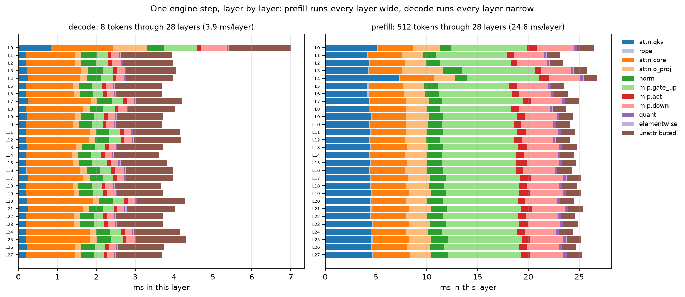

# 4. Inside one engine step, measured

[`docs/01-architecture.md`](01-architecture.md) is the source map: which file and function
is supposed to be doing what. This is the same map read from the other side — from a real
trace — so that every claim has a number attached and you can see which of the boxes
actually costs time.

Everything below comes from `traces/cpu-int8-conc8/` (INT8 W8A8, concurrency 8, 20 traced
engine iterations), the same run that produced the committed `results/cpu-int8-conc8-*`.
The tool that prints these tables is `analysis/step_report.py`; the raw traces are not
committed, so regenerate them with `harness/profile_scenario.sh conc8`.

```bash
source harness/env.sh
"$ANALYSIS_PY" analysis/step_report.py --trace "traces/cpu-int8-conc8/rank0*.json.gz" \
    --fig figures/fig4-step-anatomy.png
```

## 4.1 The trace already knows what the scheduler decided

The most useful thing in the trace is not the ops. It is the annotation vLLM writes around
every forward pass, in `Worker.annotate_profile` (`vllm/v1/worker/gpu_worker.py:1212`):

```
execute_context_<n_ctx_reqs>(<n_ctx_tokens>)_generation_<n_gen_reqs>(<n_gen_tokens>)
```

It comes from `compute_iteration_details` (`vllm/v1/utils.py:835`), which classifies each
scheduled request by whether it has produced any output token yet:

- **context** — still prefilling, including a later chunk of a chunked prefill;
- **generation** — has output tokens, so this step gives it one more.

So the trace tells you the *scheduler's own decision*, not something you inferred from
timestamps. Two properties make it trustworthy:

**The token count is the GEMM M.** `n_ctx_tokens + n_gen_tokens` must equal the row count
of every projection in the step. It does, exactly, in all four steps that have distinct
shapes — 512, 2048, 1541 and 8 — where `Input Dims` on the oneDNN op says
`[M, K] x [K, N]` with that M. This is the cheapest available check that the annotation and
the math are describing the same thing; if they ever disagree, the trace is mislabelled and
nothing downstream is worth reading.

**It tells you what to expect before you look.** `execute_context_4(2047)_generation_1(1)`
predicts a step that is 2048 rows wide through every weight. `execute_context_0(0)_generation_8(8)`
predicts a step that is 8 rows wide. The step table below is just that prediction with
timings attached.

Two related knobs, both in `ProfilerConfig` (`vllm/config/profiler.py`):

- `detailed_trace_annotation=true` switches to the richer name
  `execute_<total>_context_<n>(sq<sum seq>sk<sum kv>sqsq<..>sqsk<..>)_generation_...`,
  which carries roofline proxies (query² and query·seqlen sums) instead of just counts.
  Off by default, and off for both legs here.
- `max_iterations` is enforced by `self.profiler.step()` inside `annotate_profile`, so it
  counts **forward passes**, not seconds. That is why the trace is bounded and why both
  legs see the same number of iterations.

## 4.2 The loop

`EngineCore.step()` (`vllm/v1/engine/core.py:667`) is six statements:

```python
scheduler_output = self.scheduler.schedule(...)              # 1. decide the batch
future = self.model_executor.execute_model(scheduler_output, non_block=True)   # 2. forward
grammar_output = self.scheduler.get_grammar_bitmask(scheduler_output)          # 3. overlaps 2
model_output = future.result()                                                # 4. join
if model_output is None:
    model_output = self.model_executor.sample_tokens(grammar_output)          # 5. sample
engine_core_outputs = self.scheduler.update_from_output(...)                  # 6. bookkeep
```

Three things about this shape surprise people reading a trace for the first time.

**The forward is submitted non-blocking and the grammar bitmask is computed while it
runs.** That is a real overlap on GPU (the structured-output mask is built on the host
while the device chews through layers). On CPU there is nothing to overlap with, so the
annotation simply contains it.

**Sampling is a separate RPC, outside the annotation.** `execute_model` ends by stashing
hidden states, logits and the batch bookkeeping in `ExecuteModelState` and returning
`None`; the engine core then calls `sample_tokens`. Consequence for the trace: the
`execute_context_*` annotation covers the model forward and `compute_logits`, but **not**
the sampler. Sampling lives in the inter-step gap, next to `schedule()` and
`update_from_output()`. This is the single most common misreading of a vLLM profile — the
step looks like it is missing its sampler, and it is, by design.

**The step loop is driven by an input queue, not by a timer.**
`run_busy_loop` (`core.py:1621`) alternates `_process_input_queue()` — which blocks until
there is work — with `_process_engine_step()`. A request therefore spends its first idle
moment in `WAITING`, and adding it (`add_request`, frontend) does not interrupt a step in
flight.

## 4.3 What twenty steps actually look like

Eight requests arrive together (GuideLLM `concurrent, streams=8`), each with a 512-token
prompt and `max_tokens=128`:

```
   #   ctx req/tok  gen req/tok tokens  state prepare   forward  logits  sample  sched   post     step    gap
   0     1/512         0/0         512   7.46    2.46     692.4   19.86   63.69   1.39   0.19    723.2  65.71
   1     4/2047        1/1        2048   0.43    1.13    3286.3   23.38    9.65   2.34   0.51   3312.1  12.99
   2     4/1537        4/4        1541   0.72    1.20    2417.7   23.97    4.78   1.29   0.73   2444.7   7.25
   3     0/0           8/8           8   0.24    1.15     113.0   23.45    2.29   1.20   0.53    138.9   4.45
   4     0/0           8/8           8   0.18    1.07     133.0   22.74    2.18   1.19   0.54    158.0   4.37
  ...
  18     0/0           8/8           8   0.19    1.22     111.2   22.73    2.08   1.18   0.53    136.4   4.23
  19     0/0           8/8           8   0.18    1.09     109.4   23.39    0.00   0.00   0.00    135.2   0.00
```

(all times in ms; `step` = the annotation, `gap` = between annotations)

Read in order, this is the whole request lifecycle at concurrency 8:

1. **Admission and prefill, steps 0–2.** `max_num_batched_tokens` is 2048, so 8 × 512 =
   4096 prompt tokens need three steps. Step 0 takes one request alone (the others have not
   been admitted yet); step 1 packs 2047 context tokens *plus* one decode token from the
   request that is already generating; step 2 finishes the remaining 1537. Prefill is
   1.4–1.6 ms per token here.
2. **Step 0's `state` column is 7.46 ms** and every later step's is 0.17–0.24 ms. That is
   `_update_states` doing its first-ever call — building the batch, allocating the input
   tensors, importing the paths behind them. It never costs that again.
3. **Step 0's `sample` is 63.69 ms**, then 2.0–2.3 ms forever after. The gap decomposes
   into `TopKTopPSampler.forward_cpu` (`vllm/v1/sample/ops/topk_topp_sampler.py:344`) →
   `apply_top_k_top_p` → the Triton implementation → **Triton JIT compilation** (that one
   call is 62.6 of the 63.7 ms, and it is also where the 3 693 `ast.visit` frames in the
   trace come from). The kernel is compiled once and cached. On a CPU-only host Triton is
   still imported and used by the sampler even though it cannot run anything else.
4. **Steps 3–19 are pure decode**: 8 requests × 1 token, 8 rows through every weight.

The steady-state decode step, opened up (step 3, from the containment tree):

| phase | ms | share of step | where |
|---|---|---|---|
| `_update_states` | 0.24 | 0.2 % | `gpu_model_runner.py:1176` |
| `_prepare_inputs` | 1.15 | 0.8 % | `gpu_model_runner.py:1924` |
| `_build_attention_metadata` | 0.35 | 0.3 % | `gpu_model_runner.py:2253` |
| `_model_forward` | 113.03 | 81.4 % | `gpu_model_runner.py:3586` → 28 decoder layers |
| `compute_logits` | 23.45 | 16.9 % | `qwen3.py:339` |
| *(inside `execute_model`, unlisted)* | 0.69 | 0.5 % | misc |
| **`execute_model` total** | **138.91** | | the annotation |
| `sample_tokens` | 2.29 | 1.6 % | separate RPC |
| `scheduler.schedule` | 1.20 | 0.9 % | `scheduler.py:699` |
| `update_from_output` | 0.53 | 0.4 % | `scheduler.py:2259` |
| *(remainder of the gap)* | 0.43 | 0.3 % | `annotate_profile`, output copy, queue |

Three observations that transfer to every model and both devices:

**`compute_logits` is 17 % of a decode step and does not shrink with the batch.** It is the
`lm_head` projection: 1024 → 151936, and this artifact leaves it in fp32, so the weight is
1024 × 151936 × 4 B = **622 MB read per step**. At 23.45 ms that is ~26 GB/s, i.e. it is a
memory-bandwidth floor, not arithmetic — which is exactly why step 0 (512 rows) costs
19.86 ms and step 3 (8 rows) costs 23.45 ms for the same op. The number is identical to the
millisecond in the fp32 leg (`results/*-stages.csv`, `linear.lm_head`: 442 ms in both),
which is the cross-check that both traces measure the same thing. Any CPU deployment of
this model pays ~23 ms per step here, and the only way to shrink it is to quantize `lm_head`.

**Everything the scheduler does is cheap.** `schedule()` + `update_from_output()` +
`sample_tokens` is 4.0 ms of a 143 ms step, and over the whole window the engine-core glue
is **7.61 ms/step = 1.7 %** of engine-core time. On a CPU host the scheduler is not the
problem, and neither is Python in the scheduler.

**One step = 8 tokens = one ITL.** 143.4 ms per step means a ceiling of 8/0.1434 = 56
output tok/s at concurrency 8. The measured `cpu-int8-conc8` mean is 32.0 tok/s, and the
difference is not measurement noise — see §4.5.

## 4.4 Where a layer's time goes, and why prefill and decode disagree



Same 28 decoder layers, same artifact, two batch shapes. Per layer, mean of layers 1–27
(layer 0 is an outlier, see below), in ms:

| component | decode (8 tok) | share | prefill (512 tok) | share |
|---|---|---|---|---|
| `attn.core` (paged attention + KV write) | **1.36** | **34.8 %** | 3.49 | 14.2 % |
| `mlp.gate_up` | 0.28 | 7.2 % | **7.25** | **29.5 %** |
| `attn.qkv` | 0.20 | 5.2 % | 4.48 | 18.2 % |
| `mlp.down` | 0.20 | 5.1 % | 3.13 | 12.7 % |
| `attn.o_proj` | 0.16 | 4.1 % | 2.19 | 8.9 % |
| `norm` (RMSNorm, 4 per layer) | 0.35 | 9.0 % | 1.47 | 6.0 % |
| `mlp.act` (SiLU × gate) | 0.09 | 2.3 % | 0.83 | 3.4 % |
| `quant` (INT8 activation quantize) | 0.03 | 0.8 % | 0.27 | 1.1 % |
| `rope` | 0.01 | 0.2 % | 0.10 | 0.4 % |
| `unattributed` | 1.21 | 31.0 % | 1.38 | 5.6 % |
| **total** | **3.90** | | **24.61** | |

(`norm` is not an ATen op on CPU: vLLM's RMSNorm decomposes into
`aten::pow/mul/mean/div_`, and the INT8 quantize lives *inside* the linear that consumes
it. Both are attributed by their enclosing `nn.Module` frame rather than by op name, which
is why they show up here at all — a name-based classifier puts them in `elementwise`.)

**The flip.** Decode is attention-bound (35 %); prefill is GEMM-bound (gate_up alone is
30 %). The reason is the ratio of weights to tokens. One layer holds
1024×4096 (qkv) + 2048×1024 (o_proj) + 1024×6144 (gate_up) + 3072×1024 (down) = **15.7 M
weights**, 15.7 MB as INT8, 63 MB as fp32. A decode step reads all 15.7 MB out of memory to
produce **8** tokens; a prefill step reads the same 15.7 MB to produce 512. Same bytes,
64× more arithmetic — so decode is bound by the read and by the fixed cost of getting 8
rows through a GEMM kernel, and prefill is bound by the multiply.

That is also why INT8 buys 1.9× and not 4×. Per projection, prefill goes
`gate_up` 13.92 → 7.25 ms (1.92×), `qkv` 9.30 → 4.48 (2.08×), `down` 6.95 → 3.13 (2.22×);
`attn.core` 3.57 → 3.49 (1.02×) and `norm` 1.48 → 1.47 (1.00×) do not move at all, because
they are not quantized. At decode the GEMMs improve *more* (qkv 0.64 → 0.20, gate_up
0.93 → 0.28, ~3.2×) because at M=8 they are latency-bound, and `norm` gets **worse**
(0.17 → 0.35 ms) — the INT8 path inserts `aten::to` casts around the quantizer inside
RMSNorm. Per-layer decode only improves 4.41 → 3.90 (1.13×) even though its GEMMs improved
3×.

**`unattributed` is 31 % of a decode layer and 5.6 % of a prefill layer.** That bucket is
layer-frame time with no ATen op under it: eager dispatch, `_call_impl`, hook checks, the
interpreter. It is a *fixed* per-op cost, so it is invisible during prefill (1.38 ms against
24.61 ms of math) and huge during decode (1.21 ms against 2.70 ms of math). This is the
CPU-specific finding that matters most for tuning: at small batch, nearly a third of what the
CPU does per layer is not arithmetic. Treat the 31 % as an upper bound — the profiler runs
with `torch_profiler_with_stack=true` (vLLM's default), which unwinds Python stacks on
every op — but the *shape* of the effect is real and it is why CPU decode does not get much
faster when you quantize.

**Layer 0 is not a layer property.** On the first decode step it takes 7.00 ms against
3.90 for the others, with every GEMM in it ~4× slower; by step 19 it is 4.34 ms against
4.27 for its neighbour L1. That is one-time, lazy construction of the oneDNN primitive for
the new `M=8` shape, absorbed by whichever layer runs first. `step_report.py` reports it
separately and uses layers 1–N−1 for the means, rather than letting a one-off inflate the
per-layer average by 3 %.

## 4.5 Why the scenario mean is bigger than any decode step

`results/summary.csv` says `cpu-int8-conc8` has ITL 203.7 ms, while every decode step in
the table above is ~139 ms. Both are correct; they measure different things.

The traced window is 20 consecutive iterations at the *start* of the run: the initial burst
of 8 requests, prefilled in 3 steps, then 17 back-to-back decode steps with nothing else in
the batch. The scenario mean covers the whole 60 s, during which GuideLLM keeps 8 requests
in flight — so every time one finishes, a new 512-token prompt is admitted and its prefill
*shares* the step budget with the eight decoders. Prefill costs 1.4–1.6 ms/token here, while
a batched decode token costs 143/8 = 18 ms of step time. So the mean ITL is the decode step
plus the prefill work injected into those steps:

```
decode-only step        ~139 ms   (17 pure-decode samples, measured directly)
+ injected prefill      ~45-65 ms (7680 prompt tokens x 1.5 ms spread over ~256 steps)
=                       ~190-205 ms   measured ITL: 203.7 ms
```

The same decomposition, with the fp32 leg's 2.5 ms/token and the 16 requests GuideLLM got
through before the 60 s window closed, lands within ~15 % of its measured 293.4 ms. The
arithmetic is order-of-magnitude on purpose: the split between "prefill share" and
"ramp/tail of a duration-bounded run" is not cleanly separable from outside. Read the trace
for *composition*, read `benchmarks.json` for *cost*; `docs/02` R9 says the same thing, and
this is the concrete instance.

One more consequence worth knowing: batching 8 requests costs only ~2.9× a single request
(`cpu-int8-sync` ITL 46.9 ms at concurrency 1 vs ~139 ms at concurrency 8), not 8×. The
per-step cost is dominated by work whose size does not depend on the batch — the weight
reads, the 622 MB `lm_head`, and the fixed dispatch overhead — so concurrency on a CPU buys
much less than the batch-size ratio suggests. That is the CPU-side explanation for the
`conc8` result in the README: 17.1 tok/s fp32 for 7.7 s of TTFT.

## 4.6 The other half: what the frontend does per token

The same `/start_profile` produced a second file, `async_llm.*`, from the API-server
process. It has no ATen ops (nothing runs there), only Python frames — but it answers the
question the worker trace cannot: what happens to a token between the sampler and the
client. Over the whole 66.44 s scenario, 23 requests were admitted, 15 completed, 8 were
aborted by the client:

| what | count | total | per call |
|---|---|---|---|
| `AsyncLLM.add_request` (admission) | 23 | ~34 ms | 0.37 ms (≈1.5 ms for the whole path) |
| `output_handler` (engine→frontend batch) | 259 | 169.5 ms | 0.65 ms |
| `process_outputs_socket` (queue handoff) | 259 | 34.4 ms | 0.13 ms |
| `detokenizer.update` | 2048 | 24.1 ms | 12 µs |
| `get_next_output_text` | 2056 | 1.8 ms | 0.9 µs |
| SSE `sender` (two frames per chunk) | 4288 | 321.9 ms | 0.075 ms |

Two useful facts fall out. **One output batch per engine step**: 2 048 per-request token
updates arrived in 259 batches, and 2 048/8 = 256 is the number of engine steps that could
produce them — so the frontend is woken once per step and fans the batch out to 8 response
streams. And **detokenization is not the cost** (12 µs per token update); the cost is the
SSE plumbing around it, ~0.16 ms per chunk per client.

Total frontend CPU time is ~0.5 s out of 66 s: under 1 %. It never shows up as a
bottleneck, but it is also never *overlapped* in the way a GPU hides it — when the event
loop is busy, the token sits in the response queue and the client sees a longer ITL. That is
why the frontend trace is worth keeping even though it is cheap.

Note the window asymmetry, which is easy to trip over: the worker trace is 13.60 s (capped
at 20 iterations, so it stops after ~9 s of steps) while the frontend trace is 66.44 s (it
stops at `/stop_profile`). They are two files from one run and they do not cover the same
time span. Compare phases, not wall-clock totals.

## 4.7 What changes on GPU

Nothing in §4.2 changes — same `step()`, same annotation, same sampler-as-separate-RPC.
What changes is what the columns mean and which one dominates. Reading the GPU trace:

**The metric stops being self time.** `kind_of_trace` sees `kernel` events and the tool
switches to device time, attributed through the op that *launched* the kernel (a kernel's
own timestamp is on the device clock and does not nest inside the Python frame). So
`forward` becomes device time, while `state`/`prepare`/`logits` remain host spans. Expect
`forward` ≫ the host span it sits in: the host enqueues tens of microseconds of work per
layer and the device takes milliseconds to drain it.

**Correctness of kernel attribution comes only from launch order.** Kernels are matched to
their launch point; any profiling mode that replaces N launches with one replay invalidates
per-op attribution. That is why every profiled run uses `--enforce-eager` (R6). If you
profile *without* it, what you are reading is `cudaGraphLaunch`, not the model.

**Batch shape is decided in `_determine_batch_execution_and_padding`**
(`gpu_model_runner.py`), which asks `cudagraph_dispatcher.dispatch()` for a
`(CUDAGraphMode, BatchDescriptor)`. Two consequences you can see in a trace:
- decode with uniform query length is dispatched to a **FULL** graph when one was captured
  for that batch size, and the descriptor's `num_tokens` is a *padded* count (the next
  captured size), so the kernel shapes in the trace are not the scheduler's token count.
  Eager profiling removes the padding, which is another reason the profiled numbers are not
  serving numbers.
- with `data_parallel_size > 1`, the batch is re-padded to the agreed `num_tokens_across_dp`
  and possibly **microbatched** (`should_ubatch`), so one engine step becomes two forward
  passes. Look for two `gpu_model_runner: forward` scopes inside one annotation.

**`_prepare_inputs` gets bigger, not smaller.** On CPU it was 1.15 ms. On GPU it builds and
copies the per-step device inputs — block tables, slot mapping, positions — so it is
host-to-device work proportional to `num_reqs` and token count. It is the phase that grows
when you increase concurrency, and it is why pre-built input buffers exist.

**Sampling is where the GPU stalls.** `sample_tokens` is still a separate RPC, but
`gpu_model_runner.sample_tokens` now ends in `_bookkeeping_sync`: copy sampled token ids
from device to host and run the scheduler-facing bookkeeping in Python. That
device→host copy is a genuine synchronous stall per step, and it is inside
`gpu_model_runner: bookkeep`, not inside the annotation. On CPU the same step is an
in-process memcpy and shows up as 2.3 ms.

**Optional, and worth using:** `VLLM_CUSTOM_SCOPES_FOR_PROFILING=1` makes
`record_function_or_nullcontext` (`vllm/v1/utils.py:784`) emit named scopes —
`gpu_model_runner: preprocess`, `: forward`, `: postprocess`, `: sample`, `: bookkeep`,
`: draft`. They give the same phase split as §4.3 as explicit trace lanes instead of
Python frame names. It is **not** enabled here: the committed CPU traces were taken
without it, and both legs must be profiled identically to keep the comparison honest. It
changes labels only, never timings, so `step_report.py` does not need it.

A GPU version of the tables in §4.3/§4.4 is the same two commands on the other host:

```bash
DEVICE=gpu VARIANT=fp8 harness/check_serve.sh
DEVICE=gpu harness/run_matrix.sh
"$ANALYSIS_PY" analysis/step_report.py --trace "traces/gpu-fp8-conc8/rank0*.json.gz" \
    --fig figures/fig5-step-anatomy-gpu.png
```

Expected differences, stated ahead of the measurement so the measurement can contradict
them: `unattributed` should collapse (the host enqueues and moves on), `attn.core` should
become a *bandwidth* term too — paged attention there reads KV blocks, 8 requests × 512
context × 2 × 8 heads × 128 × 2 B ≈ 17 MB per layer — so it stays a large share at decode
rather than shrinking with the weights, and `mlp.gate_up` should stay the largest single
component at prefill but roughly an order of magnitude faster. `compute_logits` should
*not* scale with the batch: it is still a full-vocabulary weight read (311 MB in bf16 on
that leg, ~1 ms at 4060 bandwidth), and the FP8 artifact leaves it unquantized for the same
reason ours does.

## 4.8 What this is not

- It is one model (`Qwen3-0.6B`, 28 layers, hidden 1024), one host, one artifact, 20
  iterations. The *shape* of the result is general; the constants are not.
- The absolute decode step time in the trace is inflated relative to serving by
  `--enforce-eager`, `torch_profiler_with_stack`, and the profiler's own bookkeeping. Use
  it for shares, use `results/summary.csv` for latency.
- `unattributed` is a residual, not a measurement. It is the right order of magnitude to
  take seriously and the wrong number to quote to two decimals.
